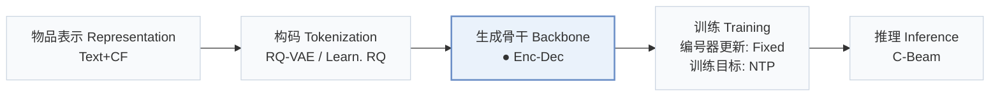
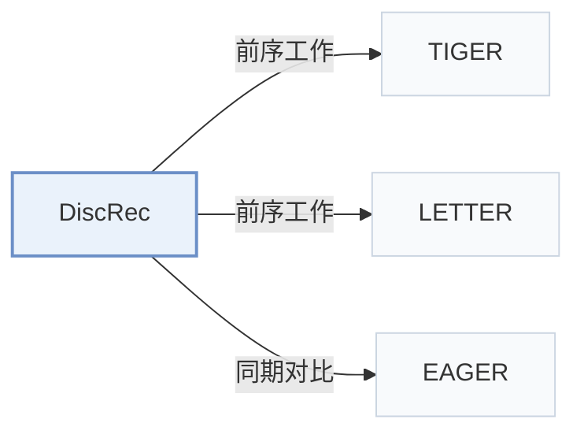

# DiscRec

[← 问题 × 阶段矩阵](../../../README.zh.md#i--backbone) · [按阶段索引](../index/stages.md) · [按模态找论文](../index/modality.md) · [按领域找论文](../index/domain.md) · [English](../../papers/discrec.md) | 中文

| **题目** | *Disentangled Semantic-Collaborative Modeling for Generative Recommendation* |
| :-- | :-- |
| **作者** | Liu et al. |
| **发表** | arXiv’25 |
| **问题与阶段** | `I. 信息量` · `生成骨干（Backbone）` |
| **改动** | ● 生成骨干 |
| **构码输入** | A: `Text` · B: `Text` + `CF` |
| **领域** | `电商` |
| **特殊设置** | `冷启动（用户）` |
| **应用场景** | `一般物品推荐`；`公开数据` |
| **链接** | [论文](https://arxiv.org/abs/2506.15576) · [代码](https://github.com/Ten-Mao/DiscRec) |
| **阅读级别** | 概览（第 1 级） |

**本页目录**：[TL;DR](#tldr) · [3. 实验发现](#3-实验发现) · [5. 相关工作](#5-相关工作)

- `Text+CF`：文本表征结合协同过滤信号。
- `RQ-VAE / Learn. RQ`：不同配置下分别采用固定 RQ-VAE 或可学习残差量化。
- `Enc-Dec`：编码器-解码器（Encoder-decoder）架构。
- `Fixed`：先独立训练并冻结编号器，生成器训练期间 SID 保持不变。
- `NTP`：标准下一 token 预测（Next-Token Prediction）交叉熵损失；基于预训练 LLM 的指令微调（SFT）亦归入此类。
- `C-Beam`：受合法物品集合约束的束搜索（Constrained beam search）。

### TL;DR

> [!NOTE]
> DiscRec 加入物品级位置嵌入，并将语义与协同信号拆分为两个门控分支（其一在物品内部做注意力计算），而非在单一嵌入空间直接混合。

---

### 3. 实验发现

实验设置

- **数据集**：Amazon Review subsets Beauty, Musical Instruments, Arts, Toys; remove users/items with fewer than 5 interactions; keep latest 20 history items, padding shorter histories.
  - 出处：[S4.SS1.SSS1.p1](https://arxiv.org/html/2506.15576v2#S4.SS1.SSS1.p1)
- **切分**：Main per-user chronological leave-one-out: most recent item test, second-most-recent validation, remaining interactions training. Additional Beauty user-level random split: train/validation/test 8:1:1, with all models retrained from scratch.
  - 出处：[S4.SS1.SSS1.p1](https://arxiv.org/html/2506.15576v2#S4.SS1.SSS1.p1) ; [S4.SS5.p2](https://arxiv.org/html/2506.15576v2#S4.SS5.p2)
- **候选集**：full catalog; reported full-ranking evaluation over the entire item set, with prefix-tree-constrained generation; history exclusion not reported.
  - 出处：[S4.SS1.SSS3.p1](https://arxiv.org/html/2506.15576v2#S4.SS1.SSS3.p1)
- **可见性**：warm; no unseen-item protocol is defined. Beauty additionally evaluates held-out users and low-popularity targets; LETTER uses pretrained SASRec embeddings, whose test-item exposure is not reported.
  - 出处：[S4.SS1.SSS1.p1](https://arxiv.org/html/2506.15576v2#S4.SS1.SSS1.p1) ; [S4.SS1.SSS4.p1](https://arxiv.org/html/2506.15576v2#S4.SS1.SSS4.p1) ; [S4.SS5.p2](https://arxiv.org/html/2506.15576v2#S4.SS5.p2)
- **SID 规格**：4 RQ-VAE codebooks, 256 entries/level, 32 dimensions/entry, from LLaMA2-7B title/description representations. DiscRec-T uses TIGER tokenization; DiscRec-L uses LETTER collaborative/diversity regularization with pretrained SASRec embeddings. Tokenizer trained before recommender; collision handling not reported.
  - 出处：[S4.SS1.SSS4.p1](https://arxiv.org/html/2506.15576v2#S4.SS1.SSS4.p1) ; [S4.SS1.SSS4.p2](https://arxiv.org/html/2506.15576v2#S4.SS1.SSS4.p2) ; [S3.SS2.p2](https://arxiv.org/html/2506.15576v2#S3.SS2.p2)
- **推理预算**：Prefix-tree-constrained autoregressive decoding, beam 20; Recall/NDCG@5/10; inference hardware, batch size and measured latency not reported. The paper gives theoretical complexity rather than serving measurements.
  - 出处：[S4.SS1.SSS3.p1](https://arxiv.org/html/2506.15576v2#S4.SS1.SSS3.p1) ; [S3.SS3.p4](https://arxiv.org/html/2506.15576v2#S3.SS3.p4)
- **结果来源**：Own DiscRec-T/DiscRec-L comparisons, ablations and Beauty generalization studies. Baselines follow referenced implementations under a unified generative configuration; EAGER is resized to dimension 128 and its histories are correctly sorted chronologically. No copied baseline result scores stated; run counts/variance not reported.
  - 出处：[S4.SS1.SSS4.p1](https://arxiv.org/html/2506.15576v2#S4.SS1.SSS4.p1) ; [S4.T2](https://arxiv.org/html/2506.15576v2#S4.T2) ; [S4.SS5.p2](https://arxiv.org/html/2506.15576v2#S4.SS5.p2)

---

### 5. 相关工作

- **前序工作** · [TIGER](tiger.md): DiscRec-T inserts disentangled modeling into TIGER.
  - 出处：[S1.p5](https://arxiv.org/html/2506.15576v2#S1.p5) ; [S4.SS1.SSS4.p2](https://arxiv.org/html/2506.15576v2#S4.SS1.SSS4.p2)
- **前序工作** · [LETTER](letter.md): DiscRec-L uses LETTER's collaboratively regularized tokenizer.
  - 出处：[S4.SS1.SSS4.p1](https://arxiv.org/html/2506.15576v2#S4.SS1.SSS4.p1) ; [S4.SS1.SSS4.p2](https://arxiv.org/html/2506.15576v2#S4.SS1.SSS4.p2)
- **同期对比** · [EAGER](eager.md): Two-stream baseline compared with DiscRec's single-workflow disentanglement.
  - 出处：[S4.SS1.SSS2.p2](https://arxiv.org/html/2506.15576v2#S4.SS1.SSS2.p2) ; [S4.SS1.SSS4.p1](https://arxiv.org/html/2506.15576v2#S4.SS1.SSS4.p1)

[查看同格全部论文](../../../README.zh.md#i--backbone)
