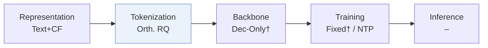
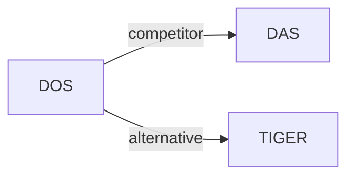

# DOS

| **题目** | *Dual-Flow Orthogonal Semantic IDs for Recommendation in Meituan* |
| :-- | :-- |
| **作者** | Yin et al. |
| **会议** | WWW’26 Short |
| **问题与阶段** | `III. SID 与模型对齐` · `Tokenization` · `POI` |
| **链接** | [论文](https://arxiv.org/abs/2602.04460) · [矩阵](../../../README.zh.md#iii--tokenization) · [English](../../papers/dos.md) |
| **阅读级别** | 概览（第 1 级） |

本页目录：[TL;DR](#tldr) · [速览](#速览) · [3. 实验发现](#3-实验发现) · [5. 相关工作](#5-相关工作)

- `Orth. RQ`: Orthogonal residual quantization.
- `NTP`: Next-token prediction loss only; continuing from a pretrained LLM (SFT) also counts as NTP.
- `–`: Not reported in the paper.

### TL;DR

> [!NOTE]
> DOS 通过协同信号上的用户-物品双向流将 SID 码本与生成空间对齐，并用正交残差量化旋转语义空间。

---

### 速览

| 维度 | 摘要 |
| :-- | :-- |
| 研究问题 | III. SID 与模型对齐：Can the generator read, write, and reason over SIDs, and do the tokenizer and generator work toward the same goal? |
| 核心贡献 | DOS 通过协同信号上的用户-物品双向流将 SID 码本与生成空间对齐，并用正交残差量化旋转语义空间。 |
| 主要改动阶段 | Tokenization |

---

### 3. 实验发现

实验设置

- **数据集**：Private Meituan production data only: past-year quantization data covering 24M unique items, and 60-day downstream data with 180M interactions. User/item filtering not reported.
  - 出处：[S3.SS1.SSS1.p1](https://arxiv.org/html/2602.04460v1#S3.SS1.SSS1.p1) ; #S3.SS1.SSS1.p2
- **切分**：Quantization data: train/validation/test 8:1:1, partition method not reported; 50-click histories predict the 51st item. Downstream data: first 57 days training, last 3 days validation; a generation test split is not separately reported.
  - 出处：[S3.SS1.SSS1.p2](https://arxiv.org/html/2602.04460v1#S3.SS1.SSS1.p2) ; #S3.SS1.SSS2.p1
- **候选集**：not reported for Hit@10 generation. Quantization classification uses randomly sampled negatives; negative count, sampling distribution and user-history exclusion not reported.
  - 出处：[S3.SS1.SSS1.p2](https://arxiv.org/html/2602.04460v1#S3.SS1.SSS1.p2) ; #S3.SS1.SSS2.p1 ; #S3.SS2.SSS2.p1
- **可见性**：warm; no unseen-item protocol is defined. The quantization dataset covers past-year business items; validation/test-item exposure during SID learning is not separately reported.
  - 出处：[S3.SS1.SSS1.p2](https://arxiv.org/html/2602.04460v1#S3.SS1.SSS1.p2) ; #S3.SS1.SSS2.p1
- **SID 规格**：Qwen3-0.6B-embedding encodes restaurant name/categories, reservation status, prices and dishes into 1,024 dimensions. Dual user/item Transformer flows share an orthogonal residual quantizer: 3 layers x 1,024 codes, with salient-feature selection and residual propagation. Collision handling not reported.
  - 出处：[S2.SS1.p2](https://arxiv.org/html/2602.04460v1#S2.SS1.p2) ; #S2.SS1.p3 ; #S2.SS1.p6 ; #S2.SS1.p8 ; #S2.SS2.p5 ; #S3.SS1.SSS2.p1
- **推理预算**：Downstream generation evaluated within HSTU. Model size, beam/decoding constraints, token budget, inference hardware/batch size and latency not reported; batch 1,024 is a training setting.
  - 出处：[S3.SS2.SSS2.p1](https://arxiv.org/html/2602.04460v1#S3.SS2.SSS2.p1) ; #S3.SS1.SSS2.p1
- **结果来源**：Own offline quantization AUC/F1 and HSTU Hit@10 experiments; RQ-KMeans/RQ-VAE baselines are fine-tuned for application metrics. Own one-week A/B test on 30% of production traffic reports +1.15% revenue from adding DOS SIDs to the original baseline.
  - 出处：[S3.SS2.p1](https://arxiv.org/html/2602.04460v1#S3.SS2.p1) ; #S3.SS2.SSS2.p1 ; #S3.SS4.p1 ; #S3.SS4.p2

---

### 5. 相关工作

- **同期对比** · [DAS](das.md): Industrial SID baseline compared offline and within HSTU; DOS contrasts direct sequence-target modeling with DAS's indirect collaborative alignment.
  - 出处：https://arxiv.org/html/2602.04460v1#S3.SS2.SSS1.p1 ; #S3.SS2.SSS2.p1
- **替代方案** · [TIGER](tiger.md): Cited as task-agnostic SID learning whose codebook-generation gap motivates context-aware DOS quantization.
  - 出处：https://arxiv.org/html/2602.04460v1#S1.p2 (Rajput et al., 2023)

[查看同格全部论文](../../../README.zh.md#iii--tokenization)
