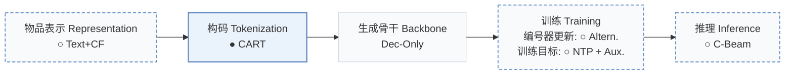
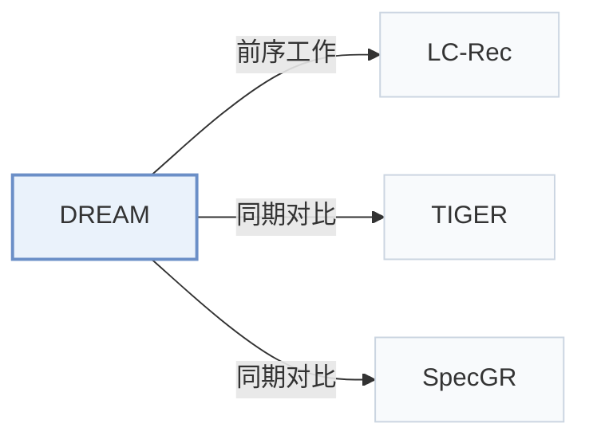

# DREAM

[← 问题 × 阶段矩阵](../../../README.zh.md#vi--tokenization) · [按阶段索引](../index/stages.md) · [按模态找论文](../index/modality.md) · [按领域找论文](../index/domain.md) · [English](../../papers/dream.md) | 中文

| **题目** | *Dynamic Refinement of Early Assignment Mappings* |
| :-- | :-- |
| **作者** | Guan et al. |
| **发表** | arXiv’26 |
| **问题与阶段** | `VI. 泛化` · `构码（Tokenization）` |
| **改动** | ○ 物品表示 · ● 构码 · ○ 编号器更新 · ○ 训练目标 · ○ 推理 |
| **构码输入** | `Text` + `CF` |
| **领域** | `电商` |
| **应用场景** | `一般物品推荐`；`公开数据` |
| **链接** | [论文](https://arxiv.org/abs/2606.06947) |
| **阅读级别** | 概览（第 1 级） |

**本页目录**：[TL;DR](#tldr) · [3. 实验发现](#3-实验发现) · [5. 相关工作](#5-相关工作)

- `Text+CF`：文本表征结合协同过滤信号。
- `CART`：协同感知精化编号（Collaborative-Aware Refined Tokenization）。
- `Dec-Only`：仅解码器（Decoder-only）自回归架构。
- `Altern.`：编号器与生成器在训练过程中交替迭代更新。
- `NTP + Aux.`：下一 token 预测结合辅助正则或对齐损失。
- `C-Beam`：受合法物品集合约束的束搜索（Constrained beam search）。

### TL;DR

> [!NOTE]
> DREAM 在冷启动物品初始分配 SID 后，由意图感知编号器提议候选、冻结生成器择优，并用动态束保留加权 ID 假设，逐步修正冷启动 SID。

---

### 3. 实验发现

实验设置

- **数据集**：Amazon Beauty, Sports and Outdoors, Toys and Games; iterative user-core-5 and item-core-3 filtering.
  - 出处：Section 4.1: [S4.SS1.p1](https://arxiv.org/html/2606.06947v1#S4.SS1.p1)
- **切分**：Per-user leave-one-out: last interaction test, penultimate validation, earlier interactions training.
  - 出处：Section 4.1: [S4.SS1.p3](https://arxiv.org/html/2606.06947v1#S4.SS1.p3)
- **候选集**：full catalog
  - 出处：Section 4.1: [S4.SS1.p3](https://arxiv.org/html/2606.06947v1#S4.SS1.p3)
- **可见性**：warm; no unseen-item protocol is defined. The cold subset means at most five interactions, not exclusively unseen items; Section 3.1 counts training frequency whereas Section 4.1 says total frequency. Strict item-level generator/tokenizer holdouts: not reported.
  - 出处：Sections 3.1 and 4.1 define low-frequency subsets, not a separate unseen-item protocol: [S3.SS1.p2](https://arxiv.org/html/2606.06947v1#S3.SS1.p2) and [S4.SS1.p1](https://arxiv.org/html/2606.06947v1#S4.SS1.p1)
- **SID 规格**：Frozen Llama-3-8B text embeddings initialize shared RQ-VAE SIDs (4 positions x 256 codes). CART refines assignments with collaborative residuals, Gumbel-Softmax/STE, diversity regularization and a static-index anchor, exporting top-8 candidates per cold item. UC3 produces a refined single-path index; CPDE preserves alternative SIDs for multi-path inference (B=4). Collision disambiguation: not reported.
  - 出处：Sections 3.1, 3.3-3.6 and 4.1: [S3.SS1.p2](https://arxiv.org/html/2606.06947v1#S3.SS1.p2) ; [S3.SS3](https://arxiv.org/html/2606.06947v1#S3.SS3) ; [S3.SS4](https://arxiv.org/html/2606.06947v1#S3.SS4) ; [S3.SS6](https://arxiv.org/html/2606.06947v1#S3.SS6) ; [S4.SS1.p1](https://arxiv.org/html/2606.06947v1#S4.SS1.p1) ; [S4.SS1.p4](https://arxiv.org/html/2606.06947v1#S4.SS1.p4)
- **推理预算**：Beam-Aware multi-path inference is primary: B=4 retained SID paths per cold item and one per warm item in a union trie; Compat-Top1 retains one path per item for ablations. LoRA is merged into the backbone at deployment. Evaluation K=5/10/50; numerical autoregressive decoding beam width, inference hardware, batch size and latency: not reported.
  - 出处：Sections 3.5-3.6 and 4.1: [S3.SS5](https://arxiv.org/html/2606.06947v1#S3.SS5) ; [S3.SS6](https://arxiv.org/html/2606.06947v1#S3.SS6) ; [S4.SS1.p3](https://arxiv.org/html/2606.06947v1#S4.SS1.p3) ; [S4.SS1.p4](https://arxiv.org/html/2606.06947v1#S4.SS1.p4)
- **结果来源**：This paper's experiments: Tables 2/3/4 report cold/overall/warm comparisons with DREAM's primary Beam-Aware view; Table 5 reports stage ablations and Compat-Top1; Figures 2-4 report Sports mechanism diagnostics.
  - 出处：Tables 2-5 and Figures 2-4: [S4.T2](https://arxiv.org/html/2606.06947v1#S4.T2) ; [S4.T3](https://arxiv.org/html/2606.06947v1#S4.T3) ; [S4.T4](https://arxiv.org/html/2606.06947v1#S4.T4) ; [S4.T5](https://arxiv.org/html/2606.06947v1#S4.T5) ; [S4.SS4](https://arxiv.org/html/2606.06947v1#S4.SS4) ; [S4.SS5](https://arxiv.org/html/2606.06947v1#S4.SS5)

---

### 5. 相关工作

- **前序工作** · [LC-Rec](lc-rec.md): DREAM adopts LC-Rec's LLaMA-7B setup, adding staged SID refinement.
  - 出处：DREAM v1, Section 4.1: [S4.SS1.p4](https://arxiv.org/html/2606.06947v1#S4.SS1.p4).
- **同期对比** · [TIGER](tiger.md): TIGER is a single-index baseline against DREAM's multi-path retrieval.
  - 出处：DREAM v1, Section 4.1 and Table 2: [S4.SS1.p2](https://arxiv.org/html/2606.06947v1#S4.SS1.p2); [S4.T2](https://arxiv.org/html/2606.06947v1#S4.T2).
- **同期对比** · [SpecGR](specgr.md): SpecGR drafts and verifies candidates; DREAM refines cold-item SID assignments.
  - 出处：DREAM v1, Section 4.1 and Table 2: [S4.SS1.p2](https://arxiv.org/html/2606.06947v1#S4.SS1.p2); [S4.T2](https://arxiv.org/html/2606.06947v1#S4.T2).

[查看同格全部论文](../../../README.zh.md#vi--tokenization)
