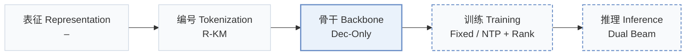
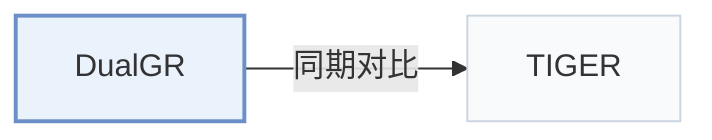

# DualGR

[← 问题 × 阶段矩阵](../../../README.zh.md#vi--backbone) · [按阶段索引](../index/stages.md) · [按模态索引](../index/modality.md) · [English](../../papers/dualgr.md) | 中文

| **题目** | *Generative Retrieval with Long and Short-Term Interests Modeling* |
| :-- | :-- |
| **作者** | Yi et al. |
| **发表** | WWW’26 Short |
| **问题与阶段** | `VI. 泛化` · `骨干（Backbone）` — 补充：`III. SID 与模型对齐` × `推理（Inference）`；`IV. 实用目标` × `训练（Training）`；`V. 效率` × `推理（Inference）`；`VI. 泛化` × `训练（Training）` |
| **链接** | [论文](https://arxiv.org/abs/2511.12518) |
| **阅读级别** | 概览（第 1 级） |

**本页目录**：[TL;DR](#tldr) · [速览](#速览) · [3. 实验发现](#3-实验发现) · [5. 相关工作](#5-相关工作)

- `R-KM`：残差 k-means 量化（Residual k-means）。
- `Dec-Only`：仅解码器（Decoder-only）自回归架构。
- `Fixed`：先独立训练并冻结编号器，生成器训练期间 SID 保持不变。
- `NTP + Rank`：下一 token 预测结合显式排序损失。
- `Dual Beam`：在双分支上分别束搜索并融合候选结果。

### TL;DR

> [!NOTE]
> DualGR 加入长短期兴趣路由器，在当前粗粒度桶内解码细粒度 SID 层级，并在训练中把未点击曝光作为粗粒度难负例。

---

### 速览

| 维度 | 摘要 |
| :-- | :-- |
| 研究问题 | VI. 泛化：面对冷启动新物品、跨领域迁移与动态兴趣漂移时能否保持泛化？ |
| 核心贡献 | DualGR 加入长短期兴趣路由器，在当前粗粒度桶内解码细粒度 SID 层级，并在训练中把未点击曝光作为粗粒度难负例。 |
| 主要改动阶段 | 骨干（Backbone） |

---

### 3. 实验发现

实验设置

- **数据集**：Kuaishou double-column Explore-feed logs; filtering rules and dataset dates not reported.
  - 出处：Section 3: [S3.p1](https://arxiv.org/html/2511.12518v1#S3.p1)
- **切分**：Offline split not reported; online A/B test lasts one week with 6% traffic.
  - 出处：Sections 3 and 3.1: [S3.p1](https://arxiv.org/html/2511.12518v1#S3.p1) and [S3.SS1.p1](https://arxiv.org/html/2511.12518v1#S3.SS1.p1)
- **候选集**：not reported
  - 出处：Section 3 describes online HR without specifying a full-catalog or sampled-negative protocol: [S3.p1](https://arxiv.org/html/2511.12518v1#S3.p1)
- **可见性**：warm; no unseen-item protocol is defined. Item-level generator/tokenizer exposure: not reported.
  - 出处：Sections 2.1 and 3 do not specify generator/tokenizer item holdouts: [S2.SS1](https://arxiv.org/html/2511.12518v1#S2.SS1) and [S3](https://arxiv.org/html/2511.12518v1#S3)
- **SID 规格**：Residual k-means: 3 levels x 8192 codes; collision handling not reported.
  - 出处：Sections 2.2 and 3: [S2.SS2.p1](https://arxiv.org/html/2511.12518v1#S2.SS2.p1) and [S3.p1](https://arxiv.org/html/2511.12518v1#S3.p1)
- **推理预算**：Two branch-wise beam searches, followed by merging; HR@100/500/1000. Beam width, hardware, inference batch size, and numerical latency not reported; A/B test reports no measurable response-time increase.
  - 出处：Section 2.3, Table 1, and Section 3.1: [S2.SS3.p2](https://arxiv.org/html/2511.12518v1#S2.SS3.p2) and [S3.T1](https://arxiv.org/html/2511.12518v1#S3.T1) and [S3.SS1.p1](https://arxiv.org/html/2511.12518v1#S3.SS1.p1)
- **结果来源**：Original Table 1: online HR; Table 2: ablations; Section 3.1: A/B results.
  - 出处：Tables 1-2 and Section 3.1: [S3.T1](https://arxiv.org/html/2511.12518v1#S3.T1) and [S3.T2](https://arxiv.org/html/2511.12518v1#S3.T2) and [S3.SS1.p1](https://arxiv.org/html/2511.12518v1#S3.SS1.p1)

---

### 5. 相关工作

- **同期对比** · [TIGER](tiger.md): TIGER is reimplemented as the generative baseline; DualGR adds explicit long/short routing and exposure-aware training.
  - 出处：DualGR v1, Section 3 and Table 1: [S3.p1](https://arxiv.org/html/2511.12518v1#S3.p1); [S3.T1](https://arxiv.org/html/2511.12518v1#S3.T1).

[查看同格全部论文](../../../README.zh.md#vi--backbone)
