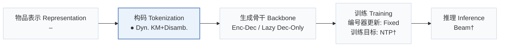
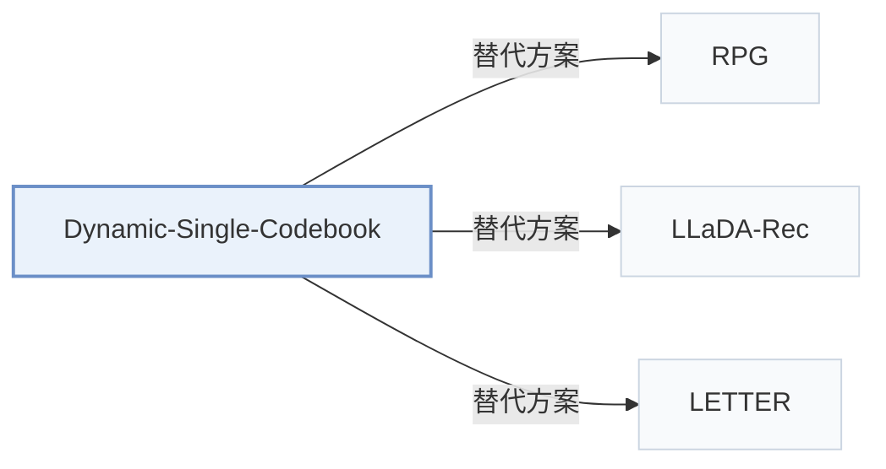

# Dynamic-Single-Codebook

[← 问题 × 阶段矩阵](../../../README.zh.md#v--tokenization) · [按阶段索引](../index/stages.md) · [按模态找论文](../index/modality.md) · [按领域找论文](../index/domain.md) · [English](../../papers/dynamic-single-codebook.md) | 中文

| **题目** | *From a Static Multi-Level Small Semantic Codebook to a Dynamic Single-Level Large Semantic Codebook for Generative Recommendation* |
| :-- | :-- |
| **作者** | Xie et al. |
| **发表** | arXiv’26 |
| **问题与阶段** | `V. 效率` · `构码（Tokenization）` |
| **改动** | ● 构码 |
| **构码输入** | `其他`（预计算的物品向量，未写来源） |
| **领域** | `电商` · `短视频与直播` · `其他`（未具名的工业平台，业务未写） |
| **特殊设置** | `目录动态变化` |
| **应用场景** | `一般物品推荐`；`线上实验或部署` |
| **链接** | [论文](https://arxiv.org/abs/2608.21012) |
| **阅读级别** | 概览（第 1 级） |

**本页目录**：[TL;DR](#tldr) · [3. 实验发现](#3-实验发现) · [5. 相关工作](#5-相关工作)

- `Dyn. KM+Disamb.`：动态更新的 k-means 编码加冲突消歧后缀码。
- `Enc-Dec / Lazy Dec-Only`：涵盖编码器-解码器与延迟解码（Lazy Decoder-only）两种变体。
- `Fixed`：先独立训练并冻结编号器，生成器训练期间 SID 保持不变。
- `NTP†`：下一 token 预测损失（由配置推断）。
- `Beam†`：自回归束搜索（由配置推断）。

### TL;DR

> [!NOTE]
> Dynamic-Single-Codebook 用大单层码本的一个 token 加协同消歧 token 替代多层残差码，并随曝光分布变化动态更新码本。

---

### 3. 实验发现

实验设置

- **数据集**：Amazon Beauty 2014; KuaiRec 2.0 Big Matrix, watch_ratio>=1 and users with >=5 retained events; industrial data. Other filters not reported.
  - 出处：Section 4.1: [S4.SS1.p1](https://arxiv.org/html/2608.21012v1#S4.SS1.p1) and [S4.SS1.p2](https://arxiv.org/html/2608.21012v1#S4.SS1.p2)
- **切分**：Per-user chronological last/penultimate holdouts; separate KuaiRec experiment trains through September 3, validates September 4, tests September 5.
  - 出处：Section 4.1 and fixed-date protocol: [S4.SS1.p2](https://arxiv.org/html/2608.21012v1#S4.SS1.p2) and [S4.SS3.SSS2.p1](https://arxiv.org/html/2608.21012v1#S4.SS3.SSS2.p1)
- **候选集**：not reported
  - 出处：Candidate protocol absent from Sections 4.1-4.5 and Appendices B-E: [S4.SS1](https://arxiv.org/html/2608.21012v1#S4.SS1)
- **可见性**：warm; no unseen-item protocol is defined. Fixed-date validation/test days are excluded from codebook fitting; leave-two-out PV weights use all viewing events. Item-level holdouts: not reported.
  - 出处：Section 4.1 and fixed-date protocol: [S4.SS1.p2](https://arxiv.org/html/2608.21012v1#S4.SS1.p2) and [S4.SS3.SSS2.p1](https://arxiv.org/html/2608.21012v1#S4.SS3.SSS2.p1)
- **SID 规格**：Public data: [1024,512], semantic plus balanced disambiguation code; baseline [256,256,256].
  - 出处：Section 4.1: [S4.SS1.p3](https://arxiv.org/html/2608.21012v1#S4.SS1.p3)
- **推理预算**：K=5/10; beam width, hardware model, inference batch size, absolute latency/QPS not reported. Single-card QPS gains: 28.57%-47.0%.
  - 出处：Sections 4.1 and 4.5: [S4.SS1.p5](https://arxiv.org/html/2608.21012v1#S4.SS1.p5) and [S4.SS5.p1](https://arxiv.org/html/2608.21012v1#S4.SS5.p1)
- **结果来源**：Original Table 2, Figures 3/4/6, Tables 9-14; Section 4.5 online A/B.
  - 出处：Section 4 and Appendices C-E: [S4](https://arxiv.org/html/2608.21012v1#S4) and [A3](https://arxiv.org/html/2608.21012v1#A3) and [A4](https://arxiv.org/html/2608.21012v1#A4) and [A5](https://arxiv.org/html/2608.21012v1#A5)

---

### 5. 相关工作

- **替代方案** · [RPG](rpg.md): RPG parallelizes long SIDs; this method shortens SIDs.
  - 出处：Dynamic-Single-Codebook v1, Section 2.2: [S2.SS2.p2](https://arxiv.org/html/2608.21012v1#S2.SS2.p2).
- **替代方案** · [LLaDA-Rec](llada-rec.md): LLaDA-Rec uses diffusion with adapted beam search; this method reduces token count.
  - 出处：Dynamic-Single-Codebook v1, Sections 1 and 2.2: [S1.p4](https://arxiv.org/html/2608.21012v1#S1.p4); [S2.SS2.p2](https://arxiv.org/html/2608.21012v1#S2.SS2.p2).
- **替代方案** · [LETTER](letter.md): LETTER regularizes residual quantization; this method changes semantic codebook width and depth.
  - 出处：Dynamic-Single-Codebook v1, Section 2.1: [S2.SS1.p2](https://arxiv.org/html/2608.21012v1#S2.SS1.p2).

[查看同格全部论文](../../../README.zh.md#v--tokenization)
