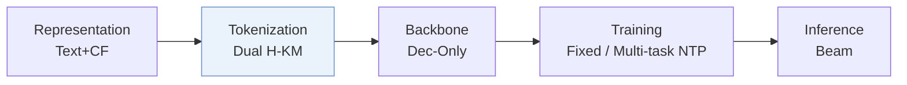
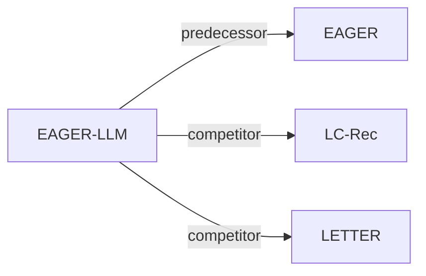

# EAGER-LLM

| **题目** | *Enhancing Large Language Models as Recommenders through Exogenous Behavior-Semantic Integration* |
| :-- | :-- |
| **作者** | Hong et al. |
| **会议** | WWW’25 |
| **问题与阶段** | `I. 信息量` · `Tokenization` |
| **链接** | [论文](https://arxiv.org/abs/2502.14735) · [矩阵](../../../README.zh.md#i--tokenization) · [English](../../papers/eager-llm.md) |
| **阅读级别** | 概览（第 1 级） |

本页目录：[TL;DR](#tldr) · [速览](#速览) · [3. 实验发现](#3-实验发现) · [5. 相关工作](#5-相关工作)

- `Dec-Only`: Decoder-only.
- `Fixed`: SIDs are built first and not changed while the generator trains.
- `Multi-task NTP`: The same NTP loss over several tasks.

### TL;DR

> [!NOTE]
> EAGER-LLM 为仅解码器 LLM 加入行为与语义双源物品索引、多尺度对齐重构任务以及退火适配器，无需从头学习协同语义。

---

### 速览

| 维度 | 摘要 |
| :-- | :-- |
| 研究问题 | I. 信息量：Do the SIDs, or the model reading them, carry the collaborative and multimodal signals recommendation needs? |
| 核心贡献 | EAGER-LLM 为仅解码器 LLM 加入行为与语义双源物品索引、多尺度对齐重构任务以及退火适配器，无需从头学习协同语义。 |
| 主要改动阶段 | Tokenization |

---

### 3. 实验发现

实验设置

- **数据集**：Amazon Beauty, Sports and Outdoors, Musical Instruments; user/item 5-core filtering.
  - 出处：Section 4.1.1: [S4.SS1.SSS1.p1](https://arxiv.org/html/2502.14735v1#S4.SS1.SSS1.p1)
- **切分**：Leave-one-out; exact validation allocation not reported; training histories capped at 20 items.
  - 出处：Section 4.1.2: [S4.SS1.SSS2.p1](https://arxiv.org/html/2502.14735v1#S4.SS1.SSS2.p1)
- **候选集**：not reported
  - 出处：Sections 4.1-4.4 do not state full-catalog versus sampled-negative evaluation: [S4.SS1.SSS2.p1](https://arxiv.org/html/2502.14735v1#S4.SS1.SSS2.p1)
- **可见性**：warm; no unseen-item protocol is defined. Item-level tokenizer and DIN behavior-encoder training exposure: not reported.
  - 出处：Sections 3.2 and 4.1 define no unseen-item protocol; DIN supplies behavioral embeddings: [S3.SS2.p3](https://arxiv.org/html/2502.14735v1#S3.SS2.p3) and [S4.SS1.SSS3.p1](https://arxiv.org/html/2502.14735v1#S4.SS1.SSS3.p1)
- **SID 规格**：Separate semantic/behavioral hierarchical k-means until singleton clusters; four layers discussed. 256 values/token is a theoretical capacity example; explicit main codebook sizes not reported.
  - 出处：Section 3.2 and Figure 6 discussion: [S3.SS2.p5](https://arxiv.org/html/2502.14735v1#S3.SS2.p5) and [S4.SS4.p3](https://arxiv.org/html/2502.14735v1#S4.SS4.p3)
- **推理预算**：Beam 20; Recall/NDCG@5/10; hardware, inference batch size, latency not reported.
  - 出处：Section 4.1.2; Section 4.1.3's batch 128 is training, not inference: [S4.SS1.SSS2.p1](https://arxiv.org/html/2502.14735v1#S4.SS1.SSS2.p1) and [S4.SS1.SSS3.p1](https://arxiv.org/html/2502.14735v1#S4.SS1.SSS3.p1)
- **结果来源**：Original Tables 2-4; Table 3 compares LETTER on Instruments using Llama2-7B.
  - 出处：Tables 2-4: [S4.T2](https://arxiv.org/html/2502.14735v1#S4.T2) and [S4.T3](https://arxiv.org/html/2502.14735v1#S4.T3) and [S4.T4](https://arxiv.org/html/2502.14735v1#S4.T4)

---

### 5. 相关工作

- **前序工作** · [EAGER](eager.md): The authors explicitly extend EAGER's dual-source modeling to an LLM backbone.
  - 出处：EAGER-LLM v1, Section 2.1: https://arxiv.org/html/2502.14735v1#S2.SS1.p1.
- **同期对比** · [LC-Rec](lc-rec.md): LC-Rec supplies the compared vector-quantized IDs; EAGER-LLM separately clusters behavioral and semantic embeddings.
  - 出处：EAGER-LLM v1, Sections 3.2/4.2.1 and Table 2: https://arxiv.org/html/2502.14735v1#S3.SS2.p5; https://arxiv.org/html/2502.14735v1#S4.SS2.SSS1.p5; https://arxiv.org/html/2502.14735v1#S4.T2.
- **同期对比** · [LETTER](letter.md): LETTER regularizes collaborative coding; EAGER-LLM separates the two information sources before LLM fusion.
  - 出处：EAGER-LLM v1, Section 4.2.2 and Table 3: https://arxiv.org/html/2502.14735v1#S4.SS2.SSS2.p4; https://arxiv.org/html/2502.14735v1#S4.T3.

[查看同格全部论文](../../../README.zh.md#i--tokenization)
