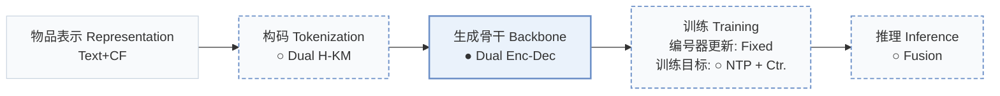
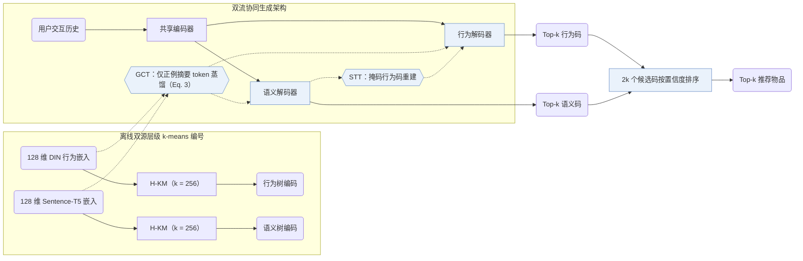
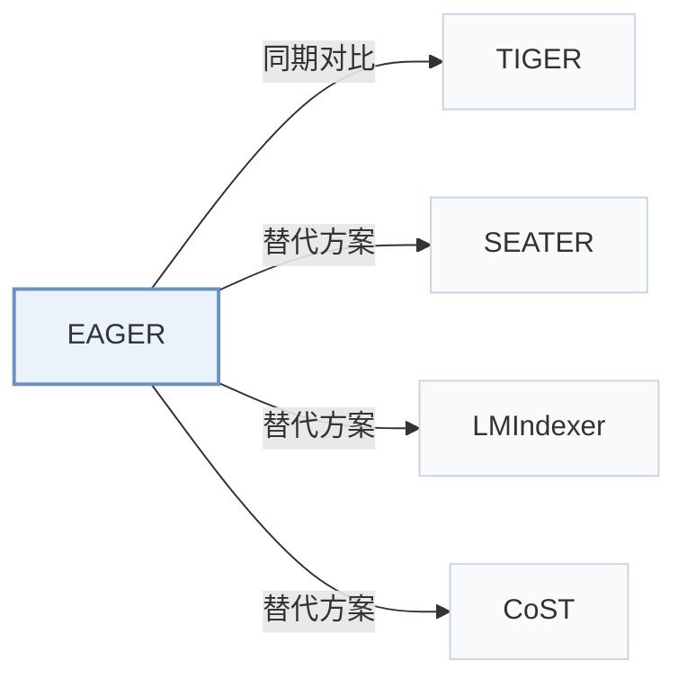

# EAGER

[← 问题 × 阶段矩阵](../../../README.zh.md#i--backbone) · [按阶段索引](../index/stages.md) · [按模态找论文](../index/modality.md) · [按领域找论文](../index/domain.md) · [English](../../papers/eager.md) | 中文

| **题目** | *Two-Stream Generative Recommender with Behavior-Semantic Collaboration* |
| :-- | :-- |
| **作者** | Wang et al. |
| **发表** | KDD’24 |
| **问题与阶段** | `I. 信息量` · `生成骨干（Backbone）` |
| **改动** | ○ 构码 · ● 生成骨干 · ○ 训练目标 · ○ 推理 |
| **构码输入** | semantic: `Text` · behavior: `CF` |
| **领域** | `电商` · `本地生活与 POI` |
| **链接** | [论文](https://arxiv.org/abs/2406.14017) · [代码](https://github.com/yewzz/EAGER) |
| **阅读级别** | 阅读笔记（第 2 级） |

**本页目录**：[TL;DR](#tldr) · [速览](#速览) · [1. 为什么重要](#1-为什么重要) · [2. 方法](#2-方法) · [3. 实验发现](#3-实验发现) · [4. 局限与分析](#4-局限与分析) · [5. 相关工作](#5-相关工作)

- `Text+CF`：文本表征结合协同过滤信号。
- `Dual H-KM`：分别在行为与语义嵌入上构建的双源层级 k-means。
- `Dual Enc-Dec`：共享编码器配合双并行解码器的双流架构。
- `Fixed`：先独立训练并冻结编号器，生成器训练期间 SID 保持不变。
- `NTP + Ctr.`：下一 token 预测结合对比学习损失。
- `Fusion`：融合并行双解码分支输出的候选得分。

### TL;DR

> [!NOTE]
> EAGER 用共享编码器和两个解码器分别解码行为 token 与语义 token，并加入对比学习与语义引导迁移任务，替代仅用单一物品信息的做法。

---

### 速览

| 维度 | 摘要 |
| :-- | :-- |
| 主要发现 | 在 Amazon Beauty、Sports and Outdoors、Toys and Games 与 Yelp 上，EAGER 全面优于序列推荐、树结构与单流生成式基线（Table 2）；消融实验中移除双流架构带来最大性能下降（Sec. 4.3，Table 3）；在 Beauty 上单样本推理耗时为 0.0325 s，而 TIGER 为 0.0281 s（Table 6）。 |
| 局限 | 推理时需在两个独立解码器中分别执行束搜索（束宽 100）并按对数概率置信度合并 2k 个候选，使 Beauty 上的单样本耗时从 TIGER 的 0.0281 s 增至 0.0325 s（Sec. 3.6，Table 6）。 |

---

### 1. 为什么重要

单流生成式推荐模型仅从交互行为或内容语义单一视图构建物品的语义 ID（Semantic ID，SID），要么丢失另一视图的互补信号，要么将两类异构特征强行压缩进同一量化空间（Abstract）。EAGER 从三方面协同建模两类信息：统一的双流编码器-解码器架构、行为与语义各自独立的层级编码树，以及跨流蒸馏与迁移任务。

> "we propose (1) a two-stream generation architecture leveraging a shared encoder and two separate decoders to decode behavior tokens and semantic tokens with a confidence-based ranking strategy"（Abstract）

---

### 2. 方法

#### 行为码与语义码

EAGER 分别用预训练 DIN 提取 128 维行为嵌入，用 Sentence-T5 提取 128 维文本语义嵌入（Sec. 4.1）。两路嵌入各自通过分支数 $`k = 256`$ 的层级 k-means（`Dual H-KM`）递归聚类，直至每个叶节点仅含单个物品，为每个物品生成独立的行为码与语义码（Sec. 3.3，Sec. 4.1）。

#### 全局对比任务

在全局对比任务（GCT）中，两个解码器各自在序列末尾附加摘要 token，并采用无需负采样的纯正例余弦距离度量（替代 InfoNCE），将摘要隐状态向该流冻结的预训练物品嵌入（DIN 或 Sentence-T5）蒸馏对齐（Sec. 3.4，Eq. 3）。

#### 语义引导迁移任务

语义引导迁移任务（STT）利用语义流的全局特征去重建被随机掩码的行为码 token，并配合二分类相关性判别器，在不混淆两套码本的前提下将语义先验迁移至行为解码流（Sec. 3.5）。

#### 置信度排序

推理阶段，行为解码器与语义解码器分别束搜索返回 $`k`$ 条候选编码，再按序列对数概率计算的置信度对合并后的 $`2k`$ 个预测统一排序（Sec. 3.6）。

> "With the 2*k prediction codes, we calculate the log probabilities over the codes as the confidence score of each prediction, which is similar to the perplexity used in the language model and the lower value indicates more confidence."（Sec. 3.6）

---

### 3. 实验发现

实验设置

- **数据集**：Amazon Product Reviews (May 1996-July 2018): Beauty, Sports and Outdoors, Toys and Games; Yelp 2019 transactions (January-December 2019). 5-core filtering of users and items. Sizes (users / items / interactions): Beauty 22,363 / 12,101 / 198,360; Sports 35,598 / 18,357 / 296,175; Toys 19,412 / 11,924 / 167,526; Yelp 30,431 / 20,033 / 316,354.
  - 出处：5-core filtering and timestamp ordering: [S4.SS1.p1](https://arxiv.org/html/2406.14017v2#S4.SS1.p1); Amazon and Yelp scope: [S4.I2.i1.p1](https://arxiv.org/html/2406.14017v2#S4.I2.i1.p1) and [S4.I2.i2.p1](https://arxiv.org/html/2406.14017v2#S4.I2.i2.p1); statistics: [S3.T1](https://arxiv.org/html/2406.14017v2#S3.T1).
- **切分**：Chronological leave-one-out: last item for test, second-to-last for validation, the rest for training; training histories limited to 20 items.
  - 出处：Leave-one-out allocation and history cap: [S4.SS1.p2](https://arxiv.org/html/2406.14017v2#S4.SS1.p2).
- **候选集**：not reported (full catalog versus sampled evaluation candidates); top-k lists come from beam search in two streams.
  - 出处：Metrics only: [S4.SS1.p2](https://arxiv.org/html/2406.14017v2#S4.SS1.p2).
- **可见性**：warm; no unseen-item protocol is defined.
  - 出处：Standard leave-one-out with no cold-start experiment: [S4.SS1.p2](https://arxiv.org/html/2406.14017v2#S4.SS1.p2).
- **SID 规格**：Two codes per item: behavior codes from DIN embeddings and semantic codes from Sentence-T5 embeddings, each built by hierarchical k-means with k=256 branches, splitting until each child cluster contains a single item; code length l follows from the item count and k.
  - 出处：Dual hierarchical k-means codes until each leaf holds one item: [S3.SS3.p3](https://arxiv.org/html/2406.14017v2#S3.SS3.p3); k=256: [S4.SS1.p3](https://arxiv.org/html/2406.14017v2#S4.SS1.p3); length varies with k: [S4.SS5.p2](https://arxiv.org/html/2406.14017v2#S4.SS5.p2).
- **推理预算**：Beam search in each of the behavior and semantic decoders returns top-k codes; the 2k predictions are merged by log-probability confidence. Table 6 (Beauty, top-k=5, beam size 100): 0.0325 s per sample for EAGER versus 0.0281 s for TIGER; hardware and inference batch size not reported. Recall and NDCG at 5, 10, and 20.
  - 出处：Two-stream beam search and confidence ranking: [S3.SS6.p2](https://arxiv.org/html/2406.14017v2#S3.SS6.p2); speed table: [S4.T6](https://arxiv.org/html/2406.14017v2#S4.T6).
- **结果来源**：Table 2 (Beauty, Sports, Toys, Yelp versus sequential, tree-based, and generative baselines); Table 3 (TSG/GCT/STT ablations); Tables 4, 5, 7 and Figures 4-6 (modalities, summary token, contrastive metric, layers, cluster number); Table 6 (inference speed).
  - 出处：Main: [S3.T2](https://arxiv.org/html/2406.14017v2#S3.T2); ablations: [S4.T3](https://arxiv.org/html/2406.14017v2#S4.T3); analyses: [S4.T4](https://arxiv.org/html/2406.14017v2#S4.T4), [S4.T5](https://arxiv.org/html/2406.14017v2#S4.T5), [S4.T7](https://arxiv.org/html/2406.14017v2#S4.T7); speed: [S4.T6](https://arxiv.org/html/2406.14017v2#S4.T6).

- 主实验对比：在 5-core 过滤的 Beauty（22,363 用户 / 12,101 物品）、Sports and Outdoors（35,598 / 18,357）、Toys and Games（19,412 / 11,924）与 Yelp（30,431 / 20,033）四个基准上，EAGER 在 Recall@5/10/20 与 NDCG@5/10/20 上全面优于序列推荐、树模型与生成式基线（Abstract，Table 1，Table 2）。
- 关键模块消融：移除双流生成架构（TSG）造成的指标滑坡最大，移除全局对比任务（GCT）的损失大于移除语义引导迁移任务（STT）（Sec. 4.3，Table 3）。

  > "Removing GCT leads to more performance drops than removing STT, suggesting that global information distillation of the inter-code is slightly more important than the knowledge flow between the intra-code."（Sec. 4.3）

- 视觉模态扩展：在 Yelp 上使用 ViT-B 提取物品封面视觉特征构建视觉语义编码流，同样优于单流基线（Sec. 4.4，Table 4）。
- 推理速度对比：在 Beauty 上取 top-$`k = 5`$、束宽 100 时，EAGER 单样本耗时 0.0325 s，对应 TIGER 为 0.0281 s、RecForest 为 0.0499 s、DIN 全库打分为 0.2349 s（Table 6）。

---

### 4. 局限与分析

**Our analysis.**

- 行为树和语义树均依赖冻结的上游编码器与精确到单物品叶节点的离线层级 k-means，物品库更新时需重跑双路编码与聚类树。
- 直接按序列对数概率合并两个解码器的 top-$`k`$ 候选列表，隐含假设行为解码器与语义解码器的输出概率尺度一致（Sec. 3.6）。
- CoST 在编号器内部引入对比学习目标（`C-RQ`）；EAGER 则保持 `Dual H-KM` 离散码固定，在 `Dual Enc-Dec` 生成器侧施加全局对比蒸馏（`GCT`）与跨流掩码重建（`STT`）。

---

### 5. 相关工作

- **同期对比** · [TIGER](tiger.md): TIGER decodes one content-based semantic ID; EAGER decodes behavior and semantic hierarchical k-means codes with two decoders and merges them by confidence.
  - 出处：EAGER v2, baselines: [S4.I6.i1.p1](https://arxiv.org/html/2406.14017v2#S4.I6.i1.p1); Table 2: [S3.T2](https://arxiv.org/html/2406.14017v2#S3.T2); speed comparison in Table 6: [S4.T6](https://arxiv.org/html/2406.14017v2#S4.T6).
- **替代方案** · [SEATER](seater.md): SEATER also uses tree-structured identifiers for generative retrieval; EAGER builds separate behavior and semantic trees and aligns them with contrastive and transfer tasks.
  - 出处：EAGER v2, Section 1 cites SEATER among generative recommenders: [S1.p2](https://arxiv.org/html/2406.14017v2#S1.p2); not a baseline in Table 2.
- **替代方案** · [LMIndexer](lmindexer.md): LMIndexer learns semantic IDs from text with a language model; EAGER keeps fixed k-means codes from pre-trained behavior and semantic encoders.
  - 出处：EAGER v2, Section 2 cites LMIndexer among semantic indexing methods: [S2.p2](https://arxiv.org/html/2406.14017v2#S2.p2); not a baseline in Table 2.
- **替代方案** · [CoST](cost.md): CoST learns RQ codes with a contrastive objective, whereas EAGER clusters frozen embeddings and adds contrastive learning on the generator side.
  - 出处：EAGER v2, Section 2 cites CoST: [S2.p2](https://arxiv.org/html/2406.14017v2#S2.p2). CoST v2, Section 2 in turn cites EAGER as a hierarchical k-means tokenizer: [S2.p2](https://arxiv.org/html/2404.14774v2#S2.p2).

[查看同格全部论文](../../../README.zh.md#i--backbone)
