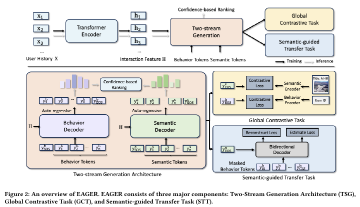
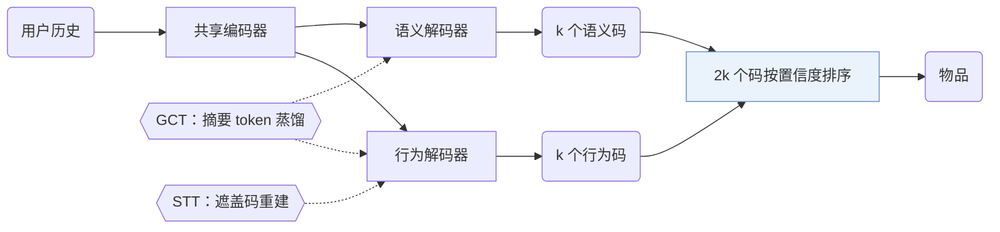
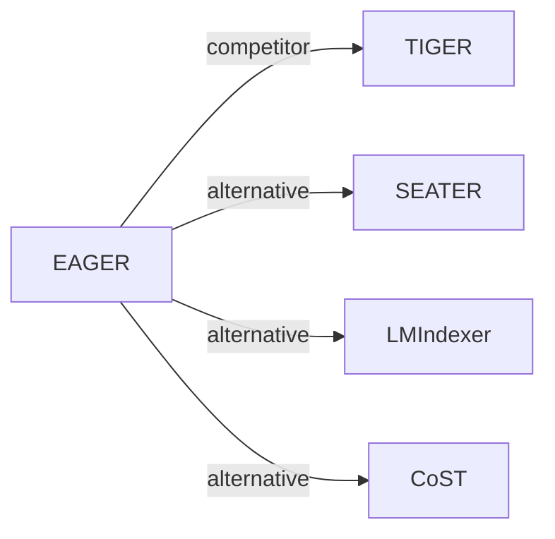

# EAGER

| **题目** | *Two-Stream Generative Recommender with Behavior-Semantic Collaboration* |
| :-- | :-- |
| **作者** | Wang et al. |
| **会议** | KDD’24 |
| **问题与阶段** | `I. 信息量` · `Backbone` |
| **链接** | [论文](https://arxiv.org/abs/2406.14017) · [代码](https://github.com/yewzz/EAGER) · [矩阵](../../../README.zh.md#i--backbone) · [English](../../papers/eager.md) |
| **阅读级别** | 阅读笔记（第 2 级） |

本页目录：[TL;DR](#tldr) · [速览](#速览) · [1. 为什么重要](#1-为什么重要) · [2. 方法](#2-方法) · [3. 实验发现](#3-实验发现) · [4. 局限与分析](#4-局限与分析) · [5. 相关工作](#5-相关工作)

- `Fixed`: SIDs are built first and not changed while the generator trains.
- `NTP + Ctr.`: NTP plus a contrastive loss.

### TL;DR

> [!NOTE]
> EAGER 用共享编码器和两个解码器分别解码行为 token 与语义 token，并加入对比学习与语义引导迁移任务，替代仅用单一物品信息的做法。

---

### 速览

| 维度 | 摘要 |
| :-- | :-- |
| 研究问题 | I. 信息量：Do the SIDs, or the model reading them, carry the collaborative and multimodal signals recommendation needs? |
| 核心贡献 | EAGER 用共享编码器和两个解码器分别解码行为 token 与语义 token，并加入对比学习与语义引导迁移任务，替代仅用单一物品信息的做法。 |
| 主要改动阶段 | Backbone |
| 主要发现 | 消融中去掉双流结构下降最多（Sec. 4.3，Table 3）；在 Beauty 上，EAGER 推理每个样本耗时 0.0325 s，TIGER 为 0.0281 s（Table 6）。 |
| 局限 | 推理要在两个解码器里分别做束搜索再合并结果，所以 EAGER 比 TIGER 慢（Sec. 3.6，Table 6）。 |

---

### 1. 为什么重要

现有生成式方法只用物品信息的行为面或语义面，作者认为这忽略了两者的互补（Abstract）。EAGER 为结合两者提出三点要求：一个结构同时处理两类特征，两类特征各自独立学习，两者之间有交互（Abstract）。

> "we propose (1) a two-stream generation architecture leveraging a shared encoder and two separate decoders to decode behavior tokens and semantic tokens with a confidence-based ranking strategy"（Abstract）（共享编码器加两个解码器，分别解码行为 token 和语义 token，再按置信度排序。）

---

### 2. 方法

#### 行为码与语义码

行为编码器是预训练的 DIN，语义编码器是 Sentence-T5，隐藏维度为 128（Sec. 4.1）。层级 k-means（簇数 256）把每个嵌入变成码（Sec. 3.3，Sec. 4.1）。

#### 全局对比任务

每一路的摘要 token 向该路的预训练物品嵌入蒸馏，用只含正例的对比度量，不用 InfoNCE（Sec. 3.4，Eq. 3）。

#### 语义引导迁移任务

语义全局特征用来重建被遮盖的行为码，再加一个识别目标训练相关性分类器（Sec. 3.5）。

#### 置信度排序

每个解码器返回 $`k`$ 个码，$`2k`$ 个预测按对数概率排序（Sec. 3.6）。

> "With the 2*k prediction codes, we calculate the log probabilities over the codes as the confidence score of each prediction, which is similar to the perplexity used in the language model and the lower value indicates more confidence."（Sec. 3.6）（用 2k 个预测码的对数概率作置信度，类似困惑度，越低越可信。）

---

### 3. 实验发现

实验设置

- **数据集**：Amazon Product Reviews (May 1996-July 2018): Beauty, Sports and Outdoors, Toys and Games; Yelp 2019 transactions (January-December 2019). 5-core filtering of users and items. Sizes (users / items / interactions): Beauty 22,363 / 12,101 / 198,360; Sports 35,598 / 18,357 / 296,175; Toys 19,412 / 11,924 / 167,526; Yelp 30,431 / 20,033 / 316,354.
  - 出处：5-core filtering and timestamp ordering: [S4.SS1.p1](https://arxiv.org/html/2406.14017v2#S4.SS1.p1); Amazon and Yelp scope: [S4.I2.i1.p1](https://arxiv.org/html/2406.14017v2#S4.I2.i1.p1) and [S4.I2.i2.p1](https://arxiv.org/html/2406.14017v2#S4.I2.i2.p1); statistics: [S3.T1](https://arxiv.org/html/2406.14017v2#S3.T1).
- **切分**：Chronological leave-one-out: last item for test, second-to-last for validation, the rest for training; training histories limited to 20 items.
  - 出处：Leave-one-out allocation and history cap: [S4.SS1.p2](https://arxiv.org/html/2406.14017v2#S4.SS1.p2).
- **候选集**：not reported (full catalog versus sampled evaluation candidates); top-k lists come from beam search in two streams.
  - 出处：Metrics only: [S4.SS1.p2](https://arxiv.org/html/2406.14017v2#S4.SS1.p2).
- **可见性**：warm; no unseen-item protocol is defined.
  - 出处：Standard leave-one-out with no cold-start experiment: [S4.SS1.p2](https://arxiv.org/html/2406.14017v2#S4.SS1.p2).
- **SID 规格**：Two codes per item: behavior codes from DIN embeddings and semantic codes from Sentence-T5 embeddings, each built by hierarchical k-means with k=256 branches, splitting until each child cluster contains a single item; code length l follows from the item count and k.
  - 出处：Dual hierarchical k-means codes until each leaf holds one item: [S3.SS3.p3](https://arxiv.org/html/2406.14017v2#S3.SS3.p3); k=256: [S4.SS1.p3](https://arxiv.org/html/2406.14017v2#S4.SS1.p3); length varies with k: [S4.SS5.p2](https://arxiv.org/html/2406.14017v2#S4.SS5.p2).
- **推理预算**：Beam search in each of the behavior and semantic decoders returns top-k codes; the 2k predictions are merged by log-probability confidence. Table 6 (Beauty, top-k=5, beam size 100): 0.0325 s per sample for EAGER versus 0.0281 s for TIGER; hardware and inference batch size not reported. Recall and NDCG at 5, 10, and 20.
  - 出处：Two-stream beam search and confidence ranking: [S3.SS6.p2](https://arxiv.org/html/2406.14017v2#S3.SS6.p2); speed table: [S4.T6](https://arxiv.org/html/2406.14017v2#S4.T6).
- **结果来源**：Table 2 (Beauty, Sports, Toys, Yelp versus sequential, tree-based, and generative baselines); Table 3 (TSG/GCT/STT ablations); Tables 4, 5, 7 and Figures 4-6 (modalities, summary token, contrastive metric, layers, cluster number); Table 6 (inference speed).
  - 出处：Main: [S3.T2](https://arxiv.org/html/2406.14017v2#S3.T2); ablations: [S4.T3](https://arxiv.org/html/2406.14017v2#S4.T3); analyses: [S4.T4](https://arxiv.org/html/2406.14017v2#S4.T4), [S4.T5](https://arxiv.org/html/2406.14017v2#S4.T5), [S4.T7](https://arxiv.org/html/2406.14017v2#S4.T7); speed: [S4.T6](https://arxiv.org/html/2406.14017v2#S4.T6).

- 主实验：EAGER 在四个公开基准上好于已有方法（Abstract）。
- 消融：去掉全局对比任务（GCT）比去掉语义引导迁移任务（STT）下降更多（Sec. 4.3，Table 3）。

  > "Removing GCT leads to more performance drops than removing STT, suggesting that global information distillation of the inter-code is slightly more important than the knowledge flow between the intra-code."（Sec. 4.3）（GCT 比 STT 稍重要。）

- 视觉特征：在 Yelp 上，用 ViT-B 提取物品封面特征，得到一组视觉语义码（Sec. 4.4，Table 4）。
- 推理速度：在 Beauty 上取 top-k 5、束宽 100，RecForest 每个样本 0.0499 s，DIN 0.2349 s（Table 6）。

---

### 4. 局限与分析

**Our analysis.**

- 两套码都来自冻结的编码器和离线聚类。由此推断，加入新物品要重跑两个编码器和聚类。
- CoST 用对比目标训练码（`C-RQ`）；EAGER 的 `Dual H-KM` 码固定不变，对比项加在生成器一侧。

---

### 5. 相关工作

- **同期对比** · [TIGER](tiger.md): TIGER decodes one content-based semantic ID; EAGER decodes behavior and semantic hierarchical k-means codes with two decoders and merges them by confidence.
  - 出处：EAGER v2, baselines: https://arxiv.org/html/2406.14017v2#S4.I6.i1.p1; Table 2: https://arxiv.org/html/2406.14017v2#S3.T2; speed comparison in Table 6: https://arxiv.org/html/2406.14017v2#S4.T6.
- **替代方案** · [SEATER](seater.md): SEATER also uses tree-structured identifiers for generative retrieval; EAGER builds separate behavior and semantic trees and aligns them with contrastive and transfer tasks.
  - 出处：EAGER v2, Section 1 cites SEATER among generative recommenders: https://arxiv.org/html/2406.14017v2#S1.p2; not a baseline in Table 2.
- **替代方案** · [LMIndexer](lmindexer.md): LMIndexer learns semantic IDs from text with a language model; EAGER keeps fixed k-means codes from pre-trained behavior and semantic encoders.
  - 出处：EAGER v2, Section 2 cites LMIndexer among semantic indexing methods: https://arxiv.org/html/2406.14017v2#S2.p2; not a baseline in Table 2.
- **替代方案** · [CoST](cost.md): CoST learns RQ codes with a contrastive objective, whereas EAGER clusters frozen embeddings and adds contrastive learning on the generator side.
  - 出处：EAGER v2, Section 2 cites CoST: https://arxiv.org/html/2406.14017v2#S2.p2. CoST v2, Section 2 in turn cites EAGER as a hierarchical k-means tokenizer: https://arxiv.org/html/2404.14774v2#S2.p2.

[查看同格全部论文](../../../README.zh.md#i--backbone)
