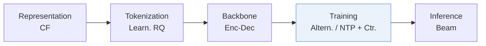
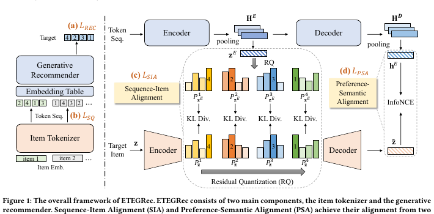
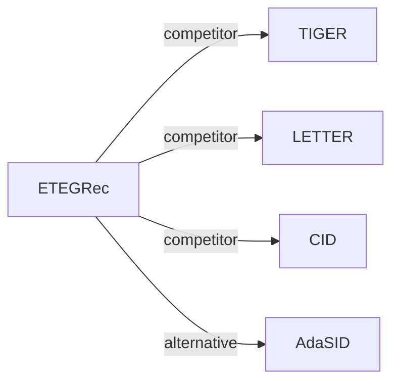

# ETEGRec

*Generative recommender with end-to-end learnable item tokenization* — Liu et al. · SIGIR’25

`III. SID 与模型对齐` · `Training` · [论文](https://arxiv.org/abs/2409.05546) · [代码](https://github.com/RUCAIBox/ETEGRec) · [矩阵](../../../README.zh.md#iii--training) · [English](../../papers/etegrec.md)

阅读级别：概览（第 1 级） · 本页目录：[TL;DR](#tldr) · [速览](#速览) · [2. 方法](#2-方法) · [3. 实验发现](#3-实验发现) · [5. 相关工作](#5-相关工作)

- `CF`: Collaborative filtering signal.
- `Enc-Dec`: Encoder-decoder.
- `Altern.`: Tokenizer and generator are updated in turns.
- `NTP + Ctr.`: NTP plus a contrastive loss.

### TL;DR

> [!NOTE]
> ETEGRec 用序列-物品对齐损失与偏好-语义对齐损失交替训练物品编号器和生成器，替代先独立训练编号器再训练生成器的两阶段流程。

### 速览

| 维度 | 摘要 |
| :-- | :-- |
| 研究问题 | III. SID 与模型对齐：Can the generator read, write, and reason over SIDs, and do the tokenizer and generator work toward the same goal? |
| 核心贡献 | ETEGRec 用序列-物品对齐损失与偏好-语义对齐损失交替训练物品编号器和生成器，替代先独立训练编号器再训练生成器的两阶段流程。 |
| 主要改动阶段 | Training |

### 2. 方法

### 3. 实验发现

实验设置

- **数据集**：Amazon 2023 Reviews (May 1996-September 2023): Musical Instruments, Industrial and Scientific, Video Games; 5-core filtering of users and items; sequences capped at 50 items. Sizes (users / items / interactions): Instrument 57,439 / 24,587 / 511,836; Scientific 50,985 / 25,848 / 412,947; Game 94,762 / 25,612 / 814,586.
  - 出处：Amazon 2023 subsets, 5-core filter, sequence length 50: [S4.SS1.SSS1.p1](https://arxiv.org/html/2409.05546v3#S4.SS1.SSS1.p1); statistics: [S4.T2](https://arxiv.org/html/2409.05546v3#S4.T2).
- **切分**：Per-user leave-one-out: latest interaction for test, second most recent for validation, the rest for training. Separate generalization study on Instrument and Scientific: the 5% of users with the least history are removed from training and evaluated as unseen users.
  - 出处：Leave-one-out allocation: [S4.SS1.SSS3.p1](https://arxiv.org/html/2409.05546v3#S4.SS1.SSS3.p1); unseen-user experiment: [S4.SS4.SSS1.p1](https://arxiv.org/html/2409.05546v3#S4.SS4.SSS1.p1).
- **候选集**：full catalog
  - 出处：Full ranking over the entire item set: [S4.SS1.SSS3.p1](https://arxiv.org/html/2409.05546v3#S4.SS1.SSS3.p1).
- **可见性**：Main: warm; no unseen-item protocol is defined. The generalization study holds out users, not items: test users are unseen by both tokenizer and generator training, while item visibility is unchanged.
  - 出处：Main protocol and unseen-user study: [S4.SS1.SSS3.p1](https://arxiv.org/html/2409.05546v3#S4.SS1.SSS3.p1) and [S4.SS4.SSS1.p1](https://arxiv.org/html/2409.05546v3#S4.SS4.SSS1.p1).
- **SID 规格**：3-level RQ-VAE x 256 codewords (dimension 128) over 256-dimensional SASRec collaborative embeddings; following TIGER, an extra token is appended to make IDs unique. The tokenizer is trained jointly with the generator by alternating optimization.
  - 出处：3 codebooks x 256, dimension 128, extra uniqueness token: [S4.SS1.SSS4.p1](https://arxiv.org/html/2409.05546v3#S4.SS1.SSS4.p1); SASRec embeddings as input: [S4.SS1.SSS4.p1](https://arxiv.org/html/2409.05546v3#S4.SS1.SSS4.p1).
- **推理预算**：Beam size 20 for all generative models; T5 with 6 encoder and 6 decoder layers. Recall and NDCG at K=5 and 10. Hardware, inference batch size, and latency: not reported (Section 3.5 gives asymptotic complexity only).
  - 出处：Beam size 20 for all generative models: [S4.SS1.SSS3.p1](https://arxiv.org/html/2409.05546v3#S4.SS1.SSS3.p1); backbone: [S4.SS1.SSS5.p1](https://arxiv.org/html/2409.05546v3#S4.SS1.SSS5.p1); complexity analysis only: [S3.SS5.SSS2.p1](https://arxiv.org/html/2409.05546v3#S3.SS5.SSS2.p1).
- **结果来源**：Table 3 (Instrument, Scientific, Game; paired t-tests); Table 4 (alignment-loss and alternating-training ablations); Figure 2 (seen versus unseen users); Figure 4 (alignment coefficients).
  - 出处：Main: [S4.T3](https://arxiv.org/html/2409.05546v3#S4.T3); ablation: [S4.T4](https://arxiv.org/html/2409.05546v3#S4.T4); seen/unseen users: [S4.F2](https://arxiv.org/html/2409.05546v3#S4.F2); coefficients: [S4.F4](https://arxiv.org/html/2409.05546v3#S4.F4).

### 5. 相关工作

- **同期对比** · [TIGER](tiger.md): TIGER trains the RQ-VAE tokenizer once and freezes it; ETEGRec optimizes tokenizer and generator alternately with sequence-item and preference-semantic alignment losses.
  - 出处：ETEGRec v3, baselines and implementation: https://arxiv.org/html/2409.05546v3#S4.SS1.SSS2.p1 and https://arxiv.org/html/2409.05546v3#S4.SS1.SSS5.p2; Table 3: https://arxiv.org/html/2409.05546v3#S4.T3; unseen-user comparison in Figure 2: https://arxiv.org/html/2409.05546v3#S4.SS4.SSS1.p1.
- **同期对比** · [LETTER](letter.md): LETTER regularizes the tokenizer before generator training; ETEGRec couples the two end to end during training.
  - 出处：ETEGRec v3, Table 1 comparison of methods: https://arxiv.org/html/2409.05546v3#S3.T1; baselines with official implementation: https://arxiv.org/html/2409.05546v3#S4.SS1.SSS5.p2; Table 3: https://arxiv.org/html/2409.05546v3#S4.T3.
- **同期对比** · [CID](cid.md): CID and SID (Hua et al., 2023) are fixed indexing schemes for P5-style models; ETEGRec learns the tokenizer jointly with the recommender.
  - 出处：ETEGRec v3, Table 1: https://arxiv.org/html/2409.05546v3#S3.T1; baselines CID and SID with official implementations: https://arxiv.org/html/2409.05546v3#S4.SS1.SSS5.p2; Table 3: https://arxiv.org/html/2409.05546v3#S4.T3.
- **替代方案** · [AdaSID](adasid.md): AdaSID keeps a pre-trained tokenizer and adapts collision repulsion, contrasting with ETEGRec's end-to-end downstream supervision of the tokenizer.
  - 出处：Evidence is from the later AdaSID paper, Section 2.2: https://arxiv.org/html/2604.23522v1#S2.SS2.p1.

[查看同格全部论文](../../../README.zh.md#iii--training)
