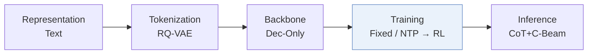
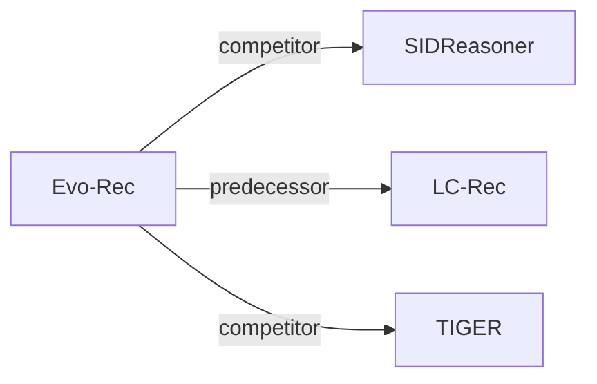

# Evo-Rec

*Learning Better Reasoning for Generative Recommendation with Semantic IDs* — Zhu et al. · arXiv’26

`III. SID 与模型对齐` · `Training` · [论文](https://arxiv.org/abs/2609.29973) · [代码](https://github.com/mengdanzhu/evo-rec) · [矩阵](../../../README.zh.md#iii--training) · [English](../../papers/evo-rec.md)

阅读级别：概览（第 1 级） · 本页目录：[TL;DR](#tldr) · [速览](#速览) · [3. 实验发现](#3-实验发现) · [5. 相关工作](#5-相关工作)

- `Dec-Only`: Decoder-only.
- `Fixed`: SIDs are built first and not changed while the generator trains.
- `NTP → RL`: NTP, then reinforcement learning (GRPO, GBPO, etc.).
- `CoT+C-Beam`: Reasoning followed by constrained beam-search decoding.

### TL;DR

> [!NOTE]
> Evo-Rec 将 SID 与文本和行为对齐，在能提升目标预测的采样推理轨迹上微调，再用受物品库约束的强化学习修正推理过程。

### 速览

| 维度 | 摘要 |
| :-- | :-- |
| 研究问题 | III. SID 与模型对齐：Can the generator read, write, and reason over SIDs, and do the tokenizer and generator work toward the same goal? |
| 核心贡献 | Evo-Rec 将 SID 与文本和行为对齐，在能提升目标预测的采样推理轨迹上微调，再用受物品库约束的强化学习修正推理过程。 |
| 主要改动阶段 | Training |

### 3. 实验发现

实验设置

- **数据集**：Amazon Video Games, Office Products, Industrial and Scientific; 5-core filtering.
  - 出处：Section 4.1.1: [S4.SS1.SSS1.p1](https://arxiv.org/html/2609.29973v1#S4.SS1.SSS1.p1)
- **切分**：Per-user chronological 80%/10%/10% training/validation/test; sliding histories capped at 10.
  - 出处：Section 4.1.1: [S4.SS1.SSS1.p1](https://arxiv.org/html/2609.29973v1#S4.SS1.SSS1.p1)
- **候选集**：full catalog
  - 出处：Section 4.1.1 explicitly ranks against the entire item catalog: [S4.SS1.SSS1.p2](https://arxiv.org/html/2609.29973v1#S4.SS1.SSS1.p2)
- **可见性**：warm; no unseen-item protocol is defined. Item-level visibility to RQ-VAE and SID-language alignment: not reported.
  - 出处：Sections 3.2 and 4.1: [S3.SS2](https://arxiv.org/html/2609.29973v1#S3.SS2) and [S4.SS1.SSS1.p1](https://arxiv.org/html/2609.29973v1#S4.SS1.SSS1.p1)
- **SID 规格**：Three RQ-VAE semantic tokens; codebook sizes and collision handling not reported.
  - 出处：Sections 3.2 and 4.1.3: [S3.SS2.p1](https://arxiv.org/html/2609.29973v1#S3.SS2.p1) and [S4.SS1.SSS3.p1](https://arxiv.org/html/2609.29973v1#S4.SS1.SSS3.p1)
- **推理预算**：Reasoning followed by catalog-trie beam search, beam 10; inference hardware, batch size, reasoning cap, and latency not reported.
  - 出处：Section 4.1.3 separates training rollout settings from inference: [S4.SS1.SSS3.p1](https://arxiv.org/html/2609.29973v1#S4.SS1.SSS3.p1)
- **结果来源**：Original Table 2; baseline numbers quoted from SIDReasoner, with Evo-Rec evaluated on the same split/protocol.
  - 出处：Section 4.1.2 and Table 2: [S4.SS1.SSS2.p1](https://arxiv.org/html/2609.29973v1#S4.SS1.SSS2.p1) and [S4.T2](https://arxiv.org/html/2609.29973v1#S4.T2)

### 5. 相关工作

- **同期对比** · [SIDReasoner](sidreasoner.md): Evo-Rec compares against SIDReasoner and adds utility-selected reasoning plus ranking-aware RL.
  - 出处：Evo-Rec v1, Sections 2.2/4.1.2 and Table 2: https://arxiv.org/html/2609.29973v1#S2.SS2.p1; https://arxiv.org/html/2609.29973v1#S4.SS1.SSS2.p1; https://arxiv.org/html/2609.29973v1#S4.T2.
- **前序工作** · [LC-Rec](lc-rec.md): The SID-language alignment stage explicitly follows LC-Rec before adding reasoning optimization.
  - 出处：Evo-Rec v1, Section 3.2: https://arxiv.org/html/2609.29973v1#S3.SS2.p1.
- **同期对比** · [TIGER](tiger.md): TIGER directly generates SIDs; Evo-Rec generates and optimizes an intermediate reasoning sequence.
  - 出处：Evo-Rec v1, Sections 2.1/3.1 and Table 2: https://arxiv.org/html/2609.29973v1#S2.SS1; https://arxiv.org/html/2609.29973v1#S3.SS1.p1; https://arxiv.org/html/2609.29973v1#S4.T2.

[查看同格全部论文](../../../README.zh.md#iii--training)
