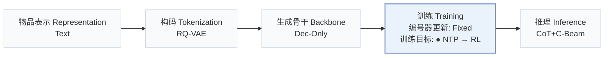
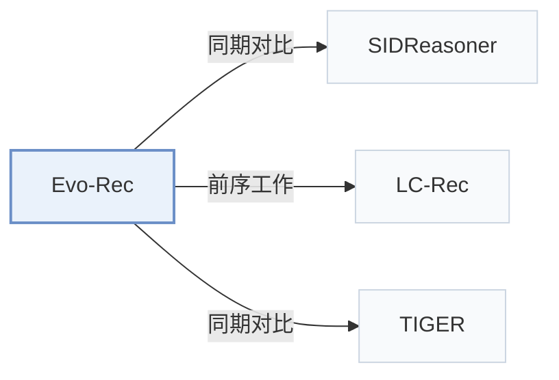

# Evo-Rec

[← 问题 × 阶段矩阵](../../../README.zh.md#iii--training) · [按阶段索引](../index/stages.md) · [按模态找论文](../index/modality.md) · [按领域找论文](../index/domain.md) · [English](../../papers/evo-rec.md) | 中文

| **题目** | *Learning Better Reasoning for Generative Recommendation with Semantic IDs* |
| :-- | :-- |
| **作者** | Zhu et al. |
| **发表** | arXiv’26 |
| **问题与阶段** | `III. SID 与模型对齐` · `训练（Training）` |
| **改动** | ● 训练目标 |
| **构码输入** | `Text` |
| **领域** | `电商` |
| **应用场景** | `一般物品推荐`；`公开数据` |
| **链接** | [论文](https://arxiv.org/abs/2609.29973) · [代码](https://github.com/mengdanzhu/evo-rec) |
| **阅读级别** | 概览（第 1 级） |

**本页目录**：[TL;DR](#tldr) · [3. 实验发现](#3-实验发现) · [5. 相关工作](#5-相关工作)

- `Text`：物品文本元数据（标题、描述、类目或提示词）。
- `RQ-VAE`：残差量化变分自编码器（Residual-Quantized VAE）。
- `Dec-Only`：仅解码器（Decoder-only）自回归架构。
- `Fixed`：先独立训练并冻结编号器，生成器训练期间 SID 保持不变。
- `NTP → RL`：先进行下一 token 预测微调，再执行强化学习（如 GRPO、GBPO 等）。
- `CoT+C-Beam`：显式推理后接合法前缀约束束搜索。

### TL;DR

> [!NOTE]
> Evo-Rec 将 SID 与文本和行为对齐，在能提升目标预测的采样推理轨迹上微调，再用受物品库约束的强化学习修正推理过程。

---

### 3. 实验发现

实验设置

- **数据集**：Amazon Video Games, Office Products, Industrial and Scientific; 5-core filtering.
  - 出处：Section 4.1.1: [S4.SS1.SSS1.p1](https://arxiv.org/html/2609.29973v1#S4.SS1.SSS1.p1)
- **切分**：Per-user chronological 80%/10%/10% training/validation/test; sliding histories capped at 10.
  - 出处：Section 4.1.1: [S4.SS1.SSS1.p1](https://arxiv.org/html/2609.29973v1#S4.SS1.SSS1.p1)
- **候选集**：full catalog
  - 出处：Section 4.1.1 explicitly ranks against the entire item catalog: [S4.SS1.SSS1.p2](https://arxiv.org/html/2609.29973v1#S4.SS1.SSS1.p2)
- **可见性**：warm; no unseen-item protocol is defined. Item-level visibility to RQ-VAE and SID-language alignment: not reported.
  - 出处：Sections 3.2 and 4.1: [S3.SS2](https://arxiv.org/html/2609.29973v1#S3.SS2) and [S4.SS1.SSS1.p1](https://arxiv.org/html/2609.29973v1#S4.SS1.SSS1.p1)
- **SID 规格**：Three RQ-VAE semantic tokens; codebook sizes and collision handling not reported.
  - 出处：Sections 3.2 and 4.1.3: [S3.SS2.p1](https://arxiv.org/html/2609.29973v1#S3.SS2.p1) and [S4.SS1.SSS3.p1](https://arxiv.org/html/2609.29973v1#S4.SS1.SSS3.p1)
- **推理预算**：Reasoning followed by catalog-trie beam search, beam 10; inference hardware, batch size, reasoning cap, and latency not reported.
  - 出处：Section 4.1.3 separates training rollout settings from inference: [S4.SS1.SSS3.p1](https://arxiv.org/html/2609.29973v1#S4.SS1.SSS3.p1)
- **结果来源**：Original Table 2; baseline numbers quoted from SIDReasoner, with Evo-Rec evaluated on the same split/protocol.
  - 出处：Section 4.1.2 and Table 2: [S4.SS1.SSS2.p1](https://arxiv.org/html/2609.29973v1#S4.SS1.SSS2.p1) and [S4.T2](https://arxiv.org/html/2609.29973v1#S4.T2)

---

### 5. 相关工作

- **同期对比** · [SIDReasoner](sidreasoner.md): Evo-Rec compares against SIDReasoner and adds utility-selected reasoning plus ranking-aware RL.
  - 出处：Evo-Rec v1, Sections 2.2/4.1.2 and Table 2: [S2.SS2.p1](https://arxiv.org/html/2609.29973v1#S2.SS2.p1); [S4.SS1.SSS2.p1](https://arxiv.org/html/2609.29973v1#S4.SS1.SSS2.p1); [S4.T2](https://arxiv.org/html/2609.29973v1#S4.T2).
- **前序工作** · [LC-Rec](lc-rec.md): The SID-language alignment stage explicitly follows LC-Rec before adding reasoning optimization.
  - 出处：Evo-Rec v1, Section 3.2: [S3.SS2.p1](https://arxiv.org/html/2609.29973v1#S3.SS2.p1).
- **同期对比** · [TIGER](tiger.md): TIGER directly generates SIDs; Evo-Rec generates and optimizes an intermediate reasoning sequence.
  - 出处：Evo-Rec v1, Sections 2.1/3.1 and Table 2: [S2.SS1](https://arxiv.org/html/2609.29973v1#S2.SS1); [S3.SS1.p1](https://arxiv.org/html/2609.29973v1#S3.SS1.p1); [S4.T2](https://arxiv.org/html/2609.29973v1#S4.T2).

[查看同格全部论文](../../../README.zh.md#iii--training)
