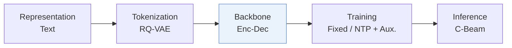
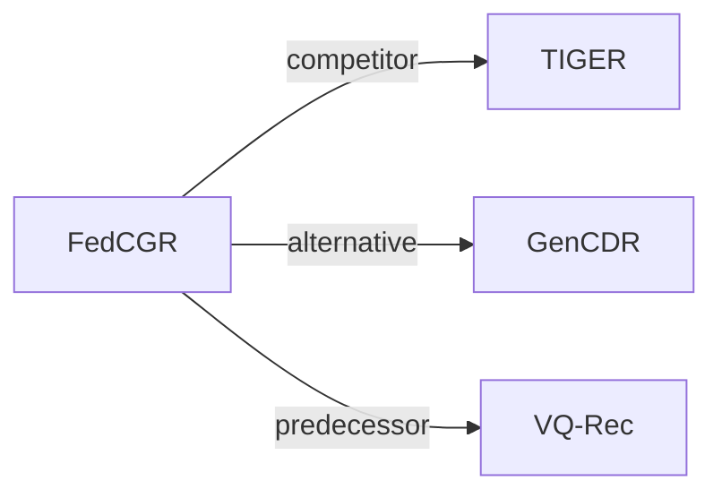

# FedCGR

*Federated Cross-Domain Generative Recommendation* — Liu et al. · CIKM’26

`VI. 泛化` · `Backbone` · [论文](https://arxiv.org/abs/2608.10929) · [代码](https://github.com/ZhuodLiu/FedCGR) · [矩阵](../../../README.zh.md#vi--backbone) · [English](../../papers/fedcgr.md)

阅读级别：概览（第 1 级） · 本页目录：[TL;DR](#tldr) · [速览](#速览) · [3. 实验发现](#3-实验发现) · [5. 相关工作](#5-相关工作)

- `Enc-Dec`: Encoder-decoder.
- `Fixed`: SIDs are built first and not changed while the generator trains.
- `NTP + Aux.`: NTP plus another auxiliary loss.
- `C-Beam`: Constrained beam search.

### TL;DR

> [!NOTE]
> FedCGR 在基于公开元数据构建的共享 SID 上做联邦跨域推荐，注入本地协同证据并按域相关性聚合参数，无需交换私有交互数据。

### 速览

| 维度 | 摘要 |
| :-- | :-- |
| 研究问题 | VI. 泛化：Does it still work for new items, new domains, and shifting interests? |
| 核心贡献 | FedCGR 在基于公开元数据构建的共享 SID 上做联邦跨域推荐，注入本地协同证据并按域相关性聚合参数，无需交换私有交互数据。 |
| 主要改动阶段 | Backbone |

### 3. 实验发现

实验设置

- **数据集**：Amazon Review: Grocery, Beauty, Sports, Food, Kitchen; six cross-domain scenarios FK/GB/GS/FKB/GBS/GKBS; per-domain 5-core filtering.
  - 出处：Section 4.1.1: [S4.SS1.SSS1.p1](https://arxiv.org/html/2608.10929v1#S4.SS1.SSS1.p1) and [S4.SS1.SSS1.p3](https://arxiv.org/html/2608.10929v1#S4.SS1.SSS1.p3)
- **切分**：Per-user leave-one-out: last item test, second-to-last validation, remaining interactions training.
  - 出处：Section 4.1.3: [S4.SS1.SSS3.p1](https://arxiv.org/html/2608.10929v1#S4.SS1.SSS3.p1)
- **候选集**：full catalog; additionally sampled: 999 random negatives per user, fixed once and shared across methods (seed42). Negative-sampling distribution beyond random and history-item exclusion: not reported.
  - 出处：Section 4.1.3: [S4.SS1.SSS3.p1](https://arxiv.org/html/2608.10929v1#S4.SS1.SSS3.p1)
- **可见性**：warm; no unseen-item protocol is defined. Cold-start analysis groups users by training-history length (<=7, 8-15, >=16), not unseen items. SID metadata pretraining excludes private interactions; local CF uses client interaction sequences. Item-level generator/tokenizer/CF exposure: not reported.
  - 出处：Sections 3.1 and 4.4: [S3.SS1.p1](https://arxiv.org/html/2608.10929v1#S3.SS1.p1) and [S4.SS4.p1](https://arxiv.org/html/2608.10929v1#S4.SS4.p1)
- **SID 规格**：Frozen metadata RQ-VAE: 3 levels x 256 codes; colliding items share SID scores, ties broken by validation-set item popularity.
  - 出处：Sections 3.2 and 4.1.4: [S3.SS2.p2](https://arxiv.org/html/2608.10929v1#S3.SS2.p2) and [S4.SS1.SSS4.p1](https://arxiv.org/html/2608.10929v1#S4.SS1.SSS4.p1)
- **推理预算**：Target-domain trie-constrained beam 50; H/NDCG@10; experiments on RTX 4090 GPUs. Inference batch size and latency: not reported.
  - 出处：Sections 3.4 and 4.1.4: [S3.SS4.p2](https://arxiv.org/html/2608.10929v1#S3.SS4.p2) and [S4.SS1.SSS4.p1](https://arxiv.org/html/2608.10929v1#S4.SS1.SSS4.p1)
- **结果来源**：Original Tables 3/4: full-ranking/sampled comparisons; Table 5: ablation; Table 6: diagnostics; Figures 3-5: user activity, sensitivity, communication efficiency.
  - 出处：Tables 3-6 and Figures 3-5: [S4.T3](https://arxiv.org/html/2608.10929v1#S4.T3) and [S4.T4](https://arxiv.org/html/2608.10929v1#S4.T4) and [S4.T5](https://arxiv.org/html/2608.10929v1#S4.T5) and [S4.T6](https://arxiv.org/html/2608.10929v1#S4.T6) and [S4.F3](https://arxiv.org/html/2608.10929v1#S4.F3) and [S4.F4](https://arxiv.org/html/2608.10929v1#S4.F4) and [S4.F5](https://arxiv.org/html/2608.10929v1#S4.F5)

### 5. 相关工作

- **同期对比** · [TIGER](tiger.md): TIGER and its FedAvg/FedProx variants are full-ranking baselines.
  - 出处：FedCGR v1, Section 4.1.2 and Table 3: https://arxiv.org/html/2608.10929v1#S4.SS1.SSS2.p2; https://arxiv.org/html/2608.10929v1#S4.T3.
- **替代方案** · [GenCDR](gencdr.md): GenCDR uses centralized semantic CDR; FedCGR keeps interactions local.
  - 出处：FedCGR v1, Section 5: https://arxiv.org/html/2608.10929v1#S5.p1; https://arxiv.org/html/2608.10929v1#S5.p2.
- **前序工作** · [VQ-Rec](vq-rec.md): Related work identifies VQ-Rec as an earlier transferable quantized-item representation method.
  - 出处：FedCGR v1, Section 5: https://arxiv.org/html/2608.10929v1#S5.p2.

[查看同格全部论文](../../../README.zh.md#vi--backbone)
