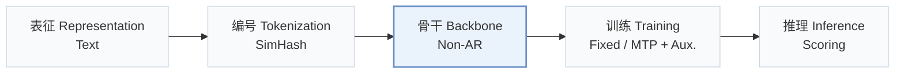
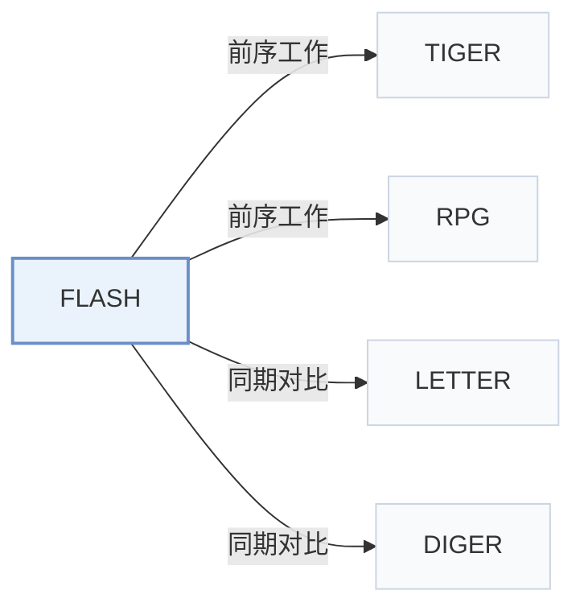

# FLASH

[← 问题 × 阶段矩阵](../../../README.zh.md#iii--backbone) · [按阶段索引](../index/stages.md) · [按模态索引](../index/modality.md) · [English](../../papers/flash.md) | 中文

| **题目** | *Rethinking Semantic ID Construction for Generative Recommendation: SimHash with Parallel Decoding and Semantic Alignment* |
| :-- | :-- |
| **作者** | Liu et al. |
| **发表** | NeurIPS’26 |
| **问题与阶段** | `III. SID 与模型对齐` · `骨干（Backbone）` |
| **链接** | [论文](https://arxiv.org/abs/2610.07402) · [代码](https://github.com/KevinC2015/Flash) |
| **阅读级别** | 概览（第 1 级） |

**本页目录**：[TL;DR](#tldr) · [速览](#速览) · [3. 实验发现](#3-实验发现) · [5. 相关工作](#5-相关工作)

- `Text`：物品文本元数据（标题、描述、类目或提示词）。
- `SimHash`：基于随机超平面的局部敏感哈希（SimHash）编码。
- `Non-AR`：非自回归（Non-autoregressive）并行预测架构。
- `Fixed`：先独立训练并冻结编号器，生成器训练期间 SID 保持不变。
- `MTP + Aux.`：多 token 预测与辅助损失联合优化。
- `Scoring`：直接计算候选物品得分，不逐位生成 SID。

### TL;DR

> [!NOTE]
> FLASH 将哈希方法的劣势归因于自回归解码和刚性离散化，把免训练的 SimHash SID 与并行解码和显式语义对齐结合起来。

---

### 速览

| 维度 | 摘要 |
| :-- | :-- |
| 研究问题 | III. SID 与模型对齐：生成模型能否理解并推理离散 SID，编号器与生成器的优化目标是否一致？ |
| 核心贡献 | FLASH 将哈希方法的劣势归因于自回归解码和刚性离散化，把免训练的 SimHash SID 与并行解码和显式语义对齐结合起来。 |
| 主要改动阶段 | 骨干（Backbone） |

---

### 3. 实验发现

实验设置

- **数据集**：Amazon Beauty, Toys and Games, Sports and Outdoors, CDs and Vinyl; users/items with fewer than 5 interactions removed.
  - 出处：Sections 3.1 and A.1: [S3.SS1.p1](https://arxiv.org/html/2610.07402v1#S3.SS1.p1) and [A1.SS1.p1](https://arxiv.org/html/2610.07402v1#A1.SS1.p1)
- **切分**：Per-user chronological leave-last-out: last item test, penultimate validation, earlier interactions training.
  - 出处：Appendix A.1: [A1.SS1.p1](https://arxiv.org/html/2610.07402v1#A1.SS1.p1)
- **候选集**：not reported
  - 出处：Section 2.3 ranks all candidate items but evaluation sampling is unspecified: [S2.SS3.p1](https://arxiv.org/html/2610.07402v1#S2.SS3.p1) and [S3.SS1.p3](https://arxiv.org/html/2610.07402v1#S3.SS1.p3)
- **可见性**：Warm main protocol; cold-start targets unseen by generator only: randomly select 5% of test-target items and remove all their training interactions. Tokenizer fitting n/a: fixed SimHash on precomputed text embeddings.
  - 出处：Sections 2.1, 3.5 and A.4: [S2.SS1.p1](https://arxiv.org/html/2610.07402v1#S2.SS1.p1) and [S3.SS5.p1](https://arxiv.org/html/2610.07402v1#S3.SS5.p1) and [A1.SS4.p1](https://arxiv.org/html/2610.07402v1#A1.SS4.p1)
- **SID 规格**：SimHash: Beauty 32x256, Toys/Sports 64x256, CDs 64x512; collision counts analyzed, collision disambiguation not reported.
  - 出处：Section 2.1, Table 4 and collision analysis: [S2.SS1.p2](https://arxiv.org/html/2610.07402v1#S2.SS1.p2) and [A1.T4](https://arxiv.org/html/2610.07402v1#A1.T4) and [S3.SS3.SSS1.p3](https://arxiv.org/html/2610.07402v1#S3.SS3.SSS1.p3)
- **推理预算**：Parallel per-position probabilities cached, then candidate scores gathered/summed; K=5/10; beam n/a. Single NVIDIA A100 80GB for experiments; inference batch size and latency not reported.
  - 出处：Sections 2.3, 3.1 and A.3: [S2.SS3.p2](https://arxiv.org/html/2610.07402v1#S2.SS3.p2) and [S3.SS1.p3](https://arxiv.org/html/2610.07402v1#S3.SS1.p3) and [A1.SS3.p4](https://arxiv.org/html/2610.07402v1#A1.SS3.p4)
- **结果来源**：Original Table 1 overall results; Figure 6 cold-start. Most baseline results copied from TIGER/RPG; remaining baselines implemented from public code.
  - 出处：Sections 3.1/3.2 and Figure 6: [S3.SS1.p4](https://arxiv.org/html/2610.07402v1#S3.SS1.p4) and [S3.T1](https://arxiv.org/html/2610.07402v1#S3.T1) and [S3.F6](https://arxiv.org/html/2610.07402v1#S3.F6)

---

### 5. 相关工作

- **前序工作** · [TIGER](tiger.md): FLASH revisits TIGER's SimHash ablation with parallel decoding and semantic alignment.
  - 出处：FLASH v1, Introduction and Table 1: [S1.p2](https://arxiv.org/html/2610.07402v1#S1.p2); [S1.p3](https://arxiv.org/html/2610.07402v1#S1.p3); [S3.T1](https://arxiv.org/html/2610.07402v1#S3.T1).
- **前序工作** · [RPG](rpg.md): FLASH follows RPG's cached-logit scoring, replacing learned OPQ codes with training-free SimHash.
  - 出处：FLASH v1, Sections 2.3 and A.2: [S2.SS3.p2](https://arxiv.org/html/2610.07402v1#S2.SS3.p2); [A1.SS2.p4](https://arxiv.org/html/2610.07402v1#A1.SS2.p4).
- **同期对比** · [LETTER](letter.md): LETTER learns regularized residual codes; FLASH uses fixed hashing with parallel prediction and alignment.
  - 出处：FLASH v1, Section A.2 and Table 1: [A1.SS2.p3](https://arxiv.org/html/2610.07402v1#A1.SS2.p3); [S3.T1](https://arxiv.org/html/2610.07402v1#S3.T1).
- **同期对比** · [DIGER](diger.md): DIGER jointly learns residual quantization and recommendation; FLASH uses a fixed tokenizer.
  - 出处：FLASH v1, Section A.2 and Table 1: [A1.SS2.p3](https://arxiv.org/html/2610.07402v1#A1.SS2.p3); [S3.T1](https://arxiv.org/html/2610.07402v1#S3.T1).

[查看同格全部论文](../../../README.zh.md#iii--backbone)
