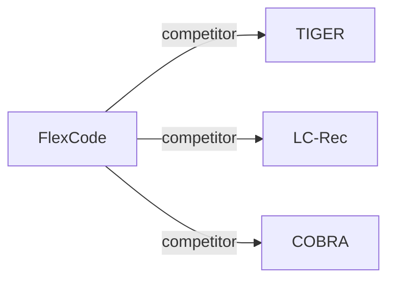

# FlexCode

*Semantics Meet Signals: Dual Codebook Representationl Learning for Generative Recommendation* — Hui et al. · arXiv’25

`I. 信息量` · `Tokenization` · [论文](https://arxiv.org/abs/2511.20673) · [矩阵](../../../README.zh.md#i--tokenization) · [English](../../papers/flexcode.md)

阅读级别：概览（第 1 级） · 本页目录：[TL;DR](#tldr) · [速览](#速览) · [3. 实验发现](#3-实验发现) · [5. 相关工作](#5-相关工作)

- `Dual RQ-VAE`: Two residual-quantized variational autoencoders for separate representation streams.
- `–`: Not reported in the paper.
- `Joint`: The generator loss updates the tokenizer directly.
- `NTP`: Next-token prediction loss only; continuing from a pretrained LLM (SFT) also counts as NTP.

### TL;DR

> [!NOTE]
> FlexCode 通过轻量 MoE 按物品流行度在协同码本与语义码本之间分配固定 token 预算，替代所有物品共用单一码本的做法。

### 速览

| 维度 | 摘要 |
| :-- | :-- |
| 研究问题 | I. 信息量：Do the SIDs, or the model reading them, carry the collaborative and multimodal signals recommendation needs? |
| 核心贡献 | FlexCode 通过轻量 MoE 按物品流行度在协同码本与语义码本之间分配固定 token 预算，替代所有物品共用单一码本的做法。 |
| 主要改动阶段 | Tokenization |

### 3. 实验发现

实验设置

- **数据集**：Amazon-Beauty, Amazon-Sports and Outdoors, KuaiRand-1K; 5-core filtering; proprietary industrial interactions.
  - 出处：Sections 4.1.1 and Public Benchmarks: [S4.SS1.SSS1.p1](https://arxiv.org/html/2511.20673v1#S4.SS1.SSS1.p1) and [S4.SS1.SSS1.Px1.p1](https://arxiv.org/html/2511.20673v1#S4.SS1.SSS1.Px1.p1)
- **切分**：Public: chronological last item test, penultimate validation; industrial: last logged day evaluation, validation not reported.
  - 出处：Section 4.1.1: [S4.SS1.SSS1.p1](https://arxiv.org/html/2511.20673v1#S4.SS1.SSS1.p1) and [S4.SS1.SSS1.Px2.p1](https://arxiv.org/html/2511.20673v1#S4.SS1.SSS1.Px2.p1)
- **候选集**：not reported
  - 出处：Candidate protocol absent from Section 4.1: [S4.SS1](https://arxiv.org/html/2511.20673v1#S4.SS1)
- **可见性**：warm; no unseen-item protocol is defined. Head/tail evaluation concerns popularity; tokenizer and collaborative-encoder item exposure: not reported.
  - 出处：Sections 4.1.1 and 4.3.2: [S4.SS1.SSS1](https://arxiv.org/html/2511.20673v1#S4.SS1.SSS1) and [S4.SS3.SSS2.p1](https://arxiv.org/html/2511.20673v1#S4.SS3.SSS2.p1)
- **SID 规格**：Dual RQ-VAE; total token budgets 3/4/5/6, popularity-dependent allocation; base K=512. Main-experiment depth and collision handling not reported.
  - 出处：Sections 3.1/3.3 and Tables 4-5: [S3.SS1](https://arxiv.org/html/2511.20673v1#S3.SS1) and [S3.SS3.p3](https://arxiv.org/html/2511.20673v1#S3.SS3.p3) and [S5.T4](https://arxiv.org/html/2511.20673v1#S5.T4) and [S5.T5](https://arxiv.org/html/2511.20673v1#S5.T5)
- **推理预算**：Recall/NDCG@5/10; beam width, hardware, inference batch size, latency not reported.
  - 出处：Sections 3.4 and 4.1.3: [S3.SS4](https://arxiv.org/html/2511.20673v1#S3.SS4) and [S4.SS1.SSS3.p1](https://arxiv.org/html/2511.20673v1#S4.SS1.SSS3.p1)
- **结果来源**：Original Table 1: public benchmarks; Figure 2: industrial overall and head/tail results.
  - 出处：Table 1 and Figure 2: [S4.T1](https://arxiv.org/html/2511.20673v1#S4.T1) and [S4.F2](https://arxiv.org/html/2511.20673v1#S4.F2)

### 5. 相关工作

- **同期对比** · [TIGER](tiger.md): Compared semantic-ID baseline; FlexCode separates semantic and collaborative codebooks.
  - 出处：FlexCode v1, Section 4.1.2 and Table 1: https://arxiv.org/html/2511.20673v1#S4.SS1.SSS2.p1; https://arxiv.org/html/2511.20673v1#S4.T1.
- **同期对比** · [LC-Rec](lc-rec.md): Compared semantic-ID baseline; FlexCode allocates tokens by item popularity.
  - 出处：FlexCode v1, Section 4.1.2 and Table 1: https://arxiv.org/html/2511.20673v1#S4.SS1.SSS2.p1; https://arxiv.org/html/2511.20673v1#S4.T1.
- **同期对比** · [COBRA](cobra.md): Compared semantic-ID baseline; FlexCode combines dual codebooks with adaptive routing.
  - 出处：FlexCode v1, Section 4.1.2 and Table 1: https://arxiv.org/html/2511.20673v1#S4.SS1.SSS2.p1; https://arxiv.org/html/2511.20673v1#S4.T1.

[查看同格全部论文](../../../README.zh.md#i--tokenization)
