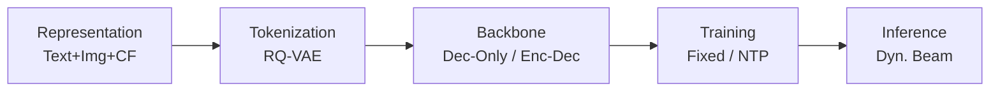
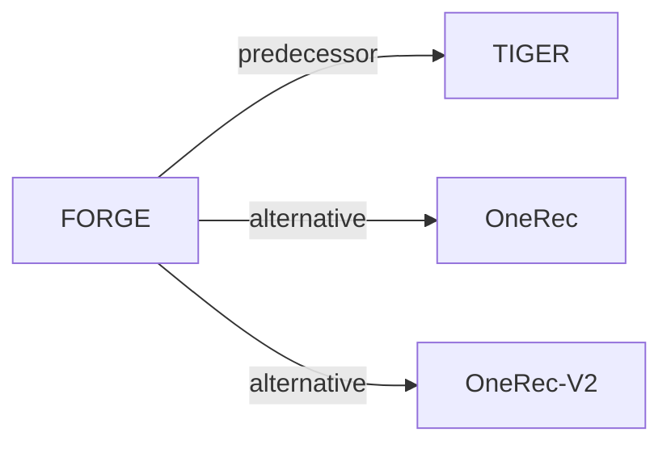

# FORGE

*Forming semantic identifiers for generative retrieval in industrial datasets* — Fu et al. · KDD’26

`范式、系统与基准` · `无单一阶段` · [论文](https://arxiv.org/abs/2509.20904) · [代码](https://github.com/selous123/al_sid) · [矩阵](../../../README.zh.md#范式系统与基准) · [English](../../papers/forge.md)

阅读级别：概览（第 1 级） · 本页目录：[TL;DR](#tldr) · [速览](#速览) · [2. 方法](#2-方法) · [3. 实验发现](#3-实验发现) · [5. 相关工作](#5-相关工作)

- `Dec-Only / Enc-Dec`: Decoder-only and encoder–decoder backbone variants.
- `Fixed`: SIDs are built first and not changed while the generator trains.
- `NTP`: Next-token prediction loss only; continuing from a pretrained LLM (SFT) also counts as NTP.
- `Dyn. Beam`: Dynamic beam search.

### TL;DR

> [!NOTE]
> FORGE 是基准与工业数据集而非新推荐模型：对比不同 SID 构建策略，提出无需训练生成器即可评估 ID 的指标，并开源淘宝数据集。

### 速览

| 维度 | 摘要 |
| :-- | :-- |
| 研究问题 | 范式、系统与基准：Baseline (TIGER), end-to-end multi-stage paradigms, open-source frameworks, benchmarks, and diagnostic resources. |
| 核心贡献 | FORGE 是基准与工业数据集而非新推荐模型：对比不同 SID 构建策略，提出无需训练生成器即可评估 ID 的指标，并开源淘宝数据集。 |
| 主要改动阶段 | 无单一阶段 |

### 2. 方法

### 3. 实验发现

实验设置

- **数据集**：Amazon 2023 Clothing (2,524,981 users / 714,957 items / 12,530,806 interactions; filtering not reported) and AL-GR, released from Taobao (131M users / 251M items / 14B interactions): 40 million behavior records sampled per day over ten consecutive days, sequences truncated to 100 items, with multimodal item embeddings and i2i relations.
  - 出处：Datasets: [S3.SS3.p1](https://arxiv.org/html/2509.20904v3#S3.SS3.p1) and [S3.T1](https://arxiv.org/html/2509.20904v3#S3.T1); AL-GR construction and truncation: [S3.SS3.SSS1.p2](https://arxiv.org/html/2509.20904v3#S3.SS3.SSS1.p2) and [S3.SS3.SSS1.p3](https://arxiv.org/html/2509.20904v3#S3.SS3.SSS1.p3).
- **切分**：AL-GR: temporal stages S1 (4 days), S2 (3 days), S3 (3 days); 100,000 samples from the day after each stage are used for evaluation; training uses the first clicked item as target, evaluation uses all interacted items on the page view. Amazon split: not reported.
  - 出处：Stage split and next-day evaluation: [S3.SS3.SSS1.p2](https://arxiv.org/html/2509.20904v3#S3.SS3.SSS1.p2); targets: [S3.SS3.SSS1.p3](https://arxiv.org/html/2509.20904v3#S3.SS3.SSS1.p3); Amazon split not found in Sections 3-4.
- **候选集**：Beam search generates 1,200 candidate SIDs (3 x 8192 example), mapped back to items; top-K items by score are checked against the page-view targets (HR@20 to HR@1000). Full catalog versus sampled candidates is not otherwise stated.
  - 出处：1,200 candidate SIDs from beam search mapped back to items: [S3.SS4.p1](https://arxiv.org/html/2509.20904v3#S3.SS4.p1).
- **可见性**：warm; no unseen-item protocol is defined. Evaluation uses the next day after each training stage.
  - 出处：Next-day temporal evaluation; unseen-item generalization is cited, not tested: [S3.SS3.SSS1.p2](https://arxiv.org/html/2509.20904v3#S3.SS3.SSS1.p2) and [S2.SS2.p1](https://arxiv.org/html/2509.20904v3#S2.SS2.p1).
- **SID 规格**：Benchmark of configurations: main 3 levels x 8,192 codewords (also 2 x 32,768), RQ-VAE with 64-dimensional codebook over CN-CLIP multimodal features. Collisions are handled by optional post-processing that caps items per SID: KNN-based reassignment (thresholds 25, 10, 5) or Random-5 random assignment of the last codeword; a no-collision-handling variant (noco) is also tested.
  - 出处：Main 3 x 8192 and 2 x 32768: [S4.SS1.SSS1.p1](https://arxiv.org/html/2509.20904v3#S4.SS1.SSS1.p1) and [S4.T11](https://arxiv.org/html/2509.20904v3#S4.T11); collision post-processing: [S3.SS1.SSS3.p1](https://arxiv.org/html/2509.20904v3#S3.SS1.SSS3.p1) and [S4.SS1.SSS4.p3](https://arxiv.org/html/2509.20904v3#S4.SS1.SSS4.p3); RQ-VAE config: [A1.T15](https://arxiv.org/html/2509.20904v3#A1.T15).
- **推理预算**：Beam search producing 1,200 candidate SIDs; generators T5-Base (0.2B), Qwen2.5-0.5B, and Qwen2.5-3B. Training uses 16 (T5) or 32 (Qwen2.5-0.5B) PPU-ZW810E GPUs; inference hardware, batch size, and latency: not reported.
  - 出处：Beam candidates: [S3.SS4.p1](https://arxiv.org/html/2509.20904v3#S3.SS4.p1); models and GPUs (training): [A1.SS2.p1](https://arxiv.org/html/2509.20904v3#A1.SS2.p1) and [A1.T14](https://arxiv.org/html/2509.20904v3#A1.T14).
- **结果来源**：Table 3 (AL-GR SID configurations across stages S1-S3); Table 4 (Amazon); Table 5 (relation sources); Table 9 (encoding methods including RQ-Kmeans); Table 11 (generative search); Table 12 (architectures and model sizes); Figures 3-4 (Embedding HitRate, Gini, and other SID metrics).
  - 出处：Results: [S4.T3](https://arxiv.org/html/2509.20904v3#S4.T3), [S4.T4](https://arxiv.org/html/2509.20904v3#S4.T4), [S4.T5](https://arxiv.org/html/2509.20904v3#S4.T5), [S4.T11](https://arxiv.org/html/2509.20904v3#S4.T11), [S4.T12](https://arxiv.org/html/2509.20904v3#S4.T12); encoding comparison: [S4.SS1.SSS6.p1](https://arxiv.org/html/2509.20904v3#S4.SS1.SSS6.p1).

### 5. 相关工作

- **前序工作** · [TIGER](tiger.md): TIGER introduced RQ-VAE semantic IDs for recommendation; FORGE benchmarks how modality, encoding, and collision post-processing choices for such SIDs affect retrieval at industrial scale.
  - 出处：FORGE v3, Section 2.2 cites Rajput et al. (2023) as the SID adopted in recommendation: https://arxiv.org/html/2509.20904v3#S2.SS2.p1; Section 3.1.2 RQ-VAE encoding: https://arxiv.org/html/2509.20904v3#S3.SS1.SSS2.p1.
- **替代方案** · [OneRec](onerec.md): OneRec encodes items with RQ-Kmeans; FORGE compares this encoding against its RQ-VAE base and Final configurations.
  - 出处：FORGE v3, Section 4.1.6 cites Deng et al. (2025) for RQ-Kmeans and compares it in Table 9: https://arxiv.org/html/2509.20904v3#S4.SS1.SSS6.p1.
- **替代方案** · [OneRec-V2](onerec-v2.md): OneRec-V2 is cited for the same RQ-Kmeans encoding route evaluated in FORGE's encoding comparison.
  - 出处：FORGE v3, Section 4.1.6 cites Zhou et al. (2025): https://arxiv.org/html/2509.20904v3#S4.SS1.SSS6.p1.

[查看同格全部论文](../../../README.zh.md#范式系统与基准)
