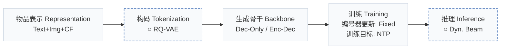
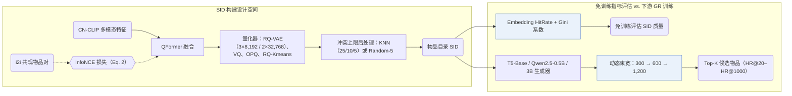
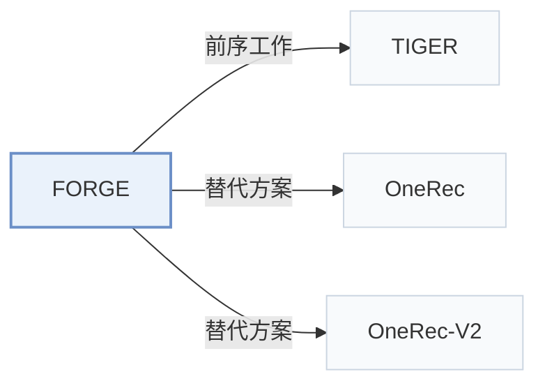

# FORGE

[← 问题 × 阶段矩阵](../../../README.zh.md#范式系统与基准) · [按阶段索引](../index/stages.md) · [按模态找论文](../index/modality.md) · [按领域找论文](../index/domain.md) · [English](../../papers/forge.md) | 中文

| **题目** | *Forming semantic identifiers for generative retrieval in industrial datasets* |
| :-- | :-- |
| **作者** | Fu et al. |
| **发表** | KDD’26 |
| **问题与阶段** | `范式、系统与基准` · `无单一阶段` |
| **改动** | ○ 构码 · ○ 推理 |
| **构码输入** | `Text` + `Img` + `CF` |
| **领域** | `电商` · `搜索` |
| **应用场景** | `一般物品推荐` · `查询驱动检索`；`线上实验或部署` |
| **链接** | [论文](https://arxiv.org/abs/2509.20904) · [代码](https://github.com/selous123/al_sid) |
| **阅读级别** | 阅读笔记（第 2 级） |

**本页目录**：[TL;DR](#tldr) · [速览](#速览) · [1. 为什么重要](#1-为什么重要) · [2. 方法](#2-方法) · [3. 实验发现](#3-实验发现) · [4. 局限与分析](#4-局限与分析) · [5. 相关工作](#5-相关工作)

- `Text+Img+CF`：文本、图像表征结合协同过滤信号。
- `RQ-VAE`：残差量化变分自编码器（Residual-Quantized VAE）。
- `Dec-Only / Enc-Dec`：涵盖仅解码器与编码器-解码器两种骨干变体。
- `Fixed`：先独立训练并冻结编号器，生成器训练期间 SID 保持不变。
- `NTP`：标准下一 token 预测（Next-Token Prediction）交叉熵损失；基于预训练 LLM 的指令微调（SFT）亦归入此类。
- `Dyn. Beam`：按步或按样本动态调整束宽的束搜索。

### TL;DR

> [!NOTE]
> FORGE 在开源淘宝工业数据集上评测不同 SID 构建策略，并提出无需训练生成器即可评估 ID 质量的指标。

---

### 速览

| 维度 | 摘要 |
| :-- | :-- |
| 主要发现 | 在淘宝在线 A/B 测试中，依据 FORGE 基准结论选出的语义 ID（Semantic ID，SID）构建策略使成交笔数提升 0.35%；离线实验表明免训练指标 Embedding HitRate 与 Gini 系数在 250 million 物品的 AL-GR 数据集上与下游 HR@20–HR@1000 强相关（Abstract，Sec. 3.4，Sec. 4.2，Table 3，Fig. 3）。 |
| 局限 | 动态束搜索在最后一步扩展至 1,200 个候选 SID 且未报告实测推理延迟，免训练 SID 质量指标也仅在本基准的数据集内验证了相关性（Sec. 3.2，Sec. 3.4）。 |

---

### 1. 为什么重要

工业级生成式检索（GR）系统在构建语义 ID（SID）时面临特征模态、向量量化器与冲突消解等大量设计选择，而传统做法每次评估编号方案都需高成本训练完整的 GR 生成器（Abstract）。FORGE 在开源的亿级淘宝数据集 AL-GR 上系统评测这些构建策略，并提出无需训练生成器即可预判 SID 质量的评估指标。

> "Specifically, FORGE provides a taxonomy of the SID construction process from several perspectives and validates their impact on downstream GR through offline experiments across diverse settings."（Abstract）

---

### 2. 方法

#### 物品表示

FORGE 用 CN-CLIP 编码物品图文内容并经 QFormer 融合（Sec. 3.1.1）。量化前以物品共现表（`i2i`）中的正例对构造 InfoNCE 对比损失，将用户协同行为模式注入多模态融合表征（Sec. 3.1.1，Eq. 2）。

#### SID 编码与冲突后处理

在 3 层 × 8,192 码字和 2 层 × 32,768 码字等配置下，基准对比了 RQ-VAE 与随机分配、多码本 VQ、OPQ 及 RQ-Kmeans（Sec. 3.1.2，Sec. 4.1，Table 9，Table 11）。为限制单个 SID 挂载的物品数量，进一步采用基于 KNN 的重分配（冲突阈值设为 25、10 或 5）或末位码字 Random-5 随机分配做冲突后处理（Sec. 3.1.3）。

#### 动态束搜索

自回归解码阶段采用逐层扩束的动态束搜索：第 1 步束宽为 300，第 2 步为 600，最后一步（第 3 步）扩展至 1,200，再将候选 SID 映射回物品集合（Sec. 3.2，Sec. 3.4）。

#### SID 质量指标

为免除下游 GR 训练开销，Embedding HitRate 评估量化空间对近邻关系的保持度，Gini 系数衡量物品在 SID 空间中的分布均衡度（Sec. 3.4）。

> "The Gini coefficient measures the deviation between a uniform SID distribution and the actual item distribution, where a lower value indicates a more balanced assignment."（Sec. 3.4）

---

### 3. 实验发现

实验设置

- **数据集**：Amazon 2023 Clothing (2,524,981 users / 714,957 items / 12,530,806 interactions; filtering not reported) and AL-GR, released from Taobao (131M users / 251M items / 14B interactions): 40 million behavior records sampled per day over ten consecutive days, sequences truncated to 100 items, with multimodal item embeddings and i2i relations.
  - 出处：Datasets: [S3.SS3.p1](https://arxiv.org/html/2509.20904v3#S3.SS3.p1) and [S3.T1](https://arxiv.org/html/2509.20904v3#S3.T1); AL-GR construction and truncation: [S3.SS3.SSS1.p2](https://arxiv.org/html/2509.20904v3#S3.SS3.SSS1.p2) and [S3.SS3.SSS1.p3](https://arxiv.org/html/2509.20904v3#S3.SS3.SSS1.p3).
- **切分**：AL-GR: temporal stages S1 (4 days), S2 (3 days), S3 (3 days); 100,000 samples from the day after each stage are used for evaluation; training uses the first clicked item as target, evaluation uses all interacted items on the page view. Amazon split: not reported.
  - 出处：Stage split and next-day evaluation: [S3.SS3.SSS1.p2](https://arxiv.org/html/2509.20904v3#S3.SS3.SSS1.p2); targets: [S3.SS3.SSS1.p3](https://arxiv.org/html/2509.20904v3#S3.SS3.SSS1.p3); Amazon split not found in Sections 3-4.
- **候选集**：Beam search generates 1,200 candidate SIDs (3 x 8192 example), mapped back to items; top-K items by score are checked against the page-view targets (HR@20 to HR@1000). Full catalog versus sampled candidates is not otherwise stated.
  - 出处：1,200 candidate SIDs from beam search mapped back to items: [S3.SS4.p1](https://arxiv.org/html/2509.20904v3#S3.SS4.p1).
- **可见性**：warm; no unseen-item protocol is defined. Evaluation uses the next day after each training stage.
  - 出处：Next-day temporal evaluation; unseen-item generalization is cited, not tested: [S3.SS3.SSS1.p2](https://arxiv.org/html/2509.20904v3#S3.SS3.SSS1.p2) and [S2.SS2.p1](https://arxiv.org/html/2509.20904v3#S2.SS2.p1).
- **SID 规格**：Benchmark of configurations: main 3 levels x 8,192 codewords (also 2 x 32,768), RQ-VAE with 64-dimensional codebook over CN-CLIP multimodal features. Collisions are handled by optional post-processing that caps items per SID: KNN-based reassignment (thresholds 25, 10, 5) or Random-5 random assignment of the last codeword; a no-collision-handling variant (noco) is also tested.
  - 出处：Main 3 x 8192 and 2 x 32768: [S4.SS1.SSS1.p1](https://arxiv.org/html/2509.20904v3#S4.SS1.SSS1.p1) and [S4.T11](https://arxiv.org/html/2509.20904v3#S4.T11); collision post-processing: [S3.SS1.SSS3.p1](https://arxiv.org/html/2509.20904v3#S3.SS1.SSS3.p1) and [S4.SS1.SSS4.p3](https://arxiv.org/html/2509.20904v3#S4.SS1.SSS4.p3); RQ-VAE config: [A1.T15](https://arxiv.org/html/2509.20904v3#A1.T15).
- **推理预算**：Beam search producing 1,200 candidate SIDs; generators T5-Base (0.2B), Qwen2.5-0.5B, and Qwen2.5-3B. Training uses 16 (T5) or 32 (Qwen2.5-0.5B) PPU-ZW810E GPUs; inference hardware, batch size, and latency: not reported.
  - 出处：Beam candidates: [S3.SS4.p1](https://arxiv.org/html/2509.20904v3#S3.SS4.p1); models and GPUs (training): [A1.SS2.p1](https://arxiv.org/html/2509.20904v3#A1.SS2.p1) and [A1.T14](https://arxiv.org/html/2509.20904v3#A1.T14).
- **结果来源**：Table 3 (AL-GR SID configurations across stages S1-S3); Table 4 (Amazon); Table 5 (relation sources); Table 9 (encoding methods including RQ-Kmeans); Table 11 (generative search); Table 12 (architectures and model sizes); Figures 3-4 (Embedding HitRate, Gini, and other SID metrics).
  - 出处：Results: [S4.T3](https://arxiv.org/html/2509.20904v3#S4.T3), [S4.T4](https://arxiv.org/html/2509.20904v3#S4.T4), [S4.T5](https://arxiv.org/html/2509.20904v3#S4.T5), [S4.T11](https://arxiv.org/html/2509.20904v3#S4.T11), [S4.T12](https://arxiv.org/html/2509.20904v3#S4.T12); encoding comparison: [S4.SS1.SSS6.p1](https://arxiv.org/html/2509.20904v3#S4.SS1.SSS6.p1).

- 免训练指标与 HR 强相关：在 AL-GR（S1–S3 三个时间阶段）与 Amazon Clothing 的多组配置上，Embedding HitRate 和 Gini 系数均与下游生成式检索的命中率（HR@20 至 HR@1000）呈强相关（Sec. 3.4，Sec. 4.2，Table 3，Table 4，Fig. 3，Fig. 4）。

  > "Our experiments show that both metrics are strongly correlated with HR, thus enabling efficient SID evaluation without additional GR training."（Sec. 3.4）

- 模态、量化器与骨干对比：引入 `i2i` 协同对比对齐（Table 5）、采用 RQ-VAE 替代 RQ-Kmeans（Table 9）、加入冲突后处理（Table 3），以及将生成骨干从 T5-Base（0.2B）扩展至 Qwen2.5-0.5B 和 Qwen2.5-3B（Table 12）均带来稳定的检索 HR 提升。
- 工业数据集开源与全量部署：论文开源包含 14 billion 次交互、250 million 个多模态物品的淘宝数据集 AL-GR（Table 1 具体统计为 131M 用户 / 251M 物品）；基于基准结论选定的 SID 策略已在淘宝全量部署，在线 A/B 测试成交笔数提升 0.35%（Abstract，Sec. 3.3）。

---

### 4. 局限与分析

**Our analysis.**

- Embedding HitRate 与 Gini 系数同下游 HR 的强相关性建立在冻结编号器与后处理变体之上；若编号器与生成器端到端联合训练，这一相关性需重新检验。
- 最后一步束宽放大至 1,200 个候选 SID 显著增加了束搜索与物品查表开销，而论文未报告在线推理延迟。
- OneRec 采用 `R-KM` 编码，OneRec-V2 采用 `R-KM†` 编码；FORGE 在 Table 9 中将 `RQ-Kmeans` 与 `RQ-VAE` 直接对比，并选定带冲突后处理的 `RQ-VAE` 作为主力配置。

---

### 5. 相关工作

- **前序工作** · [TIGER](tiger.md): TIGER introduced RQ-VAE semantic IDs for recommendation; FORGE benchmarks how modality, encoding, and collision post-processing choices for such SIDs affect retrieval at industrial scale.
  - 出处：FORGE v3, Section 2.2 cites Rajput et al. (2023) as the SID adopted in recommendation: [S2.SS2.p1](https://arxiv.org/html/2509.20904v3#S2.SS2.p1); Section 3.1.2 RQ-VAE encoding: [S3.SS1.SSS2.p1](https://arxiv.org/html/2509.20904v3#S3.SS1.SSS2.p1).
- **替代方案** · [OneRec](onerec.md): OneRec encodes items with RQ-Kmeans; FORGE compares this encoding against its RQ-VAE base and Final configurations.
  - 出处：FORGE v3, Section 4.1.6 cites Deng et al. (2025) for RQ-Kmeans and compares it in Table 9: [S4.SS1.SSS6.p1](https://arxiv.org/html/2509.20904v3#S4.SS1.SSS6.p1).
- **替代方案** · [OneRec-V2](onerec-v2.md): OneRec-V2 is cited for the same RQ-Kmeans encoding route evaluated in FORGE's encoding comparison.
  - 出处：FORGE v3, Section 4.1.6 cites Zhou et al. (2025): [S4.SS1.SSS6.p1](https://arxiv.org/html/2509.20904v3#S4.SS1.SSS6.p1).

[查看同格全部论文](../../../README.zh.md#范式系统与基准)
