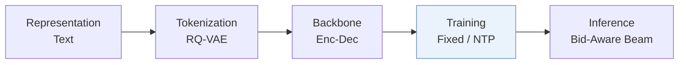
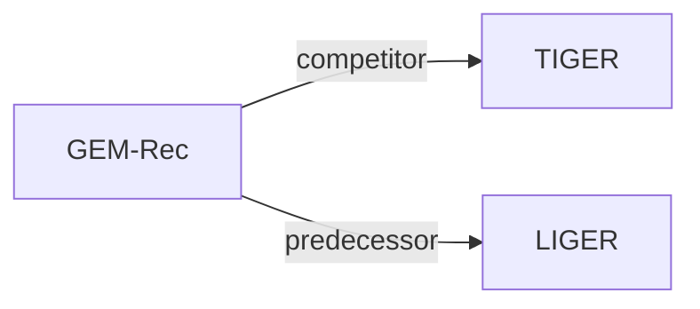

# GEM-Rec

*One Model, Two Markets: Bid-Aware Generative Recommendation* — Jiang et al. · arXiv’26

`IV. 实用目标` · `Training` · [论文](https://arxiv.org/abs/2603.22231) · [矩阵](../../../README.zh.md#iv--training) · [English](../../papers/gem-rec.md)

阅读级别：概览（第 1 级） · 本页目录：[TL;DR](#tldr) · [速览](#速览) · [3. 实验发现](#3-实验发现) · [5. 相关工作](#5-相关工作)

- `Enc-Dec`: Encoder-decoder.
- `Fixed`: SIDs are built first and not changed while the generator trains.
- `NTP`: Next-token prediction loss only; continuing from a pretrained LLM (SFT) also counts as NTP.
- `Bid-Aware Beam`: Beam search whose scores incorporate bid information.

### TL;DR

> [!NOTE]
> GEM-Rec 加入决定是否展示广告的控制 token，以及在解码时注入实时出价的出价感知解码机制，用单一生成器兼顾语义相关性与广告收益。

### 速览

| 维度 | 摘要 |
| :-- | :-- |
| 研究问题 | IV. 实用目标：Are training and search aimed at what users and the platform value, rather than at token likelihood? |
| 核心贡献 | GEM-Rec 加入决定是否展示广告的控制 token，以及在解码时注入实时出价的出价感知解码机制，用单一生成器兼顾语义相关性与广告收益。 |
| 主要改动阶段 | Training |

### 3. 实验发现

实验设置

- **数据集**：Synthetic marketplaces built on Steam and Amazon Beauty, Sports, and Toys, each with 5-core filtering. A random 20% of items is designated sponsored and given log-normal bids (mu=0, sigma=0.2, clipped and normalized to [0.1, 1.0]); ads are injected into organic histories by a prefix-match relevance filter (depth 2, relaxed to 1), softmax bid selection (tau=0.1), and frequency capping (p=0.4, r=0.05; high-density ablation p=1.0, r=0.5). Main ad density about 3-6%; ablation about 10-20%. Retained corpus sizes: not reported.
  - 出处：Base datasets and sponsored subset: [S5.SS1.p3](https://arxiv.org/html/2603.22231v1#S5.SS1.p3); 5-core filtering: [A2.SS1.p1](https://arxiv.org/html/2603.22231v1#A2.SS1.p1); bids and ad-injection policy: [A4.SS1.p1](https://arxiv.org/html/2603.22231v1#A4.SS1.p1), [A4.SS2.p2](https://arxiv.org/html/2603.22231v1#A4.SS2.p2), [A4.SS2.p3](https://arxiv.org/html/2603.22231v1#A4.SS2.p3), [A4.SS2.p4](https://arxiv.org/html/2603.22231v1#A4.SS2.p4).
- **切分**：not reported (the model is evaluated on test-set trajectories generated by the simulated policy; the train/validation/test construction is not described).
  - 出处：Evaluation protocols name only test-set trajectories, not the split rule: [S5.SS2.p1](https://arxiv.org/html/2603.22231v1#S5.SS2.p1) and [S5.I2.i1.p1](https://arxiv.org/html/2603.22231v1#S5.I2.i1.p1).
- **候选集**：not reported (full catalog versus sampled evaluation candidates); ads are generated by beam search under a sampled slot flag.
  - 出处：Metrics only: [S5.I2.i1.p1](https://arxiv.org/html/2603.22231v1#S5.I2.i1.p1) and [S5.I2.i2.p1](https://arxiv.org/html/2603.22231v1#S5.I2.i2.p1).
- **可见性**：warm; no unseen-item protocol is defined.
  - 出处：No unseen-item protocol; synthetic logs from the same item universe: [S5.SS1.p3](https://arxiv.org/html/2603.22231v1#S5.SS1.p3).
- **SID 规格**：3-level RQ-VAE x 256 codewords over Sentence-T5 item embeddings, plus a leading organic/sponsored flag token. Collision handling: not reported; the theoretical analysis assumes a one-to-one item-SID mapping.
  - 出处：RQ-VAE depth 3 x 256 on Sentence-T5 embeddings: [A2.SS2.p1](https://arxiv.org/html/2603.22231v1#A2.SS2.p1) and [A6.p2](https://arxiv.org/html/2603.22231v1#A6.p2); one-to-one item-SID mapping is an assumption of the proofs: [A3.p2](https://arxiv.org/html/2603.22231v1#A3.p2).
- **推理预算**：Hierarchical decoding: the organic/ad flag is sampled from modulated logits, then beam search of width K generates the SID; numerical K not reported. Bid modulation strength swept over lambda in [0, 10]. One NVIDIA A100 for all experiments; inference batch size and latency: not reported. Generated ad sequences are 100% valid (Table 4).
  - 出处：Flag sampling then width-K content beam search: [S4.I2.i1.p1](https://arxiv.org/html/2603.22231v1#S4.I2.i1.p1) and [S4.I2.i2.p1](https://arxiv.org/html/2603.22231v1#S4.I2.i2.p1); hardware: [A2.SS2.p1](https://arxiv.org/html/2603.22231v1#A2.SS2.p1) and [A6.p3](https://arxiv.org/html/2603.22231v1#A6.p3); validity: [A7.T4](https://arxiv.org/html/2603.22231v1#A7.T4).
- **结果来源**：Table 1 (marketplace performance versus TIGER; full version in Appendix G, Table 3); Table 2 and Appendix H, Tables 5-8 (bid-shock response); Figures 2-7 (Pareto frontiers, steerability, organic integrity, high-ad-rate ablations); Table 4 (generative validity).
  - 出处：Main: [S5.T1](https://arxiv.org/html/2603.22231v1#S5.T1); full results: [A7.T3](https://arxiv.org/html/2603.22231v1#A7.T3); volatility: [S5.T2](https://arxiv.org/html/2603.22231v1#S5.T2), [A8.T5](https://arxiv.org/html/2603.22231v1#A8.T5), [A8.T6](https://arxiv.org/html/2603.22231v1#A8.T6), [A8.T7](https://arxiv.org/html/2603.22231v1#A8.T7), [A8.T8](https://arxiv.org/html/2603.22231v1#A8.T8).

### 5. 相关工作

- **同期对比** · [TIGER](tiger.md): TIGER is the pure-utility generative baseline without sponsored slots; GEM-Rec adds an organic/ad flag token and inference-time bid modulation of the logits.
  - 出处：GEM-Rec v1, Section 5.3: https://arxiv.org/html/2603.22231v1#S5.SS3.p1; Table 1 and Appendix Table 3: https://arxiv.org/html/2603.22231v1#S5.T1 and https://arxiv.org/html/2603.22231v1#A7.T3.
- **前序工作** · [LIGER](liger.md): GEM-Rec builds on LIGER's reproduction of the TIGER architecture and 5-core preprocessing, without LIGER's own training objectives.
  - 出处：GEM-Rec v1, Section 5.4 adopts the codebase of Yang et al. (2024): https://arxiv.org/html/2603.22231v1#S5.SS4.p1; Appendix B.1 follows its 5-core filtering: https://arxiv.org/html/2603.22231v1#A2.SS1.p1; Appendix F matches its model scale: https://arxiv.org/html/2603.22231v1#A6.p1.

[查看同格全部论文](../../../README.zh.md#iv--training)
