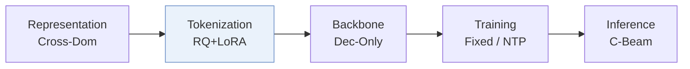
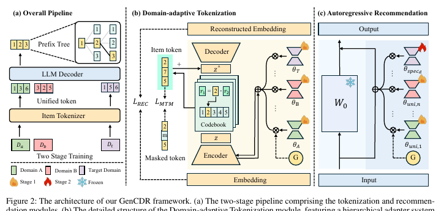
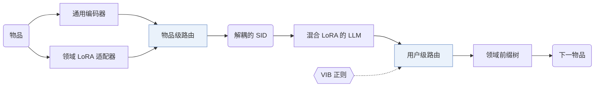
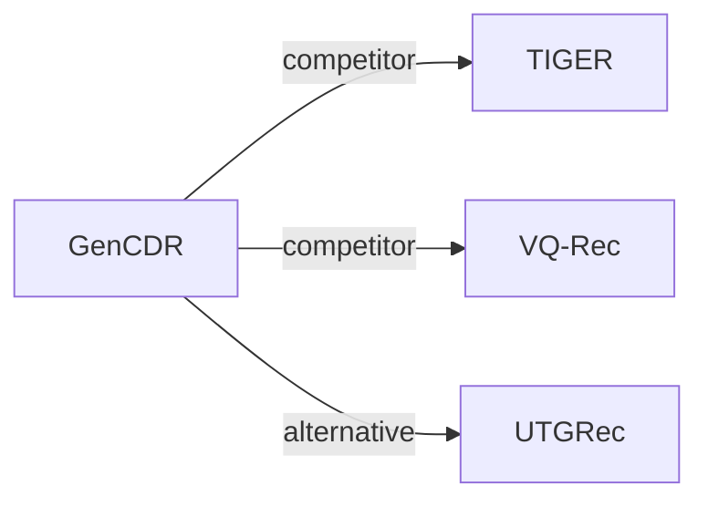

# GenCDR

| **题目** | *From ids to semantics: A generative framework for cross-domain recommendation with adaptive semantic tokenization* |
| :-- | :-- |
| **作者** | Hu et al. |
| **会议** | AAAI’26 |
| **问题与阶段** | `VI. 泛化` · `Tokenization` |
| **链接** | [论文](https://arxiv.org/abs/2511.08006) · [代码](https://github.com/hupeiyu21/GenCDR) · [矩阵](../../../README.zh.md#vi--tokenization) · [English](../../papers/gencdr.md) |
| **阅读级别** | 阅读笔记（第 2 级） |

本页目录：[TL;DR](#tldr) · [速览](#速览) · [1. 为什么重要](#1-为什么重要) · [2. 方法](#2-方法) · [3. 实验发现](#3-实验发现) · [4. 局限与分析](#4-局限与分析) · [5. 相关工作](#5-相关工作)

- `Dec-Only`: Decoder-only.
- `Fixed`: SIDs are built first and not changed while the generator trains.
- `NTP`: Next-token prediction loss only; continuing from a pretrained LLM (SFT) also counts as NTP.
- `C-Beam`: Constrained beam search.

### TL;DR

> [!NOTE]
> GenCDR 在通用编码器与域适配器之间路由以生成域解耦的 SID，并在域感知前缀树上解码，不依赖跨域共享的用户或物品 ID。

---

### 速览

| 维度 | 摘要 |
| :-- | :-- |
| 研究问题 | VI. 泛化：Does it still work for new items, new domains, and shifting interests? |
| 核心贡献 | GenCDR 在通用编码器与域适配器之间路由以生成域解耦的 SID，并在域感知前缀树上解码，不依赖跨域共享的用户或物品 ID。 |
| 主要改动阶段 | Tokenization |
| 局限 | 每个领域都要加一个自己的编号器适配器和一棵离线前缀树（Domain-adaptive Tokenization，Domain-aware Prefix-tree）。 |

---

### 1. 为什么重要

传统跨域推荐依赖共享的用户或物品 ID，而大多数真实场景没有这样的 ID（Abstract）。作者指出，基于 LLM 的方法面临物品 ID 编号的两难，领域特有的建模也不够（Abstract）。GenCDR 把领域适配放进编号器本身。

> "GenCDR first employs a Domain-adaptive Tokenization module, which generates disentangled semantic IDs for items by dynamically routing between a universal encoder and domain-specific adapters."（Abstract）（在通用编码器和领域适配器之间动态路由，生成解耦的语义 ID。）

---

### 2. 方法

#### 领域自适应编号

每个领域一个 LoRA 适配器，和通用编码器并列，学习领域特有的表示（Domain-adaptive Tokenization）。

> "To effectively integrate universal and domain-specific representations, we propose an Item-level Dynamic Semantic Routing Network that adaptively balances these representations on a per-item basis."（Domain-adaptive Tokenization）（物品级动态路由网络按物品平衡通用表示和领域表示。）

作者认为，按物品路由能减少静态融合带来的负迁移（Domain-adaptive Tokenization）。

#### 跨域自回归推荐

生成器先在所有领域的数据上训练一组混合 LoRA 适配器，捕捉与领域无关的兴趣（Cross-domain Autoregressive Recommendation）。再用一个以变分信息瓶颈（VIB）正则的用户级路由网络，融合通用兴趣和领域兴趣（Cross-domain Autoregressive Recommendation）。

#### 领域感知前缀树

每个领域离线建一棵前缀树，存放编号器给出的全部合法 ID 序列，用来约束解码（Domain-aware Prefix-tree）。

> "Finally, a Domain-aware Prefix-tree enables efficient and accurate generation."（Abstract）（领域感知前缀树让生成又快又准。）

---

### 3. 实验发现

实验设置

- **数据集**：Three cross-domain pairs: Amazon Sports-Clothing (35,598 / 39,387 users; 18,357 / 23,033 items; item overlap 1.73%, 704), Amazon Phones-Electronics (27,879 / 192,403 users; 10,429 / 63,001 items; overlap 0.55%, 404), and Douban Books-Movies (1,713 / 2,628 users; 8,601 / 20,964 items; overlap 7.48%, 2,058). Filtering rules: not reported.
  - 出处：Domain pairs: [Sx5.SSx1.p1](https://arxiv.org/html/2511.08006v2#Sx5.SSx1.p1); statistics and overlap after merging: [Sx5.T1](https://arxiv.org/html/2511.08006v2#Sx5.T1); no filtering rule found in Section 5.1.
- **切分**：Chronological leave-last-out per user: last item for test, second-to-last for validation; checkpoint chosen by validation Recall@10.
  - 出处：Chronological leave-last-out allocation: [Sx5.SSx1.p2](https://arxiv.org/html/2511.08006v2#Sx5.SSx1.p2); checkpoint selection: [Sx5.SSx1.p6](https://arxiv.org/html/2511.08006v2#Sx5.SSx1.p6).
- **候选集**：not reported (full catalog versus sampled evaluation candidates); generation is restricted to the target domain's prefix tree.
  - 出处：Metrics only: [Sx5.SSx1.p6](https://arxiv.org/html/2511.08006v2#Sx5.SSx1.p6).
- **可见性**：warm; no unseen-item protocol is defined. The RQ-VAE is pre-trained on the textual features of all items.
  - 出处：Standard split with no cold-start experiment: [Sx5.SSx1.p2](https://arxiv.org/html/2511.08006v2#Sx5.SSx1.p2); RQ-VAE is pre-trained on all items: [Sx4.SSx1.SSSx1.p1](https://arxiv.org/html/2511.08006v2#Sx4.SSx1.SSSx1.p1).
- **SID 规格**：Universal RQ-VAE with M codebooks over item text embeddings, plus domain-specific LoRA adapters and an item-level router; numerical M and codebook size: not reported. Collision handling: not reported.
  - 出处：M codebooks, no numerical M or codebook size: [Sx4.SSx1.SSSx1.p1](https://arxiv.org/html/2511.08006v2#Sx4.SSx1.SSSx1.p1); adapters and router: [Sx5.SSx1.p7](https://arxiv.org/html/2511.08006v2#Sx5.SSx1.p7).
- **推理预算**：Qwen2.5-7B with LoRA experts; decoding constrained by a per-domain prefix tree with masked softmax; beam width not reported. Training on NVIDIA H200 GPUs; inference batch size not reported. Figure 6 (Qwen2.5-0.5B) reports runtime memory and inference time versus item-pool size against TriCDR and TIGER, stating constant cost; numerical latencies are only in the figure.
  - 出处：Domain-aware prefix tree: [Sx4.SSx2.SSSx4.p1](https://arxiv.org/html/2511.08006v2#Sx4.SSx2.SSSx4.p1); backbone and GPUs: [Sx5.SSx1.p7](https://arxiv.org/html/2511.08006v2#Sx5.SSx1.p7); scalability figure: [Sx5.SSx6.p2](https://arxiv.org/html/2511.08006v2#Sx5.SSx6.p2) and [Sx5.F6](https://arxiv.org/html/2511.08006v2#Sx5.F6).
- **结果来源**：Table 2 (six domains across three pairs versus single-domain, generative, and cross-domain baselines); Table 3 (ablations); Figures 3-6 (t-SNE, sensitivity, training efficiency, inference scalability).
  - 出处：Main: [Sx5.T2](https://arxiv.org/html/2511.08006v2#Sx5.T2); ablation: [Sx5.T3](https://arxiv.org/html/2511.08006v2#Sx5.T3); efficiency: [Sx5.F5](https://arxiv.org/html/2511.08006v2#Sx5.F5) and [Sx5.F6](https://arxiv.org/html/2511.08006v2#Sx5.F6).

- 主实验：GenCDR 在多个真实数据集上好于基线（Abstract）。
- 消融：Table 3 分别去掉 MTM 组件、适配器、领域专家、通用专家、MoE 门和前缀树（Table 3）。

---

### 4. 局限与分析

**Our analysis.**

- 前缀树由编号器的输出离线构建。由此推断，新物品要重新编号并重建前缀树。
- VQ-Rec 也做跨域迁移（`Multi-Dom`），用 `OPQ` 码和 `Scoring`；GenCDR 用 `Dec-Only` LLM 生成 `RQ+LoRA` 码。

---

### 5. 相关工作

- **同期对比** · [TIGER](tiger.md): TIGER tokenizes one domain with a single RQ-VAE; GenCDR adds domain-specific tokenizer adapters with item-level routing and an LLM with universal and domain LoRA experts.
  - 出处：GenCDR v2, baselines: https://arxiv.org/html/2511.08006v2#Sx5.SSx1.p4 and https://arxiv.org/html/2511.08006v2#Sx5.I3.i2.I1.i2.p1; Table 2: https://arxiv.org/html/2511.08006v2#Sx5.T2; inference scalability in Figure 6: https://arxiv.org/html/2511.08006v2#Sx5.F6.
- **同期对比** · [VQ-Rec](vq-rec.md): VQ-Rec transfers across domains with discrete codes in a discriminative model; GenCDR generates domain-adapted semantic IDs autoregressively.
  - 出处：GenCDR v2, baselines: https://arxiv.org/html/2511.08006v2#Sx5.I3.i2.I1.i1.p1; Table 2: https://arxiv.org/html/2511.08006v2#Sx5.T2.
- **替代方案** · [UTGRec](utgrec.md): UTGRec is cited for item tokenization in generative recommendation that GenCDR describes as developed for single domains; GenCDR targets multi-domain tokenization with domain adapters.
  - 出处：GenCDR v2, Related Work cites Zheng et al. (2025): https://arxiv.org/html/2511.08006v2#Sx2.p2; not a baseline in Table 2.

[查看同格全部论文](../../../README.zh.md#vi--tokenization)
