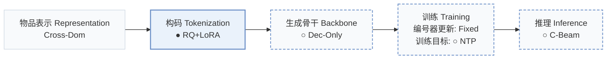
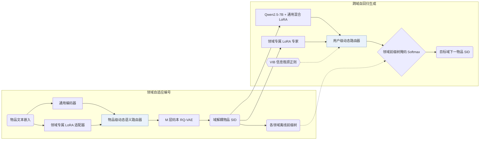
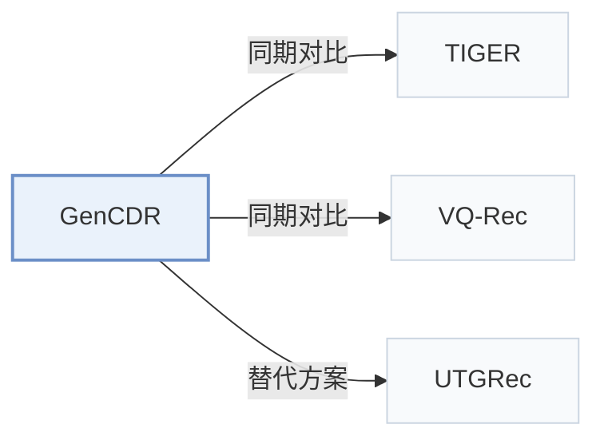

# GenCDR

[← 问题 × 阶段矩阵](../../../README.zh.md#vi--tokenization) · [按阶段索引](../index/stages.md) · [按模态找论文](../index/modality.md) · [按领域找论文](../index/domain.md) · [English](../../papers/gencdr.md) | 中文

| **题目** | *From ids to semantics: A generative framework for cross-domain recommendation with adaptive semantic tokenization* |
| :-- | :-- |
| **作者** | Hu et al. |
| **发表** | AAAI’26 |
| **问题与阶段** | `VI. 泛化` · `构码（Tokenization）` |
| **改动** | ● 构码 · ○ 生成骨干 · ○ 训练目标 · ○ 推理 |
| **构码输入** | `Text` + `unknown` |
| **领域** | `电商` · `图书与有声书` · `电影` |
| **特殊设置** | `跨域迁移` |
| **链接** | [论文](https://arxiv.org/abs/2511.08006) · [代码](https://github.com/hupeiyu21/GenCDR) |
| **阅读级别** | 阅读笔记（第 2 级） |

**本页目录**：[TL;DR](#tldr) · [速览](#速览) · [1. 为什么重要](#1-为什么重要) · [2. 方法](#2-方法) · [3. 实验发现](#3-实验发现) · [4. 局限与分析](#4-局限与分析) · [5. 相关工作](#5-相关工作)

- `Cross-Dom`：跨多个领域迁移或共享的物品表征。
- `RQ+LoRA`：带领域自适应 LoRA 模块的残差量化。
- `Dec-Only`：仅解码器（Decoder-only）自回归架构。
- `Fixed`：先独立训练并冻结编号器，生成器训练期间 SID 保持不变。
- `NTP`：标准下一 token 预测（Next-Token Prediction）交叉熵损失；基于预训练 LLM 的指令微调（SFT）亦归入此类。
- `C-Beam`：受合法物品集合约束的束搜索（Constrained beam search）。

### TL;DR

> [!NOTE]
> GenCDR 在通用编码器与域适配器之间路由以生成域解耦的 SID，并在域感知前缀树上解码，不依赖跨域共享的用户或物品 ID。

---

### 速览

| 维度 | 摘要 |
| :-- | :-- |
| 主要发现 | 在 Amazon Sports-Clothing（物品重合率 1.73%）、Phones-Electronics（0.55%）与 Douban Books-Movies（7.48%）三组低重合跨域对的六个领域上，GenCDR 在 Recall@10 与 NDCG@10 上全面优于单域、生成式（TIGER、VQ-Rec）和跨域基线，且推理耗时随物品库规模扩大保持恒定（Sec. 5.1，Sec. 5.6，Table 1，Table 2，Table 3，Fig. 6）。 |
| 局限 | 每个领域均需维护独立的 LoRA 编号器适配器与离线前缀树，且论文未报告 RQ-VAE 码本层数 M、码本大小、冲突处理策略及解码束宽（Domain-adaptive Tokenization，Domain-aware Prefix-tree，Sec. 5.1）。 |

---

### 1. 为什么重要

传统跨域推荐依赖重叠用户或共享物品 ID，而多数真实跨平台场景并不具备共享 ID；单编号器生成式方法又难以兼顾跨域共性语义与领域专有特征（Abstract）。GenCDR 将跨域自适应同时引入语义 ID（Semantic ID，SID）编号器与自回归 LLM 生成器，结合动态路由与领域前缀树完成跨域生成。

> "GenCDR first employs a Domain-adaptive Tokenization module, which generates disentangled semantic IDs for items by dynamically routing between a universal encoder and domain-specific adapters."（Abstract）

---

### 2. 方法

#### 领域自适应编号

在跨全部领域预训练的通用编码器旁，GenCDR 为每个领域挂载一个专属 LoRA 适配器以提取领域特有语义，再通过物品级动态语义路由网络按物品融合通用表征与领域表征，最后送入 $`M`$ 层码本的 RQ-VAE 量化为离散 SID（Domain-adaptive Tokenization）。按物品动态路由减轻了静态融合带来的负迁移。

> "To effectively integrate universal and domain-specific representations, we propose an Item-level Dynamic Semantic Routing Network that adaptively balances these representations on a per-item basis."（Domain-adaptive Tokenization）

#### 跨域自回归推荐

在 Qwen2.5-7B 生成器侧，先用全领域数据训练一组通用混合 LoRA 专家以捕捉领域无关的共性兴趣，再通过带变分信息瓶颈（VIB）正则的用户级路由网络融合通用兴趣与当前领域的专属 LoRA 表征（Cross-domain Autoregressive Recommendation）。

#### 领域感知前缀树

针对每个目标领域，GenCDR 根据编号器输出离线构建仅包含该领域合法物品 SID 序列的前缀树，并在解码时通过掩码 Softmax 将生成路径严格限制在目标领域目录内（Domain-aware Prefix-tree）。

> "Finally, a Domain-aware Prefix-tree enables efficient and accurate generation."（Abstract）

---

### 3. 实验发现

实验设置

- **数据集**：Three cross-domain pairs: Amazon Sports-Clothing (35,598 / 39,387 users; 18,357 / 23,033 items; item overlap 1.73%, 704), Amazon Phones-Electronics (27,879 / 192,403 users; 10,429 / 63,001 items; overlap 0.55%, 404), and Douban Books-Movies (1,713 / 2,628 users; 8,601 / 20,964 items; overlap 7.48%, 2,058). Filtering rules: not reported.
  - 出处：Domain pairs: [Sx5.SSx1.p1](https://arxiv.org/html/2511.08006v2#Sx5.SSx1.p1); statistics and overlap after merging: [Sx5.T1](https://arxiv.org/html/2511.08006v2#Sx5.T1); no filtering rule found in Section 5.1.
- **切分**：Chronological leave-last-out per user: last item for test, second-to-last for validation; checkpoint chosen by validation Recall@10.
  - 出处：Chronological leave-last-out allocation: [Sx5.SSx1.p2](https://arxiv.org/html/2511.08006v2#Sx5.SSx1.p2); checkpoint selection: [Sx5.SSx1.p6](https://arxiv.org/html/2511.08006v2#Sx5.SSx1.p6).
- **候选集**：not reported (full catalog versus sampled evaluation candidates); generation is restricted to the target domain's prefix tree.
  - 出处：Metrics only: [Sx5.SSx1.p6](https://arxiv.org/html/2511.08006v2#Sx5.SSx1.p6).
- **可见性**：warm; no unseen-item protocol is defined. The RQ-VAE is pre-trained on the textual features of all items.
  - 出处：Standard split with no cold-start experiment: [Sx5.SSx1.p2](https://arxiv.org/html/2511.08006v2#Sx5.SSx1.p2); RQ-VAE is pre-trained on all items: [Sx4.SSx1.SSSx1.p1](https://arxiv.org/html/2511.08006v2#Sx4.SSx1.SSSx1.p1).
- **SID 规格**：Universal RQ-VAE with M codebooks over item text embeddings, plus domain-specific LoRA adapters and an item-level router; numerical M and codebook size: not reported. Collision handling: not reported.
  - 出处：M codebooks, no numerical M or codebook size: [Sx4.SSx1.SSSx1.p1](https://arxiv.org/html/2511.08006v2#Sx4.SSx1.SSSx1.p1); adapters and router: [Sx5.SSx1.p7](https://arxiv.org/html/2511.08006v2#Sx5.SSx1.p7).
- **推理预算**：Qwen2.5-7B with LoRA experts; decoding constrained by a per-domain prefix tree with masked softmax; beam width not reported. Training on NVIDIA H200 GPUs; inference batch size not reported. Figure 6 (Qwen2.5-0.5B) reports runtime memory and inference time versus item-pool size against TriCDR and TIGER, stating constant cost; numerical latencies are only in the figure.
  - 出处：Domain-aware prefix tree: [Sx4.SSx2.SSSx4.p1](https://arxiv.org/html/2511.08006v2#Sx4.SSx2.SSSx4.p1); backbone and GPUs: [Sx5.SSx1.p7](https://arxiv.org/html/2511.08006v2#Sx5.SSx1.p7); scalability figure: [Sx5.SSx6.p2](https://arxiv.org/html/2511.08006v2#Sx5.SSx6.p2) and [Sx5.F6](https://arxiv.org/html/2511.08006v2#Sx5.F6).
- **结果来源**：Table 2 (six domains across three pairs versus single-domain, generative, and cross-domain baselines); Table 3 (ablations); Figures 3-6 (t-SNE, sensitivity, training efficiency, inference scalability).
  - 出处：Main: [Sx5.T2](https://arxiv.org/html/2511.08006v2#Sx5.T2); ablation: [Sx5.T3](https://arxiv.org/html/2511.08006v2#Sx5.T3); efficiency: [Sx5.F5](https://arxiv.org/html/2511.08006v2#Sx5.F5) and [Sx5.F6](https://arxiv.org/html/2511.08006v2#Sx5.F6).

- 六领域主实验：在 Sports-Clothing（物品重合率 1.73%，共 704 个重叠物品）、Phones-Electronics（0.55%，404）和 Douban Books-Movies（7.48%，2,058）三组跨域对上，GenCDR 在 Recall@5/10 与 NDCG@5/10 上均优于单域、生成式（TIGER、VQ-Rec）及跨域基线（Abstract，Sec. 5.1，Table 1，Table 2）。
- 模块消融：Table 3 依次移除 MTM 组件、编号器 LoRA 适配器、领域专属专家、通用 LoRA 专家、MoE 路由门控与领域前缀树，各项移除均导致性能下降（Table 3）。
- 推理可扩展性：在 Qwen2.5-0.5B 上的评测表明，显存占用与单次推理耗时随候选物品池规模增大保持恒定，避免了 TriCDR 等全库打分方法的线性增长，与 TIGER 的扩展曲线一致（Sec. 5.6，Fig. 5，Fig. 6）。

---

### 4. 局限与分析

**Our analysis.**

- 编号器与各领域前缀树均离线构建并冻结（`Fixed`），新增物品或接入新领域时需重新运行路由 RQ-VAE 量化并重建对应前缀树。
- 论文未报告多项核心 SID 超参数，包括码本层数 $`M`$、每层码本大小、冲突消解方式以及解码束宽（Sec. 4.1.1，Sec. 5.1）。
- VQ-Rec 在判别式 `Encoder` 上利用离散 `OPQ` 码做跨域迁移（`Multi-Dom`）与 `Scoring`；GenCDR 则通过动态路由学习 `RQ+LoRA` 编码（`Cross-Dom`），由 `Dec-Only` LLM 在领域前缀树约束（`C-Beam`）下自回归生成目标 SID。

---

### 5. 相关工作

- **同期对比** · [TIGER](tiger.md): TIGER tokenizes one domain with a single RQ-VAE; GenCDR adds domain-specific tokenizer adapters with item-level routing and an LLM with universal and domain LoRA experts.
  - 出处：GenCDR v2, baselines: [Sx5.SSx1.p4](https://arxiv.org/html/2511.08006v2#Sx5.SSx1.p4) and [Sx5.I3.i2.I1.i2.p1](https://arxiv.org/html/2511.08006v2#Sx5.I3.i2.I1.i2.p1); Table 2: [Sx5.T2](https://arxiv.org/html/2511.08006v2#Sx5.T2); inference scalability in Figure 6: [Sx5.F6](https://arxiv.org/html/2511.08006v2#Sx5.F6).
- **同期对比** · [VQ-Rec](vq-rec.md): VQ-Rec transfers across domains with discrete codes in a discriminative model; GenCDR generates domain-adapted semantic IDs autoregressively.
  - 出处：GenCDR v2, baselines: [Sx5.I3.i2.I1.i1.p1](https://arxiv.org/html/2511.08006v2#Sx5.I3.i2.I1.i1.p1); Table 2: [Sx5.T2](https://arxiv.org/html/2511.08006v2#Sx5.T2).
- **替代方案** · [UTGRec](utgrec.md): UTGRec is cited for item tokenization in generative recommendation that GenCDR describes as developed for single domains; GenCDR targets multi-domain tokenization with domain adapters.
  - 出处：GenCDR v2, Related Work cites Zheng et al. (2025): [Sx2.p2](https://arxiv.org/html/2511.08006v2#Sx2.p2); not a baseline in Table 2.

[查看同格全部论文](../../../README.zh.md#vi--tokenization)
