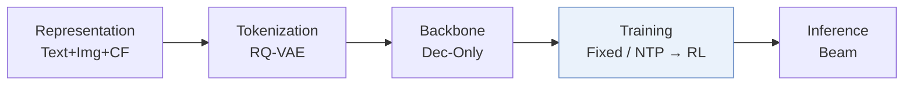
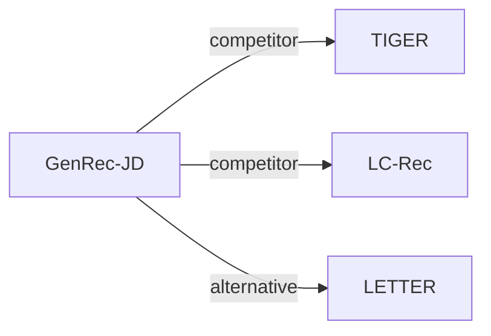

# GenRec-JD

*GenRec: A Preference-Oriented Generative Framework for Large-Scale Recommendation* — Zou et al. · SIGIR’26

`IV. 实用目标` · `Training` · [论文](https://arxiv.org/abs/2604.14878) · [矩阵](../../../README.zh.md#iv--training) · [English](../../papers/genrec-jd.md)

阅读级别：概览（第 1 级） · 本页目录：[TL;DR](#tldr) · [速览](#速览) · [3. 实验发现](#3-实验发现) · [5. 相关工作](#5-相关工作)

- `Dec-Only`: Decoder-only.
- `Fixed`: SIDs are built first and not changed while the generator trains.
- `NTP → RL`: NTP, then reinforcement learning (GRPO, GBPO, etc.).

### TL;DR

> [!NOTE]
> GenRec-JD 用按页下一 token 预测训练仅解码器生成器，用 Token Merger 压缩提示中的 SID，并在混合奖励下用 GRPO-SR 对齐输出。

### 速览

| 维度 | 摘要 |
| :-- | :-- |
| 研究问题 | IV. 实用目标：Are training and search aimed at what users and the platform value, rather than at token likelihood? |
| 核心贡献 | GenRec-JD 用按页下一 token 预测训练仅解码器生成器，用 Token Merger 压缩提示中的 SID，并在混合奖励下用 GRPO-SR 对齐输出。 |
| 主要改动阶段 | Training |

### 3. 实验发现

实验设置

- **数据集**：JD.com large-scale recommender platform: about 560 million user interaction sequences over one month. Filtering rules and catalog size: not reported.
  - 出处：JD.com data scope: [S3.SS1.p1](https://arxiv.org/html/2604.14878v1#S3.SS1.p1).
- **切分**：Temporal: the last day for testing, the remaining days for training; a validation split is not reported. Online: 10% of traffic per variant for one month on JD's homepage feed.
  - 出处：Last-day test split: [S3.SS1.p1](https://arxiv.org/html/2604.14878v1#S3.SS1.p1); online test: [S3.SS3.p1](https://arxiv.org/html/2604.14878v1#S3.SS3.p1).
- **候选集**：not reported (full catalog versus sampled evaluation candidates); HR and NDCG at K=1, 10, 50 over beam-search outputs, plus the share of invalid SIDs.
  - 出处：Metrics only, including the hallucination rate: [S3.SS1.p1](https://arxiv.org/html/2604.14878v1#S3.SS1.p1).
- **可见性**：warm; no unseen-item protocol is defined. Online results report long-tail item gains without a visibility definition.
  - 出处：Next-day temporal test with no unseen-item protocol: [S3.SS1.p1](https://arxiv.org/html/2604.14878v1#S3.SS1.p1); long-tail items are analyzed online only: [S3.SS3.p1](https://arxiv.org/html/2604.14878v1#S3.SS3.p1).
- **SID 规格**：3-level RQ K-means over Qwen2.5-VL multimodal embeddings fine-tuned on domain collaborative pairs; codebook size per level: not reported. A linear token merger compresses each SID triplet into one input vector in the prompt. Collision handling: not reported; generated invalid SIDs are measured (HaR 4.96% for GenRec).
  - 出处：Qwen2.5-VL embeddings fine-tuned on collaborative pairs, RQ K-means triplets: [S2.SS1.p2](https://arxiv.org/html/2604.14878v1#S2.SS1.p2); token merger: [S2.SS2.SSS0.Px3.p1](https://arxiv.org/html/2604.14878v1#S2.SS2.SSS0.Px3.p1).
- **推理预算**：Point-wise beam search returning beam-width items per query; numerical beam width not reported. Qwen2.5 decoder-only backbones of 1.5B, 3B, and 7B; training on 8 NVIDIA H100 GPUs; inference hardware, batch size, and latency: not reported.
  - 出处：Point-wise beam search at serving: [S2.SS2.SSS0.Px2.p1](https://arxiv.org/html/2604.14878v1#S2.SS2.SSS0.Px2.p1); hardware: [S3.SS1.p1](https://arxiv.org/html/2604.14878v1#S3.SS1.p1).
- **结果来源**：Table 1 (page-wise SFT versus BERT4Rec, SASRec, TIGER, LC-Rec, with hallucination rate); Table 2 (model scaling); Table 3 (GRPO-SR and reward variants); Table 4 (one-month online A/B test).
  - 出处：SFT table: [S3.T1](https://arxiv.org/html/2604.14878v1#S3.T1); scaling: [S3.T2](https://arxiv.org/html/2604.14878v1#S3.T2); RL: [S3.T3](https://arxiv.org/html/2604.14878v1#S3.T3); online: [S3.T4](https://arxiv.org/html/2604.14878v1#S3.T4).

### 5. 相关工作

- **同期对比** · [TIGER](tiger.md): TIGER is trained with point-wise next-item prediction; GenRec trains on page-wise target lists with a decoder-only LLM and aligns it with GRPO-SR.
  - 出处：GenRec v1, Section 3.1 baselines: https://arxiv.org/html/2604.14878v1#S3.SS1.p1; Table 1: https://arxiv.org/html/2604.14878v1#S3.T1.
- **同期对比** · [LC-Rec](lc-rec.md): LC-Rec also fine-tunes an LLM on SIDs but with point-wise NTP; GenRec adds page-wise supervision, a token merger, and RL alignment.
  - 出处：GenRec v1, Section 3.1 baselines: https://arxiv.org/html/2604.14878v1#S3.SS1.p1; Table 1: https://arxiv.org/html/2604.14878v1#S3.T1.
- **替代方案** · [LETTER](letter.md): LETTER improves the tokenizer, whereas GenRec keeps RQ K-means SIDs and changes the supervision and alignment of the generator.
  - 出处：GenRec v1, Section 4 cites Wang et al. (2025), LETTER: https://arxiv.org/html/2604.14878v1#S4.p1; not a baseline in Table 1.

[查看同格全部论文](../../../README.zh.md#iv--training)
