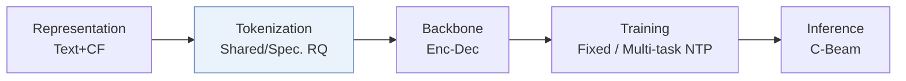
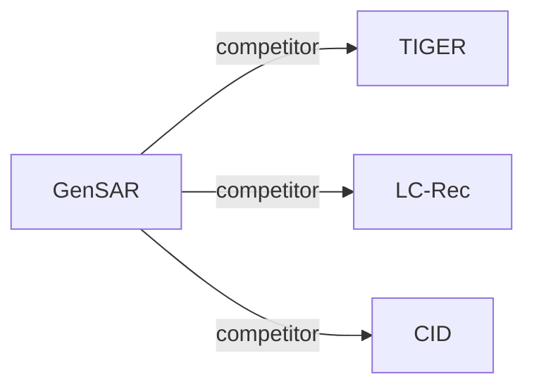

# GenSAR

| **题目** | *Unified Generative Search and Recommendation* |
| :-- | :-- |
| **作者** | Shi et al. |
| **会议** | RecSys’25 |
| **问题与阶段** | `I. 信息量` · `Tokenization` |
| **链接** | [论文](https://arxiv.org/abs/2504.05730) · [矩阵](../../../README.zh.md#i--tokenization) · [English](../../papers/gensar.md) |
| **阅读级别** | 概览（第 1 级） |

本页目录：[TL;DR](#tldr) · [速览](#速览) · [3. 实验发现](#3-实验发现) · [5. 相关工作](#5-相关工作)

- `Shared/Spec. RQ`: Residual quantization using shared and task-specific codebooks.
- `Enc-Dec`: Encoder-decoder.
- `Fixed`: SIDs are built first and not changed while the generator trains.
- `Multi-task NTP`: The same NTP loss over several tasks.
- `C-Beam`: Constrained beam search.

### TL;DR

> [!NOTE]
> GenSAR 用同时承载语义与协同信号的双用途标识和任务特定训练，把搜索与推荐统一到单个生成器中，缓解两项任务之间的冲突。

---

### 速览

| 维度 | 摘要 |
| :-- | :-- |
| 研究问题 | I. 信息量：Do the SIDs, or the model reading them, carry the collaborative and multimodal signals recommendation needs? |
| 核心贡献 | GenSAR 用同时承载语义与协同信号的双用途标识和任务特定训练，把搜索与推荐统一到单个生成器中，缓解两项任务之间的冲突。 |
| 主要改动阶段 | Tokenization |

---

### 3. 实验发现

实验设置

- **数据集**：Semi-synthetic Amazon Electronics search/recommendation data; Commercial Chinese-app data, 10,000 users over two weeks. Filtering rules: not reported in paper.
  - 出处：Section 4.1.1: [S4.SS1.SSS1.p1](https://arxiv.org/html/2504.05730v2#S4.SS1.SSS1.p1)
- **切分**：not reported in paper; data-processing and train/validation/test details are delegated to code.
  - 出处：Section 4.1.1 directs split details to code: [S4.SS1.SSS1.p1](https://arxiv.org/html/2504.05730v2#S4.SS1.SSS1.p1)
- **候选集**：Recommendation sampled: 99 random negatives excluding user-interacted items, plus the target. Search sampled: 99 BM25-retrieved hard negatives, plus the target; search history exclusion: not reported.
  - 出处：Tables 3 and 4 captions: [S4.T3](https://arxiv.org/html/2504.05730v2#S4.T3) and [S4.T4](https://arxiv.org/html/2504.05730v2#S4.T4)
- **可见性**：warm; no unseen-item protocol is defined. Collaborative-encoder exposure to test items: not reported.
  - 出处：Sections 3.2.1 and 4.1 define no unseen-item protocol: [S3.SS2.SSS1.p1](https://arxiv.org/html/2504.05730v2#S3.SS2.SSS1.p1) and [S4.SS1](https://arxiv.org/html/2504.05730v2#S4.SS1)
- **SID 规格**：Shared/task-specific RQ-VAE; sensitivity favors 2 shared + 2 task-specific codes. Numerical codebook size and collision handling: not reported; semantic/collaborative collision rates 0.18%/0.39%.
  - 出处：Sections 3.2.2 and 4.4.2-4.4.3: [S3.SS2.SSS2.p1](https://arxiv.org/html/2504.05730v2#S3.SS2.SSS2.p1) and [S4.SS4.SSS2.p1](https://arxiv.org/html/2504.05730v2#S4.SS4.SSS2.p1) and [S4.SS4.SSS3.p2](https://arxiv.org/html/2504.05730v2#S4.SS4.SSS3.p2)
- **推理预算**：Constrained beam search; HR/NDCG@1/5/10. Beam width, hardware, inference batch size, latency: not reported in paper.
  - 出处：Sections 3.4.2 and 4.1.3: [S3.SS4.SSS2.p1](https://arxiv.org/html/2504.05730v2#S3.SS4.SSS2.p1) and [S4.SS1.SSS3.p1](https://arxiv.org/html/2504.05730v2#S4.SS1.SSS3.p1)
- **结果来源**：Original Tables 3/4: recommendation/search; Table 5: task ablations; Figures 4-7: identifier analyses.
  - 出处：Tables 3-5 and Figures 4-7: [S4.T3](https://arxiv.org/html/2504.05730v2#S4.T3) and [S4.T4](https://arxiv.org/html/2504.05730v2#S4.T4) and [S4.T5](https://arxiv.org/html/2504.05730v2#S4.T5) and [S4.F4](https://arxiv.org/html/2504.05730v2#S4.F4) and [S4.F7](https://arxiv.org/html/2504.05730v2#S4.F7)

---

### 5. 相关工作

- **同期对比** · [TIGER](tiger.md): TIGER is a recommendation baseline; GenSAR extends RQ-VAE identifiers with shared and task-specific codes for joint search/recommendation.
  - 出处：GenSAR v2, Sections 1 and 4.1.2, Table 3: https://arxiv.org/html/2504.05730v2#S1.p6; https://arxiv.org/html/2504.05730v2#S4.SS1.SSS2.p2; https://arxiv.org/html/2504.05730v2#S4.T3.
- **同期对比** · [LC-Rec](lc-rec.md): LC-Rec is a generative recommendation baseline; GenSAR learns separate semantic/collaborative identifiers and joint search/recommendation tasks.
  - 出处：GenSAR v2, Sections 3.2 and 4.1.2, Table 3: https://arxiv.org/html/2504.05730v2#S3.SS2.p1; https://arxiv.org/html/2504.05730v2#S4.SS1.SSS2.p2; https://arxiv.org/html/2504.05730v2#S4.T3.
- **同期对比** · [CID](cid.md): P5-CID is a generative recommendation baseline; GenSAR uses learned shared/task-specific codebooks.
  - 出处：GenSAR v2, Sections 2 and 4.1.2, Table 3: https://arxiv.org/html/2504.05730v2#S2.p2; https://arxiv.org/html/2504.05730v2#S4.SS1.SSS2.p2; https://arxiv.org/html/2504.05730v2#S4.T3.

[查看同格全部论文](../../../README.zh.md#i--tokenization)
