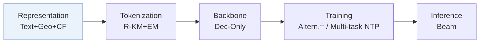
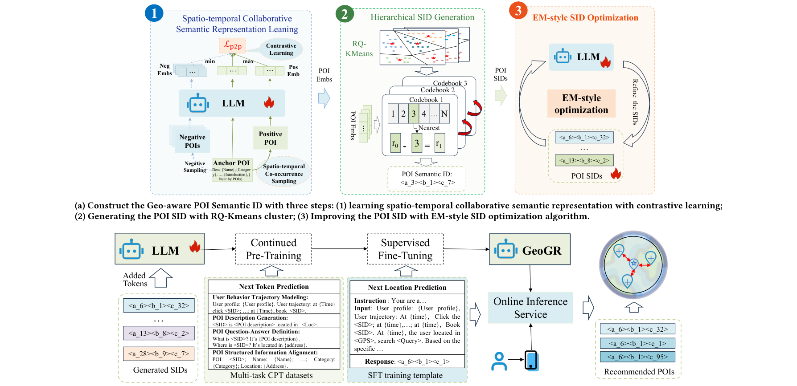
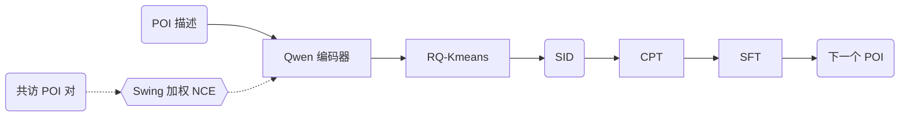
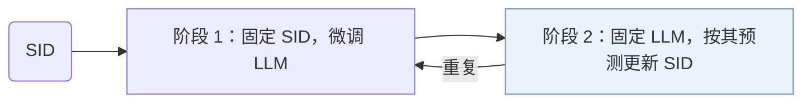
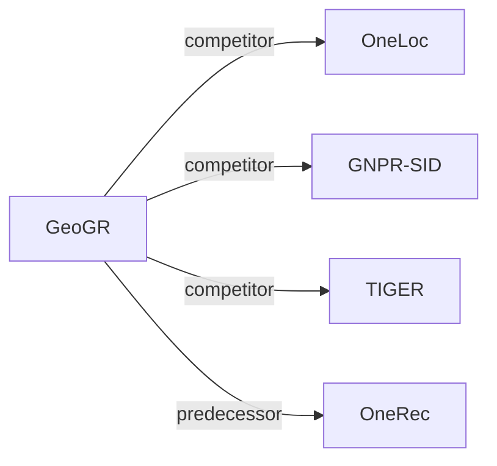

# GeoGR

| **题目** | *Enabling Spatio-Temporal Aware Industrial-Scale Generative POI Recommendations* |
| :-- | :-- |
| **作者** | Wang et al. |
| **会议** | arXiv’26 |
| **问题与阶段** | `I. 信息量` · `Representation` · `POI` |
| **链接** | [论文](https://arxiv.org/abs/2602.10411) · [矩阵](../../../README.zh.md#i--representation) · [English](../../papers/geogr.md) |
| **阅读级别** | 阅读笔记（第 2 级） |

本页目录：[TL;DR](#tldr) · [速览](#速览) · [1. 为什么重要](#1-为什么重要) · [2. 方法](#2-方法) · [3. 实验发现](#3-实验发现) · [4. 局限与分析](#4-局限与分析) · [5. 相关工作](#5-相关工作)

- `R-KM+EM`: Residual k-means with expectation-maximization-style refinement.
- `Dec-Only`: Decoder-only.
- `Multi-task NTP`: The same NTP loss over several tasks.

### TL;DR

> [!NOTE]
> GeoGR 从受地理约束的共访对出发，经对比学习与迭代修正构建地理感知 POI SID，再通过持续预训练与微调将 LLM 与之对齐。

---

### 速览

| 维度 | 摘要 |
| :-- | :-- |
| 研究问题 | I. 信息量：Do the SIDs, or the model reading them, carry the collaborative and multimodal signals recommendation needs? |
| 核心贡献 | GeoGR 从受地理约束的共访对出发，经对比学习与迭代修正构建地理感知 POI SID，再通过持续预训练与微调将 LLM 与之对齐。 |
| 主要改动阶段 | Representation |
| 主要发现 | 在高德（AMAP）平台上线三个月，GeoGR 的在线 WINRATE 提升 +2.91%，PV_CTR 提升 +5.55%（Abstract）。 |
| 局限 | 语义 ID（Semantic ID，SID）按 LLM 的预测来更新，因此和精修时所用的 LLM 检查点绑在一起（Sec. 4.1.3）。 |

---

### 1. 为什么重要

作者指出，基于 SID 的兴趣点（POI）推荐有两个问题：SID 没有刻画跨品类的时空协同关系，和大语言模型（LLM）也对不齐（Abstract）。GeoGR 在高德这类导航服务上同时处理这两点。

> "Instead, we explicitly model the joint constraints of geographic proximity and behavioral co-occurrence by constructing spatiotemporal co-visit POI pairs."（Sec. 4.1.1）（用时空共访 POI 对显式建模地理邻近和行为共现。）

---

### 2. 方法

#### 位置描述

每个 POI 有一段描述，含坐标、地址和名称、品牌、品类、geohash 编码、消费水平、活跃时段等属性，由 Qwen 模型编码（Sec. 4.1.1）。

#### 共访对比学习

轨迹中经常同时出现的 POI 对按 Swing 相似度加权，以压低热门物品的权重，再用 NCE 损失训练（Sec. 4.1.1，Eq. 4）。

#### 量化与迭代精修

RQ-Kmeans 把 LLM 嵌入离散成层级 SID（Sec. 1）。

> "As shown in Algorithm 1, the framework alternates between two phases: (1) fixing the SIDs and fine-tuning the LLM to better predict them, and (2) fixing the LLM and updating the SIDs based on its predictions."（Sec. 4.1.3）（两阶段交替：固定 SID 微调 LLM；固定 LLM 按其预测更新 SID。）

#### 多阶段 LLM 训练

继续预训练（CPT）用多种提示模板注入 POI 信息和用户行为序列（Sec. 4.2.1）。之后的监督微调训练 POI 生成（Abstract）。

> "Since the newly introduced SID tokens are out-of-vocabulary for the base LLM, we first perform Continued Pre-Training (CPT) to warm up these tokens and inject scenario-specific recommendation knowledge."（Sec. 4.2）（新 SID token 不在词表里，先做 CPT 预热这些 token。）

---

### 3. 实验发现

实验设置

- **数据集**：Foursquare NYC and TKY (11 months of check-ins; POIs with fewer than 10 interactions and users with fewer than 10 check-ins removed, following GNPR-SID; 2,083 users / 5,135 POIs and 2,293 / 7,873), and AMAP industrial data: AMAP (one day of platform-wide traffic with users' traced histories; 7,536K users / 34,119K POIs) and AMAP-SH (one month in Shanghai; 4,820K users / 910K POIs). Industrial filtering rules: not reported.
  - 出处：Datasets and filtering: [S5.SS1.SSS1.p1](https://arxiv.org/html/2602.10411v2#S5.SS1.SSS1.p1) and [S5.SS1.SSS1.p2](https://arxiv.org/html/2602.10411v2#S5.SS1.SSS1.p2); statistics: [S5.T1](https://arxiv.org/html/2602.10411v2#S5.T1).
- **切分**：NYC and TKY: records sorted by time and split 80% / 10% / 10% into training, validation, and test. AMAP: one day for training and 1 million records randomly sampled from the following day for testing. AMAP-SH: last day held out for testing. Online: three-month A/B test against the legacy multi-stage retrieval.
  - 出处：Splits: [S5.SS1.SSS1.p2](https://arxiv.org/html/2602.10411v2#S5.SS1.SSS1.p2); online test: [S5.SS9.p2](https://arxiv.org/html/2602.10411v2#S5.SS9.p2).
- **候选集**：not reported (full catalog versus sampled evaluation candidates); top-k SIDs come from beam search.
  - 出处：Metrics only: [S5.SS1.SSS2.p1](https://arxiv.org/html/2602.10411v2#S5.SS1.SSS2.p1).
- **可见性**：warm; no unseen-item protocol is defined.
  - 出处：Temporal splits with no unseen-POI protocol: [S5.SS1.SSS1.p2](https://arxiv.org/html/2602.10411v2#S5.SS1.SSS1.p2).
- **SID 规格**：3 RQ-Kmeans layers over Qwen-4B POI embeddings with geographic co-visitation alignment; codebook size stated as 32 and 64 for NYC and TKY, respectively, and 4,096 for AMAP and AMAP-SH. SIDs are refined by an EM-style loop with the LLM, using a 20-candidate dynamic beam to prevent SID collisions; a final collision-resolution rule is not reported.
  - 出处：Three RQ-Kmeans layers and codebook sizes: [S5.SS1.SSS4.p1](https://arxiv.org/html/2602.10411v2#S5.SS1.SSS4.p1) and [S4.SS1.SSS2.p2](https://arxiv.org/html/2602.10411v2#S4.SS1.SSS2.p2); RQ-Kmeans following OneRec: [S4.SS1.p1](https://arxiv.org/html/2602.10411v2#S4.SS1.p1); EM refinement with 20-candidate beam to avoid collisions: [S4.SS1.SSS3.p1](https://arxiv.org/html/2602.10411v2#S4.SS1.SSS3.p1).
- **推理预算**：Offline: beam search for the top-k SIDs; numerical beam width not reported. Online: dynamic beam search generating 50 candidate SIDs per request; GeoGR-0.6B averages 50 ms per request on NVIDIA H20 GPUs versus 90 ms for GeoGR-4B; inference batch size not reported. Training on 16 H20 GPUs with per-GPU batch 16.
  - 出处：Beam search for top-k: [S4.SS2.SSS2.p4](https://arxiv.org/html/2602.10411v2#S4.SS2.SSS2.p4); deployment budget and latency: [S5.SS9.p1](https://arxiv.org/html/2602.10411v2#S5.SS9.p1); training hardware: [S5.SS1.SSS4.p1](https://arxiv.org/html/2602.10411v2#S5.SS1.SSS4.p1).
- **结果来源**：Table 2 (NYC, TKY versus traditional, POI, and generative baselines); Table 3 (AMAP, AMAP-SH); Table 4 (ablation); Table 5 (SID quality); Table 6 (CPT effect); Section 5.6 (model scaling); Table 7 and Section 5.9 (three-month online A/B test).
  - 出处：Public: [S5.T2](https://arxiv.org/html/2602.10411v2#S5.T2); industrial: [S5.T3](https://arxiv.org/html/2602.10411v2#S5.T3); ablation: [S5.T4](https://arxiv.org/html/2602.10411v2#S5.T4); SID evaluation: [S5.T5](https://arxiv.org/html/2602.10411v2#S5.T5); CPT: [S5.T6](https://arxiv.org/html/2602.10411v2#S5.T6); scaling: [S5.SS6.p2](https://arxiv.org/html/2602.10411v2#S5.SS6.p2); online: [S5.SS9.p2](https://arxiv.org/html/2602.10411v2#S5.SS9.p2).

- 离线对比：GeoGR 在多个真实数据集上好于基线（Abstract）。
- 在线部署：三个月的测试覆盖了数百万用户（Abstract）。

---

### 4. 局限与分析

**Our analysis.**

- OneLoc 在输入里加了图像，用 DPO 训练 `Enc-Dec` 生成器；GeoGR 加的是协同信号，用 `Multi-task NTP` 训练 `Dec-Only` LLM。
- GNPR-SID 的 `RQ-VAE` 码固定不变；GeoGR 的 `R-KM+EM` 码会随生成器精修。

---

### 5. 相关工作

- **同期对比** · [OneLoc](oneloc.md): OneLoc injects geography into the SID input embedding and adds geographic rewards; GeoGR builds geo-aware SIDs from geographically constrained co-visitation and refines them with an EM loop tied to the LLM.
  - 出处：GeoGR v2, Table 2 (POI baseline) and Table 3 (strongest industrial baseline): https://arxiv.org/html/2602.10411v2#S5.T2 and https://arxiv.org/html/2602.10411v2#S5.T3; discussion in Section 5.2.2: https://arxiv.org/html/2602.10411v2#S5.SS2.SSS2.p3.
- **同期对比** · [GNPR-SID](gnpr-sid.md): GNPR-SID builds POI semantic IDs for next-POI generation; GeoGR follows its preprocessing and adds co-visitation alignment, EM-style SID refinement, and CPT plus SFT.
  - 出处：GeoGR v2, follows the GNPR-SID preprocessing: https://arxiv.org/html/2602.10411v2#S5.SS1.SSS1.p2; Tables 2, 3, 5, and 6: https://arxiv.org/html/2602.10411v2#S5.T2, https://arxiv.org/html/2602.10411v2#S5.T3, https://arxiv.org/html/2602.10411v2#S5.T5, https://arxiv.org/html/2602.10411v2#S5.T6.
- **同期对比** · [TIGER](tiger.md): TIGER uses content RQ-VAE SIDs with a small Transformer; GeoGR uses geo-aware RQ-Kmeans SIDs with an LLM aligned through continued pre-training.
  - 出处：GeoGR v2, Tables 2 and 3: https://arxiv.org/html/2602.10411v2#S5.T2 and https://arxiv.org/html/2602.10411v2#S5.T3.
- **前序工作** · [OneRec](onerec.md): GeoGR adopts OneRec's RQ-Kmeans tokenization and adds geographic co-visitation signals and EM-style refinement.
  - 出处：GeoGR v2, Section 4.1 adopts the RQ-Kmeans strategy of Deng et al. (2025): https://arxiv.org/html/2602.10411v2#S4.SS1.p1.

[查看同格全部论文](../../../README.zh.md#i--representation)
