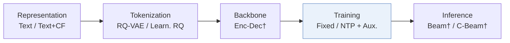
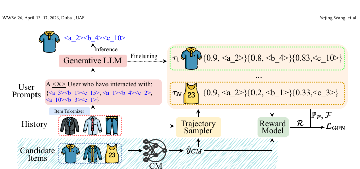
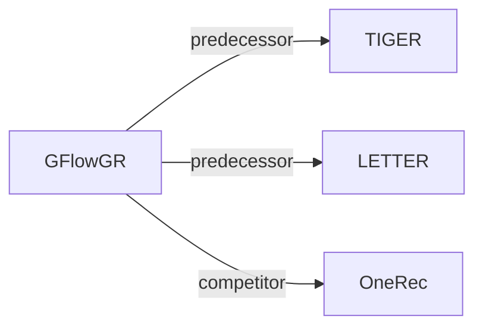

# GFlowGR

*Fine-Tuning Generative Recommendation Frameworks with Generative Flow Networks* — Wang et al. · SIGIR’26

`IV. 实用目标` · `Training` · [论文](https://arxiv.org/abs/2506.16114) · [代码](https://github.com/Applied-Machine-Learning-Lab/SIGIR26_GFlowGR) · [矩阵](../../../README.zh.md#iv--training) · [English](../../papers/gflowgr.md)

阅读级别：阅读笔记（第 2 级） · 本页目录：[TL;DR](#tldr) · [速览](#速览) · [1. 为什么重要](#1-为什么重要) · [2. 方法](#2-方法) · [3. 实验发现](#3-实验发现) · [4. 局限与分析](#4-局限与分析) · [5. 相关工作](#5-相关工作)

- `Text / Text+CF`: Text-only representations or text representations combined with collaborative signals.
- `RQ-VAE / Learn. RQ`: Residual-quantized variational codes or learnable residual-quantization codes in different configurations.
- `Fixed`: SIDs are built first and not changed while the generator trains.
- `NTP + Aux.`: NTP plus another auxiliary loss.
- `Beam† / C-Beam†`: Beam search or constrained beam search in the respective inherited configurations.

### TL;DR

> [!NOTE]
> GFlowGR 用 GFlowNets 将生成式推荐微调建模为多步生成，借助协同轨迹采样器与奖励模型探索未观测正例，替代下一 token 或 DPO 微调。

### 速览

| 维度 | 摘要 |
| :-- | :-- |
| 研究问题 | IV. 实用目标：Are training and search aimed at what users and the platform value, rather than at token likelihood? |
| 核心贡献 | GFlowGR 用 GFlowNets 将生成式推荐微调建模为多步生成，借助协同轨迹采样器与奖励模型探索未观测正例，替代下一 token 或 DPO 微调。 |
| 主要改动阶段 | Training |
| 主要发现 | 在淘宝生产数据上，GFlowGR 的 H@20 为 0.444、N@20 为 0.452，SFT 为 0.358 和 0.371；15 天在线 A/B 测试中总收入提升 +0.43%（Sec. 5，Table 7）。 |
| 局限 | 奖励模型从日志里的用户信号学习物品效用，微调目标的好坏取决于这些日志（Sec. 3.2）。 |

### 1. 为什么重要

生成式推荐（GR）模型通常用监督微调（SFT）的下一 token 损失或 DPO 类目标来微调（Abstract）。作者指出，这些目标只预测一个真实物品，并把所有交互看得一样重要（Abstract）。

> "To address these challenges, we reformulate GR as a sequential set-generation problem and propose GFlowGR, a GFlowNet-based fine-tuning framework that explicitly aligns generation probabilities with item-level utilities."（Abstract）（把 GR 看作序列式集合生成，用 GFlowNet 让生成概率和物品效用对齐。）

### 2. 方法

#### 轨迹采样器

轨迹集合由四种方法构造（Sec. 3.1）。作者指出，随机样本会让训练不稳，也偏离模型自身的学习动态（Sec. 3.1）。

> "There are four methods for constructing the trajectory set: interaction log, random sampling, CM-based sampling, and on-policy sampling."（Sec. 3.1）（四种方法：交互日志、随机采样、基于 CM 的采样、在策略采样。）

#### 奖励模型

一个感知行为的奖励模型从多种用户信号中量化物品效用（Sec. 1，Sec. 3.2）。

#### GFlowNet 目标

论文从流匹配原理推出细致平衡（DB）和轨迹平衡（TB）两种目标（Sec. 2）。

### 3. 实验发现

实验设置

- **数据集**：Yelp, Amazon Beauty, and Amazon Instruments, preprocessed following LETTER (filter thresholds not restated); 30,431 / 20,032, 22,362 / 12,101, and 24,772 / 9,922 users / items. Production: Taobao search advertising data with hundreds of millions of daily requests; filtering not reported.
  - 出处：Datasets and LETTER preprocessing: [S4.SS1.p1](https://arxiv.org/html/2506.16114v3#S4.SS1.p1); statistics: [S4.T1](https://arxiv.org/html/2506.16114v3#S4.T1); production data: [S5.p2](https://arxiv.org/html/2506.16114v3#S5.p2).
- **切分**：Per-user leave-one-out: last item for test, second-to-last for validation, the rest for training. Three random seeds. Online: 15-day A/B test on 10% of traffic (50/50).
  - 出处：Leave-one-out allocation: [S4.SS1.p1](https://arxiv.org/html/2506.16114v3#S4.SS1.p1); three seeds: [S4.SS1.p2](https://arxiv.org/html/2506.16114v3#S4.SS1.p2); online test: [S5.p3](https://arxiv.org/html/2506.16114v3#S5.p3).
- **候选集**：not reported (full catalog versus sampled evaluation candidates); top-5 and top-10 lists. Training negatives for the flow objective come from a collaborative-model sampler or beam search, which is a training choice, not the evaluation candidate set.
  - 出处：Metrics only: [S4.SS1.p2](https://arxiv.org/html/2506.16114v3#S4.SS1.p2).
- **可见性**：warm; no unseen-item protocol is defined. Online, newly listed items gain 4.0% revenue, but their tokenizer and generator visibility is not reported.
  - 出处：Standard split with no unseen-item protocol: [S4.SS1.p1](https://arxiv.org/html/2506.16114v3#S4.SS1.p1); online newly listed items without visibility definition: [S5.p3](https://arxiv.org/html/2506.16114v3#S5.p3).
- **SID 规格**：Uses the TIGER and LETTER tokenizers as backbones; layer count and codebook size for the experiments: not reported (Figure 1 illustrates L=3). Collision handling: not reported; the paper notes that intermediate states do not uniquely identify items.
  - 出处：Backbones TIGER and LETTER, no own SID settings: [S4.SS1.p2](https://arxiv.org/html/2506.16114v3#S4.SS1.p2); L=3 appears in the overview figure: [S1.F1](https://arxiv.org/html/2506.16114v3#S1.F1).
- **推理预算**：Decoding method and beam width for evaluation: not reported. All experiments run on the same GPU (model not stated). Table 7 reports training cost on production data (GFlowGR 2.1x SFT with 80x samples); inference latency and batch size: not reported.
  - 出处：Hardware statement and cost: [S4.SS1.p3](https://arxiv.org/html/2506.16114v3#S4.SS1.p3) and [S4.T7](https://arxiv.org/html/2506.16114v3#S4.T7).
- **结果来源**：Table 2 (Beauty, Instruments, Yelp; SFT, GRPO, DPO-family baselines on TIGER and LETTER backbones); Tables 3-6 (rewards, combination, sample selection, LLM reward); Figures 3-4 (parameter study); Table 7 and Section 5 (production offline and 15-day online A/B).
  - 出处：Main: [S4.T2](https://arxiv.org/html/2506.16114v3#S4.T2); ablations and strategies: [S4.T3](https://arxiv.org/html/2506.16114v3#S4.T3), [S4.T4](https://arxiv.org/html/2506.16114v3#S4.T4), [S4.T5](https://arxiv.org/html/2506.16114v3#S4.T5), [S4.T6](https://arxiv.org/html/2506.16114v3#S4.T6); production: [S4.T7](https://arxiv.org/html/2506.16114v3#S4.T7) and [S5.p3](https://arxiv.org/html/2506.16114v3#S5.p3).

- 公开数据：论文在两种 GR 骨干上评估 GFlowGR（Abstract）。
- 生产数据：GRPO 的 H@20 = 0.427，N@20 = 0.408（Sec. 5，Table 7）。

  > "The results show that GFlowGR achieves H@20 of 0.444 and N@20 of 0.452, substantially outperforming SFT (0.358/0.371) and GRPO (0.427/0.408), mirroring the conclusions on public datasets."（Sec. 5）（GFlowGR 明显好于 SFT 和 GRPO，与公开数据集的结论一致。）

- 在线测试：A/B 测试用了 10% 的流量，按 50/50 分组（Sec. 5）。
- 部署：自 2025 年 5 月起，GFlowGR 用于训练淘宝搜索广告的 GR 模型，覆盖手机淘宝、闲鱼和淘宝网页版（Sec. 5）。

### 4. 局限与分析

**Our analysis.**

- GFlowGR 只改微调目标。由此推断，它的收益可以叠加在编号器的选择之上，而不是替代编号器。
- OneRec 用 `NTP → DPO` 对齐生成器；GFlowGR 在下一 token 损失上加 GFlowNet 损失（`NTP + Aux.`）。

### 5. 相关工作

- **前序工作** · [TIGER](tiger.md): TIGER is one of the two generative backbones; GFlowGR updates the LLM with the sum of the SFT loss and a GFlowNets loss over augmented generation trajectories.
  - 出处：GFlowGR v3, Section 4.1 installs GFlowGR on TIGER: https://arxiv.org/html/2506.16114v3#S4.SS1.p2; Table 2: https://arxiv.org/html/2506.16114v3#S4.T2; training objective: https://arxiv.org/html/2506.16114v3#S3.SS4.p1.
- **前序工作** · [LETTER](letter.md): LETTER supplies the second backbone and the data preprocessing; GFlowGR changes only the fine-tuning objective.
  - 出处：GFlowGR v3, Section 4.1 follows LETTER preprocessing and uses it as a backbone: https://arxiv.org/html/2506.16114v3#S4.SS1.p1 and https://arxiv.org/html/2506.16114v3#S4.SS1.p2; Table 2: https://arxiv.org/html/2506.16114v3#S4.T2.
- **同期对比** · [OneRec](onerec.md): OneRec's IPA aligns the model by iterative SFT and DPO with reward-selected rejected samples; GFlowGR learns probabilities proportional to rewards over many trajectories.
  - 出处：GFlowGR v3, IPA baseline from OneRec, reimplemented with the same reward model: https://arxiv.org/html/2506.16114v3#S4.I2.i6.p1 and https://arxiv.org/html/2506.16114v3#S4.SS1.p3; Table 2: https://arxiv.org/html/2506.16114v3#S4.T2.

[查看同格全部论文](../../../README.zh.md#iv--training)
