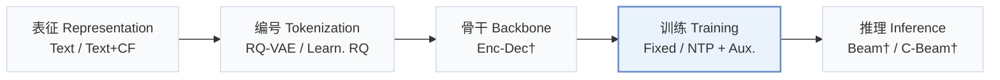
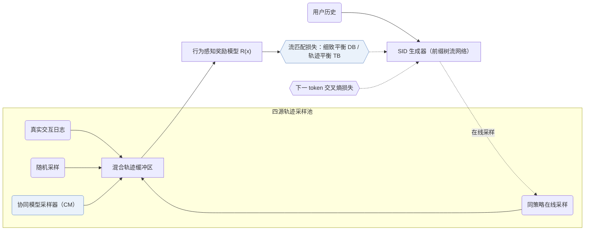
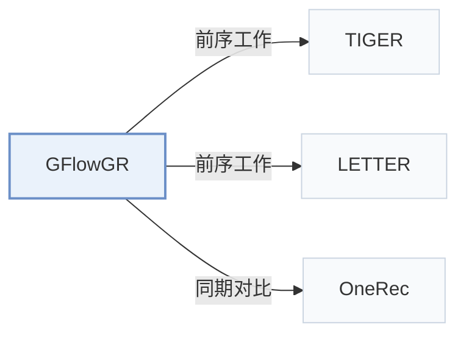

# GFlowGR

[← 问题 × 阶段矩阵](../../../README.zh.md#iv--training) · [按阶段索引](../index/stages.md) · [按模态索引](../index/modality.md) · [English](../../papers/gflowgr.md) | 中文

| **题目** | *Fine-Tuning Generative Recommendation Frameworks with Generative Flow Networks* |
| :-- | :-- |
| **作者** | Wang et al. |
| **发表** | SIGIR’26 |
| **问题与阶段** | `IV. 实用目标` · `训练（Training）` |
| **链接** | [论文](https://arxiv.org/abs/2506.16114) · [代码](https://github.com/Applied-Machine-Learning-Lab/SIGIR26_GFlowGR) |
| **阅读级别** | 阅读笔记（第 2 级） |

**本页目录**：[TL;DR](#tldr) · [速览](#速览) · [1. 为什么重要](#1-为什么重要) · [2. 方法](#2-方法) · [3. 实验发现](#3-实验发现) · [4. 局限与分析](#4-局限与分析) · [5. 相关工作](#5-相关工作)

- `Text / Text+CF`：不同配置下分别采用纯文本表征或文本加协同信号。
- `RQ-VAE / Learn. RQ`：不同配置下分别采用固定 RQ-VAE 或可学习残差量化。
- `Enc-Dec†`：编码器-解码器架构（由配置推断）。
- `Fixed`：先独立训练并冻结编号器，生成器训练期间 SID 保持不变。
- `NTP + Aux.`：下一 token 预测结合辅助正则或对齐损失。
- `Beam† / C-Beam†`：所沿用基座中的束搜索或约束束搜索。

### TL;DR

> [!NOTE]
> GFlowGR 用 GFlowNets 将生成式推荐微调建模为多步生成，借助协同轨迹采样器与奖励模型探索未观测正例，替代下一 token 或 DPO 微调。

---

### 速览

| 维度 | 摘要 |
| :-- | :-- |
| 研究问题 | IV. 实用目标：训练目标与解码搜索是否面向用户真实偏好与平台业务价值，而非单纯拟合下一 token 似然？ |
| 核心贡献 | GFlowGR 用 GFlowNets 将生成式推荐微调建模为多步生成，借助协同轨迹采样器与奖励模型探索未观测正例，替代下一 token 或 DPO 微调。 |
| 主要改动阶段 | 训练（Training） |
| 主要发现 | 在淘宝生产数据上，GFlowGR 取得 H@20 = 0.444、N@20 = 0.452（SFT 为 0.358 与 0.371）；15 天线上 A/B 测试带来总收入 +0.43% 的提升（Sec. 5，Table 7）。 |
| 局限 | 行为感知奖励模型从历史曝光日志拟合物品效用，优化上限受限于日志自身的曝光偏差（Sec. 3.2）。 |

---

### 1. 为什么重要

监督微调（SFT）的下一 token 交叉熵与 DPO 类后训练每步仅拟合单一观测目标，且将点击、转化等异构交互同等对待（Abstract）。GFlowGR 将语义 ID（Semantic ID，SID）解码建模为前缀树上的多步流生成过程，使终端物品的生成概率正比于多行为综合效用。

> "To address these challenges, we reformulate GR as a sequential set-generation problem and propose GFlowGR, a GFlowNet-based fine-tuning framework that explicitly aligns generation probabilities with item-level utilities."（Abstract）

---

### 2. 方法

#### 轨迹采样器

训练轨迹池汇总四类来源；单纯依赖随机采样容易引发离策略训练震荡并偏离当前生成分布，因此引入协同模型引导采样与同策略采样加以稳定（Sec. 3.1）。

> "There are four methods for constructing the trajectory set: interaction log, random sampling, CM-based sampling, and on-policy sampling."（Sec. 3.1）

#### 奖励模型

行为感知奖励模型融合多种异构用户反馈信号，为每条完整候选轨迹输出标量效用分数（Sec. 1，Sec. 3.2）。

#### GFlowNet 目标

在 SID 前缀有向无环图上施加流守恒约束，导出逐步转移的细致平衡（DB）损失与整条路径的轨迹平衡（TB）损失，并与下一 token 损失联合优化（Sec. 2）。

---

### 3. 实验发现

实验设置

- **数据集**：Yelp, Amazon Beauty, and Amazon Instruments, preprocessed following LETTER (filter thresholds not restated); 30,431 / 20,032, 22,362 / 12,101, and 24,772 / 9,922 users / items. Production: Taobao search advertising data with hundreds of millions of daily requests; filtering not reported.
  - 出处：Datasets and LETTER preprocessing: [S4.SS1.p1](https://arxiv.org/html/2506.16114v3#S4.SS1.p1); statistics: [S4.T1](https://arxiv.org/html/2506.16114v3#S4.T1); production data: [S5.p2](https://arxiv.org/html/2506.16114v3#S5.p2).
- **切分**：Per-user leave-one-out: last item for test, second-to-last for validation, the rest for training. Three random seeds. Online: 15-day A/B test on 10% of traffic (50/50).
  - 出处：Leave-one-out allocation: [S4.SS1.p1](https://arxiv.org/html/2506.16114v3#S4.SS1.p1); three seeds: [S4.SS1.p2](https://arxiv.org/html/2506.16114v3#S4.SS1.p2); online test: [S5.p3](https://arxiv.org/html/2506.16114v3#S5.p3).
- **候选集**：not reported (full catalog versus sampled evaluation candidates); top-5 and top-10 lists. Training negatives for the flow objective come from a collaborative-model sampler or beam search, which is a training choice, not the evaluation candidate set.
  - 出处：Metrics only: [S4.SS1.p2](https://arxiv.org/html/2506.16114v3#S4.SS1.p2).
- **可见性**：warm; no unseen-item protocol is defined. Online, newly listed items gain 4.0% revenue, but their tokenizer and generator visibility is not reported.
  - 出处：Standard split with no unseen-item protocol: [S4.SS1.p1](https://arxiv.org/html/2506.16114v3#S4.SS1.p1); online newly listed items without visibility definition: [S5.p3](https://arxiv.org/html/2506.16114v3#S5.p3).
- **SID 规格**：Uses the TIGER and LETTER tokenizers as backbones; layer count and codebook size for the experiments: not reported (Figure 1 illustrates L=3). Collision handling: not reported; the paper notes that intermediate states do not uniquely identify items.
  - 出处：Backbones TIGER and LETTER, no own SID settings: [S4.SS1.p2](https://arxiv.org/html/2506.16114v3#S4.SS1.p2); L=3 appears in the overview figure: [S1.F1](https://arxiv.org/html/2506.16114v3#S1.F1).
- **推理预算**：Decoding method and beam width for evaluation: not reported. All experiments run on the same GPU (model not stated). Table 7 reports training cost on production data (GFlowGR 2.1x SFT with 80x samples); inference latency and batch size: not reported.
  - 出处：Hardware statement and cost: [S4.SS1.p3](https://arxiv.org/html/2506.16114v3#S4.SS1.p3) and [S4.T7](https://arxiv.org/html/2506.16114v3#S4.T7).
- **结果来源**：Table 2 (Beauty, Instruments, Yelp; SFT, GRPO, DPO-family baselines on TIGER and LETTER backbones); Tables 3-6 (rewards, combination, sample selection, LLM reward); Figures 3-4 (parameter study); Table 7 and Section 5 (production offline and 15-day online A/B).
  - 出处：Main: [S4.T2](https://arxiv.org/html/2506.16114v3#S4.T2); ablations and strategies: [S4.T3](https://arxiv.org/html/2506.16114v3#S4.T3), [S4.T4](https://arxiv.org/html/2506.16114v3#S4.T4), [S4.T5](https://arxiv.org/html/2506.16114v3#S4.T5), [S4.T6](https://arxiv.org/html/2506.16114v3#S4.T6); production: [S4.T7](https://arxiv.org/html/2506.16114v3#S4.T7) and [S5.p3](https://arxiv.org/html/2506.16114v3#S5.p3).

- 公开基准：GFlowGR 搭载在 TIGER 与 LETTER 两种骨干上均稳定提升推荐精度（Abstract）。
- 工业离线评测：在淘宝数据集上，GFlowGR 同时超越 SFT 与 GRPO（H@20 = 0.427，N@20 = 0.408）（Sec. 5，Table 7）。

  > "The results show that GFlowGR achieves H@20 of 0.444 and N@20 of 0.452, substantially outperforming SFT (0.358/0.371) and GRPO (0.427/0.408), mirroring the conclusions on public datasets."（Sec. 5）

- 在线部署：在抽取 10% 流量并按 50/50 切分的 15 天线上 A/B 测试中，GFlowGR 将总广告收入提升 +0.43%，并自 2025 年 5 月起在手机淘宝、闲鱼和淘宝网页版搜索广告全量部署（Sec. 5）。

---

### 4. 局限与分析

**Our analysis.**

- GFlowGR 仅改动生成器微调损失，与上游编号器改进（如 LETTER）正交互补。
- OneRec 按 `NTP → DPO` 串行对齐生成器；GFlowGR 则将 GFlowNet 流平衡损失作为辅助项与下一 token 似然联合训练（`NTP + Aux.`）。

---

### 5. 相关工作

- **前序工作** · [TIGER](tiger.md): TIGER is one of the two generative backbones; GFlowGR updates the LLM with the sum of the SFT loss and a GFlowNets loss over augmented generation trajectories.
  - 出处：GFlowGR v3, Section 4.1 installs GFlowGR on TIGER: [S4.SS1.p2](https://arxiv.org/html/2506.16114v3#S4.SS1.p2); Table 2: [S4.T2](https://arxiv.org/html/2506.16114v3#S4.T2); training objective: [S3.SS4.p1](https://arxiv.org/html/2506.16114v3#S3.SS4.p1).
- **前序工作** · [LETTER](letter.md): LETTER supplies the second backbone and the data preprocessing; GFlowGR changes only the fine-tuning objective.
  - 出处：GFlowGR v3, Section 4.1 follows LETTER preprocessing and uses it as a backbone: [S4.SS1.p1](https://arxiv.org/html/2506.16114v3#S4.SS1.p1) and [S4.SS1.p2](https://arxiv.org/html/2506.16114v3#S4.SS1.p2); Table 2: [S4.T2](https://arxiv.org/html/2506.16114v3#S4.T2).
- **同期对比** · [OneRec](onerec.md): OneRec's IPA aligns the model by iterative SFT and DPO with reward-selected rejected samples; GFlowGR learns probabilities proportional to rewards over many trajectories.
  - 出处：GFlowGR v3, IPA baseline from OneRec, reimplemented with the same reward model: [S4.I2.i6.p1](https://arxiv.org/html/2506.16114v3#S4.I2.i6.p1) and [S4.SS1.p3](https://arxiv.org/html/2506.16114v3#S4.SS1.p3); Table 2: [S4.T2](https://arxiv.org/html/2506.16114v3#S4.T2).

[查看同格全部论文](../../../README.zh.md#iv--training)
