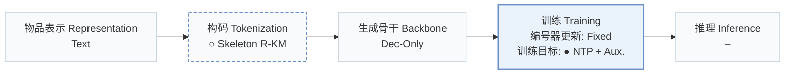
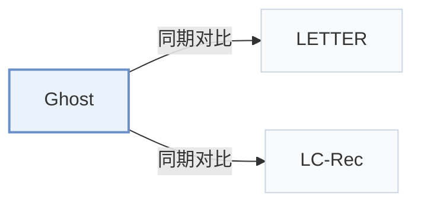

# Ghost

[← 问题 × 阶段矩阵](../../../README.zh.md#iv--training) · [按阶段索引](../index/stages.md) · [按模态找论文](../index/modality.md) · [按领域找论文](../index/domain.md) · [English](../../papers/ghost.md) | 中文

| **题目** | *Echoes in Filter Bubble: Diagnosing and Curing Popularity Bias in Generative Recommenders* |
| :-- | :-- |
| **作者** | Yin et al. |
| **发表** | NeurIPS’26 |
| **问题与阶段** | `IV. 实用目标` · `训练（Training）` |
| **改动** | ○ 构码 · ● 训练目标 |
| **构码输入** | `Text` |
| **领域** | `电商` |
| **链接** | [论文](https://arxiv.org/abs/2605.16825) · [代码](https://github.com/Esperanto-mega/Ghost) |
| **阅读级别** | 概览（第 1 级） |

**本页目录**：[TL;DR](#tldr) · [3. 实验发现](#3-实验发现) · [5. 相关工作](#5-相关工作)

- `Text`：物品文本元数据（标题、描述、类目或提示词）。
- `Skeleton R-KM`：围绕共享语义骨架组织的残差 k-means。
- `Dec-Only`：仅解码器（Decoder-only）自回归架构。
- `Fixed`：先独立训练并冻结编号器，生成器训练期间 SID 保持不变。
- `NTP + Aux.`：下一 token 预测结合辅助正则或对齐损失。

### TL;DR

> [!NOTE]
> Ghost 将流行度偏差归因于 token 级优化和无差别的物品编号，结合非对称负似然损失与骨架支撑的编号方法加以缓解。

---

### 3. 实验发现

实验设置

- **数据集**：Amazon Product Review 2018: Musical Instruments; Arts, Crafts and Sewing; Video Games. Users/items with fewer than five interactions are filtered out.
  - 出处：Appendix C-A: [A3.SS1.p1](https://arxiv.org/html/2605.16825v3#A3.SS1.p1)
- **切分**：User interactions are ordered chronologically; train/validation/test allocation: not reported.
  - 出处：Appendix C-A reports chronological sequences but no holdout allocation: [A3.SS1.p1](https://arxiv.org/html/2605.16825v3#A3.SS1.p1)
- **候选集**：not reported
  - 出处：Section V and Appendix C describe metrics/baselines but not Ghost's candidate protocol: [S5](https://arxiv.org/html/2605.16825v3#S5) and [A3](https://arxiv.org/html/2605.16825v3#A3)
- **可见性**：warm; no unseen-item protocol is defined.
  - 出处：Section V and Appendix C define no unseen-item evaluation: [S5](https://arxiv.org/html/2605.16825v3#S5) and [A3](https://arxiv.org/html/2605.16825v3#A3)
- **SID 规格**：Skeleton RQ-KMeans, 256 centers/level; head length Lh, tail length Lh+Lt with inherited head prefix. Sweeps Lh=3/4/5 and Lt=1/2/3; main numerical lengths and collision handling: not reported.
  - 出处：Section IV-A, Section V-C, Appendix C-D: [S4.SS1.p2](https://arxiv.org/html/2605.16825v3#S4.SS1.p2) and [S5.SS3.p1](https://arxiv.org/html/2605.16825v3#S5.SS3.p1) and [A3.SS4.p2](https://arxiv.org/html/2605.16825v3#A3.SS4.p2)
- **推理预算**：Metrics at K=5/10; decoding algorithm, beam width, inference batch size, latency: not reported. General experimental machine: 8 NVIDIA A100 80GB GPUs; inference-specific allocation: not reported.
  - 出处：Table I and Appendix C-D: [S5.T1](https://arxiv.org/html/2605.16825v3#S5.T1) and [A3.SS4.p2](https://arxiv.org/html/2605.16825v3#A3.SS4.p2)
- **结果来源**：Original Table I: main comparison; Table II: ablations; Table III: backbone scaling. Main and ablation experiments use Qwen2.5-3B; scaling uses Qwen3 0.6B-8B.
  - 出处：Tables I-III and Appendix C-D: [S5.T1](https://arxiv.org/html/2605.16825v3#S5.T1) and [S5.T2](https://arxiv.org/html/2605.16825v3#S5.T2) and [S5.T3](https://arxiv.org/html/2605.16825v3#S5.T3) and [A3.SS4.p1](https://arxiv.org/html/2605.16825v3#A3.SS4.p1)

---

### 5. 相关工作

- **同期对比** · [LETTER](letter.md): LETTER is evaluated as a standard generative baseline; Ghost addresses popularity bias through skeleton tokenization and asymmetric unlikelihood.
  - 出处：Ghost v3, Section V and Appendix C-B, Table I: [S5.p2](https://arxiv.org/html/2605.16825v3#S5.p2); [A3.SS2.p1](https://arxiv.org/html/2605.16825v3#A3.SS2.p1); [S5.T1](https://arxiv.org/html/2605.16825v3#S5.T1).
- **同期对比** · [LC-Rec](lc-rec.md): LC-Rec is a standard generative baseline and the backbone reference for RQ-KMeans ablations; Ghost modifies tokenization and optimization.
  - 出处：Ghost v3, Section V and Table II: [S5.p2](https://arxiv.org/html/2605.16825v3#S5.p2); [S5.T2](https://arxiv.org/html/2605.16825v3#S5.T2); [S5.SS2.p1](https://arxiv.org/html/2605.16825v3#S5.SS2.p1).

[查看同格全部论文](../../../README.zh.md#iv--training)
