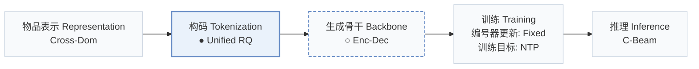
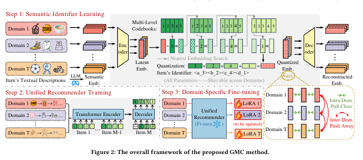
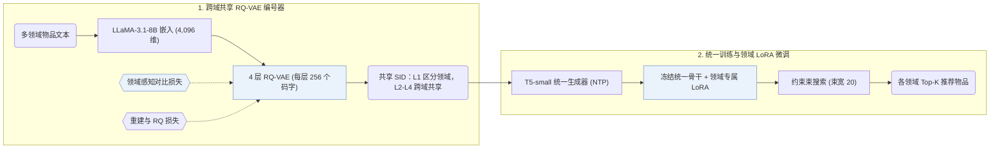
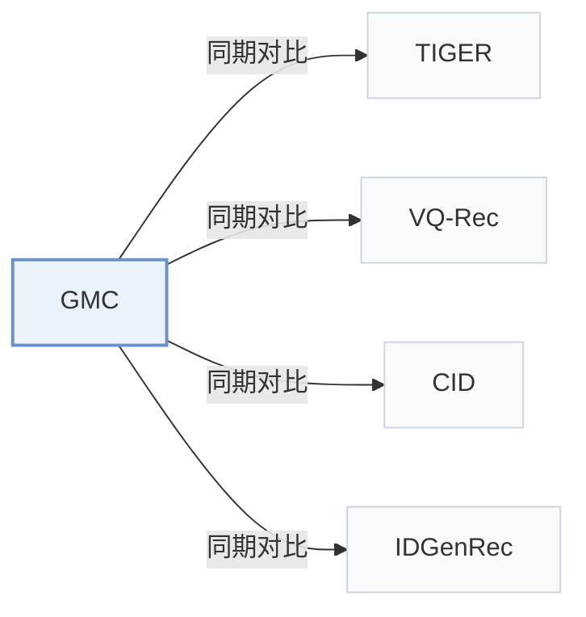

# GMC

[← 问题 × 阶段矩阵](../../../README.zh.md#vi--tokenization) · [按阶段索引](../index/stages.md) · [按模态找论文](../index/modality.md) · [按领域找论文](../index/domain.md) · [English](../../papers/gmc.md) | 中文

| **题目** | *Generative Multi-Target Cross-Domain Recommendation* |
| :-- | :-- |
| **作者** | Jin et al. |
| **发表** | arXiv’25 |
| **问题与阶段** | `VI. 泛化` · `构码（Tokenization）` |
| **改动** | ● 构码 · ○ 生成骨干 |
| **构码输入** | `Text` |
| **领域** | `电商` |
| **特殊设置** | `跨域迁移` |
| **应用场景** | `一般物品推荐`；`公开数据` |
| **链接** | [论文](https://arxiv.org/abs/2507.12871) |
| **阅读级别** | 阅读笔记（第 2 级） |

**本页目录**：[TL;DR](#tldr) · [速览](#速览) · [1. 为什么重要](#1-为什么重要) · [2. 方法](#2-方法) · [3. 实验发现](#3-实验发现) · [4. 局限与分析](#4-局限与分析) · [5. 相关工作](#5-相关工作)

- `Cross-Dom`：跨多个领域迁移或共享的物品表征。
- `Unified RQ`：多领域共享空间的统一残差量化。
- `Enc-Dec`：编码器-解码器（Encoder-decoder）架构。
- `Fixed`：先独立训练并冻结编号器，生成器训练期间 SID 保持不变。
- `NTP`：标准下一 token 预测（Next-Token Prediction）交叉熵损失；基于预训练 LLM 的指令微调（SFT）亦归入此类。
- `C-Beam`：受合法物品集合约束的束搜索（Constrained beam search）。

### TL;DR

> [!NOTE]
> GMC 用域感知对比损失分配跨域共享 SID，并在多个域上训练单一序列到序列生成器，不依赖域间重叠的用户或物品。

---

### 速览

| 维度 | 摘要 |
| :-- | :-- |
| 主要发现 | 在五个无重叠 Amazon 领域（Scientific、Pantry、Instruments、Arts 和 Office）上，GMC 在 Recall@5、Recall@10、NDCG@5 和 NDCG@10 上均优于基于 ID、文本、预训练和生成式的基线方法（Abstract，Table 3）。 |
| 局限 | 语义 ID（Semantic ID，SID）仅由文本嵌入生成，协同信号只能通过生成器的训练序列进入模型（Sec. 3）。 |

---

### 1. 为什么重要

现有多目标跨域推荐（MTCDR）方法依赖领域间共享的用户或物品，无法直接用于无重叠场景；而基于可共享语义表征的方法通常需要大规模辅助语料做预训练（Abstract）。GMC 通过跨域共享的离散 SID 空间与统一序列到序列生成器打通无重叠领域。

> "The core idea of GMC is to leverage semantically quantized discrete item identifiers as a medium for integrating multi-domain knowledge within a unified generative model." (Abstract)

---

### 2. 方法

#### 学习语义标识

GMC 用 LLaMA-3.1-8B 将各领域的物品文本编码为 4,096 维嵌入，再用 4 层 RQ-VAE（每层码本包含 256 个 32 维码字）量化为跨域共享的 SID（Sec. 3）。编号阶段加入领域感知对比损失，拉近同领域物品的量化嵌入，使第 1 层码区分不同领域、深层码在领域间共享（Sec. 3.3，Eq. 6）。

> "Specifically, since items within the same domain are generally more similar to each other than items from different domains, we introduce a novel domain-aware contrastive loss that brings quantized embeddings of intra-domain items closer together." (Sec. 1)

#### 领域专属微调

GMC 先在所有领域上用下一 token 预测训练统一的 T5-small 生成器，随后冻结统一骨干参数，为每个目标领域挂载并微调独立的 LoRA 模块（Sec. 1，Sec. 3.5）。

> "Specifically, we incorporate domain-specific LoRA modules (Hu et al., 2022) into the unified recommender and update the corresponding LoRA parameters using domain-specific data, while freezing all other parameters of the unified model." (Sec. 1)

---

### 3. 实验发现

实验设置

- **数据集**：Multi-target cross-domain task on five Amazon 2018 Reviews subsets: Scientific, Pantry, Instruments, Arts, Office. Items without titles are removed and 5-core filtering is applied to users and items; sequences capped at 20 items. Sizes (users / items): 8,317 / 4,344; 13,073 / 4,897; 24,772 / 9,922; 45,141 / 20,956; 86,554 / 25,847.
  - 出处：Five Amazon subsets, title filter, 5-core, length 20: [S5.SS1.SSS1.p1](https://arxiv.org/html/2507.12871v3#S5.SS1.SSS1.p1); statistics: [S5.T2](https://arxiv.org/html/2507.12871v3#S5.T2).
- **切分**：Per-user leave-one-out: last item for test, second latest for validation, the rest for training; results reported per domain and as a user-weighted average.
  - 出处：Leave-one-out allocation: [S5.SS1.SSS3.p1](https://arxiv.org/html/2507.12871v3#S5.SS1.SSS3.p1).
- **候选集**：full catalog (the target item is ranked over the entire item set).
  - 出处：Ranking over the entire item set: [S5.SS1.SSS3.p1](https://arxiv.org/html/2507.12871v3#S5.SS1.SSS3.p1).
- **可见性**：warm; no unseen-item protocol is defined.
  - 出处：Standard split with no unseen-item protocol: [S5.SS1.SSS3.p1](https://arxiv.org/html/2507.12871v3#S5.SS1.SSS3.p1).
- **SID 规格**：4-level RQ-VAE x 256 codewords (dimension 32) over LLaMA-3.1-8B text embeddings (D=4,096), with a codebook shared across domains and a domain-aware contrastive loss; first-level codes separate domains and deeper levels are shared. Collision handling: not reported.
  - 出处：L=4 x N=256, d=32, LLaMA-3.1 4,096-dimensional embeddings, shared codebook across domains: [S5.SS1.SSS4.p1](https://arxiv.org/html/2507.12871v3#S5.SS1.SSS4.p1) and [S5.SS4.SSS1.p2](https://arxiv.org/html/2507.12871v3#S5.SS4.SSS1.p2); no collision rule found.
- **推理预算**：Beam size 20 for item generation; T5-small backbone with domain-specific LoRA. Recall and NDCG at K=5 and 10. Hardware, inference batch size, and latency: not reported.
  - 出处：Beam size 20: [S5.SS1.SSS4.p2](https://arxiv.org/html/2507.12871v3#S5.SS1.SSS4.p2); T5-small backbone: [S5.SS1.SSS4.p2](https://arxiv.org/html/2507.12871v3#S5.SS1.SSS4.p2).
- **结果来源**：Table 3 (five domains and user-weighted average versus ID, ID-text, pre-training, and generative baselines); Table 4 (ablations); Figures 3-5 (code sharing, code similarity, multi-domain settings).
  - 出处：Main: [S5.T3](https://arxiv.org/html/2507.12871v3#S5.T3); ablation: [S5.T4](https://arxiv.org/html/2507.12871v3#S5.T4); code analysis: [S5.F3](https://arxiv.org/html/2507.12871v3#S5.F3) and [S5.F4](https://arxiv.org/html/2507.12871v3#S5.F4); domain settings: [S5.F5](https://arxiv.org/html/2507.12871v3#S5.F5).

- 主实验对比：在五个无重叠 Amazon 领域（Scientific、Pantry、Instruments、Arts 和 Office）上，GMC 在 Recall@5、Recall@10、NDCG@5 和 NDCG@10 上均优于基于 ID、文本、预训练和生成式的基线方法（Abstract，Table 3）。
- 消融与码共享分析：Table 4 消融了共享码本、领域感知对比损失与领域专属 LoRA 模块；Figs. 3–5 显示第 1 层码按领域分离，而深层码在领域间共享。

---

### 4. 局限与分析

**Our analysis.**

- 领域感知对比损失将同领域物品拉近，这意味着在较粗的量化层级上，同域聚集与跨域共享码之间存在权衡。
- VQ-Rec 在 `Encoder` 生成器上用 `OPQ` 码做 `Scoring` 实现跨域迁移；GMC 则用 `Enc-Dec` 生成器配合 `C-Beam` 解码生成 `Unified RQ` 码。

---

### 5. 相关工作

- **同期对比** · [TIGER](tiger.md): TIGER learns one-domain RQ-VAE identifiers; GMC learns a domain-shared codebook with a domain-aware contrastive loss and adds domain-specific LoRA tuning to a unified generator.
  - 出处：GMC v3, generative baselines: [S5.I1.i4.I1.i2.p1](https://arxiv.org/html/2507.12871v3#S5.I1.i4.I1.i2.p1); Table 1 comparison: [S3.T1](https://arxiv.org/html/2507.12871v3#S3.T1); Table 3: [S5.T3](https://arxiv.org/html/2507.12871v3#S5.T3).
- **同期对比** · [VQ-Rec](vq-rec.md): VQ-Rec transfers across domains through vector-quantized codes for a discriminative model, pre-trained here on the five target domains; GMC generates shared semantic identifiers.
  - 出处：GMC v3, pre-training baselines with the adapted setting: [S5.I1.i3.p1](https://arxiv.org/html/2507.12871v3#S5.I1.i3.p1) and [S5.I1.i3.I1.i2.p1](https://arxiv.org/html/2507.12871v3#S5.I1.i3.I1.i2.p1); Table 3: [S5.T3](https://arxiv.org/html/2507.12871v3#S5.T3).
- **同期对比** · [CID](cid.md): P5-CID builds collaborative identifiers by spectral clustering within a domain; GMC builds semantic identifiers shared across domains.
  - 出处：GMC v3, generative baselines: [S5.I1.i4.I1.i1.p1](https://arxiv.org/html/2507.12871v3#S5.I1.i4.I1.i1.p1); Table 3: [S5.T3](https://arxiv.org/html/2507.12871v3#S5.T3).
- **同期对比** · [IDGenRec](idgenrec.md): IDGenRec learns textual IDs with an ID generator; GMC quantizes LLM embeddings into codebook IDs shared across domains.
  - 出处：GMC v3, generative baselines: [S5.I1.i4.I1.i3.p1](https://arxiv.org/html/2507.12871v3#S5.I1.i4.I1.i3.p1); Table 3: [S5.T3](https://arxiv.org/html/2507.12871v3#S5.T3).

[查看同格全部论文](../../../README.zh.md#vi--tokenization)
