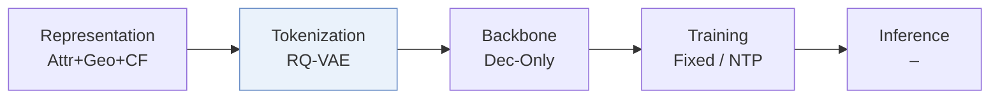
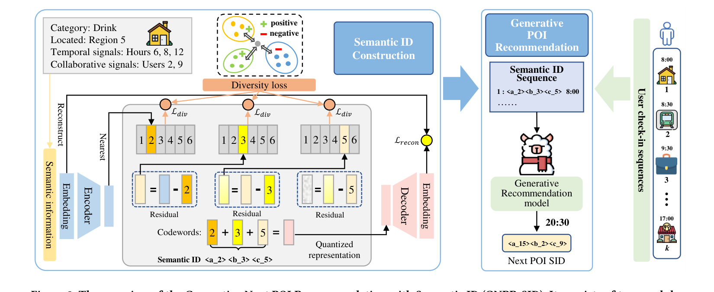
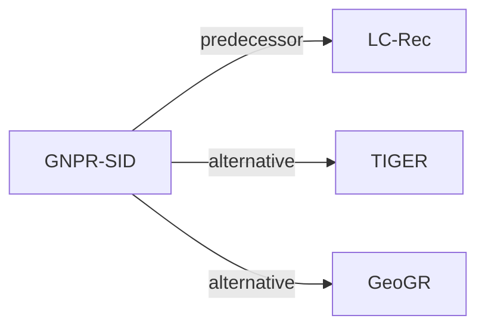

# GNPR-SID

*Generative Next POI Recommendation with Semantic ID* — Wang et al. · KDD’25

`I. 信息量` · `Tokenization` · `POI` · [论文](https://arxiv.org/abs/2506.01375) · [代码](https://github.com/wds1996/GNPR-SID) · [矩阵](../../../README.zh.md#i--tokenization) · [English](../../papers/gnpr-sid.md)

阅读级别：阅读笔记（第 2 级） · 本页目录：[TL;DR](#tldr) · [速览](#速览) · [1. 为什么重要](#1-为什么重要) · [2. 方法](#2-方法) · [3. 实验发现](#3-实验发现) · [4. 局限与分析](#4-局限与分析) · [5. 相关工作](#5-相关工作)

- `Attr+Geo+CF`: Category and other attributes, plus geography, plus CF (POI).
- `Dec-Only`: Decoder-only.
- `Fixed`: SIDs are built first and not changed while the generator trains.
- `NTP`: Next-token prediction loss only; continuing from a pretrained LLM (SFT) also counts as NTP.
- `–`: Not reported in the paper.

### TL;DR

> [!NOTE]
> GNPR-SID 用融合语义与协同特征并在多样性损失下训练的 RQ-VAE SID 替代随机数字 POI ID，并微调 LLM 生成下一访问 POI。

### 速览

| 维度 | 摘要 |
| :-- | :-- |
| 研究问题 | I. 信息量：Do the SIDs, or the model reading them, carry the collaborative and multimodal signals recommendation needs? |
| 核心贡献 | GNPR-SID 用融合语义与协同特征并在多样性损失下训练的 RQ-VAE SID 替代随机数字 POI ID，并微调 LLM 生成下一访问 POI。 |
| 主要改动阶段 | Tokenization |
| 主要发现 | 在三个基准数据集上，GNPR-SID 的推荐准确率比对比方法最多高 16%（Abstract）。 |
| 局限 | 营业时段和协同特征都来自签到数据，没有访问记录的新兴趣点（POI）特征不全（Sec. 4.1.1）。 |

### 1. 为什么重要

现有生成式 POI 推荐通常给 POI 随机数字 ID，难以刻画相似地点之间的语义关系（Abstract）。GNPR-SID 改用从 POI 特征学到的语义 ID（Semantic ID，SID）。

> "To achieve this, we propose the diversity loss, which promotes the distinctiveness of codewords within each codebook layer."（Sec. 1）（多样性损失让每层码本内的码字彼此区分。）

### 2. 方法

#### POI 特征

每个 POI 有空间、时间和协同三类特征（Sec. 4.1.1）。区域用 Google Plus Code 表示。

> "Compared to directly using geographic coordinates as spatial features, these region-based codes r ensure that nearby POIs are assigned the same Plus Code, allowing the model to share information among spatially adjacent POIs."（Sec. 4.1.1）（相邻 POI 得到同一个 Plus Code，模型能在相邻 POI 间共享信息。）

营业时段取 24 个时间段中访问最多的 10 个，协同特征取每个 POI 最常来的 10 位访客（Sec. 4.1.1）。每种特征都变成一个 one-hot 向量（Sec. 4.1.1，Eq. 1）。

#### 量化

多样性损失让 SID 在语义空间里分布均匀（Abstract）。

#### 训练数据

附录 A.1 加了多重裁剪和填空两种数据增强（Appendix A.1）。

### 3. 实验发现

实验设置

- **数据集**：Foursquare NYC and TKY, Gowalla CA. POIs with fewer than 10 interactions and users with fewer than 10 check-ins are removed (following Yan et al. 2023). Sizes (users / POIs): NYC 1,083 / 5,135; TKY 2,293 / 7,873; CA 6,592 / 14,027.
  - 出处：Datasets, filters, splits: [S5.SS1.p1](https://arxiv.org/html/2506.01375v2#S5.SS1.p1); statistics: [S5.T1](https://arxiv.org/html/2506.01375v2#S5.T1).
- **切分**：Records sorted by time and split 80% / 10% / 10% into training, validation, and test; within each user's test sequence the last visited POI is the target. Separate cross-city test: train on one city and test on the others (Table 5).
  - 出处：Temporal 80/10/10 split and last-visit target: [S5.SS1.p1](https://arxiv.org/html/2506.01375v2#S5.SS1.p1); out-of-domain transfer: [S6.T5](https://arxiv.org/html/2506.01375v2#S6.T5).
- **候选集**：not reported (full catalog versus sampled candidates); the metric is top-1 accuracy (Acc@1) of the generated POI.
  - 出处：Top-1 accuracy only: [S5.SS3.p1](https://arxiv.org/html/2506.01375v2#S5.SS3.p1).
- **可见性**：warm; users and POIs that do not appear in the training set are removed from the test set. The cross-city test in Table 5 uses POIs from another city, but their tokenizer visibility is not reported.
  - 出处：Test users and POIs absent from training are removed: [S5.SS1.p1](https://arxiv.org/html/2506.01375v2#S5.SS1.p1).
- **SID 规格**：3-level RQ-VAE with 32 (NYC) or 64 (TKY, CA) codewords of dimension 64, k-means-initialized, plus diversity and compactness losses. Remaining collisions get an appended fourth token that makes each POI's SID unique (e.g. <d_0>, <d_1>). Table 4 reports unique SIDs and collisions before the suffix (e.g. NYC 590 collisions at lambda=0.25).
  - 出处：3 layers x 32 (NYC) or 64 (TKY, CA), dimension 64, k-means initialization: [S5.SS2.p1](https://arxiv.org/html/2506.01375v2#S5.SS2.p1); collision suffix: [S4.SS1.SSS2.p6](https://arxiv.org/html/2506.01375v2#S4.SS1.SSS2.p6); diversity loss and collision counts: [S4.SS1.SSS3.Px3.p1](https://arxiv.org/html/2506.01375v2#S4.SS1.SSS3.Px3.p1) and [S6.T4](https://arxiv.org/html/2506.01375v2#S6.T4).
- **推理预算**：LLaMA3-8B with LoRA; decoding method not reported beyond top-1 prediction. Fine-tuning on 4 NVIDIA L40 GPUs (batch 2 per GPU); inference batch size not reported. Table 6 (NYC): total test time 110.62 s versus 230.36 s for LLM4POI.
  - 出处：Hardware for fine-tuning: [S5.SS2.p1](https://arxiv.org/html/2506.01375v2#S5.SS2.p1); efficiency table: [S6.T6](https://arxiv.org/html/2506.01375v2#S6.T6); decoding not specified in Section 5.
- **结果来源**：Table 2 (Acc@1 on NYC, TKY, CA versus traditional, Transformer, GCN, time-aware, and LLM-based baselines); Table 3 (ablations); Table 4 (diversity-loss weight and SID collisions); Table 5 (cross-city generalization); Table 6 (efficiency).
  - 出处：Main: [S6.T2](https://arxiv.org/html/2506.01375v2#S6.T2); ablation: [S6.T3](https://arxiv.org/html/2506.01375v2#S6.T3); diversity loss: [S6.T4](https://arxiv.org/html/2506.01375v2#S6.T4); cross-city: [S6.T5](https://arxiv.org/html/2506.01375v2#S6.T5); efficiency: [S6.T6](https://arxiv.org/html/2506.01375v2#S6.T6).

- 其他分析：论文测试了域外数据（Sec. 6.5），并从训练时间、测试时间和 token 数三方面看效率（Sec. 6.6，Table 6）。

### 4. 局限与分析

**Our analysis.**

- GeoGR 的 `R-KM+EM` 码会随生成器精修；GNPR-SID 的 `RQ-VAE` 码只训练一次。
- LC-Rec 用 `Multi-task NTP` 在文本上训练 LLM；GNPR-SID 用 POI 属性、地理和协同特征，只用普通 `NTP`。

### 5. 相关工作

- **前序工作** · [LC-Rec](lc-rec.md): GNPR-SID follows LC-Rec in aligning an LLM to SID tokens through language-task prompts, and adds POI-specific quantization with time-aware prompts.
  - 出处：GNPR-SID v2, Section 4.2 builds its prompts inspired by Zheng et al. (2024): https://arxiv.org/html/2506.01375v2#S4.SS2.p2.
- **替代方案** · [TIGER](tiger.md): TIGER is cited as generative recommendation with semantic IDs for products; GNPR-SID adapts RQ-VAE SIDs to POIs with diversity and compactness losses and an LLM generator.
  - 出处：GNPR-SID v2, Section 2 cites Rajput et al. (2023): https://arxiv.org/html/2506.01375v2#S2.p2; not a baseline in Table 2.
- **替代方案** · [GeoGR](geogr.md): GeoGR later builds geo-aware SIDs from geographic co-visitation and an EM refinement loop, and reports gains over GNPR-SID's SIDs.
  - 出处：Evidence is from the later GeoGR paper: it follows GNPR-SID preprocessing and compares against it in Tables 2, 3, and 5: https://arxiv.org/html/2602.10411v2#S5.SS1.SSS1.p2, https://arxiv.org/html/2602.10411v2#S5.T2, https://arxiv.org/html/2602.10411v2#S5.T3, https://arxiv.org/html/2602.10411v2#S5.T5.

[查看同格全部论文](../../../README.zh.md#i--tokenization)
