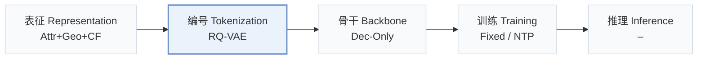
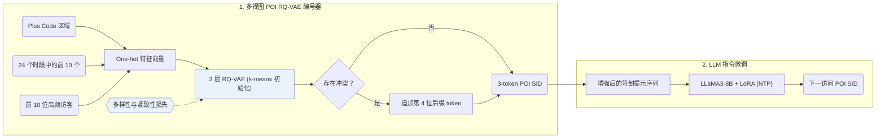
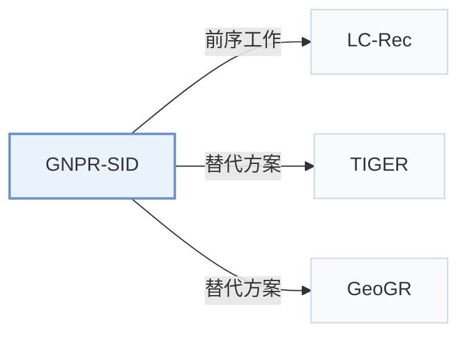

# GNPR-SID

[← 问题 × 阶段矩阵](../../../README.zh.md#i--tokenization) · [按阶段索引](../index/stages.md) · [按模态索引](../index/modality.md) · [English](../../papers/gnpr-sid.md) | 中文

| **题目** | *Generative Next POI Recommendation with Semantic ID* |
| :-- | :-- |
| **作者** | Wang et al. |
| **发表** | KDD’25 |
| **问题与阶段** | `I. 信息量` · `编号（Tokenization）` · `POI` |
| **链接** | [论文](https://arxiv.org/abs/2506.01375) · [代码](https://github.com/wds1996/GNPR-SID) |
| **阅读级别** | 阅读笔记（第 2 级） |

**本页目录**：[TL;DR](#tldr) · [速览](#速览) · [1. 为什么重要](#1-为什么重要) · [2. 方法](#2-方法) · [3. 实验发现](#3-实验发现) · [4. 局限与分析](#4-局限与分析) · [5. 相关工作](#5-相关工作)

- `Attr+Geo+CF`：类目等结构化属性、地理空间特征与协同过滤信号融合（POI 场景）。
- `RQ-VAE`：残差量化变分自编码器（Residual-Quantized VAE）。
- `Dec-Only`：仅解码器（Decoder-only）自回归架构。
- `Fixed`：先独立训练并冻结编号器，生成器训练期间 SID 保持不变。
- `NTP`：标准下一 token 预测（Next-Token Prediction）交叉熵损失；基于预训练 LLM 的指令微调（SFT）亦归入此类。

### TL;DR

> [!NOTE]
> GNPR-SID 用融合语义与协同特征并在多样性损失下训练的 RQ-VAE SID 替代随机数字 POI ID，并微调 LLM 生成下一访问 POI。

---

### 速览

| 维度 | 摘要 |
| :-- | :-- |
| 研究问题 | I. 信息量：SID 或读取它的模型是否充分携带了推荐所需的协同、多模态与时空信号？ |
| 核心贡献 | GNPR-SID 用融合语义与协同特征并在多样性损失下训练的 RQ-VAE SID 替代随机数字 POI ID，并微调 LLM 生成下一访问 POI。 |
| 主要改动阶段 | 编号（Tokenization） |
| 主要发现 | 在三个基准数据集上，GNPR-SID 的推荐准确率（Acc@1）比对比方法最高提升 16%（Abstract）。 |
| 局限 | 营业时段和协同特征均提取自历史签到记录，尚无访问记录的新兴趣点（POI）缺乏完整特征（Sec. 4.1.1）。 |

---

### 1. 为什么重要

现有生成式 POI 推荐方法通常为地点分配随机数字 ID，难以刻画相似地点之间的空间与语义关联（Abstract）。GNPR-SID 用融合空间、时间和协同特征并在多样性损失下训练的语义 ID（Semantic ID，SID）替代随机数字 ID。

> "To achieve this, we propose the diversity loss, which promotes the distinctiveness of codewords within each codebook layer." (Sec. 1)

---

### 2. 方法

#### POI 特征

GNPR-SID 为每个 POI 提取空间、时间和协同三类特征（Sec. 4.1.1）。空间特征采用 Google Plus Code 区域编码。

> "Compared to directly using geographic coordinates as spatial features, these region-based codes r ensure that nearby POIs are assigned the same Plus Code, allowing the model to share information among spatially adjacent POIs." (Sec. 4.1.1)

营业时段取 24 个小时段中访问量最高的 10 个时段，协同特征记录每个 POI 访问频次最高的 10 位访客（Sec. 4.1.1）。三类特征分别编码为 one-hot 向量（Sec. 4.1.1，Eq. 1）。

#### 量化

3 层 RQ-VAE（NYC 每层码本 32 个码字，TKY 与 CA 每层 64 个码字，维度均为 64）将融合后的 POI 表征量化为离散码；多样性损失促使各层码本内的码字在语义空间均匀分布，剩余冲突通过追加第 4 位后缀 token 消解（Abstract，Sec. 4.1.2）。

#### 训练数据

在用 LoRA 微调 LLaMA3-8B 生成器之前，GNPR-SID 对用户签到序列做多重裁剪和填空两类数据增强以扩充训练样本（Appendix A.1）。

---

### 3. 实验发现

实验设置

- **数据集**：Foursquare NYC and TKY, Gowalla CA. POIs with fewer than 10 interactions and users with fewer than 10 check-ins are removed (following Yan et al. 2023). Sizes (users / POIs): NYC 1,083 / 5,135; TKY 2,293 / 7,873; CA 6,592 / 14,027.
  - 出处：Datasets, filters, splits: [S5.SS1.p1](https://arxiv.org/html/2506.01375v2#S5.SS1.p1); statistics: [S5.T1](https://arxiv.org/html/2506.01375v2#S5.T1).
- **切分**：Records sorted by time and split 80% / 10% / 10% into training, validation, and test; within each user's test sequence the last visited POI is the target. Separate cross-city test: train on one city and test on the others (Table 5).
  - 出处：Temporal 80/10/10 split and last-visit target: [S5.SS1.p1](https://arxiv.org/html/2506.01375v2#S5.SS1.p1); out-of-domain transfer: [S6.T5](https://arxiv.org/html/2506.01375v2#S6.T5).
- **候选集**：not reported (full catalog versus sampled candidates); the metric is top-1 accuracy (Acc@1) of the generated POI.
  - 出处：Top-1 accuracy only: [S5.SS3.p1](https://arxiv.org/html/2506.01375v2#S5.SS3.p1).
- **可见性**：warm; users and POIs that do not appear in the training set are removed from the test set. The cross-city test in Table 5 uses POIs from another city, but their tokenizer visibility is not reported.
  - 出处：Test users and POIs absent from training are removed: [S5.SS1.p1](https://arxiv.org/html/2506.01375v2#S5.SS1.p1).
- **SID 规格**：3-level RQ-VAE with 32 (NYC) or 64 (TKY, CA) codewords of dimension 64, k-means-initialized, plus diversity and compactness losses. Remaining collisions get an appended fourth token that makes each POI's SID unique (e.g. <d_0>, <d_1>). Table 4 reports unique SIDs and collisions before the suffix (e.g. NYC 590 collisions at lambda=0.25).
  - 出处：3 layers x 32 (NYC) or 64 (TKY, CA), dimension 64, k-means initialization: [S5.SS2.p1](https://arxiv.org/html/2506.01375v2#S5.SS2.p1); collision suffix: [S4.SS1.SSS2.p6](https://arxiv.org/html/2506.01375v2#S4.SS1.SSS2.p6); diversity loss and collision counts: [S4.SS1.SSS3.Px3.p1](https://arxiv.org/html/2506.01375v2#S4.SS1.SSS3.Px3.p1) and [S6.T4](https://arxiv.org/html/2506.01375v2#S6.T4).
- **推理预算**：LLaMA3-8B with LoRA; decoding method not reported beyond top-1 prediction. Fine-tuning on 4 NVIDIA L40 GPUs (batch 2 per GPU); inference batch size not reported. Table 6 (NYC): total test time 110.62 s versus 230.36 s for LLM4POI.
  - 出处：Hardware for fine-tuning: [S5.SS2.p1](https://arxiv.org/html/2506.01375v2#S5.SS2.p1); efficiency table: [S6.T6](https://arxiv.org/html/2506.01375v2#S6.T6); decoding not specified in Section 5.
- **结果来源**：Table 2 (Acc@1 on NYC, TKY, CA versus traditional, Transformer, GCN, time-aware, and LLM-based baselines); Table 3 (ablations); Table 4 (diversity-loss weight and SID collisions); Table 5 (cross-city generalization); Table 6 (efficiency).
  - 出处：Main: [S6.T2](https://arxiv.org/html/2506.01375v2#S6.T2); ablation: [S6.T3](https://arxiv.org/html/2506.01375v2#S6.T3); diversity loss: [S6.T4](https://arxiv.org/html/2506.01375v2#S6.T4); cross-city: [S6.T5](https://arxiv.org/html/2506.01375v2#S6.T5); efficiency: [S6.T6](https://arxiv.org/html/2506.01375v2#S6.T6).

- 主实验对比：在 Foursquare NYC、Foursquare TKY 和 Gowalla CA 上，GNPR-SID 的 Top-1 准确率（Acc@1）比传统方法、Transformer、GCN、时间感知模型和 LLM 基线最高提升 16%（Abstract，Table 2）。
- 消融与冲突率分析：Table 3 消融了空间、时间与协同特征以及量化损失，Table 4 统计了不同多样性损失权重下追加第 4 位后缀前的唯一 SID 数量与冲突数（NYC 在 $`\lambda = 0.25`$ 时有 590 个冲突）。
- 跨城迁移：在一个城市上训练并在其他城市的域外签到序列上测试时，GNPR-SID 保持了跨城市迁移准确率（Sec. 6.5，Table 5）。
- 效率对比：在 NYC 上，将 POI 压缩为简短 SID 序列使总测试耗时从 LLM4POI 的 230.36 s 降至 110.62 s，同时降低了训练时间与提示 token 数（Sec. 6.6，Table 6）。

---

### 4. 局限与分析

**Our analysis.**

- GeoGR 在交替循环中随生成器精修 `R-KM+EM` 码；GNPR-SID 的 `RQ-VAE` 码仅离线训练一次并保持固定（`Fixed`）。
- LC-Rec 用物品文本上的 `Multi-task NTP` 对齐 LLM；GNPR-SID 在编号器中融合 POI 属性、地理和协同特征（`Attr+Geo+CF`），生成器仅用标准 `NTP` 微调。

---

### 5. 相关工作

- **前序工作** · [LC-Rec](lc-rec.md): GNPR-SID follows LC-Rec in aligning an LLM to SID tokens through language-task prompts, and adds POI-specific quantization with time-aware prompts.
  - 出处：GNPR-SID v2, Section 4.2 builds its prompts inspired by Zheng et al. (2024): [S4.SS2.p2](https://arxiv.org/html/2506.01375v2#S4.SS2.p2).
- **替代方案** · [TIGER](tiger.md): TIGER is cited as generative recommendation with semantic IDs for products; GNPR-SID adapts RQ-VAE SIDs to POIs with diversity and compactness losses and an LLM generator.
  - 出处：GNPR-SID v2, Section 2 cites Rajput et al. (2023): [S2.p2](https://arxiv.org/html/2506.01375v2#S2.p2); not a baseline in Table 2.
- **替代方案** · [GeoGR](geogr.md): GeoGR later builds geo-aware SIDs from geographic co-visitation and an EM refinement loop, and reports gains over GNPR-SID's SIDs.
  - 出处：Evidence is from the later GeoGR paper: it follows GNPR-SID preprocessing and compares against it in Tables 2, 3, and 5: [S5.SS1.SSS1.p2](https://arxiv.org/html/2602.10411v2#S5.SS1.SSS1.p2), [S5.T2](https://arxiv.org/html/2602.10411v2#S5.T2), [S5.T3](https://arxiv.org/html/2602.10411v2#S5.T3), [S5.T5](https://arxiv.org/html/2602.10411v2#S5.T5).

[查看同格全部论文](../../../README.zh.md#i--tokenization)
