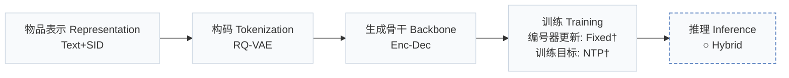
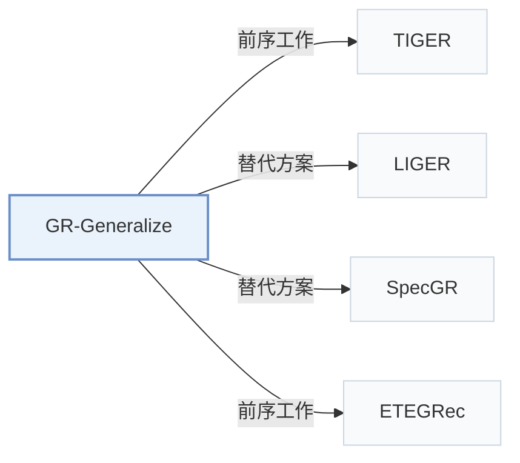

# GR-Generalize

[← 问题 × 阶段矩阵](../../../README.zh.md#范式系统与基准) · [按阶段索引](../index/stages.md) · [按模态找论文](../index/modality.md) · [按领域找论文](../index/domain.md) · [English](../../papers/gr-generalize.md) | 中文

| **题目** | *How Well Does Generative Recommendation Generalize?* |
| :-- | :-- |
| **作者** | Ding et al. |
| **发表** | arXiv’26 |
| **问题与阶段** | `范式、系统与基准` · `无单一阶段` |
| **改动** | ○ 推理 |
| **构码输入** | `Text` |
| **领域** | `电商` · `游戏` · `本地生活与 POI` |
| **链接** | [论文](https://arxiv.org/abs/2603.19809) · [代码](https://github.com/Jamesding000/MemGen-GR) |
| **阅读级别** | 概览（第 1 级） |

**本页目录**：[TL;DR](#tldr) · [3. 实验发现](#3-实验发现) · [5. 相关工作](#5-相关工作)

- `Text+SID`：稠密文本表征拼接离散语义 ID（稠密与生成式混合检索）。
- `RQ-VAE`：残差量化变分自编码器（Residual-Quantized VAE）。
- `Enc-Dec`：编码器-解码器（Encoder-decoder）架构。
- `Fixed†`：生成器训练期间冻结编号器（由配置推断）。
- `NTP†`：下一 token 预测损失（由配置推断）。
- `Hybrid`：结合生成式 SID 解码与稠密/共现检索的混合召回。

### TL;DR

> [!NOTE]
> GR-Generalize 将测试样本划分为记忆型与泛化型子集，分别对比生成式模型与传统物品 ID 模型的表现，并按样本自适应集成二者。

---

### 3. 实验发现

实验设置

- **数据集**：Seven public datasets: Amazon 2014 Sports and Beauty; Amazon 2023 Industrial and Scientific, Musical Instruments, Office Products; Steam; Yelp. Sizes (users / items): Sports 35,599 / 18,358; Beauty 22,364 / 12,102; Science 50,986 / 25,849; Music 57,440 / 24,588; Office 223,309 / 77,552; Steam 47,762 / 10,972; Yelp 30,432 / 20,034. Filtering rules: not reported.
  - 出处：Seven datasets and split: [S3.SS1.p1](https://arxiv.org/html/2603.19809v1#S3.SS1.p1); statistics: [S3.T2](https://arxiv.org/html/2603.19809v1#S3.T2); filtering rules not stated.
- **切分**：Standard leave-last-out: last item for test, second-to-last for validation. Test instances are then partitioned into memorization, generalization (with hop counts up to 4), and uncategorized subsets.
  - 出处：Leave-last-out: [S3.SS1.p1](https://arxiv.org/html/2603.19809v1#S3.SS1.p1); categorization of test instances: [S3.SS1.p4](https://arxiv.org/html/2603.19809v1#S3.SS1.p4).
- **候选集**：not reported (full catalog versus sampled evaluation candidates). SASRec is trained with cross-entropy over all items rather than one sampled negative.
  - 出处：SASRec trained against all items, evaluation set not stated: [S3.SS1.p2](https://arxiv.org/html/2603.19809v1#S3.SS1.p2).
- **可见性**：warm; no unseen-item protocol is defined. The uncategorized subset may include items unseen during training, but they are not separated.
  - 出处：No unseen-item protocol; uncategorized instances may include unseen items: [S2.SS5.p1](https://arxiv.org/html/2603.19809v1#S2.SS5.p1).
- **SID 规格**：Analysis of TIGER SIDs: the mechanism study varies SID length L in {2, 3, 4, 5} (including identifier tokens) with two codebook sizes V per length (e.g. L=2 with V=1,024 or 4,096; L=3 with V=256 and a second size), at matched training compute. The default configuration for Table 1 and collision handling: not reported.
  - 出处：SID length and codebook variations: [S4.SS4.p2](https://arxiv.org/html/2603.19809v1#S4.SS4.p2) and [S4.T3](https://arxiv.org/html/2603.19809v1#S4.T3); default TIGER configuration not stated.
- **推理预算**：Decoding method and beam width: not reported. Table 3 gives matched training compute per SID length (e.g. 5.00e15 FLOPs for L=2); hardware, inference batch size, and latency: not reported. NDCG@10 is the main metric.
  - 出处：Compute budgets in Table 3: [S4.T3](https://arxiv.org/html/2603.19809v1#S4.T3); no decoding settings found.
- **结果来源**：Table 1 (NDCG@10 of TIGER and SASRec on memorization and generalization subsets); Figures 4-7 and Table 3 (token-level memorization analysis and codebook-size study); Table 4 (memorization-aware adaptive ensemble).
  - 出处：Breakdown: [S2.T1](https://arxiv.org/html/2603.19809v1#S2.T1); SID configurations: [S4.T3](https://arxiv.org/html/2603.19809v1#S4.T3); ensemble: [S5.T4](https://arxiv.org/html/2603.19809v1#S5.T4).

---

### 5. 相关工作

- **前序工作** · [TIGER](tiger.md): TIGER is the semantic-ID model under study; the paper explains its generalization advantage over SASRec as token-level prefix memorization.
  - 出处：GR-Generalize v1, Section 1 and Section 3.1 benchmark TIGER: [S1.p6](https://arxiv.org/html/2603.19809v1#S1.p6) and [S3.SS1.p2](https://arxiv.org/html/2603.19809v1#S3.SS1.p2); Table 1: [S2.T1](https://arxiv.org/html/2603.19809v1#S2.T1).
- **替代方案** · [LIGER](liger.md): LIGER treats cold-start items as the out-of-distribution case for generative recommendation; this paper defines generalization by history-to-target transitions instead of target-item rarity.
  - 出处：GR-Generalize v1, Section 1 cites Yang et al. (2025): [S1.p3](https://arxiv.org/html/2603.19809v1#S1.p3).
- **替代方案** · [SpecGR](specgr.md): SpecGR also studies cold-start items as the generalization case; this paper argues that a popular target can still require generalization.
  - 出处：GR-Generalize v1, Section 1 cites Ding et al. (2026): [S1.p3](https://arxiv.org/html/2603.19809v1#S1.p3).
- **前序工作** · [ETEGRec](etegrec.md): The paper follows ETEGRec in training SASRec with full cross-entropy for a fair comparison and uses its datasets.
  - 出处：GR-Generalize v1, Section 3.1: [S3.SS1.p1](https://arxiv.org/html/2603.19809v1#S3.SS1.p1) and [S3.SS1.p2](https://arxiv.org/html/2603.19809v1#S3.SS1.p2).

[查看同格全部论文](../../../README.zh.md#范式系统与基准)
