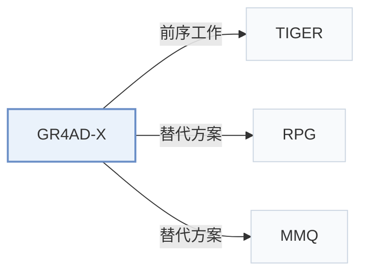

# GR4AD-X

[← 问题 × 阶段矩阵](../../../README.zh.md#iii--tokenization) · [按阶段索引](../index/stages.md) · [按模态找论文](../index/modality.md) · [按领域找论文](../index/domain.md) · [English](../../papers/gr4ad-x.md) | 中文

| **题目** | *Towards Reliable, Scalable, and Value-Aligned Generative Recommendation for Large-Scale Advertising* |
| :-- | :-- |
| **作者** | Xiao et al. |
| **发表** | arXiv’26 |
| **问题与阶段** | `III. SID 与模型对齐` · `构码（Tokenization）` |
| **改动** | ● 构码 · ○ 生成骨干 · ○ 训练目标 · ○ 推理 |
| **构码输入** | `其他`（广告语义向量，未写来源） + `Attr` |
| **领域** | `广告` |
| **应用场景** | `一般物品推荐`；`线上实验或部署` |
| **链接** | [论文](https://arxiv.org/abs/2610.38378) |
| **阅读级别** | 概览（第 1 级） |

**本页目录**：[TL;DR](#tldr) · [3. 实验发现](#3-实验发现) · [5. 相关工作](#5-相关工作)

- `Multi-Path R-KM+Hash`：多路径残差 k-means 结合哈希消歧组件。
- `Enc-Dec`：编码器-解码器（Encoder-decoder）架构。
- `Fixed`：先独立训练并冻结编号器，生成器训练期间 SID 保持不变。
- `NTP + PV-RSPO + Rank + Aux.`：下一 token 预测联合前缀价值 RSPO、排序损失与辅助损失。
- `PV-Beam+Rerank`：前缀价值引导束搜索后接候选重排。

### TL;DR

> [!NOTE]
> GR4AD-X 面向广告场景扩展 GR4AD，结合多路径 SID 分配、不单纯加宽加深骨干的容量扩展，以及带束剪枝和判别式重排的价值引导生成。

---

### 3. 实验发现

实验设置

- **数据集**：Kuaishou production advertising; 7.556M advertisement embeddings in the SID analysis. Dates and filtering rules not reported.
  - 出处：Section 4.2 and Appendix A: [S4.SS2.p2](https://arxiv.org/html/2610.38378v1#S4.SS2.p2) and [A1.SS0.SSS0.Px1.p1](https://arxiv.org/html/2610.38378v1#A1.SS0.SSS0.Px1.p1)
- **切分**：Offline train/validation/test split not reported; each online variant receives a random 5% traffic share for seven days.
  - 出处：Appendix A: [A1.SS0.SSS0.Px2.p1](https://arxiv.org/html/2610.38378v1#A1.SS0.SSS0.Px2.p1)
- **候选集**：not reported; value-alignment analysis uses final-ranking candidates from sampled online requests, without a full-catalog or sampled-negative protocol.
  - 出处：Section 4.4: [S4.SS4.p1](https://arxiv.org/html/2610.38378v1#S4.SS4.p1)
- **可见性**：warm; no unseen-item protocol is defined.
  - 出处：Section 4 and Appendix A define no item holdout: [S4](https://arxiv.org/html/2610.38378v1#S4) and [A1](https://arxiv.org/html/2610.38378v1#A1)
- **SID 规格**：Two paths per advertisement, each with three levels: first-level RQ-KMeans 16384 centroids, second-level RQ-KMeans size not reported, final non-semantic feature hash size not reported. Collision disambiguation not reported; repeated retrieved advertisements are deduplicated by their highest-scoring path.
  - 出处：Section 3.2 and Appendix A: [S3.SS2.p3](https://arxiv.org/html/2610.38378v1#S3.SS2.p3) and [A1.SS0.SSS0.Px3.p1](https://arxiv.org/html/2610.38378v1#A1.SS0.SSS0.Px3.p1)
- **推理预算**：Beam 512; PV-BeamSearch expands to 1024 before pruning at SID levels >=2, followed by advertisement deduplication and reranking. Serving exceeds 500 QPS per NVIDIA L20 GPU with end-to-end latency below 100 ms; inference batch size not reported.
  - 出处：Sections 3.2/3.4 and Appendix A: [S3.SS2.p7](https://arxiv.org/html/2610.38378v1#S3.SS2.p7) and [S3.SS4.SSS2.p2](https://arxiv.org/html/2610.38378v1#S3.SS4.SSS2.p2) and [A1.SS0.SSS0.Px1.p1](https://arxiv.org/html/2610.38378v1#A1.SS0.SSS0.Px1.p1) and [A1.SS0.SSS0.Px3.p1](https://arxiv.org/html/2610.38378v1#A1.SS0.SSS0.Px3.p1)
- **结果来源**：Original Table 1: cumulative online revenue versus deployed GR4AD; Table 2: scaling/QPS; Table 3: value alignment; Figure 3: SID analysis.
  - 出处：Section 4: [S4.T1](https://arxiv.org/html/2610.38378v1#S4.T1) and [S4.T2](https://arxiv.org/html/2610.38378v1#S4.T2) and [S4.T3](https://arxiv.org/html/2610.38378v1#S4.T3) and [S4.F3](https://arxiv.org/html/2610.38378v1#S4.F3)

---

### 5. 相关工作

- **前序工作** · [TIGER](tiger.md): GR4AD-X places its multi-path residual SID construction in the lineage of TIGER's residual-quantized identifiers.
  - 出处：GR4AD-X v1, Sections 2.1 and 3.2: [S2.SS1.p1](https://arxiv.org/html/2610.38378v1#S2.SS1.p1); [S3.SS2.p3](https://arxiv.org/html/2610.38378v1#S3.SS2.p3).
- **替代方案** · [RPG](rpg.md): RPG is cited for parallel generation; GR4AD-X instead scales capacity under a fixed serving budget.
  - 出处：GR4AD-X v1, Section 2.3 (Hou et al., 2025): [S2.SS3.p1](https://arxiv.org/html/2610.38378v1#S2.SS3.p1).
- **替代方案** · [MMQ](mmq.md): MMQ is cited among multimodal quantization studies; GR4AD-X targets SID reliability with alternative first-level paths.
  - 出处：GR4AD-X v1, Section 2.1 (Xu et al., 2026): [S2.SS1.p1](https://arxiv.org/html/2610.38378v1#S2.SS1.p1).

[查看同格全部论文](../../../README.zh.md#iii--tokenization)
