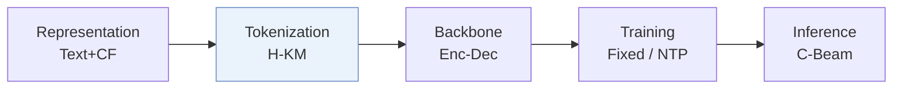
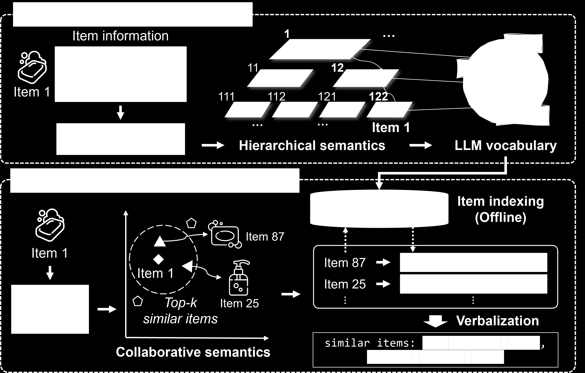
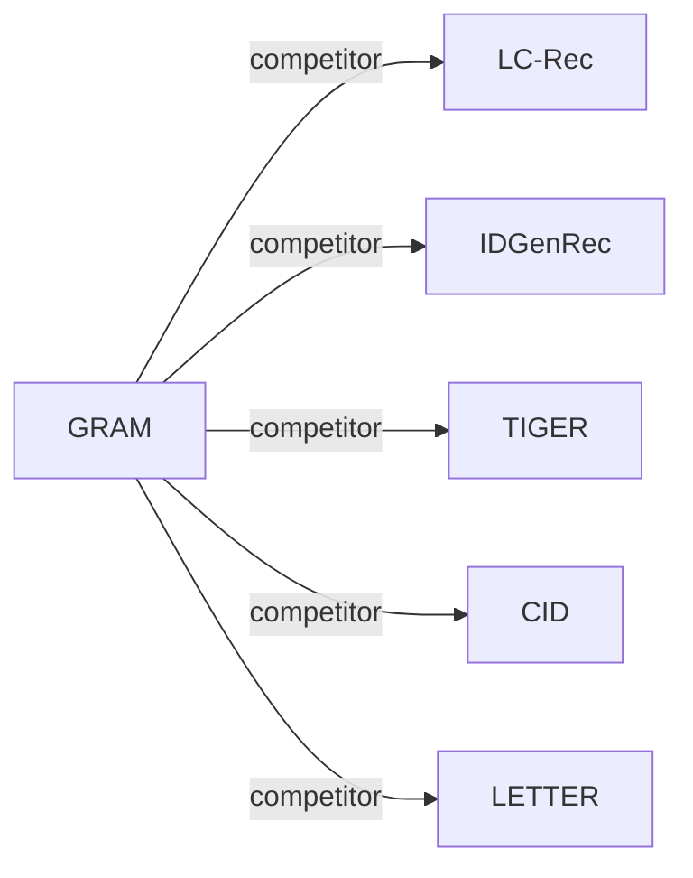

# GRAM

*Generative recommendation via semantic-aware multi-granular late fusion* — Lee et al. · ACL’25

`I. 信息量` · `Tokenization` · [论文](https://arxiv.org/abs/2506.01673) · [代码](https://github.com/skleee/GRAM) · [矩阵](../../../README.zh.md#i--tokenization) · [English](../../papers/gram.md)

阅读级别：概览（第 1 级） · 本页目录：[TL;DR](#tldr) · [速览](#速览) · [2. 方法](#2-方法) · [3. 实验发现](#3-实验发现) · [5. 相关工作](#5-相关工作)

- `H-KM`: Hierarchical k-means.
- `Enc-Dec`: Encoder-decoder.
- `Fixed`: SIDs are built first and not changed while the generator trains.
- `NTP`: Next-token prediction loss only; continuing from a pretrained LLM (SFT) also counts as NTP.
- `C-Beam`: Constrained beam search.

### TL;DR

> [!NOTE]
> GRAM 将层级与协同物品关系转化为 LLM 词表中的词，分别编码多粒度提示并仅在解码时融合，以利用长物品文本。

### 速览

| 维度 | 摘要 |
| :-- | :-- |
| 研究问题 | I. 信息量：Do the SIDs, or the model reading them, carry the collaborative and multimodal signals recommendation needs? |
| 核心贡献 | GRAM 将层级与协同物品关系转化为 LLM 词表中的词，分别编码多粒度提示并仅在解码时融合，以利用长物品文本。 |
| 主要改动阶段 | Tokenization |

### 2. 方法

### 3. 实验发现

实验设置

- **数据集**：Amazon Beauty, Toys and Games, Sports and Outdoors, and Yelp, with 5-core filtering of users and items (following Hua et al. 2023). Sizes (users / items / interactions): Beauty 22,363 / 12,101 / 198,502; Toys 19,412 / 11,924 / 167,597; Sports 35,598 / 18,357 / 296,337; Yelp 30,431 / 20,033 / 316,354.
  - 出处：Datasets and 5-core: [S4.p1](https://arxiv.org/html/2506.01673v1#S4.p1); statistics: [A7.T10](https://arxiv.org/html/2506.01673v1#A7.T10).
- **切分**：Per-user leave-one-out: last item for test, second last for validation, the rest for training; sequences capped at 20 items. Three seeds.
  - 出处：Leave-one-out allocation and history cap: [S4.p2](https://arxiv.org/html/2506.01673v1#S4.p2) and [S4.p4](https://arxiv.org/html/2506.01673v1#S4.p4).
- **候选集**：full catalog (full-ranking evaluation on all items rather than sampled items).
  - 出处：Full ranking on all items: [S4.p2](https://arxiv.org/html/2506.01673v1#S4.p2).
- **可见性**：warm; no unseen-item protocol is defined. A head/tail analysis splits test users by target-item popularity (top 20% versus bottom 80%).
  - 出处：Standard split with no unseen-item protocol: [S4.p2](https://arxiv.org/html/2506.01673v1#S4.p2); head/tail by target popularity: [S5.SS3.p2](https://arxiv.org/html/2506.01673v1#S5.SS3.p2).
- **SID 规格**：Hierarchical textual IDs: recursive k-means over item text embeddings, stopping when a cluster has fewer than c items or depth reaches l; each cluster index is mapped to an existing LLM vocabulary token chosen by TF-IDF. Final (l, k, c): Beauty (7, 128, 128); Toys (5, 32, 32); Sports and Yelp (7 or 9, 32, 32). Duplicate IDs receive an appended digit for uniqueness.
  - 出处：Hierarchical k-means textual IDs: [S3.SS2.SSS1.p2](https://arxiv.org/html/2506.01673v1#S3.SS2.SSS1.p2) and [S3.SS2.SSS1.p3](https://arxiv.org/html/2506.01673v1#S3.SS2.SSS1.p3); final settings: [A7.T12](https://arxiv.org/html/2506.01673v1#A7.T12); duplicate-ID digit: [S3.SS2.SSS1.p3](https://arxiv.org/html/2506.01673v1#S3.SS2.SSS1.p3).
- **推理预算**：Constrained beam search with beam size 50 and a Trie over valid IDs; T5-small on OpenP5. Table 7: average inference time per user sequence with all user sequences in a single batch on one NVIDIA A6000 GPU (Beauty 0.2008 s, Toys 0.1605 s; LC-Rec 1.8312 s and 1.8125 s).
  - 出处：Constrained beam 50 with Trie: [S4.p4](https://arxiv.org/html/2506.01673v1#S4.p4) and [S3.SS4.p2](https://arxiv.org/html/2506.01673v1#S3.SS4.p2); timing: [A3.T7](https://arxiv.org/html/2506.01673v1#A3.T7).
- **结果来源**：Table 2 (four datasets versus six sequential and eight generative baselines; three seeds); Table 3 (ablations); Table 4 (ID types); Figures 6-8 (head/tail, ID length, similar items); Tables 6-7 (preprocessing and inference time); Tables 8-9 (baseline reproduction fixes for ELMRec and IDGenRec).
  - 出处：Main: [S4.T2](https://arxiv.org/html/2506.01673v1#S4.T2); ablation: [S5.T3](https://arxiv.org/html/2506.01673v1#S5.T3); ID types: [S5.T4](https://arxiv.org/html/2506.01673v1#S5.T4); reproducibility: [A3.T8](https://arxiv.org/html/2506.01673v1#A3.T8) and [A4.T9](https://arxiv.org/html/2506.01673v1#A4.T9).

### 5. 相关工作

- **同期对比** · [LC-Rec](lc-rec.md): LC-Rec maps RQ-VAE codes to new out-of-vocabulary tokens; GRAM builds hierarchical IDs from existing vocabulary tokens and verbalizes collaborative signals in item prompts.
  - 出处：GRAM v1, Section 3.2.1 contrasts the token choice: https://arxiv.org/html/2506.01673v1#S3.SS2.SSS1.p3; baselines and Table 2: https://arxiv.org/html/2506.01673v1#S4.p3 and https://arxiv.org/html/2506.01673v1#S4.T2; inference time in Table 7: https://arxiv.org/html/2506.01673v1#A3.T7.
- **同期对比** · [IDGenRec](idgenrec.md): IDGenRec generates textual IDs with a learned ID generator; GRAM derives hierarchical textual IDs by clustering, and the authors rerun IDGenRec without user IDs that leak test items.
  - 出处：GRAM v1, baselines and Table 2: https://arxiv.org/html/2506.01673v1#S4.p3 and https://arxiv.org/html/2506.01673v1#S4.T2; reproduction in Table 9 and Appendix E: https://arxiv.org/html/2506.01673v1#A4.T9 and https://arxiv.org/html/2506.01673v1#A5.p3.
- **同期对比** · [TIGER](tiger.md): TIGER uses RQ-VAE codes as new tokens; GRAM's ID-type study also tests RQ-VAE IDs inside GRAM against hierarchical textual IDs.
  - 出处：GRAM v1, baselines and Table 2: https://arxiv.org/html/2506.01673v1#S4.p3 and https://arxiv.org/html/2506.01673v1#S4.T2; Table 4 ID types: https://arxiv.org/html/2506.01673v1#S5.T4 and https://arxiv.org/html/2506.01673v1#S5.SS3.p1.
- **同期对比** · [CID](cid.md): P5-CID, P5-SID, and P5-SemID are fixed indexing schemes for P5; GRAM adds hierarchical semantic text IDs and collaborative prompts.
  - 出处：GRAM v1, baselines and Table 2: https://arxiv.org/html/2506.01673v1#S4.p3 and https://arxiv.org/html/2506.01673v1#S4.T2; 5-core setting follows Hua et al. (2023): https://arxiv.org/html/2506.01673v1#S4.p1.
- **同期对比** · [LETTER](letter.md): LETTER learns a regularized RQ-VAE tokenizer; GRAM avoids learned codebooks and uses text clustering mapped to vocabulary tokens.
  - 出处：GRAM v1, baselines and Table 2: https://arxiv.org/html/2506.01673v1#S4.p3 and https://arxiv.org/html/2506.01673v1#S4.T2.

[查看同格全部论文](../../../README.zh.md#i--tokenization)
