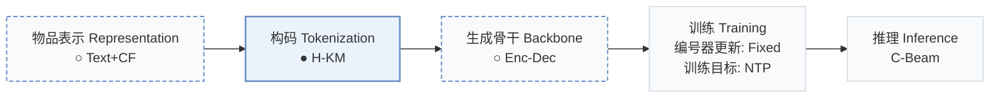
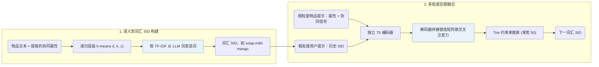
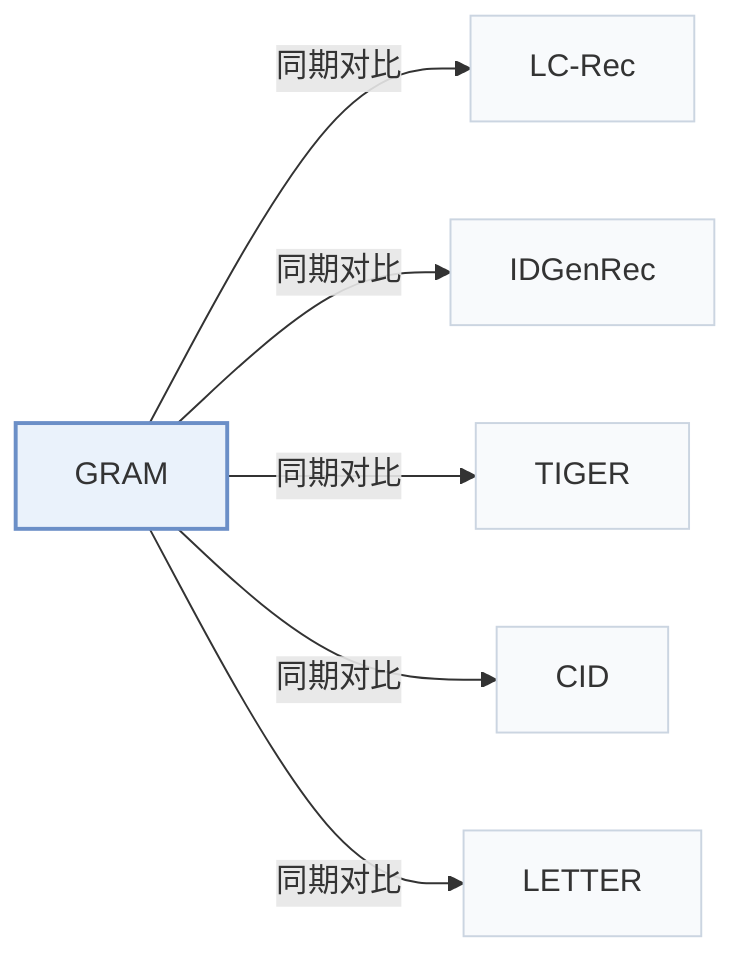

# GRAM

[← 问题 × 阶段矩阵](../../../README.zh.md#i--tokenization) · [按阶段索引](../index/stages.md) · [按模态找论文](../index/modality.md) · [按领域找论文](../index/domain.md) · [English](../../papers/gram.md) | 中文

| **题目** | *Generative recommendation via semantic-aware multi-granular late fusion* |
| :-- | :-- |
| **作者** | Lee et al. |
| **发表** | ACL’25 |
| **问题与阶段** | `I. 信息量` · `构码（Tokenization）` |
| **改动** | ○ 物品表示 · ● 构码 · ○ 生成骨干 |
| **构码输入** | `Text` |
| **领域** | `电商` · `本地生活与 POI` |
| **链接** | [论文](https://arxiv.org/abs/2506.01673) · [代码](https://github.com/skleee/GRAM) |
| **阅读级别** | 阅读笔记（第 2 级） |

**本页目录**：[TL;DR](#tldr) · [速览](#速览) · [1. 为什么重要](#1-为什么重要) · [2. 方法](#2-方法) · [3. 实验发现](#3-实验发现) · [4. 局限与分析](#4-局限与分析) · [5. 相关工作](#5-相关工作)

- `Text+CF`：文本表征结合协同过滤信号。
- `H-KM`：层级 k-means 聚类（Hierarchical k-means）。
- `Enc-Dec`：编码器-解码器（Encoder-decoder）架构。
- `Fixed`：先独立训练并冻结编号器，生成器训练期间 SID 保持不变。
- `NTP`：标准下一 token 预测（Next-Token Prediction）交叉熵损失；基于预训练 LLM 的指令微调（SFT）亦归入此类。
- `C-Beam`：受合法物品集合约束的束搜索（Constrained beam search）。

### TL;DR

> [!NOTE]
> GRAM 将层级与协同物品关系转化为 LLM 词表中的词，分别编码多粒度提示并仅在解码时融合，以利用长物品文本。

---

### 速览

| 维度 | 摘要 |
| :-- | :-- |
| 主要发现 | 在四个基准数据集上，GRAM 的 Recall@5 比八个生成式推荐模型高 11.5–16.0%，NDCG@5 高 5.3–13.6%（Abstract）。 |
| 局限 | 作者指出，用 TF-IDF 挑选词表词以及仅在大模型架构上测试小规模 T5（T5-small 和 T5-base）是主要局限（Sec. 7）。 |

---

### 1. 为什么重要

基于大语言模型（LLM）的生成式推荐难以纳入物品间的隐含协同关联，同时直接拼接冗长的物品描述会带来编码瓶颈（Abstract）。GRAM 从 LLM 原生词表中挑选词元构建层级词汇语义 ID（Semantic ID，SID），并在独立编码多粒度提示后推迟到解码阶段融合。

> "It employs separate encoders for multi-granular prompts, delaying the fusion until the decoding stage." (Abstract)

---

### 2. 方法

#### 语义到词汇的转换

GRAM 对物品嵌入执行递归层级 k-means 聚类（当簇内物品少于 $`c`$ 个或深度达到 $`l`$ 时停止），并通过 TF-IDF 将每个簇映射为 LLM 词表中的原生词，生成形如 `"soap-mild-mango"` 的层级词汇 SID，重复 ID 追加数字区分（Sec. 3.2.1，Sec. 7）。协同共现信号被提取并转化为附加文本属性。

> "To bridge collaborative semantics to LLMs, we extract collaborative signals and convert them as an additional item attribute." (Sec. 3.2.2)

#### 多粒度提示

粗粒度用户提示直接拼接历史交互物品的词汇 SID；细粒度物品提示则分别承载单个物品的属性文本与协同语义（Sec. 3.3.1）。

#### 后期融合

独立编码器分别处理粗粒度用户提示和各条细粒度物品提示，解码器在每一步将所有编码器输出拼接为交叉注意力的键值矩阵，并结合束宽为 50 的 Trie 约束束搜索解码目标 SID（Sec. 3.3.2，Eq. 8–9）。

---

### 3. 实验发现

实验设置

- **数据集**：Amazon Beauty, Toys and Games, Sports and Outdoors, and Yelp, with 5-core filtering of users and items (following Hua et al. 2023). Sizes (users / items / interactions): Beauty 22,363 / 12,101 / 198,502; Toys 19,412 / 11,924 / 167,597; Sports 35,598 / 18,357 / 296,337; Yelp 30,431 / 20,033 / 316,354.
  - 出处：Datasets and 5-core: [S4.p1](https://arxiv.org/html/2506.01673v1#S4.p1); statistics: [A7.T10](https://arxiv.org/html/2506.01673v1#A7.T10).
- **切分**：Per-user leave-one-out: last item for test, second last for validation, the rest for training; sequences capped at 20 items. Three seeds.
  - 出处：Leave-one-out allocation and history cap: [S4.p2](https://arxiv.org/html/2506.01673v1#S4.p2) and [S4.p4](https://arxiv.org/html/2506.01673v1#S4.p4).
- **候选集**：full catalog (full-ranking evaluation on all items rather than sampled items).
  - 出处：Full ranking on all items: [S4.p2](https://arxiv.org/html/2506.01673v1#S4.p2).
- **可见性**：warm; no unseen-item protocol is defined. A head/tail analysis splits test users by target-item popularity (top 20% versus bottom 80%).
  - 出处：Standard split with no unseen-item protocol: [S4.p2](https://arxiv.org/html/2506.01673v1#S4.p2); head/tail by target popularity: [S5.SS3.p2](https://arxiv.org/html/2506.01673v1#S5.SS3.p2).
- **SID 规格**：Hierarchical textual IDs: recursive k-means over item text embeddings, stopping when a cluster has fewer than c items or depth reaches l; each cluster index is mapped to an existing LLM vocabulary token chosen by TF-IDF. Final (l, k, c): Beauty (7, 128, 128); Toys (5, 32, 32); Sports and Yelp (7 or 9, 32, 32). Duplicate IDs receive an appended digit for uniqueness.
  - 出处：Hierarchical k-means textual IDs: [S3.SS2.SSS1.p2](https://arxiv.org/html/2506.01673v1#S3.SS2.SSS1.p2) and [S3.SS2.SSS1.p3](https://arxiv.org/html/2506.01673v1#S3.SS2.SSS1.p3); final settings: [A7.T12](https://arxiv.org/html/2506.01673v1#A7.T12); duplicate-ID digit: [S3.SS2.SSS1.p3](https://arxiv.org/html/2506.01673v1#S3.SS2.SSS1.p3).
- **推理预算**：Constrained beam search with beam size 50 and a Trie over valid IDs; T5-small on OpenP5. Table 7: average inference time per user sequence with all user sequences in a single batch on one NVIDIA A6000 GPU (Beauty 0.2008 s, Toys 0.1605 s; LC-Rec 1.8312 s and 1.8125 s).
  - 出处：Constrained beam 50 with Trie: [S4.p4](https://arxiv.org/html/2506.01673v1#S4.p4) and [S3.SS4.p2](https://arxiv.org/html/2506.01673v1#S3.SS4.p2); timing: [A3.T7](https://arxiv.org/html/2506.01673v1#A3.T7).
- **结果来源**：Table 2 (four datasets versus six sequential and eight generative baselines; three seeds); Table 3 (ablations); Table 4 (ID types); Figures 6-8 (head/tail, ID length, similar items); Tables 6-7 (preprocessing and inference time); Tables 8-9 (baseline reproduction fixes for ELMRec and IDGenRec).
  - 出处：Main: [S4.T2](https://arxiv.org/html/2506.01673v1#S4.T2); ablation: [S5.T3](https://arxiv.org/html/2506.01673v1#S5.T3); ID types: [S5.T4](https://arxiv.org/html/2506.01673v1#S5.T4); reproducibility: [A3.T8](https://arxiv.org/html/2506.01673v1#A3.T8) and [A4.T9](https://arxiv.org/html/2506.01673v1#A4.T9).

- 主实验对比：在 Amazon Beauty、Toys and Games、Sports and Outdoors 和 Yelp 四个数据集上，GRAM 的 Recall@5 比八个生成式基线高 11.5–16.0%，NDCG@5 高 5.3–13.6%（Abstract，Table 2）。
- 组件与 ID 消融：Table 3 消融了层级聚类、协同属性和多粒度后期融合；Table 4 显示在 GRAM 框架内，层级词汇 SID 优于 RQ-VAE 码和扁平 ID。
- 推理效率：在单张 NVIDIA A6000 GPU 上单批评估全部测试序列时，GRAM 在 Beauty 和 Toys 上平均每条用户序列推理耗时分别为 0.2008 s 和 0.1605 s，而 LC-Rec 分别为 1.8312 s 和 1.8125 s（Appendix C，Tables 6–7）。

---

### 4. 局限与分析

**Our analysis.**

- 直接复用词表中的原生词而非新增词表外 token，意味着预训练词义可能与物品语义吻合，也可能产生语义冲突。
- LC-Rec 在 `Dec-Only` LLM 中把 `RQ-VAE` 码映射为词表外新 token；GRAM 则在 `Enc-Dec` 生成器中用词表已有词构建 `H-KM` 词汇 SID。

---

### 5. 相关工作

- **同期对比** · [LC-Rec](lc-rec.md): LC-Rec maps RQ-VAE codes to new out-of-vocabulary tokens; GRAM builds hierarchical IDs from existing vocabulary tokens and verbalizes collaborative signals in item prompts.
  - 出处：GRAM v1, Section 3.2.1 contrasts the token choice: [S3.SS2.SSS1.p3](https://arxiv.org/html/2506.01673v1#S3.SS2.SSS1.p3); baselines and Table 2: [S4.p3](https://arxiv.org/html/2506.01673v1#S4.p3) and [S4.T2](https://arxiv.org/html/2506.01673v1#S4.T2); inference time in Table 7: [A3.T7](https://arxiv.org/html/2506.01673v1#A3.T7).
- **同期对比** · [IDGenRec](idgenrec.md): IDGenRec generates textual IDs with a learned ID generator; GRAM derives hierarchical textual IDs by clustering, and the authors rerun IDGenRec without user IDs that leak test items.
  - 出处：GRAM v1, baselines and Table 2: [S4.p3](https://arxiv.org/html/2506.01673v1#S4.p3) and [S4.T2](https://arxiv.org/html/2506.01673v1#S4.T2); reproduction in Table 9 and Appendix E: [A4.T9](https://arxiv.org/html/2506.01673v1#A4.T9) and [A5.p3](https://arxiv.org/html/2506.01673v1#A5.p3).
- **同期对比** · [TIGER](tiger.md): TIGER uses RQ-VAE codes as new tokens; GRAM's ID-type study also tests RQ-VAE IDs inside GRAM against hierarchical textual IDs.
  - 出处：GRAM v1, baselines and Table 2: [S4.p3](https://arxiv.org/html/2506.01673v1#S4.p3) and [S4.T2](https://arxiv.org/html/2506.01673v1#S4.T2); Table 4 ID types: [S5.T4](https://arxiv.org/html/2506.01673v1#S5.T4) and [S5.SS3.p1](https://arxiv.org/html/2506.01673v1#S5.SS3.p1).
- **同期对比** · [CID](cid.md): P5-CID, P5-SID, and P5-SemID are fixed indexing schemes for P5; GRAM adds hierarchical semantic text IDs and collaborative prompts.
  - 出处：GRAM v1, baselines and Table 2: [S4.p3](https://arxiv.org/html/2506.01673v1#S4.p3) and [S4.T2](https://arxiv.org/html/2506.01673v1#S4.T2); 5-core setting follows Hua et al. (2023): [S4.p1](https://arxiv.org/html/2506.01673v1#S4.p1).
- **同期对比** · [LETTER](letter.md): LETTER learns a regularized RQ-VAE tokenizer; GRAM avoids learned codebooks and uses text clustering mapped to vocabulary tokens.
  - 出处：GRAM v1, baselines and Table 2: [S4.p3](https://arxiv.org/html/2506.01673v1#S4.p3) and [S4.T2](https://arxiv.org/html/2506.01673v1#S4.T2).

[查看同格全部论文](../../../README.zh.md#i--tokenization)
