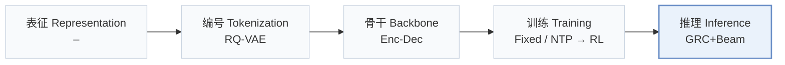
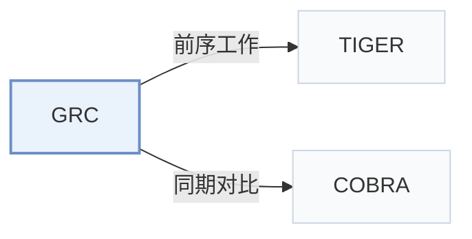

# GRC

[← 问题 × 阶段矩阵](../../../README.zh.md#iii--inference) · [按阶段索引](../index/stages.md) · [按模态索引](../index/modality.md) · [English](../../papers/grc.md) | 中文

| **题目** | *Learning to Reflect and Correct: Towards Better Decoding Trajectories for Large-Scale Generative Recommendation* |
| :-- | :-- |
| **作者** | Xing et al. |
| **发表** | CIKM’26 |
| **问题与阶段** | `III. SID 与模型对齐` · `推理（Inference）` |
| **链接** | [论文](https://arxiv.org/abs/2602.23639) |
| **阅读级别** | 概览（第 1 级） |

**本页目录**：[TL;DR](#tldr) · [速览](#速览) · [3. 实验发现](#3-实验发现) · [5. 相关工作](#5-相关工作)

- `RQ-VAE`：残差量化变分自编码器（Residual-Quantized VAE）。
- `Enc-Dec`：编码器-解码器（Encoder-decoder）架构。
- `Fixed`：先独立训练并冻结编号器，生成器训练期间 SID 保持不变。
- `NTP → RL`：先进行下一 token 预测微调，再执行强化学习（如 GRPO、GBPO 等）。
- `GRC+Beam`：生成-反思-修正（GRC）配合束搜索解码。

### TL;DR

> [!NOTE]
> GRC 将单遍解码扩展为语义 token 空间中的“生成-反思-修正”流程，用 GRPO 训练轨迹，并在束搜索中按熵分配修正预算。

---

### 速览

| 维度 | 摘要 |
| :-- | :-- |
| 研究问题 | III. SID 与模型对齐：生成模型能否理解并推理离散 SID，编号器与生成器的优化目标是否一致？ |
| 核心贡献 | GRC 将单遍解码扩展为语义 token 空间中的“生成-反思-修正”流程，用 GRPO 训练轨迹，并在束搜索中按熵分配修正预算。 |
| 主要改动阶段 | 推理（Inference） |

---

### 3. 实验发现

实验设置

- **数据集**：Amazon Arts and Musical Instruments; industrial e-commerce advertising logs spanning March-August 2025 (over 1B interactions, 19M users, 25M advertisements). Filtering rules not reported.
  - 出处：Section 5.1: [S5.SS1.p1](https://arxiv.org/html/2602.23639v1#S5.SS1.p1)
- **切分**：Amazon: per-user last interaction test, penultimate validation, remaining interactions training. Industrial offline split not reported. Online A/B: January 2-12, 2026, with control/treatment each containing 15% randomly sampled users.
  - 出处：Sections 5.1 and 6: [S5.SS1.p1](https://arxiv.org/html/2602.23639v1#S5.SS1.p1) and [S6.p1](https://arxiv.org/html/2602.23639v1#S6.p1)
- **候选集**：not reported
  - 出处：Sections 5.1 and 3.2 specify metrics and beam search, not evaluation negatives: [S5.SS1.p3](https://arxiv.org/html/2602.23639v1#S5.SS1.p3) and [S3.SS2.p3](https://arxiv.org/html/2602.23639v1#S3.SS2.p3)
- **可见性**：warm; no unseen-item protocol is defined. Tokenizer exposure to test items not reported; all GR models share a frozen dataset-specific RQ-VAE codebook.
  - 出处：Section 5.1 defines no item holdout: [S5.SS1.p1](https://arxiv.org/html/2602.23639v1#S5.SS1.p1) and [S5.SS1.p4](https://arxiv.org/html/2602.23639v1#S5.SS1.p4)
- **SID 规格**：RQ-VAE: 4 levels x 300 codes, fitted to Qwen3-8B item embeddings and then frozen. Deterministic SID-to-item lookup defined; collision disambiguation not reported.
  - 出处：Sections 3.1 and 5.1: [S3.SS1.p1](https://arxiv.org/html/2602.23639v1#S3.SS1.p1) and [S5.SS1.p4](https://arxiv.org/html/2602.23639v1#S5.SS1.p4)
- **推理预算**：Beam 200 offline/online; reflection and correction use entropy-guided pruning with alpha_e=0.2; paths judged correct skip regeneration. K=5/10, plus Recall@100/200 ablations. Online P99 latency 31 ms versus TIGER 27 ms, both using FlashAttention. Inference hardware and batch size not reported.
  - 出处：Sections 4.3, 5.1 and 6: [S4.SS3.p2](https://arxiv.org/html/2602.23639v1#S4.SS3.p2) and [S4.SS3.p4](https://arxiv.org/html/2602.23639v1#S4.SS3.p4) and [S5.SS1.p4](https://arxiv.org/html/2602.23639v1#S5.SS1.p4) and [S6.p1](https://arxiv.org/html/2602.23639v1#S6.p1)
- **结果来源**：Original Table 1: offline comparisons; Table 2: reflection accuracy; Table 3: ablations; Section 6: online A/B against in-house TIGER.
  - 出处：Section 5 Tables 1-3 and Section 6: [S5.T1](https://arxiv.org/html/2602.23639v1#S5.T1) and [S5.T2](https://arxiv.org/html/2602.23639v1#S5.T2) and [S5.T3](https://arxiv.org/html/2602.23639v1#S5.T3) and [S6.p1](https://arxiv.org/html/2602.23639v1#S6.p1)

---

### 5. 相关工作

- **前序工作** · [TIGER](tiger.md): GRC augments TIGER with structured reflection-correction supervision, followed by GRPO optimization.
  - 出处：GRC v1, Section 5.2 and Table 1: [S5.SS2.p1](https://arxiv.org/html/2602.23639v1#S5.SS2.p1); [S5.T1](https://arxiv.org/html/2602.23639v1#S5.T1).
- **同期对比** · [COBRA](cobra.md): COBRA supplements token generation with dense retrieval; GRC explicitly detects and corrects token trajectories.
  - 出处：GRC v1, Sections 2.1/5.1 and Table 1: [S2.SS1.p1](https://arxiv.org/html/2602.23639v1#S2.SS1.p1); [S5.SS1.p2](https://arxiv.org/html/2602.23639v1#S5.SS1.p2); [S5.T1](https://arxiv.org/html/2602.23639v1#S5.T1).

[查看同格全部论文](../../../README.zh.md#iii--inference)
