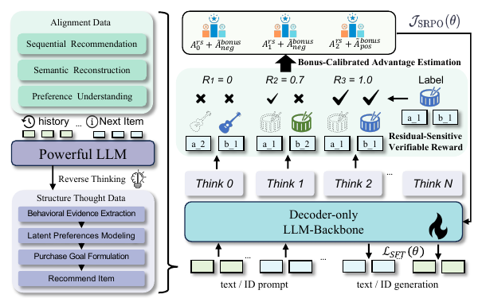
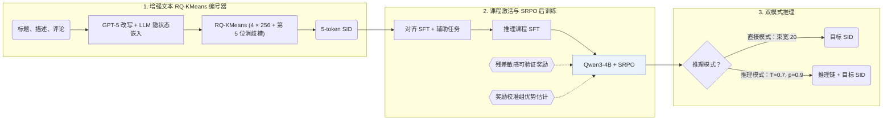
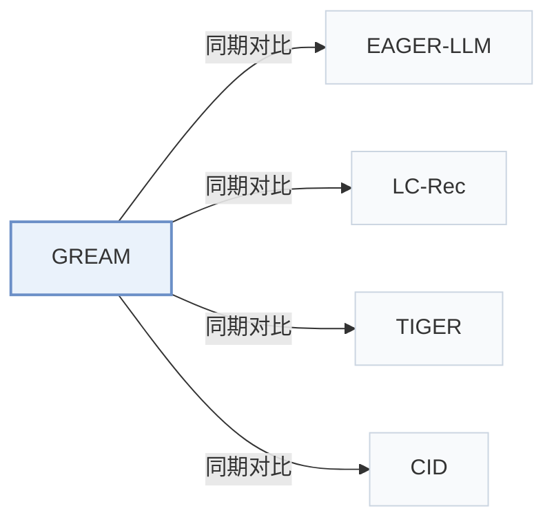

# GREAM

[← 问题 × 阶段矩阵](../../../README.zh.md#iii--training) · [按阶段索引](../index/stages.md) · [按模态索引](../index/modality.md) · [English](../../papers/gream.md) | 中文

| **题目** | *Generative Reasoning Recommendation via LLMs* |
| :-- | :-- |
| **作者** | Hong et al. |
| **发表** | arXiv’25 |
| **问题与阶段** | `III. SID 与模型对齐` · `训练（Training）` |
| **链接** | [论文](https://arxiv.org/abs/2510.20815) · [代码](https://github.com/Indolent-Kawhi/GRRM) |
| **阅读级别** | 阅读笔记（第 2 级） |

**本页目录**：[TL;DR](#tldr) · [速览](#速览) · [1. 为什么重要](#1-为什么重要) · [2. 方法](#2-方法) · [3. 实验发现](#3-实验发现) · [4. 局限与分析](#4-局限与分析) · [5. 相关工作](#5-相关工作)

- `Text+CF`：文本表征结合协同过滤信号。
- `RQ-KM`：残差 k-means 量化。
- `Dec-Only`：仅解码器（Decoder-only）自回归架构。
- `Fixed`：先独立训练并冻结编号器，生成器训练期间 SID 保持不变。
- `NTP → RL`：先进行下一 token 预测微调，再执行强化学习（如 GRPO、GBPO 等）。
- `Beam`：在 SID token 上执行自回归束搜索（Beam search）。

### TL;DR

> [!NOTE]
> GREAM 结合协同-语义物品索引、思维链课程学习与 SRPO 后训练将 LLM 改造为推理推荐模型，同时支持直接生成和先推理后生成两种模式。

---

### 速览

| 维度 | 摘要 |
| :-- | :-- |
| 研究问题 | III. SID 与模型对齐：生成模型能否理解并推理离散 SID，编号器与生成器的优化目标是否一致？ |
| 核心贡献 | GREAM 结合协同-语义物品索引、思维链课程学习与 SRPO 后训练将 LLM 改造为推理推荐模型，同时支持直接生成和先推理后生成两种模式。 |
| 主要改动阶段 | 训练（Training） |
| 主要发现 | 在 Amazon Beauty、Sports and Outdoors 和 Musical Instruments 上，GREAM 在直接模式和推理模式下均优于生成式与 LLM 基线，并将 RQ-KMeans 索引冲突率降低约 50%（Abstract，Sec. 4.1，Table 2）。 |
| 局限 | 物品索引依赖 GPT-5 改写的描述，推理数据来自外部 LLM，复现结果受限于对这些闭源或外部模型的调用条件（Sec. 4.1，Sec. 4.2）。 |

---

### 1. 为什么重要

用大语言模型（LLM）做生成式推理推荐面临两大障碍：文本语义与协同过滤信号之间存在表征鸿沟，且用户反馈稀疏并带有随机性（Abstract）。GREAM 通过增强语义 ID（Semantic ID，SID）、合成推理课程与稀疏正则强化后训练应对这两点，同时提供低延迟直接生成和显式思维链推理两种模式。

> "GREAM natively supports two complementary inference modes: Direct Sequence Recommendation for high-throughput, low-latency deployment, and Sequential Reasoning Recommendation that first emits an interpretable reasoning chain for causal transparency." (Abstract)

---

### 2. 方法

#### 协同-语义对齐

对每个物品，GPT-5 将标题、官方描述与精选评论整合成统一描述，RQ-KMeans 再将其 LLM 最后一层隐状态量化为 5 位 SID（前 4 层每层码本大小 256，第 5 位为冲突消解槽）（Sec. 4.1，Eq. 4–5）。辅助对齐任务将语言表征锚定到交互语义（Abstract）。

#### 推理课程激活

外部教师 LLM 从已知目标物品出发，向用户交互历史反向推演，生成结构化的五步因果推理轨迹用于 Qwen3-4B 的课程监督微调（Sec. 4.2）。

> "This process guides the model through a structured, five-stage logical chain—behavioral evidence extraction, latent preference modeling, intent inference, recommendation formulation, and denoised sequence rewriting" (Sec. 1)

#### SRPO

稀疏正则组策略优化（SRPO）结合前缀级残差敏感可验证奖励与带奖励校准的组优势估计，使生成器在完全命中极少时仍能获得有效梯度信号（Abstract，Sec. 5.2）。

> "In the early stages of generative recommendation, exactly correct generations are typically rare." (Sec. 5.2)

---

### 3. 实验发现

实验设置

- **数据集**：Amazon Beauty, Sports and Outdoors, Musical Instruments, with 5-core filtering of users and items. Sizes (users / items / interactions): 22,363 / 12,101 / 198,360; 35,598 / 18,357 / 296,175; 24,733 / 9,923 / 206,153. Alignment and reasoning text is synthesized by Qwen3, GPT-5, Llama-3.1, and Gemini.
  - 出处：Datasets and 5-core: [S6.SS1.SSS1.p1](https://arxiv.org/html/2510.20815v1#S6.SS1.SSS1.p1); statistics: [S6.T1](https://arxiv.org/html/2510.20815v1#S6.T1).
- **切分**：Leave-one-out; the exact validation/test position allocation is not reported beyond the leave-one-out label.
  - 出处：Leave-one-out named only: [S6.SS1.SSS2.p1](https://arxiv.org/html/2510.20815v1#S6.SS1.SSS2.p1).
- **候选集**：not reported (full catalog versus sampled evaluation candidates); direct mode reports Recall and NDCG at 5 and 10, reasoning mode reports Pass@1, 5, 10.
  - 出处：Metrics only: [S6.SS1.SSS2.p1](https://arxiv.org/html/2510.20815v1#S6.SS1.SSS2.p1).
- **可见性**：warm; no unseen-item protocol is defined.
  - 出处：Standard split with no unseen-item protocol: [S6.SS1.SSS2.p1](https://arxiv.org/html/2510.20815v1#S6.SS1.SSS2.p1).
- **SID 规格**：RQ-KMeans indices over LLM last-hidden-state embeddings of GPT-5-enriched item text; fixed length 5 with 256 values per layer, where the fifth position is a conflict-resolution slot.
  - 出处：Length 5 with a conflict-resolution slot, 256 values per layer: [S6.SS1.SSS3.p1](https://arxiv.org/html/2510.20815v1#S6.SS1.SSS3.p1); RQ-KMeans over LLM embeddings of GPT-5-enriched text: [S3.SS1.SSS2.p1](https://arxiv.org/html/2510.20815v1#S3.SS1.SSS2.p1) and [S4.SS1.p1](https://arxiv.org/html/2510.20815v1#S4.SS1.p1).
- **推理预算**：Direct mode: beam size 20 for all generative methods. Reasoning mode: sampling with temperature 0.7 and top-p 0.9. Backbone Qwen3-4B-Instruct; experiments on a cluster of 24 NVIDIA A100 GPUs; inference batch size and latency: not reported.
  - 出处：Beam 20 and sampling settings: [S6.SS1.SSS2.p1](https://arxiv.org/html/2510.20815v1#S6.SS1.SSS2.p1); hardware: [S6.SS1.SSS3.p1](https://arxiv.org/html/2510.20815v1#S6.SS1.SSS3.p1).
- **结果来源**：Table 2 (direct and reasoning modes on Beauty, Sports, Instruments versus traditional, Transformer, generative, and LLM baselines); Table 3 (alignment and RL ablations); Table 4 (data composition); Figure 3 (RL regimes on Instruments).
  - 出处：Main: [S6.T2](https://arxiv.org/html/2510.20815v1#S6.T2); ablations: [S6.T3](https://arxiv.org/html/2510.20815v1#S6.T3) and [S6.T4](https://arxiv.org/html/2510.20815v1#S6.T4); RL regimes: [S6.SS5.p2](https://arxiv.org/html/2510.20815v1#S6.SS5.p2).

- 主实验对比：在 Amazon Beauty、Sports and Outdoors 和 Musical Instruments 上，GREAM 在直接模式（Recall@5/10、NDCG@5/10）和推理模式（Pass@1/5/10）下均优于传统模型、Transformer、生成式基线和 LLM 基线（Abstract，Table 2）。
- 索引质量与消融：在 GPT-5 增强嵌入上执行 RQ-KMeans 使索引冲突率降低约 50%（Sec. 4.1）；Tables 3–4 验证了协同-语义对齐、推理激活与 SRPO 各阶段的贡献。
- 推理扩展性：增加推理激活阶段的合成思维链数据后，Pass@Avg 在 $`10^{16}`$–$`10^{19}`$ 训练 FLOPs 范围内呈近线性增长（Sec. 6.4，Fig. 1）。

---

### 4. 局限与分析

**Our analysis.**

- 推理模式需在生成目标 SID 前先输出五步推理链，这意味着其推理解码延迟和生成 token 开销高于直接束搜索模式，但原文未报告实测延迟。
- LC-Rec 和 EAGER-LLM 用 `Multi-task NTP` 训练仅解码器 LLM；GREAM 在监督对齐之后增加了强化学习后训练阶段（`NTP → RL`）。

---

### 5. 相关工作

- **同期对比** · [EAGER-LLM](eager-llm.md): EAGER-LLM injects behavioral and semantic signals into a decoder-only LLM recommender; GREAM adds collaborative-semantic alignment data, reasoning curricula, and RL with a prefix-based verifiable reward.
  - 出处：GREAM v1, LLM-based baselines: [A2.I4.i2.p1](https://arxiv.org/html/2510.20815v1#A2.I4.i2.p1); Table 2: [S6.T2](https://arxiv.org/html/2510.20815v1#S6.T2).
- **同期对比** · [LC-Rec](lc-rec.md): LC-Rec aligns LLaMA to VQ indices with language tasks; GREAM adds explicit reasoning chains and RL fine-tuning on Qwen3.
  - 出处：GREAM v1, LLM-based baselines: [A2.I4.i1.p1](https://arxiv.org/html/2510.20815v1#A2.I4.i1.p1); Table 2: [S6.T2](https://arxiv.org/html/2510.20815v1#S6.T2).
- **同期对比** · [TIGER](tiger.md): TIGER generates RQ-VAE identifiers with a small T5; GREAM generates RQ-KMeans indices with an LLM that can reason before recommending.
  - 出处：GREAM v1, generative baselines: [A2.I3.i2.p1](https://arxiv.org/html/2510.20815v1#A2.I3.i2.p1); Table 2: [S6.T2](https://arxiv.org/html/2510.20815v1#S6.T2).
- **同期对比** · [CID](cid.md): P5-CID uses collaborative IDs for a T5 recommender; GREAM uses semantic RQ-KMeans indices with LLM reasoning.
  - 出处：GREAM v1, generative baselines: [A2.I3.i1.p1](https://arxiv.org/html/2510.20815v1#A2.I3.i1.p1); Table 2: [S6.T2](https://arxiv.org/html/2510.20815v1#S6.T2).

[查看同格全部论文](../../../README.zh.md#iii--training)
