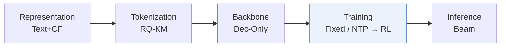
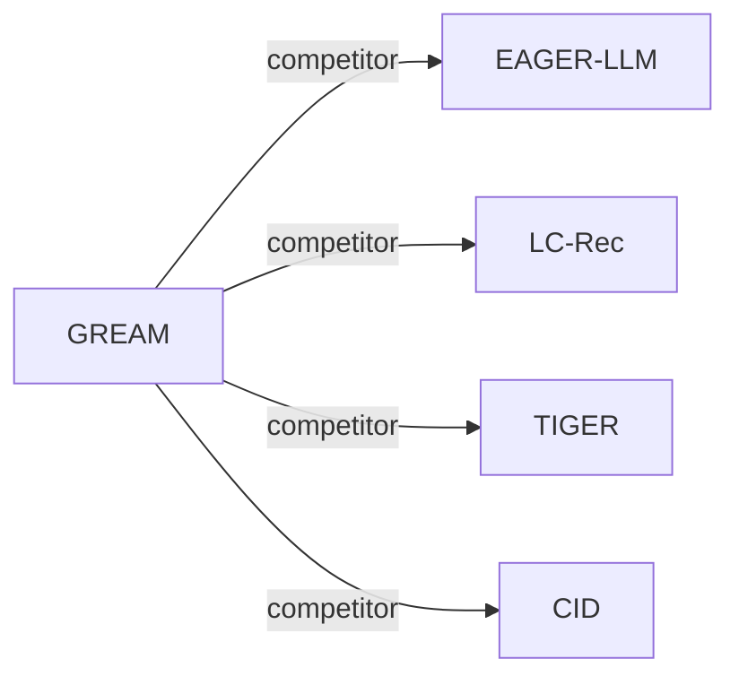

# GREAM

*Generative Reasoning Recommendation via LLMs* — Hong et al. · arXiv’25

`III. SID 与模型对齐` · `Training` · [论文](https://arxiv.org/abs/2510.20815) · [代码](https://github.com/Indolent-Kawhi/GRRM) · [矩阵](../../../README.zh.md#iii--training) · [English](../../papers/gream.md)

阅读级别：概览（第 1 级） · 本页目录：[TL;DR](#tldr) · [速览](#速览) · [2. 方法](#2-方法) · [3. 实验发现](#3-实验发现) · [5. 相关工作](#5-相关工作)

- `Dec-Only`: Decoder-only.
- `Fixed`: SIDs are built first and not changed while the generator trains.
- `NTP → RL`: NTP, then reinforcement learning (GRPO, GBPO, etc.).

### TL;DR

> [!NOTE]
> GREAM 结合协同-语义物品索引、思维链课程学习与 SRPO 后训练将 LLM 改造为推理推荐模型，同时支持直接生成和先推理后生成两种模式。

### 速览

| 维度 | 摘要 |
| :-- | :-- |
| 研究问题 | III. SID 与模型对齐：Can the generator read, write, and reason over SIDs, and do the tokenizer and generator work toward the same goal? |
| 核心贡献 | GREAM 结合协同-语义物品索引、思维链课程学习与 SRPO 后训练将 LLM 改造为推理推荐模型，同时支持直接生成和先推理后生成两种模式。 |
| 主要改动阶段 | Training |

### 2. 方法

### 3. 实验发现

实验设置

- **数据集**：Amazon Beauty, Sports and Outdoors, Musical Instruments, with 5-core filtering of users and items. Sizes (users / items / interactions): 22,363 / 12,101 / 198,360; 35,598 / 18,357 / 296,175; 24,733 / 9,923 / 206,153. Alignment and reasoning text is synthesized by Qwen3, GPT-5, Llama-3.1, and Gemini.
  - 出处：Datasets and 5-core: [S6.SS1.SSS1.p1](https://arxiv.org/html/2510.20815v1#S6.SS1.SSS1.p1); statistics: [S6.T1](https://arxiv.org/html/2510.20815v1#S6.T1).
- **切分**：Leave-one-out; the exact validation/test position allocation is not reported beyond the leave-one-out label.
  - 出处：Leave-one-out named only: [S6.SS1.SSS2.p1](https://arxiv.org/html/2510.20815v1#S6.SS1.SSS2.p1).
- **候选集**：not reported (full catalog versus sampled evaluation candidates); direct mode reports Recall and NDCG at 5 and 10, reasoning mode reports Pass@1, 5, 10.
  - 出处：Metrics only: [S6.SS1.SSS2.p1](https://arxiv.org/html/2510.20815v1#S6.SS1.SSS2.p1).
- **可见性**：warm; no unseen-item protocol is defined.
  - 出处：Standard split with no unseen-item protocol: [S6.SS1.SSS2.p1](https://arxiv.org/html/2510.20815v1#S6.SS1.SSS2.p1).
- **SID 规格**：RQ-KMeans indices over LLM last-hidden-state embeddings of GPT-5-enriched item text; fixed length 5 with 256 values per layer, where the fifth position is a conflict-resolution slot.
  - 出处：Length 5 with a conflict-resolution slot, 256 values per layer: [S6.SS1.SSS3.p1](https://arxiv.org/html/2510.20815v1#S6.SS1.SSS3.p1); RQ-KMeans over LLM embeddings of GPT-5-enriched text: [S3.SS1.SSS2.p1](https://arxiv.org/html/2510.20815v1#S3.SS1.SSS2.p1) and [S4.SS1.p1](https://arxiv.org/html/2510.20815v1#S4.SS1.p1).
- **推理预算**：Direct mode: beam size 20 for all generative methods. Reasoning mode: sampling with temperature 0.7 and top-p 0.9. Backbone Qwen3-4B-Instruct; experiments on a cluster of 24 NVIDIA A100 GPUs; inference batch size and latency: not reported.
  - 出处：Beam 20 and sampling settings: [S6.SS1.SSS2.p1](https://arxiv.org/html/2510.20815v1#S6.SS1.SSS2.p1); hardware: [S6.SS1.SSS3.p1](https://arxiv.org/html/2510.20815v1#S6.SS1.SSS3.p1).
- **结果来源**：Table 2 (direct and reasoning modes on Beauty, Sports, Instruments versus traditional, Transformer, generative, and LLM baselines); Table 3 (alignment and RL ablations); Table 4 (data composition); Figure 3 (RL regimes on Instruments).
  - 出处：Main: [S6.T2](https://arxiv.org/html/2510.20815v1#S6.T2); ablations: [S6.T3](https://arxiv.org/html/2510.20815v1#S6.T3) and [S6.T4](https://arxiv.org/html/2510.20815v1#S6.T4); RL regimes: [S6.SS5.p2](https://arxiv.org/html/2510.20815v1#S6.SS5.p2).

### 5. 相关工作

- **同期对比** · [EAGER-LLM](eager-llm.md): EAGER-LLM injects behavioral and semantic signals into a decoder-only LLM recommender; GREAM adds collaborative-semantic alignment data, reasoning curricula, and RL with a prefix-based verifiable reward.
  - 出处：GREAM v1, LLM-based baselines: https://arxiv.org/html/2510.20815v1#A2.I4.i2.p1; Table 2: https://arxiv.org/html/2510.20815v1#S6.T2.
- **同期对比** · [LC-Rec](lc-rec.md): LC-Rec aligns LLaMA to VQ indices with language tasks; GREAM adds explicit reasoning chains and RL fine-tuning on Qwen3.
  - 出处：GREAM v1, LLM-based baselines: https://arxiv.org/html/2510.20815v1#A2.I4.i1.p1; Table 2: https://arxiv.org/html/2510.20815v1#S6.T2.
- **同期对比** · [TIGER](tiger.md): TIGER generates RQ-VAE identifiers with a small T5; GREAM generates RQ-KMeans indices with an LLM that can reason before recommending.
  - 出处：GREAM v1, generative baselines: https://arxiv.org/html/2510.20815v1#A2.I3.i2.p1; Table 2: https://arxiv.org/html/2510.20815v1#S6.T2.
- **同期对比** · [CID](cid.md): P5-CID uses collaborative IDs for a T5 recommender; GREAM uses semantic RQ-KMeans indices with LLM reasoning.
  - 出处：GREAM v1, generative baselines: https://arxiv.org/html/2510.20815v1#A2.I3.i1.p1; Table 2: https://arxiv.org/html/2510.20815v1#S6.T2.

[查看同格全部论文](../../../README.zh.md#iii--training)
