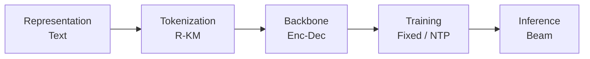
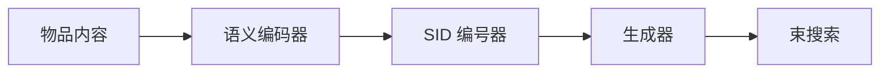
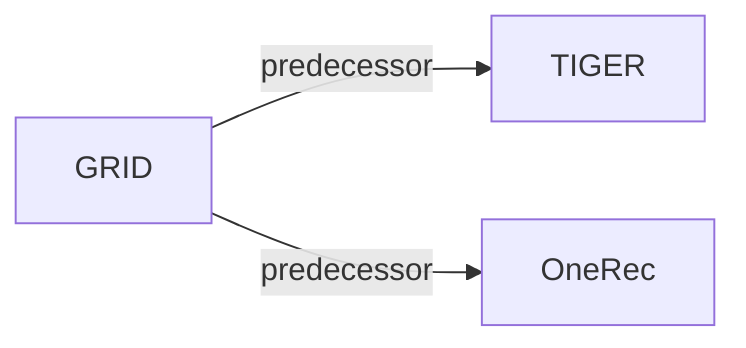

# GRID

*Generative Recommendation with Semantic IDs: A Practitioner's Handbook* — Ju et al. · CIKM’25

`范式、系统与基准` · `无单一阶段` · [论文](https://arxiv.org/abs/2507.22224) · [代码](https://github.com/snap-research/GRID) · [矩阵](../../../README.zh.md#范式系统与基准) · [English](../../papers/grid.md)

阅读级别：阅读笔记（第 2 级） · 本页目录：[TL;DR](#tldr) · [速览](#速览) · [1. 为什么重要](#1-为什么重要) · [2. 方法](#2-方法) · [3. 实验发现](#3-实验发现) · [4. 局限与分析](#4-局限与分析) · [5. 相关工作](#5-相关工作)

- `R-KM`: Residual k-means.
- `Enc-Dec`: Encoder-decoder.
- `Fixed`: SIDs are built first and not changed while the generator trains.
- `NTP`: Next-token prediction loss only; continuing from a pretrained LLM (SFT) also counts as NTP.

### TL;DR

> [!NOTE]
> GRID 是开源模块化框架而非新推荐模型：支持替换 SID 生成式推荐器的各个组件，并在公开基准上开展消融对比。

### 速览

| 维度 | 摘要 |
| :-- | :-- |
| 研究问题 | 范式、系统与基准：Baseline (TIGER), end-to-end multi-stage paradigms, open-source frameworks, benchmarks, and diagnostic resources. |
| 核心贡献 | GRID 是开源模块化框架而非新推荐模型：支持替换 SID 生成式推荐器的各个组件，并在公开基准上开展消融对比。 |
| 主要改动阶段 | 无单一阶段 |

### 1. 为什么重要

各家生成式推荐（GR）方案的建模技巧、超参数和实验设置各不相同，很难直接比较（Abstract）。GRID 把这些方案放进一个模块化框架，组件可以替换，也可以逐个消融。

> "Our comprehensive experiments with GRID reveal that many overlooked architectural components in GR models with SIDs substantially impact performance."（Abstract）（许多被忽视的结构组件对效果影响很大。）

### 2. 方法

#### 先编号，再生成

GRID 把基于语义 ID（Semantic ID，SID）的 GR 分成编号和生成两个阶段（Sec. 3.1）。

#### 编号阶段的消融

研究改变编号算法、语义编码器的大小、残差层数 $`L`$ 和每层 token 数 $`W`$（Sec. 4.1）。

> "Unless otherwise noted, we use RK-Means with (L,W)=(3,256) and Flan-T5-XL."（Sec. 4.1）（默认配置是 RK-Means、(L,W)=(3,256) 和 Flan-T5-XL。）

#### 生成阶段的消融

研究改变用户 token 数、编码器-解码器与仅解码器、数据增强、去重 ID，以及约束与不约束的束搜索（Sec. 4.2）。

### 3. 实验发现

实验设置

- **数据集**：5-core filtered Amazon Beauty, Sports, and Toys; item text from Title, Categories, Description, and Price. Retained corpus sizes: not reported in the body.
  - 出处：5-core Amazon datasets and text features: [S4.p2](https://arxiv.org/html/2507.22224v1#S4.p2).
- **切分**：Per-user leave-last-out: last item for test, second-to-last for validation, the rest for training; sliding-window training samples; averages over 5 seeds.
  - 出处：Leave-last-out allocation and 5 seeds: [S4.p2](https://arxiv.org/html/2507.22224v1#S4.p2).
- **候选集**：not reported (full catalog versus sampled evaluation candidates); top-K lists from beam search.
  - 出处：Metrics only: [S4.p2](https://arxiv.org/html/2507.22224v1#S4.p2).
- **可见性**：warm; no unseen-item protocol is defined.
  - 出处：Standard split with no unseen-item protocol: [S4.p2](https://arxiv.org/html/2507.22224v1#S4.p2).
- **SID 规格**：Benchmark default: RK-Means with 3 levels x 256 tokens over mean-pooled Flan-T5-XL embeddings; also R-VQ and RQ-VAE, and L x W variants (e.g. 3 x 128, 3 x 512, 2 x 256). Collisions: Table 7 compares TIGER-style appended-digit de-duplication with randomly selecting one item when SIDs conflict; which one is the default setting is not stated.
  - 出处：Default RK-Means (3, 256) with Flan-T5-XL: [S4.SS1.p1](https://arxiv.org/html/2507.22224v1#S4.SS1.p1); dimension study: [S3.T3](https://arxiv.org/html/2507.22224v1#S3.T3); de-duplication strategies: [S4.SS2.p5](https://arxiv.org/html/2507.22224v1#S4.SS2.p5) and [S4.T7](https://arxiv.org/html/2507.22224v1#S4.T7).
- **推理预算**：Beam search with KV cache; constrained and unconstrained beam compared (Table 8), with unconstrained stated to be cheaper; numerical beam width not reported. Tokenizers trained on 8 GPUs (per-device batch 2,048); generator training batch 256; inference hardware, batch size, and latency: not reported.
  - 出处：Beam search with KV cache: [S3.SS1.p3](https://arxiv.org/html/2507.22224v1#S3.SS1.p3); constrained versus free-form beam: [S4.SS2.p6](https://arxiv.org/html/2507.22224v1#S4.SS2.p6) and [S4.T8](https://arxiv.org/html/2507.22224v1#S4.T8); tokenizer GPUs: [S4.p2](https://arxiv.org/html/2507.22224v1#S4.p2).
- **结果来源**：Tables 1-3 (tokenizer algorithm, encoder size, codebook dimensions); Tables 4-8 (user tokens, encoder-decoder versus decoder-only, augmentation, SID de-duplication, constrained versus free-form beam). Tables 3 and 4 cover Beauty only; the other tables cover Beauty, Sports, and Toys; results average 5 seeds.
  - 出处：Tables 1-8: [S3.T1](https://arxiv.org/html/2507.22224v1#S3.T1), [S3.T2](https://arxiv.org/html/2507.22224v1#S3.T2), [S3.T3](https://arxiv.org/html/2507.22224v1#S3.T3), [S4.T4](https://arxiv.org/html/2507.22224v1#S4.T4), [S4.T5](https://arxiv.org/html/2507.22224v1#S4.T5), [S4.T6](https://arxiv.org/html/2507.22224v1#S4.T6), [S4.T7](https://arxiv.org/html/2507.22224v1#S4.T7), [S4.T8](https://arxiv.org/html/2507.22224v1#S4.T8).

- 主要结论：几个被当作必需、往往还费算力或工程量的组件，可以换成更省的做法而效果不降（Sec. 5）。

  > "Conversely, other, often overlooked design choices prove to be vital, such as encoder-decoder architectures and data augmentation."（Sec. 5）（反过来，编码器-解码器结构和数据增强这类常被忽视的选择很关键。）

### 4. 局限与分析

**Our analysis.**

- 消融每次只在默认配置上改一个组件（Sec. 4.1）。由此推断，组件之间的交互没有覆盖到。
- TIGER 用 `RQ-VAE` 码；GRID 默认用 `R-KM` 码，和 OneRec 的编号方式相同。

### 5. 相关工作

- **前序工作** · [TIGER](tiger.md): TIGER's RQ-VAE tokenizer, user tokens, and appended-digit de-duplication are the components that GRID ablates in one open framework.
  - 出处：GRID v1, Section 4.1 on RQ-VAE as the TIGER default: https://arxiv.org/html/2507.22224v1#S4.SS1.p2; Table 4 (TIGER-style user tokens): https://arxiv.org/html/2507.22224v1#S4.T4; Section 4.2 de-duplication: https://arxiv.org/html/2507.22224v1#S4.SS2.p5.
- **前序工作** · [OneRec](onerec.md): GRID's default RK-Means tokenizer is taken from OneRec; GRID compares it with R-VQ and RQ-VAE.
  - 出处：GRID v1, Section 4 setup cites Deng et al. (2025) for RK-Means: https://arxiv.org/html/2507.22224v1#S4.p2; Table 1: https://arxiv.org/html/2507.22224v1#S3.T1.

[查看同格全部论文](../../../README.zh.md#范式系统与基准)
