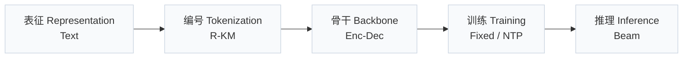
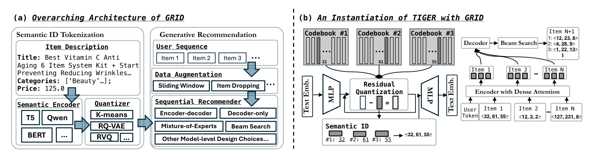
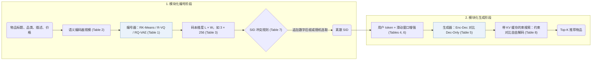
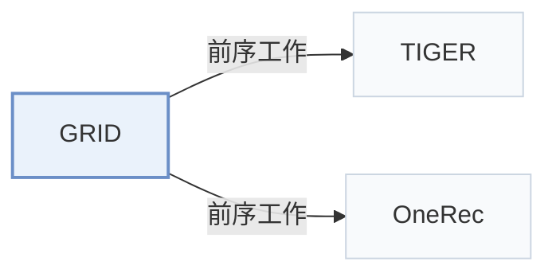

# GRID

[← 问题 × 阶段矩阵](../../../README.zh.md#范式系统与基准) · [按阶段索引](../index/stages.md) · [按模态索引](../index/modality.md) · [English](../../papers/grid.md) | 中文

| **题目** | *Generative Recommendation with Semantic IDs: A Practitioner's Handbook* |
| :-- | :-- |
| **作者** | Ju et al. |
| **发表** | CIKM’25 |
| **问题与阶段** | `范式、系统与基准` · `无单一阶段` |
| **链接** | [论文](https://arxiv.org/abs/2507.22224) · [代码](https://github.com/snap-research/GRID) |
| **阅读级别** | 阅读笔记（第 2 级） |

**本页目录**：[TL;DR](#tldr) · [速览](#速览) · [1. 为什么重要](#1-为什么重要) · [2. 方法](#2-方法) · [3. 实验发现](#3-实验发现) · [4. 局限与分析](#4-局限与分析) · [5. 相关工作](#5-相关工作)

- `Text`：物品文本元数据（标题、描述、类目或提示词）。
- `R-KM`：残差 k-means 量化（Residual k-means）。
- `Enc-Dec`：编码器-解码器（Encoder-decoder）架构。
- `Fixed`：先独立训练并冻结编号器，生成器训练期间 SID 保持不变。
- `NTP`：标准下一 token 预测（Next-Token Prediction）交叉熵损失；基于预训练 LLM 的指令微调（SFT）亦归入此类。
- `Beam`：在 SID token 上执行自回归束搜索（Beam search）。

### TL;DR

> [!NOTE]
> GRID 提供开源模块化框架，支持自由替换 SID 编号器、生成骨干与解码策略，并在公开基准上系统消融各组件的设计选择。

---

### 速览

| 维度 | 摘要 |
| :-- | :-- |
| 研究问题 | 范式、系统与基准：基线范式（TIGER）、端到端多阶段工业框架、开源代码库、评测基准与诊断工具。 |
| 核心贡献 | GRID 提供开源模块化框架，支持自由替换 SID 编号器、生成骨干与解码策略，并在公开基准上系统消融各组件的设计选择。 |
| 主要改动阶段 | 无单一阶段 |
| 主要发现 | 在 Amazon Beauty、Sports 和 Toys 上的 5 随机种子消融实验（Tables 1–8）表明，编码器-解码器结构与滑动窗口数据增强主导推荐精度，而若干高开销默认组件可替换为更高效的替代方案且不损效果（Sec. 5）。 |
| 局限 | GRID 围绕固定的 RK-Means $`(3, 256)`$ 与 Flan-T5-XL 默认配置做单因素消融，未覆盖组件间的交互效应，也未报告束宽数值与实测推理延迟（Sec. 4.1）。 |

---

### 1. 为什么重要

现有生成式推荐（GR）工作在编号器、骨干网络、超参数与评估切分上各不相同，难以直接横向比较（Abstract）。GRID 将基于语义 ID（Semantic ID，SID）的推荐流程整合进统一的开源模块化框架，使研究者可以在固定协议下逐一替换并消融各个组件。

> "Our comprehensive experiments with GRID reveal that many overlooked architectural components in GR models with SIDs substantially impact performance." (Abstract)

---

### 2. 方法

#### 先编号，再生成

GRID 将基于 SID 的生成式推荐拆解为离线物品编号阶段与自回归序列生成阶段（Sec. 3.1）。

#### 编号阶段的消融

在编号阶段，GRID 围绕固定参考配置依次改变编号器算法（`RK-Means`、`R-VQ` 与 `RQ-VAE`）、预训练语义编码器参数规模，以及码本层数 $`L`$ 与每层宽度 $`W`$（Sec. 4.1，Tables 1–3）。

> "Unless otherwise noted, we use RK-Means with (L,W)=(3,256) and Flan-T5-XL." (Sec. 4.1)

#### 生成阶段的消融

在生成阶段，GRID 依次消融哈希用户 token 数量、编码器-解码器与仅解码器结构、滑动窗口数据增强、追加数字去重与冲突随机采样，以及带 KV 缓存的 Trie 约束束搜索与无约束自由束搜索（Sec. 4.2，Tables 4–8）。

---

### 3. 实验发现

实验设置

- **数据集**：5-core filtered Amazon Beauty, Sports, and Toys; item text from Title, Categories, Description, and Price. Retained corpus sizes: not reported in the body.
  - 出处：5-core Amazon datasets and text features: [S4.p2](https://arxiv.org/html/2507.22224v1#S4.p2).
- **切分**：Per-user leave-last-out: last item for test, second-to-last for validation, the rest for training; sliding-window training samples; averages over 5 seeds.
  - 出处：Leave-last-out allocation and 5 seeds: [S4.p2](https://arxiv.org/html/2507.22224v1#S4.p2).
- **候选集**：not reported (full catalog versus sampled evaluation candidates); top-K lists from beam search.
  - 出处：Metrics only: [S4.p2](https://arxiv.org/html/2507.22224v1#S4.p2).
- **可见性**：warm; no unseen-item protocol is defined.
  - 出处：Standard split with no unseen-item protocol: [S4.p2](https://arxiv.org/html/2507.22224v1#S4.p2).
- **SID 规格**：Benchmark default: RK-Means with 3 levels x 256 tokens over mean-pooled Flan-T5-XL embeddings; also R-VQ and RQ-VAE, and L x W variants (e.g. 3 x 128, 3 x 512, 2 x 256). Collisions: Table 7 compares TIGER-style appended-digit de-duplication with randomly selecting one item when SIDs conflict; which one is the default setting is not stated.
  - 出处：Default RK-Means (3, 256) with Flan-T5-XL: [S4.SS1.p1](https://arxiv.org/html/2507.22224v1#S4.SS1.p1); dimension study: [S3.T3](https://arxiv.org/html/2507.22224v1#S3.T3); de-duplication strategies: [S4.SS2.p5](https://arxiv.org/html/2507.22224v1#S4.SS2.p5) and [S4.T7](https://arxiv.org/html/2507.22224v1#S4.T7).
- **推理预算**：Beam search with KV cache; constrained and unconstrained beam compared (Table 8), with unconstrained stated to be cheaper; numerical beam width not reported. Tokenizers trained on 8 GPUs (per-device batch 2,048); generator training batch 256; inference hardware, batch size, and latency: not reported.
  - 出处：Beam search with KV cache: [S3.SS1.p3](https://arxiv.org/html/2507.22224v1#S3.SS1.p3); constrained versus free-form beam: [S4.SS2.p6](https://arxiv.org/html/2507.22224v1#S4.SS2.p6) and [S4.T8](https://arxiv.org/html/2507.22224v1#S4.T8); tokenizer GPUs: [S4.p2](https://arxiv.org/html/2507.22224v1#S4.p2).
- **结果来源**：Tables 1-3 (tokenizer algorithm, encoder size, codebook dimensions); Tables 4-8 (user tokens, encoder-decoder versus decoder-only, augmentation, SID de-duplication, constrained versus free-form beam). Tables 3 and 4 cover Beauty only; the other tables cover Beauty, Sports, and Toys; results average 5 seeds.
  - 出处：Tables 1-8: [S3.T1](https://arxiv.org/html/2507.22224v1#S3.T1), [S3.T2](https://arxiv.org/html/2507.22224v1#S3.T2), [S3.T3](https://arxiv.org/html/2507.22224v1#S3.T3), [S4.T4](https://arxiv.org/html/2507.22224v1#S4.T4), [S4.T5](https://arxiv.org/html/2507.22224v1#S4.T5), [S4.T6](https://arxiv.org/html/2507.22224v1#S4.T6), [S4.T7](https://arxiv.org/html/2507.22224v1#S4.T7), [S4.T8](https://arxiv.org/html/2507.22224v1#S4.T8).

- 可简化的组件：在 5-core Amazon Beauty、Sports 和 Toys 的 5 随机种子平均结果中，将 `RQ-VAE` 换为 `RK-Means` 或将 Trie 约束束搜索换为开销更低的无约束束搜索，均不会降低排序指标（Sec. 4.2，Sec. 5，Tables 1 and 8）。
- 关键增益来源：编码器-解码器生成器持续优于仅解码器结构，滑动窗口序列数据增强也在各基准上一致提升 Recall 与 NDCG（Sec. 5，Tables 5 and 6）。

  > "Conversely, other, often overlooked design choices prove to be vital, such as encoder-decoder architectures and data augmentation." (Sec. 5)

---

### 4. 局限与分析

**Our analysis.**

- 围绕 `RK-Means` $`(3, 256)`$ 与 Flan-T5-XL 默认基线每次仅变动单一维度（Sec. 4.1），这意味着跨组件交互效应（例如小码本宽度下约束解码是否更敏感）尚未得到检验。
- TIGER 用 `RQ-VAE` 码配合 `Enc-Dec` 生成器；GRID 默认采用与 OneRec 相同的 `R-KM`（`RK-Means`）编号器。

---

### 5. 相关工作

- **前序工作** · [TIGER](tiger.md): TIGER's RQ-VAE tokenizer, user tokens, and appended-digit de-duplication are the components that GRID ablates in one open framework.
  - 出处：GRID v1, Section 4.1 on RQ-VAE as the TIGER default: [S4.SS1.p2](https://arxiv.org/html/2507.22224v1#S4.SS1.p2); Table 4 (TIGER-style user tokens): [S4.T4](https://arxiv.org/html/2507.22224v1#S4.T4); Section 4.2 de-duplication: [S4.SS2.p5](https://arxiv.org/html/2507.22224v1#S4.SS2.p5).
- **前序工作** · [OneRec](onerec.md): GRID's default RK-Means tokenizer is taken from OneRec; GRID compares it with R-VQ and RQ-VAE.
  - 出处：GRID v1, Section 4 setup cites Deng et al. (2025) for RK-Means: [S4.p2](https://arxiv.org/html/2507.22224v1#S4.p2); Table 1: [S3.T1](https://arxiv.org/html/2507.22224v1#S3.T1).

[查看同格全部论文](../../../README.zh.md#范式系统与基准)
