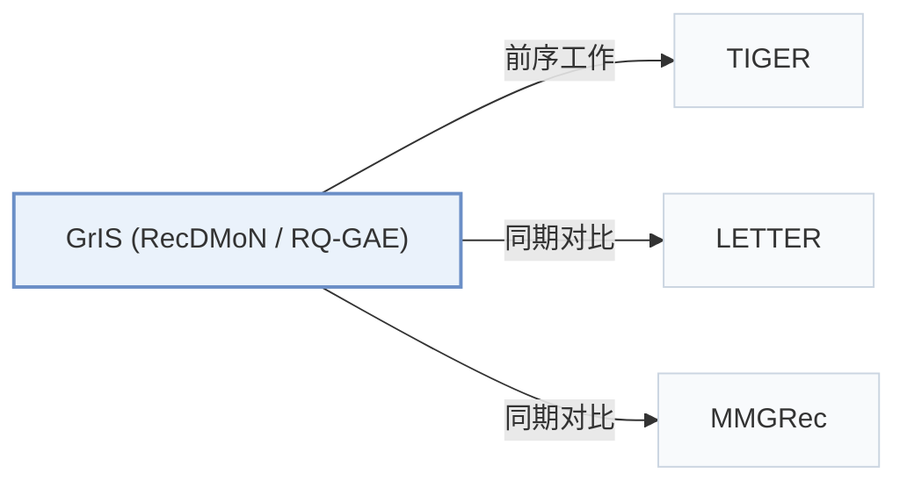

# GrIS (RecDMoN / RQ-GAE)

[← 问题 × 阶段矩阵](../../../README.zh.md#i--tokenization) · [按阶段索引](../index/stages.md) · [按模态索引](../index/modality.md) · [English](../../papers/gris-recdmon-rq-gae.md) | 中文

| **题目** | *Graph-Informed Semantic IDs (RecDMoN / RQ-GAE) for Generative Recommendation* |
| :-- | :-- |
| **作者** | Medvedev et al. |
| **发表** | CIKM’26 |
| **问题与阶段** | `I. 信息量` · `编号（Tokenization）` |
| **链接** | [论文](https://arxiv.org/abs/2610.01533) · [代码](https://github.com/hirc-airecs/graph-informed-sids) |
| **阅读级别** | 概览（第 1 级） |

**本页目录**：[TL;DR](#tldr) · [速览](#速览) · [3. 实验发现](#3-实验发现) · [5. 相关工作](#5-相关工作)

- `Text+CF`：文本表征结合协同过滤信号。
- `RecDMoN / RQ-GAE`：递归 DMoN 图划分，或基于图重构损失的图自编码残差量化。
- `Enc-Dec`：编码器-解码器（Encoder-decoder）架构。
- `Fixed`：先独立训练并冻结编号器，生成器训练期间 SID 保持不变。

### TL;DR

> [!NOTE]
> GrIS (RecDMoN / RQ-GAE) 将 SID 构建视为带协同边的物品图层级划分；当图为空集时，RQ-VAE 与 RQ-KMeans 是它的退化特例。

---

### 速览

| 维度 | 摘要 |
| :-- | :-- |
| 研究问题 | I. 信息量：SID 或读取它的模型是否充分携带了推荐所需的协同、多模态与时空信号？ |
| 核心贡献 | GrIS (RecDMoN / RQ-GAE) 将 SID 构建视为带协同边的物品图层级划分；当图为空集时，RQ-VAE 与 RQ-KMeans 是它的退化特例。 |
| 主要改动阶段 | 编号（Tokenization） |

---

### 3. 实验发现

实验设置

- **数据集**：Amazon Reviews 2014 Beauty, Toys, Sports, Books; MIND-Small; Yelp 2018. Iterative 5-core filtering on all datasets.
  - 出处：Section 5.1: [S5.SS1.SSS0.Px1.p1](https://arxiv.org/html/2610.01533v1#S5.SS1.SSS0.Px1.p1) and [S5.SS1.SSS0.Px3.p1](https://arxiv.org/html/2610.01533v1#S5.SS1.SSS0.Px3.p1)
- **切分**：Per-user leave-one-out: last interaction test, second-to-last validation; maximum sequence length 20.
  - 出处：Section 5.1: [S5.SS1.SSS0.Px3.p1](https://arxiv.org/html/2610.01533v1#S5.SS1.SSS0.Px3.p1)
- **候选集**：not reported
  - 出处：Evaluation protocol in Section 5.1 does not specify candidate enumeration or negative sampling: [S5.SS1](https://arxiv.org/html/2610.01533v1#S5.SS1)
- **可见性**：warm; no unseen-item protocol is defined. RQ-GAE item-graph edges use adjacent co-occurrences from training sequences.
  - 出处：Section 5.1: [S5.SS1.SSS0.Px3.p1](https://arxiv.org/html/2610.01533v1#S5.SS1.SSS0.Px3.p1) and [S5.SS1.SSS0.Px3.p3](https://arxiv.org/html/2610.01533v1#S5.SS1.SSS0.Px3.p3)
- **SID 规格**：RQ-GAE: 4 x 256 codebooks; collision handling not reported. RecDMoN: four recursive levels with branching factor 6 in Table 6, plus a fifth deduplication codebook; Appendix A reports five levels. Deduplication assignment rule not reported.
  - 出处：Section 5.1, Section 5.2.4, Table 6, and Appendix A Table 8: [S5.SS1.SSS0.Px3.p2](https://arxiv.org/html/2610.01533v1#S5.SS1.SSS0.Px3.p2) and [S5.SS2.SSS4.p1](https://arxiv.org/html/2610.01533v1#S5.SS2.SSS4.p1) and [S5.T6](https://arxiv.org/html/2610.01533v1#S5.T6) and [A1.T8](https://arxiv.org/html/2610.01533v1#A1.T8)
- **推理预算**：Hit/NDCG@5/10; decoding beam, hardware, inference batch size, latency not reported.
  - 出处：Section 5.1: [S5.SS1.SSS0.Px3.p1](https://arxiv.org/html/2610.01533v1#S5.SS1.SSS0.Px3.p1) and [S5.SS1.SSS0.Px3.p2](https://arxiv.org/html/2610.01533v1#S5.SS1.SSS0.Px3.p2)
- **结果来源**：Original Table 3: six-dataset comparison, averages over three seeds. RecDMoN Books unavailable due to GPU memory limits.
  - 出处：Table 3 and Section 5.2.1: [S5.T3](https://arxiv.org/html/2610.01533v1#S5.T3) and [S5.SS2.SSS1.p1](https://arxiv.org/html/2610.01533v1#S5.SS2.SSS1.p1) and [S5.SS2.SSS1.p2](https://arxiv.org/html/2610.01533v1#S5.SS2.SSS1.p2)

---

### 5. 相关工作

- **前序工作** · [TIGER](tiger.md): Uses TIGER's T5 backbone to isolate improvements from graph-informed SID construction.
  - 出处：GrIS v1, Section 5.2.1: [S5.SS2.SSS1.p1](https://arxiv.org/html/2610.01533v1#S5.SS2.SSS1.p1).
- **同期对比** · [LETTER](letter.md): LETTER aligns codes with pretrained CF embeddings; GrIS explicitly constructs and partitions item graphs.
  - 出处：GrIS v1, Sections 2.2/5.1 and Table 3: [S2.SS2.p1](https://arxiv.org/html/2610.01533v1#S2.SS2.p1); [S5.SS1.SSS0.Px2.p1](https://arxiv.org/html/2610.01533v1#S5.SS1.SSS0.Px2.p1); [S5.T3](https://arxiv.org/html/2610.01533v1#S5.T3).
- **同期对比** · [MMGRec](mmgrec.md): MMGRec supplies a graph-aware tokenizer baseline; GrIS also studies recursive graph pooling and graph-reconstruction quantization.
  - 出处：GrIS v1, Sections 2.3/5.1 and Table 3: [S2.SS3.p2](https://arxiv.org/html/2610.01533v1#S2.SS3.p2); [S5.SS1.SSS0.Px2.p1](https://arxiv.org/html/2610.01533v1#S5.SS1.SSS0.Px2.p1); [S5.T3](https://arxiv.org/html/2610.01533v1#S5.T3).

[查看同格全部论文](../../../README.zh.md#i--tokenization)
