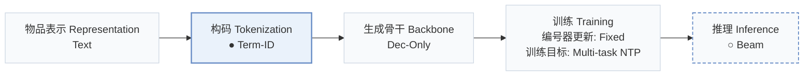
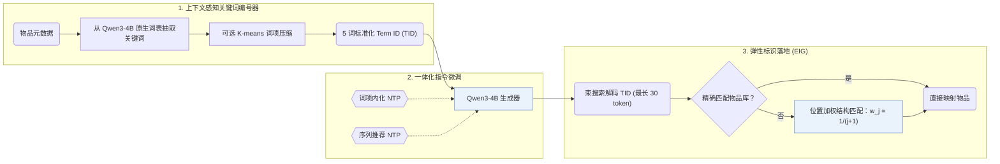
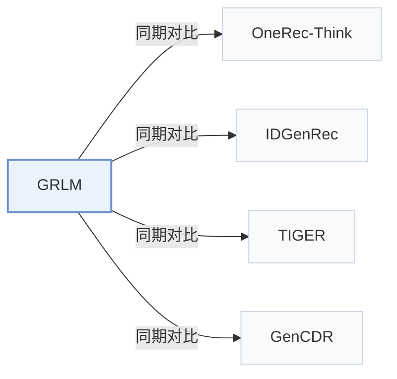

# GRLM

[← 问题 × 阶段矩阵](../../../README.zh.md#iii--tokenization) · [按阶段索引](../index/stages.md) · [按模态找论文](../index/modality.md) · [按领域找论文](../index/domain.md) · [English](../../papers/grlm.md) | 中文

| **题目** | *Unleashing the Native Recommendation Potential: LLM-Based Generative Recommendation via Structured Term Identifiers* |
| :-- | :-- |
| **作者** | Zhang et al. |
| **发表** | arXiv’26 |
| **问题与阶段** | `III. SID 与模型对齐` · `构码（Tokenization）` |
| **改动** | ● 构码 · ○ 推理 |
| **构码输入** | `Text` |
| **领域** | `电商` |
| **特殊设置** | `跨域迁移` |
| **链接** | [论文](https://arxiv.org/abs/2601.06798) · [代码](https://github.com/ZY0025/GRLM) |
| **阅读级别** | 阅读笔记（第 2 级） |

**本页目录**：[TL;DR](#tldr) · [速览](#速览) · [1. 为什么重要](#1-为什么重要) · [2. 方法](#2-方法) · [3. 实验发现](#3-实验发现) · [4. 局限与分析](#4-局限与分析) · [5. 相关工作](#5-相关工作)

- `Text`：物品文本元数据（标题、描述、类目或提示词）。
- `Term-ID`：由物品元数据提炼的标准化文本关键词标识符。
- `Dec-Only`：仅解码器（Decoder-only）自回归架构。
- `Fixed`：先独立训练并冻结编号器，生成器训练期间 SID 保持不变。
- `Multi-task NTP`：在多个对齐或推荐子任务上联合优化下一 token 预测损失。
- `Beam`：在 SID token 上执行自回归束搜索（Beam search）。

### TL;DR

> [!NOTE]
> GRLM 用从元数据生成的标准化文本关键词（Term ID）标识物品并据此微调 LLM，避免自由文本幻觉以及 SID 带来的词表扩张。

---

### 速览

| 维度 | 摘要 |
| :-- | :-- |
| 主要发现 | 在域内 Amazon 基准（Beauty、Sports 和 Toys）及跨域配对（Sports-Clothing 和 Phones-Electronics）上，GRLM 均优于生成式与 LLM 基线，且 Top-10 生成 Term ID 的合法率达 0.989–0.998（Abstract，Tables 2, 3, and 5）。 |
| 局限 | 生成的 Term ID 若无精确匹配的物品，需经结构匹配落地到候选库，因此最终排序部分取决于落地匹配规则而非生成器本身（Sec. 3.3）。 |

---

### 1. 为什么重要

自由文本物品标识直接暴露大语言模型（LLM）庞大的输出空间并易引发幻觉，而数值型语义 ID（Semantic ID，SID）又与原生词表存在语义鸿沟，需要高开销的词表扩充与对齐训练（Abstract）。GRLM 从 LLM 原生词表中抽取定长标准化关键词序列作为物品标识。

> "Text-based methods introduce LLMs' vast output space, leading to hallucination, while methods based on Semantic IDs (SIDs) encounter a semantic gap between SIDs and LLMs' native vocabulary, requiring costly vocabulary expansion and alignment training." (Abstract)

---

### 2. 方法

#### 上下文感知的关键词生成

上下文感知的关键词生成模块将物品元数据转化为由 5 个 Qwen3-4B 原生词组成的标准化 Term ID（TID），并可通过可选的 K-means 压缩将 54,255 个原始词项映射为 3,000–8,000 个核心词项（Abstract，Appendix A.4）。

#### 一体化指令微调

一体化指令微调在多任务下一 token 预测目标下，联合优化 Qwen3-4B 的词项语义内化与序列下一 TID 预测（Abstract）。

#### 弹性标识落地

推理阶段用束搜索解码最长 30 个 token 的候选 TID；当生成结果无法精确命中物品库时，弹性标识落地（EIG）按词项重合度对物品做结构匹配打分，第 $`j`$ 个生成词项的位置权重设为 $`w_j = \frac{1}{j+1}`$（Sec. 3.3）。

> "By exploiting the decompositional nature of TIDs, EIG combines direct mapping with structural mapping to ground TIDs into actual items efficiently." (Sec. 1)

---

### 3. 实验发现

实验设置

- **数据集**：In-domain: Amazon Beauty, Sports, Toys (5-core, following TIGER and OneRec-Think; 22,363 / 12,101, 35,598 / 18,357, 19,412 / 11,924 users / items). Cross-domain pairs Sports-Clothing and Phones-Electronics, built per GenCDR by merging overlapping users' interactions chronologically. Appendix: ten Amazon 2014 categories merged.
  - 出处：In-domain and cross-domain datasets: [S4.p3](https://arxiv.org/html/2601.06798v1#S4.p3) and [S4.p4](https://arxiv.org/html/2601.06798v1#S4.p4); statistics: [S4.T1](https://arxiv.org/html/2601.06798v1#S4.T1); ten-dataset appendix: [A1.T6](https://arxiv.org/html/2601.06798v1#A1.T6).
- **切分**：Leave-one-out (allocation not restated beyond the label); in the cross-domain setting the last interaction in each domain of the pair is predicted separately.
  - 出处：Leave-one-out and cross-domain evaluation: [S4.p3](https://arxiv.org/html/2601.06798v1#S4.p3) and [S4.p4](https://arxiv.org/html/2601.06798v1#S4.p4).
- **候选集**：not reported (full catalog versus sampled evaluation candidates); validity of generated Term IDs is measured separately (Table 5).
  - 出处：Metrics only: [S4.p5](https://arxiv.org/html/2601.06798v1#S4.p5).
- **可见性**：warm; no unseen-item protocol is defined.
  - 出处：Standard split with no unseen-item protocol: [S4.p3](https://arxiv.org/html/2601.06798v1#S4.p3).
- **SID 规格**：Term IDs: 5 natural-language terms per item from Qwen3-4B's native vocabulary, produced by context-aware term generation (7 and 10 terms tested). Collision handling: not reported beyond relying on a large term space; an optional K-means compression maps 54,255 raw terms to K core terms (3,000-8,000).
  - 出处：Term IDs of length 5 from the LLM vocabulary: [S4.p5](https://arxiv.org/html/2601.06798v1#S4.p5); length study: [A2.T8](https://arxiv.org/html/2601.06798v1#A2.T8); collision discussion and compression: [A2.p1](https://arxiv.org/html/2601.06798v1#A2.p1), [A4.p4](https://arxiv.org/html/2601.06798v1#A4.p4), [A4.T9](https://arxiv.org/html/2601.06798v1#A4.T9).
- **推理预算**：Beam search with generation max length 30 tokens; beam width not reported. Qwen3-4B backbone; hardware, inference batch size, and latency: not reported. Valid rate at 10 is 0.989-0.998 (Table 5).
  - 出处：Beam search, max length 30: [S4.p5](https://arxiv.org/html/2601.06798v1#S4.p5); training batch: [A1.p2](https://arxiv.org/html/2601.06798v1#A1.p2); validity: [S5.T5](https://arxiv.org/html/2601.06798v1#S5.T5).
- **结果来源**：Table 2 (in-domain), Table 3 (cross-domain), Table 4 (ablations), Table 5 (Term ID validity), Appendix Tables 7-9 (ten-dataset results, Term ID length, vocabulary compression).
  - 出处：Results: [S5.T2](https://arxiv.org/html/2601.06798v1#S5.T2), [S5.T3](https://arxiv.org/html/2601.06798v1#S5.T3), [S5.T4](https://arxiv.org/html/2601.06798v1#S5.T4), [S5.T5](https://arxiv.org/html/2601.06798v1#S5.T5), [A1.T7](https://arxiv.org/html/2601.06798v1#A1.T7), [A2.T8](https://arxiv.org/html/2601.06798v1#A2.T8), [A4.T9](https://arxiv.org/html/2601.06798v1#A4.T9).

- 域内与跨域精度：在 Amazon Beauty、Sports 和 Toys 域内基准（Table 2）、Sports-Clothing 与 Phones-Electronics 跨域配对（Table 3）以及十品类合并 Amazon 语料（Appendix Table 7）上，GRLM 均优于序列模型、SID 方法与自由文本 ID 基线（Abstract）。
- 合法率、消融与扩展性：Table 4 验证了上下文感知关键词生成、一体化指令微调与 EIG 的贡献；Table 5 报告 Top-10 TID 合法率达 0.989–0.998，Appendix Tables 8–9 对比了不同 TID 长度（5、7 和 10 个词）及词项压缩规模。

  > "Moreover, through detailed analytical experiments, we provide evidence that our TID-based method exhibits robust scaling properties while significantly mitigating hallucination." (Sec. 1)

---

### 4. 局限与分析

**Our analysis.**

- TIGER 将数值型 `RQ-VAE` 码作为词表外新 token 扩充词表；GRLM 直接复用 LLM 原生词表中的词构建 `Term-ID`。
- IDGenRec 同样采用原生词表词（`LLM-Vocab`），但在训练过程中交替更新 ID 生成器（`Altern.`）；GRLM 的 TID 仅离线生成一次（`Fixed`）。

---

### 5. 相关工作

- **同期对比** · [OneRec-Think](onerec-think.md): OneRec-Think reasons over numeric SIDs with an LLM; GRLM replaces SIDs with Term IDs drawn from the LLM's own vocabulary.
  - 出处：GRLM v1, LLM-based baselines and preprocessing: [S4.I1.i3.p1](https://arxiv.org/html/2601.06798v1#S4.I1.i3.p1) and [S4.p3](https://arxiv.org/html/2601.06798v1#S4.p3); Table 2: [S5.T2](https://arxiv.org/html/2601.06798v1#S5.T2).
- **同期对比** · [IDGenRec](idgenrec.md): IDGenRec generates free textual IDs; GRLM extracts a fixed number of standardized terms with context-aware generation to limit synonym ambiguity.
  - 出处：GRLM v1, LLM-based baselines: [S4.I1.i3.p1](https://arxiv.org/html/2601.06798v1#S4.I1.i3.p1); Table 2: [S5.T2](https://arxiv.org/html/2601.06798v1#S5.T2); case study: [A3.p1](https://arxiv.org/html/2601.06798v1#A3.p1).
- **同期对比** · [TIGER](tiger.md): TIGER uses numeric RQ-VAE semantic IDs; GRLM uses natural-language term IDs.
  - 出处：GRLM v1, generative baselines: [S4.I1.i2.p1](https://arxiv.org/html/2601.06798v1#S4.I1.i2.p1); Tables 2 and 3: [S5.T2](https://arxiv.org/html/2601.06798v1#S5.T2) and [S5.T3](https://arxiv.org/html/2601.06798v1#S5.T3).
- **同期对比** · [GenCDR](gencdr.md): GenCDR adapts semantic-ID tokenization per domain; GRLM transfers across domains through shared vocabulary terms.
  - 出处：GRLM v1, cross-domain baselines and protocol: [S4.I1.i4.p1](https://arxiv.org/html/2601.06798v1#S4.I1.i4.p1) and [S4.p4](https://arxiv.org/html/2601.06798v1#S4.p4); Table 3: [S5.T3](https://arxiv.org/html/2601.06798v1#S5.T3).

[查看同格全部论文](../../../README.zh.md#iii--tokenization)
