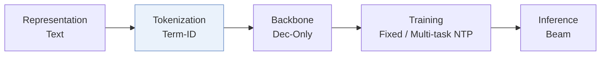
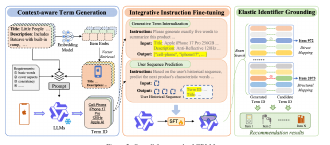
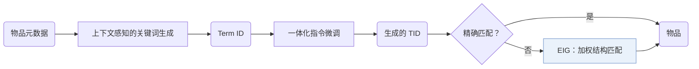
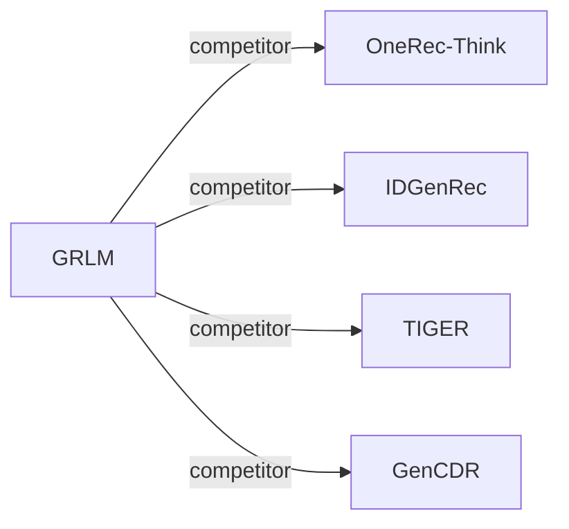

# GRLM

| **题目** | *Unleashing the Native Recommendation Potential: LLM-Based Generative Recommendation via Structured Term Identifiers* |
| :-- | :-- |
| **作者** | Zhang et al. |
| **会议** | arXiv’26 |
| **问题与阶段** | `III. SID 与模型对齐` · `Tokenization` |
| **链接** | [论文](https://arxiv.org/abs/2601.06798) · [代码](https://github.com/ZY0025/GRLM) · [矩阵](../../../README.zh.md#iii--tokenization) · [English](../../papers/grlm.md) |
| **阅读级别** | 阅读笔记（第 2 级） |

本页目录：[TL;DR](#tldr) · [速览](#速览) · [1. 为什么重要](#1-为什么重要) · [2. 方法](#2-方法) · [3. 实验发现](#3-实验发现) · [4. 局限与分析](#4-局限与分析) · [5. 相关工作](#5-相关工作)

- `Dec-Only`: Decoder-only.
- `Fixed`: SIDs are built first and not changed while the generator trains.
- `Multi-task NTP`: The same NTP loss over several tasks.

### TL;DR

> [!NOTE]
> GRLM 用从元数据生成的标准化文本关键词（Term ID）标识物品并据此微调 LLM，避免自由文本幻觉以及 SID 带来的词表扩张。

---

### 速览

| 维度 | 摘要 |
| :-- | :-- |
| 研究问题 | III. SID 与模型对齐：Can the generator read, write, and reason over SIDs, and do the tokenizer and generator work toward the same goal? |
| 核心贡献 | GRLM 用从元数据生成的标准化文本关键词（Term ID）标识物品并据此微调 LLM，避免自由文本幻觉以及 SID 带来的词表扩张。 |
| 主要改动阶段 | Tokenization |
| 局限 | 生成的 Term ID 若对不上任何物品，就靠结构匹配落到物品上，所以最终排序有一部分来自落地步骤，而不是生成器（Sec. 3.3）。 |

---

### 1. 为什么重要

基于文本的物品标识把 LLM 巨大的输出空间暴露出来；语义 ID（Semantic ID，SID）则需要代价高的词表扩充和对齐训练（Abstract）。GRLM 走中间路线，用标准化的关键词做标识。

> "Text-based methods introduce LLMs' vast output space, leading to hallucination, while methods based on Semantic IDs (SIDs) encounter a semantic gap between SIDs and LLMs' native vocabulary, requiring costly vocabulary expansion and alignment training."（Abstract）（文本方法会幻觉；SID 方法和 LLM 原生词表之间有语义鸿沟。）

---

### 2. 方法

#### 上下文感知的关键词生成

上下文感知的关键词生成把物品元数据转成标准化的 Term ID（TID）（Abstract）。

#### 一体化指令微调

一体化指令微调把关键词内化和序列推荐放在一起优化（Abstract）。

#### 弹性标识落地

没有精确匹配时，弹性标识落地（EIG）按结构匹配给物品打分，第 $`j`$ 个生成的关键词权重为 $`w_j = \frac{1}{j+1}`$（Sec. 3.3）。

> "By exploiting the decompositional nature of TIDs, EIG combines direct mapping with structural mapping to ground TIDs into actual items efficiently."（Sec. 1）（利用 TID 可拆分的特点，结合直接映射和结构映射，把 TID 落到真实物品。）

---

### 3. 实验发现

实验设置

- **数据集**：In-domain: Amazon Beauty, Sports, Toys (5-core, following TIGER and OneRec-Think; 22,363 / 12,101, 35,598 / 18,357, 19,412 / 11,924 users / items). Cross-domain pairs Sports-Clothing and Phones-Electronics, built per GenCDR by merging overlapping users' interactions chronologically. Appendix: ten Amazon 2014 categories merged.
  - 出处：In-domain and cross-domain datasets: [S4.p3](https://arxiv.org/html/2601.06798v1#S4.p3) and [S4.p4](https://arxiv.org/html/2601.06798v1#S4.p4); statistics: [S4.T1](https://arxiv.org/html/2601.06798v1#S4.T1); ten-dataset appendix: [A1.T6](https://arxiv.org/html/2601.06798v1#A1.T6).
- **切分**：Leave-one-out (allocation not restated beyond the label); in the cross-domain setting the last interaction in each domain of the pair is predicted separately.
  - 出处：Leave-one-out and cross-domain evaluation: [S4.p3](https://arxiv.org/html/2601.06798v1#S4.p3) and [S4.p4](https://arxiv.org/html/2601.06798v1#S4.p4).
- **候选集**：not reported (full catalog versus sampled evaluation candidates); validity of generated Term IDs is measured separately (Table 5).
  - 出处：Metrics only: [S4.p5](https://arxiv.org/html/2601.06798v1#S4.p5).
- **可见性**：warm; no unseen-item protocol is defined.
  - 出处：Standard split with no unseen-item protocol: [S4.p3](https://arxiv.org/html/2601.06798v1#S4.p3).
- **SID 规格**：Term IDs: 5 natural-language terms per item from Qwen3-4B's native vocabulary, produced by context-aware term generation (7 and 10 terms tested). Collision handling: not reported beyond relying on a large term space; an optional K-means compression maps 54,255 raw terms to K core terms (3,000-8,000).
  - 出处：Term IDs of length 5 from the LLM vocabulary: [S4.p5](https://arxiv.org/html/2601.06798v1#S4.p5); length study: [A2.T8](https://arxiv.org/html/2601.06798v1#A2.T8); collision discussion and compression: [A2.p1](https://arxiv.org/html/2601.06798v1#A2.p1), [A4.p4](https://arxiv.org/html/2601.06798v1#A4.p4), [A4.T9](https://arxiv.org/html/2601.06798v1#A4.T9).
- **推理预算**：Beam search with generation max length 30 tokens; beam width not reported. Qwen3-4B backbone; hardware, inference batch size, and latency: not reported. Valid rate at 10 is 0.989-0.998 (Table 5).
  - 出处：Beam search, max length 30: [S4.p5](https://arxiv.org/html/2601.06798v1#S4.p5); training batch: [A1.p2](https://arxiv.org/html/2601.06798v1#A1.p2); validity: [S5.T5](https://arxiv.org/html/2601.06798v1#S5.T5).
- **结果来源**：Table 2 (in-domain), Table 3 (cross-domain), Table 4 (ablations), Table 5 (Term ID validity), Appendix Tables 7-9 (ten-dataset results, Term ID length, vocabulary compression).
  - 出处：Results: [S5.T2](https://arxiv.org/html/2601.06798v1#S5.T2), [S5.T3](https://arxiv.org/html/2601.06798v1#S5.T3), [S5.T4](https://arxiv.org/html/2601.06798v1#S5.T4), [S5.T5](https://arxiv.org/html/2601.06798v1#S5.T5), [A1.T7](https://arxiv.org/html/2601.06798v1#A1.T7), [A2.T8](https://arxiv.org/html/2601.06798v1#A2.T8), [A4.T9](https://arxiv.org/html/2601.06798v1#A4.T9).

- 主实验：GRLM 在多个场景下好于基线（Abstract）。
- 扩展性与幻觉：作者认为 TID 扩展性好，并减少了幻觉（Sec. 1）。

  > "Moreover, through detailed analytical experiments, we provide evidence that our TID-based method exhibits robust scaling properties while significantly mitigating hallucination."（Sec. 1）（分析实验表明 TID 方法扩展性稳健，并明显减少幻觉。）

---

### 4. 局限与分析

**Our analysis.**

- TIGER 把 `RQ-VAE` 码作为新 token 加入；GRLM 用词表里已有的 `Term-ID` 词。
- IDGenRec 也用词表词（`LLM-Vocab`），但在训练中更新 ID 生成器（`Altern.`）；GRLM 的 TID 只生成一次。

---

### 5. 相关工作

- **同期对比** · [OneRec-Think](onerec-think.md): OneRec-Think reasons over numeric SIDs with an LLM; GRLM replaces SIDs with Term IDs drawn from the LLM's own vocabulary.
  - 出处：GRLM v1, LLM-based baselines and preprocessing: https://arxiv.org/html/2601.06798v1#S4.I1.i3.p1 and https://arxiv.org/html/2601.06798v1#S4.p3; Table 2: https://arxiv.org/html/2601.06798v1#S5.T2.
- **同期对比** · [IDGenRec](idgenrec.md): IDGenRec generates free textual IDs; GRLM extracts a fixed number of standardized terms with context-aware generation to limit synonym ambiguity.
  - 出处：GRLM v1, LLM-based baselines: https://arxiv.org/html/2601.06798v1#S4.I1.i3.p1; Table 2: https://arxiv.org/html/2601.06798v1#S5.T2; case study: https://arxiv.org/html/2601.06798v1#A3.p1.
- **同期对比** · [TIGER](tiger.md): TIGER uses numeric RQ-VAE semantic IDs; GRLM uses natural-language term IDs.
  - 出处：GRLM v1, generative baselines: https://arxiv.org/html/2601.06798v1#S4.I1.i2.p1; Tables 2 and 3: https://arxiv.org/html/2601.06798v1#S5.T2 and https://arxiv.org/html/2601.06798v1#S5.T3.
- **同期对比** · [GenCDR](gencdr.md): GenCDR adapts semantic-ID tokenization per domain; GRLM transfers across domains through shared vocabulary terms.
  - 出处：GRLM v1, cross-domain baselines and protocol: https://arxiv.org/html/2601.06798v1#S4.I1.i4.p1 and https://arxiv.org/html/2601.06798v1#S4.p4; Table 3: https://arxiv.org/html/2601.06798v1#S5.T3.

[查看同格全部论文](../../../README.zh.md#iii--tokenization)
