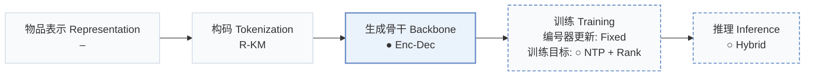
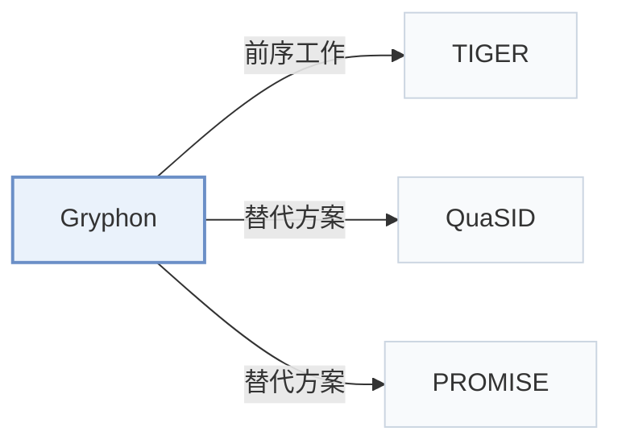

# Gryphon

[← 问题 × 阶段矩阵](../../../README.zh.md#iv--backbone) · [按阶段索引](../index/stages.md) · [按模态找论文](../index/modality.md) · [按领域找论文](../index/domain.md) · [English](../../papers/gryphon.md) | 中文

| **题目** | *A Unified Architecture for Semantic-ID Generation and Item-Level Scoring in Industrial Recommendations* |
| :-- | :-- |
| **作者** | Tikhonovich et al. |
| **发表** | CIKM’26 Short |
| **问题与阶段** | `IV. 实用目标` · `生成骨干（Backbone）` |
| **改动** | ● 生成骨干 · ○ 训练目标 · ○ 推理 |
| **构码输入** | `其他`（残差 K-Means，未写输入） |
| **领域** | `音乐` |
| **链接** | [论文](https://arxiv.org/abs/2606.08604) |
| **阅读级别** | 概览（第 1 级） |

**本页目录**：[TL;DR](#tldr) · [3. 实验发现](#3-实验发现) · [5. 相关工作](#5-相关工作)

- `R-KM`：残差 k-means 量化（Residual k-means）。
- `Enc-Dec`：编码器-解码器（Encoder-decoder）架构。
- `Fixed`：先独立训练并冻结编号器，生成器训练期间 SID 保持不变。
- `NTP + Rank`：下一 token 预测结合显式排序损失。
- `Hybrid`：结合生成式 SID 解码与稠密/共现检索的混合召回。

### TL;DR

> [!NOTE]
> Gryphon 在编码器-解码器生成器中加入联合训练的物品级打分模块，将生成的 SID 解析为具体物品并重新打分，替代按 token 似然排序。

---

### 3. 实验发现

实验设置

- **数据集**：One week of industrial music-platform logs; tens of millions of active users and items. Filtering not reported.
  - 出处：Section 4.1.1: [S4.SS1.SSS1.p1](https://arxiv.org/html/2606.08604v1#S4.SS1.SSS1.p1)
- **切分**：not reported
  - 出处：Section 4.1.1: [S4.SS1.SSS1.p1](https://arxiv.org/html/2606.08604v1#S4.SS1.SSS1.p1)
- **候选集**：not reported
  - 出处：Offline evaluation in Sections 4.1.1/4.1.4 does not specify full-catalog versus sampled-negative evaluation: [S4.SS1.SSS1.p1](https://arxiv.org/html/2606.08604v1#S4.SS1.SSS1.p1) and [S4.SS1.SSS4.p1](https://arxiv.org/html/2606.08604v1#S4.SS1.SSS4.p1)
- **可见性**：warm; no unseen-item protocol is defined. All items are quantized into SIDs; tokenizer fitting exposure not reported.
  - 出处：Sections 4.1.1/4.1.3: [S4.SS1.SSS1.p1](https://arxiv.org/html/2606.08604v1#S4.SS1.SSS1.p1) and [S4.SS1.SSS3.p1](https://arxiv.org/html/2606.08604v1#S4.SS1.SSS3.p1)
- **SID 规格**：Residual K-Means: 3 x 32000; collisions retained, generated SIDs expanded to all matching items and rescored by ILSM.
  - 出处：Sections 3.4/4.1.3: [S3.SS4.p2](https://arxiv.org/html/2606.08604v1#S3.SS4.p2) and [S4.SS1.SSS3.p1](https://arxiv.org/html/2606.08604v1#S4.SS1.SSS3.p1)
- **推理预算**：Beam 2048; Recall@10/1000; online outputs 1000 items. Hardware, inference batch size, absolute latency not reported; parameter count and inference time differ from vanilla GR by <1%.
  - 出处：Sections 4.1.3/4.1.4/4.2: [S4.SS1.SSS3.p1](https://arxiv.org/html/2606.08604v1#S4.SS1.SSS3.p1) and [S4.SS1.SSS4.p1](https://arxiv.org/html/2606.08604v1#S4.SS1.SSS4.p1) and [S4.SS2.p1](https://arxiv.org/html/2606.08604v1#S4.SS2.p1)
- **结果来源**：Original Table 1: offline comparison; Table 2: same-pool scoring ablation; Table 3: seven-day online A/B test.
  - 出处：Tables 1-3: [S4.T1](https://arxiv.org/html/2606.08604v1#S4.T1) and [S4.T2](https://arxiv.org/html/2606.08604v1#S4.T2) and [S4.T3](https://arxiv.org/html/2606.08604v1#S4.T3)

---

### 5. 相关工作

- **前序工作** · [TIGER](tiger.md): TIGER's extra collision-resolution token motivates the resolved-GR baseline; Gryphon instead scores colliding items separately.
  - 出处：Gryphon v1, Sections 2.2/4.1.2: [S2.SS2.p1](https://arxiv.org/html/2606.08604v1#S2.SS2.p1); [S4.SS1.SSS2.p3](https://arxiv.org/html/2606.08604v1#S4.SS1.SSS2.p3).
- **替代方案** · [QuaSID](quasid.md): Cited collision-focused SID-learning work; Gryphon retains shared SIDs and distinguishes their items through ILSM.
  - 出处：Gryphon v1, Sections 1/3.2, citing Hu et al. (2026): [S1.SS0.SSS0.Px2.p2](https://arxiv.org/html/2606.08604v1#S1.SS0.SSS0.Px2.p2); [S3.SS2.p2](https://arxiv.org/html/2606.08604v1#S3.SS2.p2).
- **替代方案** · [PROMISE](promise.md): Cited for autoregressive prefix errors; Gryphon addresses candidate ordering with jointly trained item-level scoring.
  - 出处：Gryphon v1, Section 2.3, citing Guo et al. (2026): [S2.SS3.p1](https://arxiv.org/html/2606.08604v1#S2.SS3.p1).

[查看同格全部论文](../../../README.zh.md#iv--backbone)
