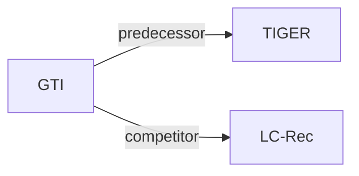

# GTI

*Grounded Token Initialization for New Vocabulary in LMs for Generative Recommendation* — Chen et al. · arXiv’26

`III. SID 与模型对齐` · `Training` · [论文](https://arxiv.org/abs/2604.02324) · [矩阵](../../../README.zh.md#iii--training) · [English](../../papers/gti.md)

阅读级别：概览（第 1 级） · 本页目录：[TL;DR](#tldr) · [速览](#速览) · [3. 实验发现](#3-实验发现) · [5. 相关工作](#5-相关工作)

- `Text+CF / Text`: Text with collaborative signals, or text-only representations, in different configurations.
- `Dec-Only`: Decoder-only.
- `Fixed`: SIDs are built first and not changed while the generator trains.
- `Multi-task NTP`: The same NTP loss over several tasks.
- `–`: Not reported in the paper.

### TL;DR

> [!NOTE]
> GTI 在微调前借助配对语言监督，把新增 SID token 映射到预训练嵌入空间中的区分性位置，而非用已有嵌入的均值初始化。

### 速览

| 维度 | 摘要 |
| :-- | :-- |
| 研究问题 | III. SID 与模型对齐：Can the generator read, write, and reason over SIDs, and do the tokenizer and generator work toward the same goal? |
| 核心贡献 | GTI 在微调前借助配对语言监督，把新增 SID token 映射到预训练嵌入空间中的区分性位置，而非用已有嵌入的均值初始化。 |
| 主要改动阶段 | Training |

### 3. 实验发现

实验设置

- **数据集**：Industrial recruitment pairs (good matches for SFT; profiles require at least one listed attribute); Vibrent rentals; other filtering not reported.
  - 出处：[S7.SS1](https://arxiv.org/html/2604.02324v1#S7.SS1)
- **切分**：Vibrent: leave-one-out; validation details not reported. Industry: 200 evaluation jobs; train/test separation not reported.
  - 出处：[S4.SS1.SSS0.Px3.p1](https://arxiv.org/html/2604.02324v1#S4.SS1.SSS0.Px3.p1)
- **候选集**：not reported; 200 retrieved candidates per industrial query does not specify the evaluation universe.
  - 出处：[S4.SS1.SSS0.Px3.p1](https://arxiv.org/html/2604.02324v1#S4.SS1.SSS0.Px3.p1) (200 retrieved candidates is an output count, not a negative-sampling protocol).
- **可见性**：warm; no unseen-item protocol is defined. Industrial Mistral-E5 uses engagement supervision; test-candidate exposure not reported.
  - 出处：[S4.SS1.SSS0.Px4.p2](https://arxiv.org/html/2604.02324v1#S4.SS1.SSS0.Px4.p2) and #S4.SS1.SSS0.Px4.p3
- **SID 规格**：RQ-VAE SIDs from 1024-d embeddings. Industry: engagement-tuned Mistral-E5 embeddings, 3 x 8192. Vibrent: Qwen3-Embedding-0.6B embeddings, 4 x 256 with 32-d codes and the Wang et al. (2024) diversity regularizer for balanced codebook use. The appendix's 4 x 256 configuration additionally uses final-layer Sinkhorn-Knopp balancing to reduce collisions; residual collision resolution is not reported.
  - 出处：[S4.SS1.SSS0.Px4.p2](https://arxiv.org/html/2604.02324v1#S4.SS1.SSS0.Px4.p2) ; [S4.SS1.SSS0.Px4.p3](https://arxiv.org/html/2604.02324v1#S4.SS1.SSS0.Px4.p3) ; [S7.SS3.p2](https://arxiv.org/html/2604.02324v1#S7.SS3.p2)
- **推理预算**：K=5/10/20/50/100. Experiments use four H100s; inference-specific hardware, beam width, batch size and latency not reported.
  - 出处：[S4.T1](https://arxiv.org/html/2604.02324v1#S4.T1) ; #S4.T3 ; #S4.SS1.SSS0.Px4.p1
- **结果来源**：Original experiments: Tables 1-2 industrial relative gains; Table 3 Vibrent relative gains; Table 4 absolute metrics.
  - 出处：[S4.T1](https://arxiv.org/html/2604.02324v1#S4.T1) ; #S4.T2 ; #S4.T3 ; #S7.T4

### 5. 相关工作

- **前序工作** · [TIGER](tiger.md): GTI adopts TIGER-style RQ-VAE semantic identifiers.
  - 出处：https://arxiv.org/html/2604.02324v1#S7.SS3.p2 (Appendix 7.3).
- **同期对比** · [LC-Rec](lc-rec.md): LC-Rec uses multi-task alignment; GTI adds grounding before fine-tuning.
  - 出处：https://arxiv.org/html/2604.02324v1#S4.SS1.SSS0.Px2.p3 ; #S4.T1 ; #S7.T4.

[查看同格全部论文](../../../README.zh.md#iii--training)
