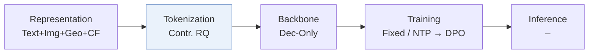
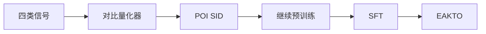
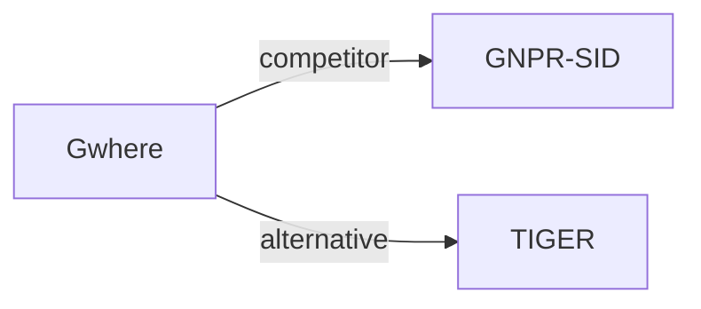

# Gwhere

*Guess Where You Go: Generative Next Point-of-Interest Recommendation in Amap* — Zhai et al. · RecSys’26

`II. 唯一性与合法性` · `Tokenization` · `POI` · [论文](https://arxiv.org/abs/2607.26073) · [代码](https://github.com/alibaba/SimCIT) · [矩阵](../../../README.zh.md#ii--tokenization) · [English](../../papers/gwhere.md)

阅读级别：阅读笔记（第 2 级） · 本页目录：[TL;DR](#tldr) · [速览](#速览) · [1. 为什么重要](#1-为什么重要) · [2. 方法](#2-方法) · [3. 实验发现](#3-实验发现) · [4. 局限与分析](#4-局限与分析) · [5. 相关工作](#5-相关工作)

- `Contr. RQ`: Residual quantization trained with contrastive objectives.
- `Dec-Only`: Decoder-only.
- `Fixed`: SIDs are built first and not changed while the generator trains.
- `NTP → DPO`: NTP, then preference optimization.
- `–`: Not reported in the paper.

### TL;DR

> [!NOTE]
> Gwhere 在文本、图像、空间与协同信号上用对比残差量化编号器学习 POI SID，再经持续预训练、微调和曝光感知 KTO 适配 LLM。

### 速览

| 维度 | 摘要 |
| :-- | :-- |
| 研究问题 | II. 唯一性与合法性：Does every item get its own SID, every generated SID name a real item, and the codebook get used evenly? |
| 核心贡献 | Gwhere 在文本、图像、空间与协同信号上用对比残差量化编号器学习 POI SID，再经持续预训练、微调和曝光感知 KTO 适配 LLM。 |
| 主要改动阶段 | Tokenization |
| 主要发现 | 在高德（Amap）的长期在线 A/B 测试中，Gwhere 比线上基线的 P-CTR 高 5.83%，U-CTR 高 6.20%（Abstract）。 |

### 1. 为什么重要

作者指出，生成式检索难以扩展到工业场景，原因是 token 分配有冗余或冲突，异构物品信号也融合得不好（Abstract）。下一兴趣点（POI）推荐还多了结构化的空间实体和移动模式（Abstract）。

> "Gwhere first learns discriminative POI SIDs through a contrastive residual-quantization tokenizer that aligns textual, visual, spatial, and collaborative signals."（Abstract）（用对比残差量化编号器对齐文本、视觉、空间、协同四类信号，学出有区分度的 POI SID。）

### 2. 方法

#### 对比式物品编号

量化器用 Gumbel-softmax 分配码字（Sec. 3.2.2）。NT-Xent 损失把量化表示拉向物品自己的各模态表示，推离同批的其他物品（Sec. 3.2.2）。编号器没有重建损失（Sec. 3.2）。

#### 继续预训练

两份语料来自脱敏的高德轨迹和 POI 元数据，分别覆盖语义对齐和行为模式（Sec. 3.3.1，Table 1）。

> "Each entry is a triplet of (SID, Geohash, Text Description), where Geohash is a 6-character string encoding the POI's precise geographical coordinates"（Sec. 3.3.1）（每条数据是 (SID, Geohash, 文本描述) 三元组，Geohash 是编码 POI 坐标的 6 位字符串。）

#### EAKTO

曝光感知的 Kahneman-Tversky 优化（EAKTO）把 KTO 改到曝光日志的点击和未点击上（Sec. 3.4）。

> "In contrast, KTO (Ethayarajh et al., 2024) operates on simpler binary signals (desirable / undesirable), aligning with the natural structure of exposure logs (clicks vs. non-clicks)."（Sec. 3.4）（KTO 用二元信号，正好对应曝光日志的点击与未点击。）

### 3. 实验发现

实验设置

- **数据集**：Foursquare NYC and TKY, Gowalla CA (POIs with fewer than 10 interactions and users with fewer than 10 check-ins removed, following GNPR-SID; 1,083 / 5,135, 2,293 / 7,873, 6,592 / 14,027 users / POIs), and a proprietary AMAP dataset of sampled desensitized users (10,000K users / 83,100K POIs / 380,000K interactions); AMAP filtering not reported.
  - 出处：Datasets and GNPR-SID preprocessing: [S4.SS1.SSS1.p1](https://arxiv.org/html/2607.26073v1#S4.SS1.SSS1.p1) and [S4.SS1.SSS1.p2](https://arxiv.org/html/2607.26073v1#S4.SS1.SSS1.p2); statistics: [S4.T2](https://arxiv.org/html/2607.26073v1#S4.T2).
- **切分**：Public: time-sorted 80% / 10% / 10% train/validation/test; within each user's test sequence the last visited POI is the target. AMAP offline split: not reported. Online: one-week and one-month A/B tests on the 'Guess Where You Go' card.
  - 出处：Public split: [S4.SS1.SSS1.p2](https://arxiv.org/html/2607.26073v1#S4.SS1.SSS1.p2); AMAP split not stated; online tests: [S4.SS4.SSS3.p1](https://arxiv.org/html/2607.26073v1#S4.SS4.SSS3.p1) and [S4.SS4.SSS3.p3](https://arxiv.org/html/2607.26073v1#S4.SS4.SSS3.p3).
- **候选集**：not reported (full catalog versus sampled candidates); the metric is top-1 accuracy (Acc@1).
  - 出处：Top-1 accuracy only: [S4.T3](https://arxiv.org/html/2607.26073v1#S4.T3) and [S4.T4](https://arxiv.org/html/2607.26073v1#S4.T4).
- **可见性**：warm; users and POIs absent from the training set are removed from the test set.
  - 出处：Test users and POIs absent from training are removed: [S4.SS1.SSS1.p2](https://arxiv.org/html/2607.26073v1#S4.SS1.SSS1.p2).
- **SID 规格**：3-layer residual quantizer over a 96-dimensional fused latent from text, ALS collaborative, image, and spatial GraphSAGE views, trained contrastively with Gumbel-softmax assignment; 48 codewords per layer on public data, larger (not specified) on AMAP. Collision handling: not reported beyond the contrastive objective that aims to reduce code collision.
  - 出处：3-layer residual quantizer, 96-dimensional latent, 48 codewords on public data: [S4.SS1.SSS2.p2](https://arxiv.org/html/2607.26073v1#S4.SS1.SSS2.p2); four modality views: [S4.SS1.SSS2.p1](https://arxiv.org/html/2607.26073v1#S4.SS1.SSS2.p1); contrastive Gumbel-softmax quantization: [S3.SS2.SSS2.Px1.p1](https://arxiv.org/html/2607.26073v1#S3.SS2.SSS2.Px1.p1).
- **推理预算**：Decoding method and beam width: not reported. Online load test at 50 QPS on 2 NVIDIA H20 GPUs: deployed Gwhere-0.5B at about 30 ms p99 versus about 20 ms for the cascade-ranking system (Figure 4). Training on 200 H20 GPUs with batch 16 per GPU; inputs are the 50 most recent check-ins.
  - 出处：Load test: [S4.SS4.SSS2.p1](https://arxiv.org/html/2607.26073v1#S4.SS4.SSS2.p1) and [S4.SS4.SSS2.p2](https://arxiv.org/html/2607.26073v1#S4.SS4.SSS2.p2); training hardware: [S4.SS1.SSS2.p3](https://arxiv.org/html/2607.26073v1#S4.SS1.SSS2.p3); decoding not specified.
- **结果来源**：Table 4 (Acc@1 on NYC, TKY, CA; baseline numbers borrowed from LLM4POI and GNPR-SID); Table 3 (AMAP model sizes versus the cascade-ranking system); Table 5 and Figures 2-3 (ablations, modalities, pretraining); Figure 4 (latency); Table 6 (online A/B).
  - 出处：Public: [S4.T4](https://arxiv.org/html/2607.26073v1#S4.T4); AMAP: [S4.T3](https://arxiv.org/html/2607.26073v1#S4.T3); ablations: Table 5 and [S4.F2](https://arxiv.org/html/2607.26073v1#S4.F2); online: [S4.T6](https://arxiv.org/html/2607.26073v1#S4.T6).

- 离线：论文在公开数据集和高德工业数据集上评估 Gwhere（Abstract）。
- 部署：Gwhere 在高并发、低延迟的约束下服务高德首页（Abstract）。

### 4. 局限与分析

**Our analysis.**

- 没有重建损失，量化器只为可区分性训练。由此推断，语义 ID（Semantic ID，SID）的前缀不一定构成语义层级。
- GNPR-SID 构建 `RQ-VAE` 码，只用普通 `NTP` 训练；Gwhere 构建 `Contr. RQ` 码，并加了偏好对齐。

### 5. 相关工作

- **同期对比** · [GNPR-SID](gnpr-sid.md): GNPR-SID quantizes POIs with an RQ-VAE plus diversity losses; Gwhere fuses four modalities with a contrastive Gumbel-softmax quantizer and adds continued pretraining and exposure-aware preference alignment.
  - 出处：Gwhere v1, follows GNPR-SID preprocessing and baselines: https://arxiv.org/html/2607.26073v1#S4.SS1.SSS1.p2 and https://arxiv.org/html/2607.26073v1#S4.SS1.SSS3.p1; Table 4: https://arxiv.org/html/2607.26073v1#S4.T4.
- **替代方案** · [TIGER](tiger.md): TIGER's reconstruction-trained RQ-VAE is the tokenizer style Gwhere argues against; Gwhere trains the quantizer contrastively for item separability.
  - 出处：Gwhere v1, Section 1: https://arxiv.org/html/2607.26073v1#S1.p1; Section 3.2: https://arxiv.org/html/2607.26073v1#S3.SS2.p1; not a baseline in Table 4.

[查看同格全部论文](../../../README.zh.md#ii--tokenization)
