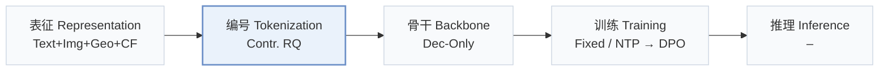
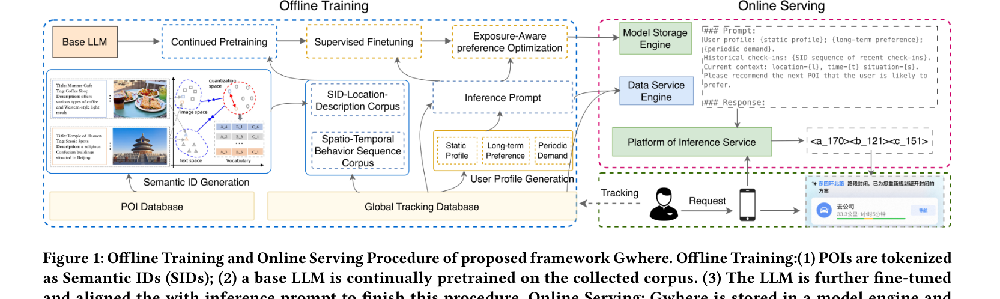
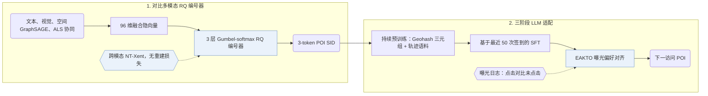
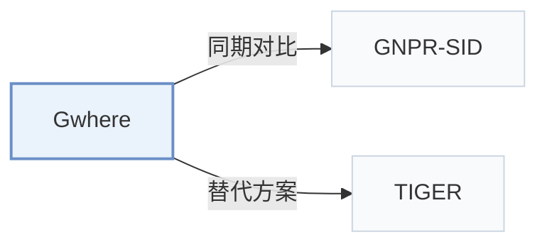

# Gwhere

[← 问题 × 阶段矩阵](../../../README.zh.md#ii--tokenization) · [按阶段索引](../index/stages.md) · [按模态索引](../index/modality.md) · [English](../../papers/gwhere.md) | 中文

| **题目** | *Guess Where You Go: Generative Next Point-of-Interest Recommendation in Amap* |
| :-- | :-- |
| **作者** | Zhai et al. |
| **发表** | RecSys’26 |
| **问题与阶段** | `II. 唯一性与合法性` · `编号（Tokenization）` · `POI` |
| **链接** | [论文](https://arxiv.org/abs/2607.26073) · [代码](https://github.com/alibaba/SimCIT) |
| **阅读级别** | 阅读笔记（第 2 级） |

**本页目录**：[TL;DR](#tldr) · [速览](#速览) · [1. 为什么重要](#1-为什么重要) · [2. 方法](#2-方法) · [3. 实验发现](#3-实验发现) · [4. 局限与分析](#4-局限与分析) · [5. 相关工作](#5-相关工作)

- `Text+Img+Geo+CF`：文本、图像、地理空间与协同信号融合表征。
- `Contr. RQ`：采用对比损失训练的残差量化。
- `Dec-Only`：仅解码器（Decoder-only）自回归架构。
- `Fixed`：先独立训练并冻结编号器，生成器训练期间 SID 保持不变。
- `NTP → DPO`：先进行下一 token 预测微调，再执行直接偏好优化（DPO）。

### TL;DR

> [!NOTE]
> Gwhere 在文本、图像、空间与协同信号上用对比残差量化编号器学习 POI SID，再经持续预训练、微调和曝光感知 KTO 适配 LLM。

---

### 速览

| 维度 | 摘要 |
| :-- | :-- |
| 研究问题 | II. 唯一性与合法性：每个物品是否拥有无冲突的唯一 SID，生成的 SID 是否对应真实物品，码本是否均衡利用？ |
| 核心贡献 | Gwhere 在文本、图像、空间与协同信号上用对比残差量化编号器学习 POI SID，再经持续预训练、微调和曝光感知 KTO 适配 LLM。 |
| 主要改动阶段 | 编号（Tokenization） |
| 主要发现 | 在高德地图（Amap）的长期在线 A/B 测试中，Gwhere 的 P-CTR 比线上基线提升 5.83%，U-CTR 提升 6.20%（Abstract）。 |
| 局限 | 原文未报告量化后的冲突消解规则、解码策略及高德数据集的码本大小；在 50 QPS 负载下，线上部署的 Gwhere-0.5B 的 p99 延迟约为 30 ms，高于级联排序基线的 20 ms（Fig. 4）。 |

---

### 1. 为什么重要

将生成式检索扩展到工业级下一兴趣点（POI）推荐时，常受制于冗余或冲突的 token 分配、异构多模态信号难以融合，以及结构化的空间实体与移动规律（Abstract）。Gwhere 通过无重建损失的对比残差量化编号器学习高区分度的语义 ID（Semantic ID，SID），再经持续预训练、监督微调与曝光偏好对齐适配 LLM 生成器。

> "Gwhere first learns discriminative POI SIDs through a contrastive residual-quantization tokenizer that aligns textual, visual, spatial, and collaborative signals." (Abstract)

---

### 2. 方法

#### 对比式物品编号

Gwhere 将文本、图像、空间 GraphSAGE 和 ALS 协同四类视图融合为 96 维隐向量，并通过 Gumbel-softmax 分配 3 层残差码本中的码字（公开基准上每层 48 个码字）（Sec. 3.2.2，Sec. 4.1.2）。编号器省去解码器与重建损失，仅用 NT-Xent 对比损失将量化表征拉近自身多模态视图并推离同批负样本（Sec. 3.2，Sec. 3.2.2）。

#### 继续预训练

在基于最近 50 条签到序列做监督微调之前，Gwhere 先在由脱敏高德轨迹和 POI 元数据构建的两份语料上持续预训练，分别注入空间-语义对齐知识与群体移动模式（Sec. 3.3.1，Table 1）。

> "Each entry is a triplet of (SID, Geohash, Text Description), where Geohash is a 6-character string encoding the POI's precise geographical coordinates" (Sec. 3.3.1)

#### EAKTO

曝光感知的 Kahneman-Tversky 优化（EAKTO）将 KTO 适配到真实曝光日志中的非成对二元隐式反馈（Sec. 3.4）。

> "In contrast, KTO (Ethayarajh et al., 2024) operates on simpler binary signals (desirable / undesirable), aligning with the natural structure of exposure logs (clicks vs. non-clicks)." (Sec. 3.4)

---

### 3. 实验发现

实验设置

- **数据集**：Foursquare NYC and TKY, Gowalla CA (POIs with fewer than 10 interactions and users with fewer than 10 check-ins removed, following GNPR-SID; 1,083 / 5,135, 2,293 / 7,873, 6,592 / 14,027 users / POIs), and a proprietary AMAP dataset of sampled desensitized users (10,000K users / 83,100K POIs / 380,000K interactions); AMAP filtering not reported.
  - 出处：Datasets and GNPR-SID preprocessing: [S4.SS1.SSS1.p1](https://arxiv.org/html/2607.26073v1#S4.SS1.SSS1.p1) and [S4.SS1.SSS1.p2](https://arxiv.org/html/2607.26073v1#S4.SS1.SSS1.p2); statistics: [S4.T2](https://arxiv.org/html/2607.26073v1#S4.T2).
- **切分**：Public: time-sorted 80% / 10% / 10% train/validation/test; within each user's test sequence the last visited POI is the target. AMAP offline split: not reported. Online: one-week and one-month A/B tests on the 'Guess Where You Go' card.
  - 出处：Public split: [S4.SS1.SSS1.p2](https://arxiv.org/html/2607.26073v1#S4.SS1.SSS1.p2); AMAP split not stated; online tests: [S4.SS4.SSS3.p1](https://arxiv.org/html/2607.26073v1#S4.SS4.SSS3.p1) and [S4.SS4.SSS3.p3](https://arxiv.org/html/2607.26073v1#S4.SS4.SSS3.p3).
- **候选集**：not reported (full catalog versus sampled candidates); the metric is top-1 accuracy (Acc@1).
  - 出处：Top-1 accuracy only: [S4.T3](https://arxiv.org/html/2607.26073v1#S4.T3) and [S4.T4](https://arxiv.org/html/2607.26073v1#S4.T4).
- **可见性**：warm; users and POIs absent from the training set are removed from the test set.
  - 出处：Test users and POIs absent from training are removed: [S4.SS1.SSS1.p2](https://arxiv.org/html/2607.26073v1#S4.SS1.SSS1.p2).
- **SID 规格**：3-layer residual quantizer over a 96-dimensional fused latent from text, ALS collaborative, image, and spatial GraphSAGE views, trained contrastively with Gumbel-softmax assignment; 48 codewords per layer on public data, larger (not specified) on AMAP. Collision handling: not reported beyond the contrastive objective that aims to reduce code collision.
  - 出处：3-layer residual quantizer, 96-dimensional latent, 48 codewords on public data: [S4.SS1.SSS2.p2](https://arxiv.org/html/2607.26073v1#S4.SS1.SSS2.p2); four modality views: [S4.SS1.SSS2.p1](https://arxiv.org/html/2607.26073v1#S4.SS1.SSS2.p1); contrastive Gumbel-softmax quantization: [S3.SS2.SSS2.Px1.p1](https://arxiv.org/html/2607.26073v1#S3.SS2.SSS2.Px1.p1).
- **推理预算**：Decoding method and beam width: not reported. Online load test at 50 QPS on 2 NVIDIA H20 GPUs: deployed Gwhere-0.5B at about 30 ms p99 versus about 20 ms for the cascade-ranking system (Figure 4). Training on 200 H20 GPUs with batch 16 per GPU; inputs are the 50 most recent check-ins.
  - 出处：Load test: [S4.SS4.SSS2.p1](https://arxiv.org/html/2607.26073v1#S4.SS4.SSS2.p1) and [S4.SS4.SSS2.p2](https://arxiv.org/html/2607.26073v1#S4.SS4.SSS2.p2); training hardware: [S4.SS1.SSS2.p3](https://arxiv.org/html/2607.26073v1#S4.SS1.SSS2.p3); decoding not specified.
- **结果来源**：Table 4 (Acc@1 on NYC, TKY, CA; baseline numbers borrowed from LLM4POI and GNPR-SID); Table 3 (AMAP model sizes versus the cascade-ranking system); Table 5 and Figures 2-3 (ablations, modalities, pretraining); Figure 4 (latency); Table 6 (online A/B).
  - 出处：Public: [S4.T4](https://arxiv.org/html/2607.26073v1#S4.T4); AMAP: [S4.T3](https://arxiv.org/html/2607.26073v1#S4.T3); ablations: Table 5 and [S4.F2](https://arxiv.org/html/2607.26073v1#S4.F2); online: [S4.T6](https://arxiv.org/html/2607.26073v1#S4.T6).

- 公开与工业离线评估：在 Foursquare NYC、Foursquare TKY 和 Gowalla CA 上，Gwhere 的 Top-1 准确率（Acc@1）均优于传统模型、序列推荐与 LLM 基线（Table 4）；在包含 10,000K 用户与 83,100K POI 的高德工业数据集上，不同参数规模的 Gwhere 均超越线上级联排序系统（Abstract，Table 3）。
- 在线 A/B 与服务延迟：在高德首页的一周及一月期在线 A/B 测试中，Gwhere 将 P-CTR 提升 5.83%、U-CTR 提升 6.20%（Abstract，Table 6）；在 2 张 NVIDIA H20 GPU、50 QPS 压测下，Gwhere-0.5B 的 p99 延迟约为 30 ms，级联排序系统约为 20 ms（Fig. 4）。

---

### 4. 局限与分析

**Our analysis.**

- 编号器去掉重建损失而仅针对跨模态对比可分性训练，这意味着 SID 前缀未必构成由粗到细的语义层级。
- GNPR-SID 用带重建与多样性损失的 `RQ-VAE` 构建编码并仅以 `NTP` 微调；Gwhere 构建无重建损失的 `Contr. RQ` 码，并在后训练中加入曝光偏好对齐（`NTP → DPO`）。

---

### 5. 相关工作

- **同期对比** · [GNPR-SID](gnpr-sid.md): GNPR-SID quantizes POIs with an RQ-VAE plus diversity losses; Gwhere fuses four modalities with a contrastive Gumbel-softmax quantizer and adds continued pretraining and exposure-aware preference alignment.
  - 出处：Gwhere v1, follows GNPR-SID preprocessing and baselines: [S4.SS1.SSS1.p2](https://arxiv.org/html/2607.26073v1#S4.SS1.SSS1.p2) and [S4.SS1.SSS3.p1](https://arxiv.org/html/2607.26073v1#S4.SS1.SSS3.p1); Table 4: [S4.T4](https://arxiv.org/html/2607.26073v1#S4.T4).
- **替代方案** · [TIGER](tiger.md): TIGER's reconstruction-trained RQ-VAE is the tokenizer style Gwhere argues against; Gwhere trains the quantizer contrastively for item separability.
  - 出处：Gwhere v1, Section 1: [S1.p1](https://arxiv.org/html/2607.26073v1#S1.p1); Section 3.2: [S3.SS2.p1](https://arxiv.org/html/2607.26073v1#S3.SS2.p1); not a baseline in Table 4.

[查看同格全部论文](../../../README.zh.md#ii--tokenization)
