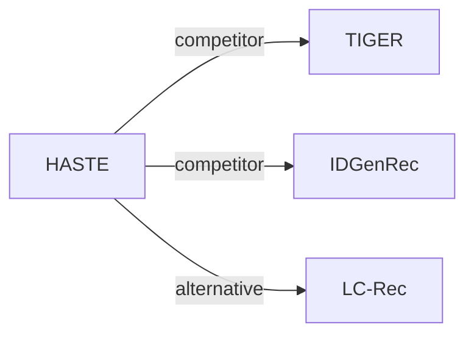

# HASTE

| **题目** | *Hierarchical and Attribute-aware Supervision for Generative Recommendation* |
| :-- | :-- |
| **作者** | Shukla et al. |
| **会议** | arXiv’26 |
| **问题与阶段** | `IV. 实用目标` · `Training` |
| **链接** | [论文](https://arxiv.org/abs/2610.17368) · [矩阵](../../../README.zh.md#iv--training) · [English](../../papers/haste.md) |
| **阅读级别** | 概览（第 1 级） |

本页目录：[TL;DR](#tldr) · [速览](#速览) · [3. 实验发现](#3-实验发现) · [5. 相关工作](#5-相关工作)

- `Text / MM`: Text-only or multimodal representations in different configurations.
- `Dec-Only`: Decoder-only.
- `Fixed`: SIDs are built first and not changed while the generator trains.
- `NTP + Aux.`: NTP plus another auxiliary loss.
- `–`: Not reported in the paper.

### TL;DR

> [!NOTE]
> HASTE 在生成器训练中加入各 SID 层级损失与属性特定损失，加快收敛并改善长尾物品表现，优于标准自回归交叉熵目标。

---

### 速览

| 维度 | 摘要 |
| :-- | :-- |
| 研究问题 | IV. 实用目标：Are training and search aimed at what users and the platform value, rather than at token likelihood? |
| 核心贡献 | HASTE 在生成器训练中加入各 SID 层级损失与属性特定损失，加快收敛并改善长尾物品表现，优于标准自回归交叉熵目标。 |
| 主要改动阶段 | Training |

---

### 3. 实验发现

实验设置

- **数据集**：Amazon-2014 Sports/Beauty/Toys: P5 5-core; Fashion-140k: 5-core, minimum sequence length 3, cap 100; internal-fashion: six deliberate engagement types, deduplication, length 3-100, resolved location, single profile; consecutive events with gaps of at least 30 days are discarded.
  - 出处：[S9.SS1.SSS1.Px1.p1](https://arxiv.org/html/2610.17368v1#S9.SS1.SSS1.Px1.p1) ; [S9.SS1.SSS2.Px1.p1](https://arxiv.org/html/2610.17368v1#S9.SS1.SSS2.Px1.p1) ; [S9.SS1.SSS3.Px1.p1](https://arxiv.org/html/2610.17368v1#S9.SS1.SSS3.Px1.p1) ; [S9.SS1.SSS3.Px1.p2](https://arxiv.org/html/2610.17368v1#S9.SS1.SSS3.Px1.p2) ; [S9.SS1.SSS3.Px2.p1](https://arxiv.org/html/2610.17368v1#S9.SS1.SSS3.Px2.p1)
- **切分**：Public sequences: last test, penultimate validation. Amazon conversational examples: shuffled 92/5/3%. Internal-fashion: Section 9.1.3 reports 6255087/339950/203971 train/validation/test conversations; Section 9.1.5 separately reports 368482/19482 training/validation conversations for the attribute-loss SFT corpus. The relationship between these internal corpus counts is not explained.
  - 出处：[S9.SS1.SSS1.Px2.p1](https://arxiv.org/html/2610.17368v1#S9.SS1.SSS1.Px2.p1) ; [S9.SS1.SSS2.Px2.p1](https://arxiv.org/html/2610.17368v1#S9.SS1.SSS2.Px2.p1) ; [S9.SS1.SSS3.Px3.p1](https://arxiv.org/html/2610.17368v1#S9.SS1.SSS3.Px3.p1) ; [S9.SS1.SSS5.Px2.p4](https://arxiv.org/html/2610.17368v1#S9.SS1.SSS5.Px2.p4)
- **候选集**：not reported; catalog-valid prefix constraints do not establish full-catalog evaluation.
  - 出处：[S6.p4](https://arxiv.org/html/2610.17368v1#S6.p4) ; #S9.SS2.SSS1.Px6.p2
- **可见性**：warm; no unseen-item protocol is defined. Fashion-140k tokenizer uses the full 799953-item Fashion pool.
  - 出处：[S9.SS1.SSS4.p1](https://arxiv.org/html/2610.17368v1#S9.SS1.SSS4.p1)
- **SID 规格**：TIGER-style RQ-VAE: 3 x 256 plus a fourth collision-disambiguation token. Sports/Beauty/Toys use 1024-d text representations; Internal-fashion uses 1024-d multimodal Qwen3-VL embeddings. Section 6 also describes four 256-entry codebooks, inconsistently.
  - 出处：[S6.p1](https://arxiv.org/html/2610.17368v1#S6.p1) ; [S6.p2](https://arxiv.org/html/2610.17368v1#S6.p2) ; [S9.SS1.SSS4.p1](https://arxiv.org/html/2610.17368v1#S9.SS1.SSS4.p1) ; [S9.SS1.SSS4.p2](https://arxiv.org/html/2610.17368v1#S9.SS1.SSS4.p2) ; [S9.SS2.SSS1.Px5.p1](https://arxiv.org/html/2610.17368v1#S9.SS2.SSS1.Px5.p1)
- **推理预算**：K=5/10; prefix tree from up to 100K training sequences, per-position fallback. Experiments: RTX6000 96GB; beam, inference batch/latency not reported.
  - 出处：[S6.p1](https://arxiv.org/html/2610.17368v1#S6.p1) ; #S6.p4 ; #S9.SS2.SSS1.Px6.p2
- **结果来源**：Original Tables 1-2: sequential/attribute results; Table 3: convergence; Tables 4-5: ablations.
  - 出处：[S6.SS1](https://arxiv.org/html/2610.17368v1#S6.SS1)

---

### 5. 相关工作

- **同期对比** · [TIGER](tiger.md): TIGER supplies the SID construction and a baseline.
  - 出处：https://arxiv.org/html/2610.17368v1#S6.p3 ; #S9.SS1.SSS4.p1.
- **同期对比** · [IDGenRec](idgenrec.md): IDGenRec generates textual identifiers; HASTE supervises quantized SIDs.
  - 出处：https://arxiv.org/html/2610.17368v1#S2.p2 ; #S6.p3.
- **替代方案** · [LC-Rec](lc-rec.md): LC-Rec adds alignment tasks; HASTE changes losses.
  - 出处：https://arxiv.org/html/2610.17368v1#S2.p2.

[查看同格全部论文](../../../README.zh.md#iv--training)
