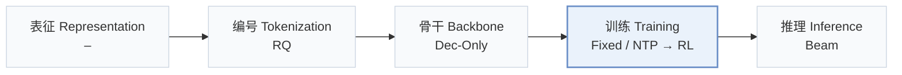
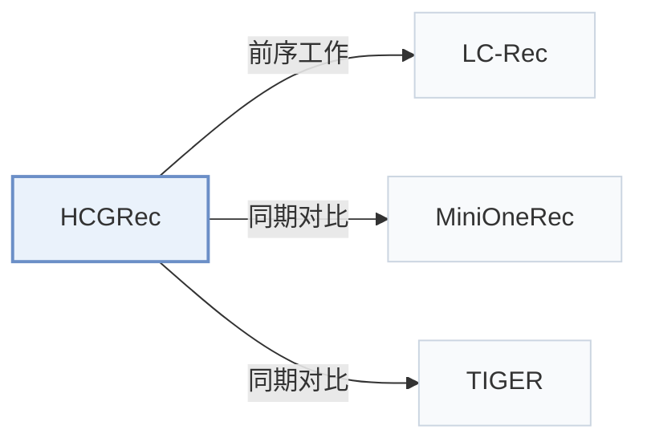

# HCGRec

[← 问题 × 阶段矩阵](../../../README.zh.md#iv--training) · [按阶段索引](../index/stages.md) · [按模态索引](../index/modality.md) · [English](../../papers/hcgrec.md) | 中文

| **题目** | *Learning from Unreachable Rewards: Hint-Conditioned Reinforcement Learning for Generative Recommendation* |
| :-- | :-- |
| **作者** | Zhang et al. |
| **发表** | CIKM’26 |
| **问题与阶段** | `IV. 实用目标` · `训练（Training）` |
| **链接** | [论文](https://arxiv.org/abs/2608.11980) · [代码](https://github.com/WncFht/GRec) |
| **阅读级别** | 概览（第 1 级） |

**本页目录**：[TL;DR](#tldr) · [速览](#速览) · [3. 实验发现](#3-实验发现) · [5. 相关工作](#5-相关工作)

- `RQ`：残差向量量化（Residual Quantization）。
- `Dec-Only`：仅解码器（Decoder-only）自回归架构。
- `Fixed`：先独立训练并冻结编号器，生成器训练期间 SID 保持不变。
- `NTP → RL`：先进行下一 token 预测微调，再执行强化学习（如 GRPO、GBPO 等）。
- `Beam`：在 SID token 上执行自回归束搜索（Beam search）。

### TL;DR

> [!NOTE]
> HCGRec 在 GRPO 采样全部偏离正确物品时提供最小目标前缀提示，对提示 token 用监督损失、对采样后缀用 GRPO，从零奖励组中恢复训练信号。

---

### 速览

| 维度 | 摘要 |
| :-- | :-- |
| 研究问题 | IV. 实用目标：训练目标与解码搜索是否面向用户真实偏好与平台业务价值，而非单纯拟合下一 token 似然？ |
| 核心贡献 | HCGRec 在 GRPO 采样全部偏离正确物品时提供最小目标前缀提示，对提示 token 用监督损失、对采样后缀用 GRPO，从零奖励组中恢复训练信号。 |
| 主要改动阶段 | 训练（Training） |

---

### 3. 实验发现

实验设置

- **数据集**：Amazon Musical Instruments, Arts/Crafts/Sewing, Video Games; maximum history 50. Filtering: not reported.
  - 出处：Section 4.1.1: [S4.SS1.SSS1.p1](https://arxiv.org/html/2608.11980v2#S4.SS1.SSS1.p1)
- **切分**：Per-user chronological leave-one-out: last item test, penultimate validation, remaining interactions training.
  - 出处：Section 4.1.2: [S4.SS1.SSS2.p1](https://arxiv.org/html/2608.11980v2#S4.SS1.SSS2.p1)
- **候选集**：full catalog
  - 出处：Section 4.1.2: [S4.SS1.SSS2.p1](https://arxiv.org/html/2608.11980v2#S4.SS1.SSS2.p1)
- **可见性**：warm; no unseen-item protocol is defined.
  - 出处：Section 4.1 defines no unseen-item evaluation: [S4.SS1](https://arxiv.org/html/2608.11980v2#S4.SS1)
- **SID 规格**：Four-token residual-quantization SIDs, shared across variants; codebook sizes and collision handling: not reported.
  - 出处：Sections 3.1 and 4.1.1: [S3.SS1.p1](https://arxiv.org/html/2608.11980v2#S3.SS1.p1) and [S4.SS1.SSS1.p1](https://arxiv.org/html/2608.11980v2#S4.SS1.SSS1.p1)
- **推理预算**：Beam 50; HR/NDCG@5/10/50; no target-prefix hints at inference. Inference hardware, batch size, latency: not reported.
  - 出处：Sections 3.5 and 4.1.2: [S3.SS5.p1](https://arxiv.org/html/2608.11980v2#S3.SS5.p1) and [S4.SS1.SSS2.p1](https://arxiv.org/html/2608.11980v2#S4.SS1.SSS2.p1)
- **结果来源**：Original Table 2: main comparison; Figures 2-6 and Sections 4.3-4.5: reachability, hint policy, task/loss ablations, credit weight.
  - 出处：Table 2 and Figures 2-6: [S4.T2](https://arxiv.org/html/2608.11980v2#S4.T2) and [S4.F2](https://arxiv.org/html/2608.11980v2#S4.F2) and [S4.F6](https://arxiv.org/html/2608.11980v2#S4.F6)

---

### 5. 相关工作

- **前序工作** · [LC-Rec](lc-rec.md): LC-Rec provides the supervised semantic-alignment checkpoint in this pipeline.
  - 出处：HCGRec v2, Section 4.2: [S4.SS2.p2](https://arxiv.org/html/2608.11980v2#S4.SS2.p2).
- **同期对比** · [MiniOneRec](minionerec.md): MiniOneRec shares the SFT checkpoint and controlled post-training budget.
  - 出处：HCGRec v2, Section 4.2 and Table 2: [S4.SS2.p1](https://arxiv.org/html/2608.11980v2#S4.SS2.p1); [S4.T2](https://arxiv.org/html/2608.11980v2#S4.T2).
- **同期对比** · [TIGER](tiger.md): TIGER is the semantic-ID generative baseline in the main comparison.
  - 出处：HCGRec v2, Section 4.2 and Table 2: [S4.SS2.p2](https://arxiv.org/html/2608.11980v2#S4.SS2.p2); [S4.T2](https://arxiv.org/html/2608.11980v2#S4.T2).

[查看同格全部论文](../../../README.zh.md#iv--training)
