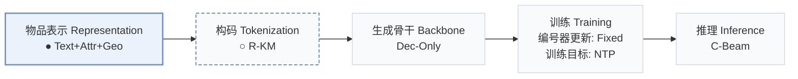
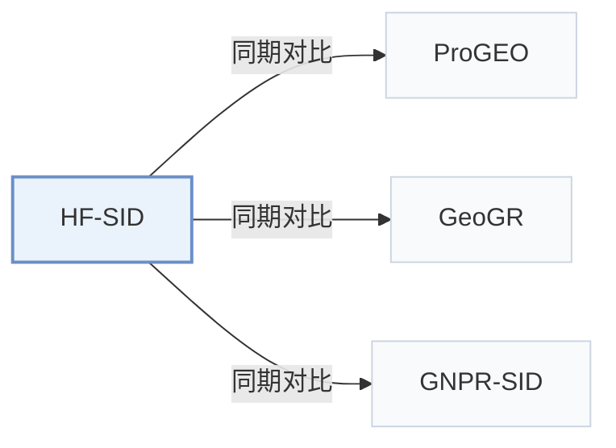

# HF-SID

[← 问题 × 阶段矩阵](../../../README.zh.md#i--representation) · [按阶段索引](../index/stages.md) · [按模态找论文](../index/modality.md) · [按领域找论文](../index/domain.md) · [English](../../papers/hf-sid.md) | 中文

| **题目** | *High-Fidelity Semantic IDs for Generative Retrieval in Location-Based Services* |
| :-- | :-- |
| **作者** | Lin et al. |
| **发表** | arXiv’26 |
| **问题与阶段** | `I. 信息量` · `物品表示（Representation）` · `POI` |
| **改动** | ● 物品表示 · ○ 构码 |
| **构码输入** | `Text` + `Attr` + `Geo` |
| **领域** | `本地生活与 POI` |
| **链接** | [论文](https://arxiv.org/abs/2608.30479) |
| **阅读级别** | 概览（第 1 级） |

**本页目录**：[TL;DR](#tldr) · [3. 实验发现](#3-实验发现) · [5. 相关工作](#5-相关工作)

- `Text+Attr+Geo`：文本、结构化属性与地理空间信息融合。
- `R-KM`：残差 k-means 量化（Residual k-means）。
- `Dec-Only`：仅解码器（Decoder-only）自回归架构。
- `Fixed`：先独立训练并冻结编号器，生成器训练期间 SID 保持不变。
- `NTP`：标准下一 token 预测（Next-Token Prediction）交叉熵损失；基于预训练 LLM 的指令微调（SFT）亦归入此类。
- `C-Beam`：受合法物品集合约束的束搜索（Constrained beam search）。

### TL;DR

> [!NOTE]
> HF-SID 在量化前通过笛卡尔坐标、带单位数值编码与残差对比学习恢复 POI 表示中的地理、数值与结构细节，无需加长 SID。

---

### 3. 实验发现

实验设置

- **数据集**：AMap-L (one day), AMap-S; remove POIs without interaction sequences and sessions without authenticated users. Foursquare NYC/TKY use Geo-CPT only; public-data filtering: not reported.
  - 出处：Sections 4.1 and 4.5: [S4.SS1.p1](https://arxiv.org/html/2608.30479v1#S4.SS1.p1) and [S4.SS5.p1](https://arxiv.org/html/2608.30479v1#S4.SS5.p1)
- **切分**：not reported; methods share identical splits.
  - 出处：Section 4.1 mentions identical baseline splits without specifying allocation: [S4.SS1.p2](https://arxiv.org/html/2608.30479v1#S4.SS1.p2)
- **候选集**：not reported
  - 出处：Sections 3.4 and 4.1 describe valid-SID generation but no full-catalog/sampled evaluation declaration: [S3.SS4.p4](https://arxiv.org/html/2608.30479v1#S3.SS4.p4) and [S4.SS1.p3](https://arxiv.org/html/2608.30479v1#S4.SS1.p3)
- **可见性**：warm; no unseen-item protocol is defined. Tokenizer fits representations of the entire POI corpus.
  - 出处：Sections 3.4 and 4.1: [S3.SS4.p1](https://arxiv.org/html/2608.30479v1#S3.SS4.p1) and [S4.SS1](https://arxiv.org/html/2608.30479v1#S4.SS1)
- **SID 规格**：3-level RQ-KMeans with last-residual contrastive refinement: 4096 codes/level on AMap-L, 512 on AMap-S. Public-data codebook sizes and collision materialization: not reported.
  - 出处：Sections 3.4 and 4.1: [S3.SS4.p3](https://arxiv.org/html/2608.30479v1#S3.SS4.p3) and [S4.SS1.p2](https://arxiv.org/html/2608.30479v1#S4.SS1.p2)
- **推理预算**：Valid-SID trie-constrained beam 300; Hit@200/300 on AMap, @5 on NYC/TKY. General experiments: 64 A100 GPUs; inference allocation, batch size, latency: not reported.
  - 出处：Sections 3.4, 4.1 and Table 5: [S3.SS4.p4](https://arxiv.org/html/2608.30479v1#S3.SS4.p4) and [S4.SS1.p4](https://arxiv.org/html/2608.30479v1#S4.SS1.p4) and [S4.T5](https://arxiv.org/html/2608.30479v1#S4.T5)
- **结果来源**：Original Tables 2/3/4/5/6: AMap comparison, ablation, numerical fidelity, public datasets, one-week online A/B.
  - 出处：Tables 2-6: [S4.T2](https://arxiv.org/html/2608.30479v1#S4.T2) and [S4.T3](https://arxiv.org/html/2608.30479v1#S4.T3) and [S4.T4](https://arxiv.org/html/2608.30479v1#S4.T4) and [S4.T5](https://arxiv.org/html/2608.30479v1#S4.T5) and [S4.T6](https://arxiv.org/html/2608.30479v1#S4.T6)

---

### 5. 相关工作

- **同期对比** · [ProGEO](progeo.md): Pro-GEO injects geography during quantization; HF-SID improves representations before quantization.
  - 出处：HF-SID v1, Sections 2 and 4.1, Table 2: [S2.p2](https://arxiv.org/html/2608.30479v1#S2.p2); [S4.SS1.p2](https://arxiv.org/html/2608.30479v1#S4.SS1.p2); [S4.T2](https://arxiv.org/html/2608.30479v1#S4.T2).
- **同期对比** · [GeoGR](geogr.md): GeoGR uses co-visit alignment; HF-SID directly encodes coordinates and numerical attributes.
  - 出处：HF-SID v1, Sections 2 and 4.2, Table 2: [S2.p2](https://arxiv.org/html/2608.30479v1#S2.p2); [S4.SS2.p2](https://arxiv.org/html/2608.30479v1#S4.SS2.p2); [S4.T2](https://arxiv.org/html/2608.30479v1#S4.T2).
- **同期对比** · [GNPR-SID](gnpr-sid.md): GNPR-SID regularizes codeword diversity; HF-SID focuses on representation fidelity.
  - 出处：HF-SID v1, Section 4.2 and Table 2: [S4.SS2.p2](https://arxiv.org/html/2608.30479v1#S4.SS2.p2); [S4.T2](https://arxiv.org/html/2608.30479v1#S4.T2).

[查看同格全部论文](../../../README.zh.md#i--representation)
