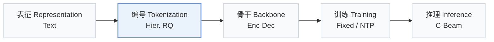
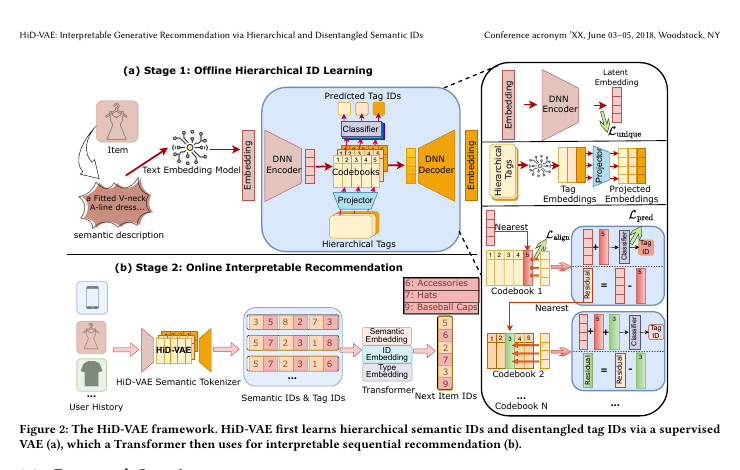
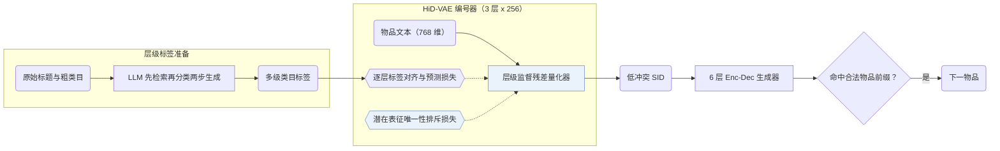
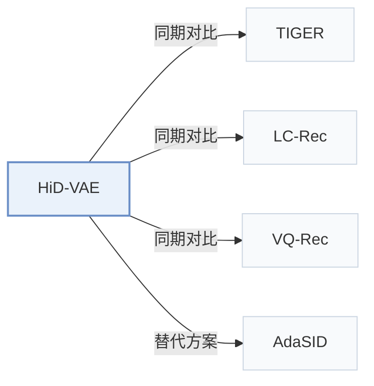

# HiD-VAE

[← 问题 × 阶段矩阵](../../../README.zh.md#ii--tokenization) · [按阶段索引](../index/stages.md) · [按模态索引](../index/modality.md) · [English](../../papers/hid-vae.md) | 中文

| **题目** | *Interpretable Generative Recommendation via Hierarchical and Disentangled Semantic IDs* |
| :-- | :-- |
| **作者** | Fang et al. |
| **发表** | arXiv’25 |
| **问题与阶段** | `II. 唯一性与合法性` · `编号（Tokenization）` — 补充：`I. 信息量` × `编号（Tokenization）` |
| **链接** | [论文](https://arxiv.org/abs/2508.04618) · [代码](https://anonymous.4open.science/r/HiD-VAE-84B2) |
| **阅读级别** | 阅读笔记（第 2 级） |

**本页目录**：[TL;DR](#tldr) · [速览](#速览) · [1. 为什么重要](#1-为什么重要) · [2. 方法](#2-方法) · [3. 实验发现](#3-实验发现) · [4. 局限与分析](#4-局限与分析) · [5. 相关工作](#5-相关工作)

- `Text`：物品文本元数据（标题、描述、类目或提示词）。
- `Hier. RQ`：带多级标签监督的层级残差量化。
- `Enc-Dec`：编码器-解码器（Encoder-decoder）架构。
- `Fixed`：先独立训练并冻结编号器，生成器训练期间 SID 保持不变。
- `NTP`：标准下一 token 预测（Next-Token Prediction）交叉熵损失；基于预训练 LLM 的指令微调（SFT）亦归入此类。
- `C-Beam`：受合法物品集合约束的束搜索（Constrained beam search）。

### TL;DR

> [!NOTE]
> HiD-VAE 通过层级监督量化将各 SID 层与多级物品标签对齐，并加入防冲突唯一性损失，替代扁平的无监督编号。

---

### 速览

| 维度 | 摘要 |
| :-- | :-- |
| 研究问题 | II. 唯一性与合法性：每个物品是否拥有无冲突的唯一 SID，生成的 SID 是否对应真实物品，码本是否均衡利用？ |
| 核心贡献 | HiD-VAE 通过层级监督量化将各 SID 层与多级物品标签对齐，并加入防冲突唯一性损失，替代扁平的无监督编号。 |
| 主要改动阶段 | 编号（Tokenization） |
| 主要发现 | HiD-VAE 将 Beauty、Sports 与 KuaiRand 上的 SID 冲突率从无监督 RQ-VAE 的 18.7%、19.5%、17.8% 降至 2.1%、2.8%、1.9%，并在三个基准上全面优于对比基线（Abstract，Table 1，Table 3）。 |
| 局限 | 层级监督量化依赖多级类目标签，缺失类目树的物品库需依赖 LLM 合成标签（Sec. 3.4）。 |

---

### 1. 为什么重要

无监督残差量化生成的语义 ID（Semantic ID，SID）缺乏明确的层级语义，且不同物品的潜在表征纠缠在一起，极易产生编码冲突（Abstract）。HiD-VAE 用多级类目标签逐层监督码本，并在离散化前对潜在表征施加排斥惩罚。

> "Concurrently, to combat representation entanglement and prevent ID collisions at the source, we design a novel uniqueness loss that directly penalizes the latent representation overlap between distinct items."（Sec. 1）

---

### 2. 方法

#### 生成层级标签

对于 KuaiRand 这类缺少现成类目树的数据集，HiD-VAE 用 LLM 按“先检索、再分类”（`"retrieval-then-classification"`）两步流程从标题与原始类目合成多级标签（Sec. 1，Sec. 3.4）。

#### 层级监督量化

RQ-VAE 每一层码本分别对齐并预测对应层级的物品标签，使生成的离散码序列具备可追溯的粗到细类目路径（Abstract）。

#### 唯一性损失

唯一性损失在量化取整前直接惩罚不同物品在潜在空间中的重叠，在压低 ID 冲突率的同时促使物品更均匀地覆盖码本空间（Abstract，Sec. 1）。

> "This mechanism not only resolves the critical ID collision problem but also promotes recommendation diversity by ensuring a more comprehensive utilization of the item representation space."（Abstract）

#### 生成

6 层编码器-解码器根据用户历史预测下一物品的 SID，并在推理时通过前缀约束解码过滤非法码序列（Sec. 3.3）。

> "During inference, constrained decoding ensures that generated IDs correspond to valid items."（Sec. 3.3）

---

### 3. 实验发现

实验设置

- **数据集**：Amazon Beauty, Sports and Outdoors, and KuaiRand-1K, with 5-core filtering of users and items. Sizes (users / items / interactions): Beauty 22,363 / 12,101 / 198,360; Sports 35,598 / 18,357 / 296,175; KuaiRand 983 / 29,983 / 953,166. KuaiRand category hierarchies are generated by an LLM from titles and raw categories.
  - 出处：Datasets and 5-core: [S4.SS1.p1](https://arxiv.org/html/2508.04618v2#S4.SS1.p1) and [S4.I2.i2.p1](https://arxiv.org/html/2508.04618v2#S4.I2.i2.p1); LLM-built hierarchies: [S4.SS1.p3](https://arxiv.org/html/2508.04618v2#S4.SS1.p3); statistics: [A4.T4](https://arxiv.org/html/2508.04618v2#A4.T4).
- **切分**：Per-user leave-one-out: last item for test, second-to-last for validation, the rest for training.
  - 出处：Leave-one-out allocation: [S4.SS1.p5](https://arxiv.org/html/2508.04618v2#S4.SS1.p5).
- **候选集**：not reported (full catalog versus sampled evaluation candidates); generation is constrained to valid ID prefixes.
  - 出处：Metrics only: [S4.SS1.p5](https://arxiv.org/html/2508.04618v2#S4.SS1.p5).
- **可见性**：warm; no unseen-item protocol is defined.
  - 出处：Standard split with no unseen-item protocol: [S4.SS1.p5](https://arxiv.org/html/2508.04618v2#S4.SS1.p5).
- **SID 规格**：3-level hierarchically supervised RQ-VAE x 256 codewords (K-means initialized) over 768-dimensional SentenceTransformer embeddings; each level is aligned with a category-tag level, and a uniqueness loss pushes items apart. Measured collision rate 2.1% (Beauty), 2.8% (Sports), 1.9% (KuaiRand) versus 18.7%, 19.5%, and 17.8% for RQ-VAE. How the remaining collisions are resolved in the full model: not reported; the w/o-uniqueness variant uses TIGER's appended integer.
  - 出处：L=3 x K=256, K-means initialization, SentenceTransformer input: [S4.SS1.p6](https://arxiv.org/html/2508.04618v2#S4.SS1.p6); uniqueness loss: [S3.SS6.p1](https://arxiv.org/html/2508.04618v2#S3.SS6.p1); collision rates: [S4.T3](https://arxiv.org/html/2508.04618v2#S4.T3); TIGER suffix only in the w/o DUL variant: [S4.I4.i4.p1](https://arxiv.org/html/2508.04618v2#S4.I4.i4.p1).
- **推理预算**：Autoregressive generation with constrained decoding against a corpus cache; beam width not reported. 6-layer encoder-decoder (8 heads, hidden 512). Training on NVIDIA 4060 GPUs with FP16; inference batch size and latency: not reported.
  - 出处：Constrained decoding: [S4.SS1.p6](https://arxiv.org/html/2508.04618v2#S4.SS1.p6); hardware: [S4.SS1.p6](https://arxiv.org/html/2508.04618v2#S4.SS1.p6).
- **结果来源**：Table 1 (Beauty, Sports, KuaiRand versus traditional, Transformer, and generative baselines); Table 2 (ablations of tag alignment, tag prediction, uniqueness loss); Table 3 (ID collision rates).
  - 出处：Main: [S4.T1](https://arxiv.org/html/2508.04618v2#S4.T1); ablation: [S4.T2](https://arxiv.org/html/2508.04618v2#S4.T2); collisions: [S4.T3](https://arxiv.org/html/2508.04618v2#S4.T3).

- 主结果与冲突率：在 Amazon Beauty、Sports and Outdoors 与 KuaiRand 三个公开基准上，HiD-VAE 均优于传统、序列与生成式基线，并将 SID 冲突率从 RQ-VAE 的 18.7%、19.5%、17.8% 分别降至 2.1%、2.8%、1.9%（Abstract，Table 1，Table 3）。

---

### 4. 局限与分析

**Our analysis.**

- TIGER 使用无监督 `RQ-VAE` 码、整数后缀消歧与无约束 `Beam` 搜索；HiD-VAE 在相同类型的 `Enc-Dec` 生成器前端改用多级标签监督的 `Hier. RQ` 码与唯一性损失，并配合约束解码。

---

### 5. 相关工作

- **同期对比** · [TIGER](tiger.md): TIGER resolves collisions by appending an integer after unsupervised RQ-VAE; HiD-VAE supervises each level with category tags and adds a uniqueness loss so that fewer items collide.
  - 出处：HiD-VAE v2, baselines and Table 1: [S4.SS1.p4](https://arxiv.org/html/2508.04618v2#S4.SS1.p4) and [S4.T1](https://arxiv.org/html/2508.04618v2#S4.T1); TIGER-style suffix in the ablation: [S4.I4.i4.p1](https://arxiv.org/html/2508.04618v2#S4.I4.i4.p1) and [S4.I5.i2.p1](https://arxiv.org/html/2508.04618v2#S4.I5.i2.p1).
- **同期对比** · [LC-Rec](lc-rec.md): LC-Rec aligns an LLM to RQ-VAE codes; HiD-VAE changes the tokenizer and keeps a small encoder-decoder; LC-Rec is run with a T5-base backbone for scale parity.
  - 出处：HiD-VAE v2, baselines: [S4.SS1.p4](https://arxiv.org/html/2508.04618v2#S4.SS1.p4) and [S4.SS1.p7](https://arxiv.org/html/2508.04618v2#S4.SS1.p7); Table 1: [S4.T1](https://arxiv.org/html/2508.04618v2#S4.T1).
- **同期对比** · [VQ-Rec](vq-rec.md): VQ-Rec's product-quantized codes are adapted to generation here and collide more often (21.2% on Beauty) than HiD-VAE's hierarchical codes.
  - 出处：HiD-VAE v2, baselines and adaptation: [S4.SS1.p4](https://arxiv.org/html/2508.04618v2#S4.SS1.p4) and [S4.I3.i2.p1](https://arxiv.org/html/2508.04618v2#S4.I3.i2.p1); Tables 1 and 3: [S4.T1](https://arxiv.org/html/2508.04618v2#S4.T1) and [S4.T3](https://arxiv.org/html/2508.04618v2#S4.T3).
- **替代方案** · [AdaSID](adasid.md): AdaSID later argues that HiD-VAE's overlap-aware objective treats collisions under a fixed standard, and makes the repulsion adaptive.
  - 出处：Evidence is from the later AdaSID paper, Sections 1 and 2.2: [S1.p3](https://arxiv.org/html/2604.23522v1#S1.p3) and [S2.SS2.p1](https://arxiv.org/html/2604.23522v1#S2.SS2.p1).

[查看同格全部论文](../../../README.zh.md#ii--tokenization)
