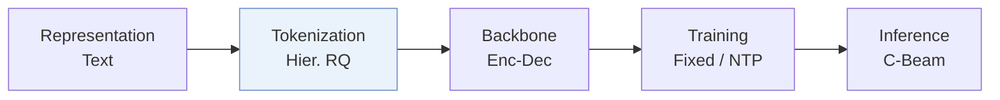
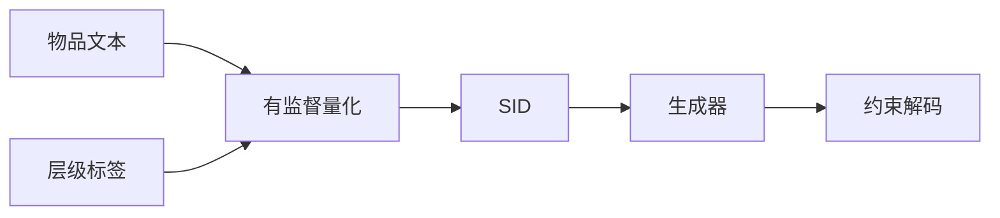
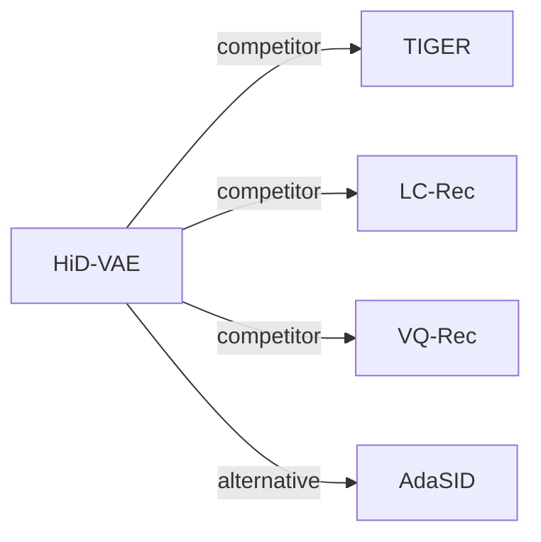

# HiD-VAE

*Interpretable Generative Recommendation via Hierarchical and Disentangled Semantic IDs* — Fang et al. · arXiv’25

`II. 唯一性与合法性` · `Tokenization` · [论文](https://arxiv.org/abs/2508.04618) · [代码](https://anonymous.4open.science/r/HiD-VAE-84B2) · [矩阵](../../../README.zh.md#ii--tokenization) · [English](../../papers/hid-vae.md)

阅读级别：阅读笔记（第 2 级） · 本页目录：[TL;DR](#tldr) · [速览](#速览) · [1. 为什么重要](#1-为什么重要) · [2. 方法](#2-方法) · [3. 实验发现](#3-实验发现) · [4. 局限与分析](#4-局限与分析) · [5. 相关工作](#5-相关工作)

- `Enc-Dec`: Encoder-decoder.
- `Fixed`: SIDs are built first and not changed while the generator trains.
- `NTP`: Next-token prediction loss only; continuing from a pretrained LLM (SFT) also counts as NTP.
- `C-Beam`: Constrained beam search.

### TL;DR

> [!NOTE]
> HiD-VAE 通过层级监督量化将各 SID 层与多级物品标签对齐，并加入防冲突唯一性损失，替代扁平的无监督编号。

### 速览

| 维度 | 摘要 |
| :-- | :-- |
| 研究问题 | II. 唯一性与合法性：Does every item get its own SID, every generated SID name a real item, and the codebook get used evenly? |
| 核心贡献 | HiD-VAE 通过层级监督量化将各 SID 层与多级物品标签对齐，并加入防冲突唯一性损失，替代扁平的无监督编号。 |
| 主要改动阶段 | Tokenization |
| 局限 | 编号器需要多级物品标签，没有标签的数据集要靠 LLM 生成，所以 ID 质量取决于标签质量（Sec. 3.4）。 |

### 1. 为什么重要

作者指出，无监督编号让语义 ID（Semantic ID，SID）有两个缺陷：语义上是扁平的；不同物品的表示纠缠在一起，会发生冲突（Abstract）。

> "Concurrently, to combat representation entanglement and prevent ID collisions at the source, we design a novel uniqueness loss that directly penalizes the latent representation overlap between distinct items."（Sec. 1）（唯一性损失直接惩罚不同物品潜在表示的重叠，从源头防止 ID 冲突。）

### 2. 方法

#### 生成层级标签

KuaiRand 这类没有层级标签的数据集，由 LLM 按"先检索、再分类"两步生成标签（Sec. 3.4，Sec. 1）。

#### 层级监督量化

训练好的码本能预测物品标签，于是每条推荐都有一条可追溯的语义路径（Abstract）。

#### 唯一性损失

唯一性损失惩罚不同物品之间的潜在重叠（Sec. 1）。作者认为，这个损失也提高了推荐多样性（Abstract）。

> "This mechanism not only resolves the critical ID collision problem but also promotes recommendation diversity by ensuring a more comprehensive utilization of the item representation space."（Abstract）（既解决 ID 冲突，也因表示空间用得更充分而提高多样性。）

#### 生成

生成器根据用户历史预测下一物品的 SID（Sec. 3.3）。

> "During inference, constrained decoding ensures that generated IDs correspond to valid items."（Sec. 3.3）（推理时用约束解码保证生成的 ID 对应真实物品。）

### 3. 实验发现

实验设置

- **数据集**：Amazon Beauty, Sports and Outdoors, and KuaiRand-1K, with 5-core filtering of users and items. Sizes (users / items / interactions): Beauty 22,363 / 12,101 / 198,360; Sports 35,598 / 18,357 / 296,175; KuaiRand 983 / 29,983 / 953,166. KuaiRand category hierarchies are generated by an LLM from titles and raw categories.
  - 出处：Datasets and 5-core: [S4.SS1.p1](https://arxiv.org/html/2508.04618v2#S4.SS1.p1) and [S4.I2.i2.p1](https://arxiv.org/html/2508.04618v2#S4.I2.i2.p1); LLM-built hierarchies: [S4.SS1.p3](https://arxiv.org/html/2508.04618v2#S4.SS1.p3); statistics: [A4.T4](https://arxiv.org/html/2508.04618v2#A4.T4).
- **切分**：Per-user leave-one-out: last item for test, second-to-last for validation, the rest for training.
  - 出处：Leave-one-out allocation: [S4.SS1.p5](https://arxiv.org/html/2508.04618v2#S4.SS1.p5).
- **候选集**：not reported (full catalog versus sampled evaluation candidates); generation is constrained to valid ID prefixes.
  - 出处：Metrics only: [S4.SS1.p5](https://arxiv.org/html/2508.04618v2#S4.SS1.p5).
- **可见性**：warm; no unseen-item protocol is defined.
  - 出处：Standard split with no unseen-item protocol: [S4.SS1.p5](https://arxiv.org/html/2508.04618v2#S4.SS1.p5).
- **SID 规格**：3-level hierarchically supervised RQ-VAE x 256 codewords (K-means initialized) over 768-dimensional SentenceTransformer embeddings; each level is aligned with a category-tag level, and a uniqueness loss pushes items apart. Measured collision rate 2.1% (Beauty), 2.8% (Sports), 1.9% (KuaiRand) versus 18.7%, 19.5%, and 17.8% for RQ-VAE. How the remaining collisions are resolved in the full model: not reported; the w/o-uniqueness variant uses TIGER's appended integer.
  - 出处：L=3 x K=256, K-means initialization, SentenceTransformer input: [S4.SS1.p6](https://arxiv.org/html/2508.04618v2#S4.SS1.p6); uniqueness loss: [S3.SS6.p1](https://arxiv.org/html/2508.04618v2#S3.SS6.p1); collision rates: [S4.T3](https://arxiv.org/html/2508.04618v2#S4.T3); TIGER suffix only in the w/o DUL variant: [S4.I4.i4.p1](https://arxiv.org/html/2508.04618v2#S4.I4.i4.p1).
- **推理预算**：Autoregressive generation with constrained decoding against a corpus cache; beam width not reported. 6-layer encoder-decoder (8 heads, hidden 512). Training on NVIDIA 4060 GPUs with FP16; inference batch size and latency: not reported.
  - 出处：Constrained decoding: [S4.SS1.p6](https://arxiv.org/html/2508.04618v2#S4.SS1.p6); hardware: [S4.SS1.p6](https://arxiv.org/html/2508.04618v2#S4.SS1.p6).
- **结果来源**：Table 1 (Beauty, Sports, KuaiRand versus traditional, Transformer, and generative baselines); Table 2 (ablations of tag alignment, tag prediction, uniqueness loss); Table 3 (ID collision rates).
  - 出处：Main: [S4.T1](https://arxiv.org/html/2508.04618v2#S4.T1); ablation: [S4.T2](https://arxiv.org/html/2508.04618v2#S4.T2); collisions: [S4.T3](https://arxiv.org/html/2508.04618v2#S4.T3).

- 主实验：在三个公开基准上，HiD-VAE 好于对比方法（Abstract）。

### 4. 局限与分析

**Our analysis.**

- TIGER 用无监督的 `RQ-VAE` 码和普通 `Beam` 搜索；HiD-VAE 用标签监督的 `Hier. RQ` 码，生成器同为 `Enc-Dec`，并加约束解码。

### 5. 相关工作

- **同期对比** · [TIGER](tiger.md): TIGER resolves collisions by appending an integer after unsupervised RQ-VAE; HiD-VAE supervises each level with category tags and adds a uniqueness loss so that fewer items collide.
  - 出处：HiD-VAE v2, baselines and Table 1: https://arxiv.org/html/2508.04618v2#S4.SS1.p4 and https://arxiv.org/html/2508.04618v2#S4.T1; TIGER-style suffix in the ablation: https://arxiv.org/html/2508.04618v2#S4.I4.i4.p1 and https://arxiv.org/html/2508.04618v2#S4.I5.i2.p1.
- **同期对比** · [LC-Rec](lc-rec.md): LC-Rec aligns an LLM to RQ-VAE codes; HiD-VAE changes the tokenizer and keeps a small encoder-decoder; LC-Rec is run with a T5-base backbone for scale parity.
  - 出处：HiD-VAE v2, baselines: https://arxiv.org/html/2508.04618v2#S4.SS1.p4 and https://arxiv.org/html/2508.04618v2#S4.SS1.p7; Table 1: https://arxiv.org/html/2508.04618v2#S4.T1.
- **同期对比** · [VQ-Rec](vq-rec.md): VQ-Rec's product-quantized codes are adapted to generation here and collide more often (21.2% on Beauty) than HiD-VAE's hierarchical codes.
  - 出处：HiD-VAE v2, baselines and adaptation: https://arxiv.org/html/2508.04618v2#S4.SS1.p4 and https://arxiv.org/html/2508.04618v2#S4.I3.i2.p1; Tables 1 and 3: https://arxiv.org/html/2508.04618v2#S4.T1 and https://arxiv.org/html/2508.04618v2#S4.T3.
- **替代方案** · [AdaSID](adasid.md): AdaSID later argues that HiD-VAE's overlap-aware objective treats collisions under a fixed standard, and makes the repulsion adaptive.
  - 出处：Evidence is from the later AdaSID paper, Sections 1 and 2.2: https://arxiv.org/html/2604.23522v1#S1.p3 and https://arxiv.org/html/2604.23522v1#S2.SS2.p1.

[查看同格全部论文](../../../README.zh.md#ii--tokenization)
