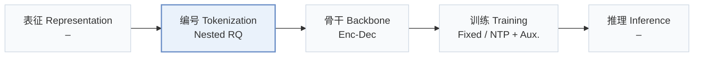
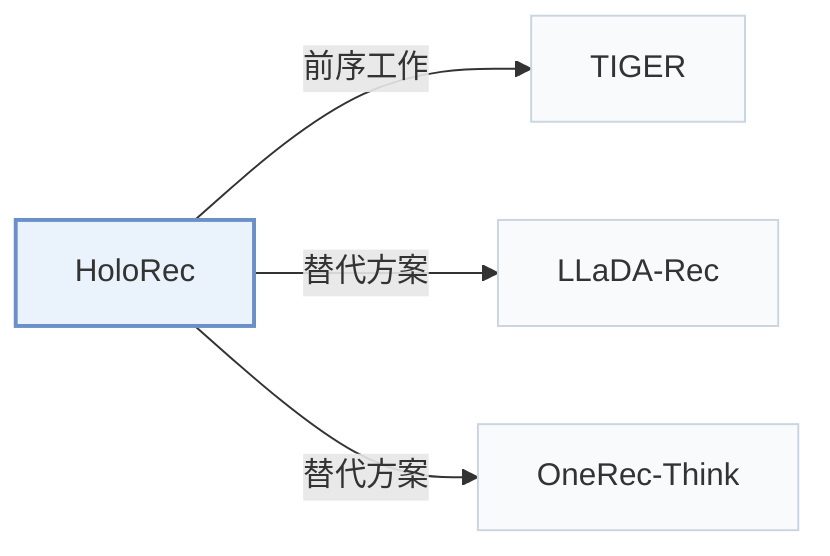

# HoloRec

[← 问题 × 阶段矩阵](../../../README.zh.md#iii--tokenization) · [按阶段索引](../index/stages.md) · [按模态索引](../index/modality.md) · [English](../../papers/holorec.md) | 中文

| **题目** | *Holistic Encoding and Interleaved Reasoning for Generative Recommendation* |
| :-- | :-- |
| **作者** | Zhao et al. |
| **发表** | arXiv’26 |
| **问题与阶段** | `III. SID 与模型对齐` · `编号（Tokenization）` |
| **链接** | [论文](https://arxiv.org/abs/2606.15331) |
| **阅读级别** | 概览（第 1 级） |

**本页目录**：[TL;DR](#tldr) · [速览](#速览) · [3. 实验发现](#3-实验发现) · [5. 相关工作](#5-相关工作)

- `Nested RQ`：跨嵌套表征粒度的残差量化。
- `Enc-Dec`：编码器-解码器（Encoder-decoder）架构。
- `Fixed`：先独立训练并冻结编号器，生成器训练期间 SID 保持不变。
- `NTP + Aux.`：下一 token 预测结合辅助正则或对齐损失。

### TL;DR

> [!NOTE]
> HoloRec 用带全粒度重构损失的嵌套残差量化构建层级 SID，并在解码过程中直接生成思维链步骤，不依赖外部标注的推理文本。

---

### 速览

| 维度 | 摘要 |
| :-- | :-- |
| 研究问题 | III. SID 与模型对齐：生成模型能否理解并推理离散 SID，编号器与生成器的优化目标是否一致？ |
| 核心贡献 | HoloRec 用带全粒度重构损失的嵌套残差量化构建层级 SID，并在解码过程中直接生成思维链步骤，不依赖外部标注的推理文本。 |
| 主要改动阶段 | 编号（Tokenization） |

---

### 3. 实验发现

实验设置

- **数据集**：Amazon Beauty and Instruments; user/item five-core filtering.
  - 出处：Section 4.1.1: [S4.SS1.SSS1.p1](https://arxiv.org/html/2606.15331v1#S4.SS1.SSS1.p1)
- **切分**：Leave-one-out; exact validation/test allocation not reported.
  - 出处：Section 4.1.1: [S4.SS1.SSS1.p1](https://arxiv.org/html/2606.15331v1#S4.SS1.SSS1.p1)
- **候选集**：not reported
  - 出处：Section 4.1 gives metrics but no evaluation candidate protocol: [S4.SS1.SSS2.p1](https://arxiv.org/html/2606.15331v1#S4.SS1.SSS2.p1)
- **可见性**：warm; no unseen-item protocol is defined.
  - 出处：Section 4 defines no item holdout: [S4.SS1](https://arxiv.org/html/2606.15331v1#S4.SS1)
- **SID 规格**：Three nested granularities (8/16/32 dimensions), each with 4 residual levels x 256 codes; codebooks shared across granularities. Collision handling not reported.
  - 出处：Sections 3.1 and 4.1.4: [S3.SS1.SSS1.p1](https://arxiv.org/html/2606.15331v1#S3.SS1.SSS1.p1) and [S4.SS1.SSS4.p1](https://arxiv.org/html/2606.15331v1#S4.SS1.SSS4.p1)
- **推理预算**：K=5/10; non-thinking and interleaved-thinking modes. Beam width, inference hardware/batch size, and measured latency not reported; A100 and batch 1024 describe training.
  - 出处：Sections 4.1.2/4.1.4 and 4.7: [S4.SS1.SSS2.p1](https://arxiv.org/html/2606.15331v1#S4.SS1.SSS2.p1) and [S4.SS1.SSS4.p1](https://arxiv.org/html/2606.15331v1#S4.SS1.SSS4.p1) and [S4.SS7.p1](https://arxiv.org/html/2606.15331v1#S4.SS7.p1)
- **结果来源**：Original Table 2: overall comparisons; Table 3: ablations.
  - 出处：Tables 2-3: [S4.T2](https://arxiv.org/html/2606.15331v1#S4.T2) and [S4.T3](https://arxiv.org/html/2606.15331v1#S4.T3)

---

### 5. 相关工作

- **前序工作** · [TIGER](tiger.md): HoloRec retains TIGER's T5 backbone and adds nested semantic granularities.
  - 出处：HoloRec v1, Section 4.1.4 and Table 2: [S4.SS1.SSS4.p1](https://arxiv.org/html/2606.15331v1#S4.SS1.SSS4.p1); [S4.T2](https://arxiv.org/html/2606.15331v1#S4.T2).
- **替代方案** · [LLaDA-Rec](llada-rec.md): LLaDA-Rec uses parallel diffusion; HoloRec interleaves autoregressive semantic reasoning.
  - 出处：HoloRec v1, Sections 2.2 and 3.3: [S2.SS2.p1](https://arxiv.org/html/2606.15331v1#S2.SS2.p1); [S3.SS3](https://arxiv.org/html/2606.15331v1#S3.SS3).
- **替代方案** · [OneRec-Think](onerec-think.md): OneRec-Think reasons in natural language; HoloRec uses endogenous semantic codes.
  - 出处：HoloRec v1, Section 2.3: [S2.SS3.p1](https://arxiv.org/html/2606.15331v1#S2.SS3.p1).

[查看同格全部论文](../../../README.zh.md#iii--tokenization)
